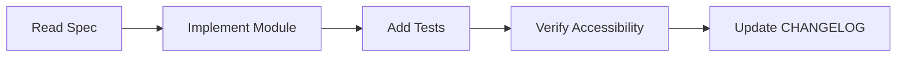

# AI Agent Rules — Founder Portfolio Platform (FounderOS)

## Purpose

Define mandatory rules for AI-assisted development agents (Cursor, Copilot, custom agents) working on FounderOS. Ensures all generated code, documentation, and decisions align with the product vision as a **reusable commercial SaaS platform**, not a one-off personal site.

## Scope

| Applies To | Does Not Apply To |
|------------|-------------------|
| All AI agents modifying FounderOS codebase | Third-party library internals |
| Code generation, refactoring, testing | Marketing copy outside the platform |
| Documentation updates | Unrelated repositories |

## Business Context

FounderOS is architected for **white-label multi-tenant commercialization**. Every AI-generated artifact must preserve modularity, tenant isolation readiness, CMS-driven content, and extensibility documented in [14_Future/Plugin_System.md](docs/14_Future/Plugin_System.md).

## Goals

1. Prevent architectural drift toward monolithic personal-site patterns.
2. Enforce documentation-first development — specs before code.
3. Maintain consistency with the design system and API contracts.
4. Protect security, accessibility, and SEO standards.
5. Ensure all changes are traceable to requirements.

---

## Functional Requirements

### FR-1: Documentation Compliance

- **FR-1.1** Before implementing any feature, the agent MUST read the relevant module doc in `docs/06_Modules/`, page doc in `docs/05_Pages/`, and API doc in `docs/08_API/`.
- **FR-1.2** If documentation is ambiguous, the agent MUST flag open questions in a comment or issue — not invent undocumented behavior.
- **FR-1.3** After implementation, update `CHANGELOG.md` if behavior diverges from spec.

### FR-2: Architecture Compliance

- **FR-2.1** Frontend code MUST follow [Frontend_Architecture.md](docs/04_Architecture/Frontend_Architecture.md) folder structure.
- **FR-2.2** Backend code MUST follow [Backend_Architecture.md](docs/04_Architecture/Backend_Architecture.md) layered pattern: routes → services → repositories → models.
- **FR-2.3** No direct database access from frontend. All data via REST API.
- **FR-2.4** All user-editable content MUST be CMS-driven, not hardcoded.

### FR-3: Module Boundaries

- **FR-3.1** Modules MUST NOT import across module boundaries except through defined interfaces (see each module's "Reusable Interfaces" section).
- **FR-3.2** Shared utilities live in `lib/` (frontend) or `core/` (backend) only.
- **FR-3.3** New features MUST be implemented as modules with corresponding documentation.

### FR-4: Design System Compliance

- **FR-4.1** UI components MUST use shadcn/ui primitives and design tokens from [Design_Tokens.md](docs/03_Design_System/Design_Tokens.md).
- **FR-4.2** No arbitrary colors, spacing, or typography outside the token system.
- **FR-4.3** All interactive elements MUST meet [Accessibility.md](docs/02_UX/Accessibility.md) requirements.

### FR-5: API Compliance

- **FR-5.1** API endpoints MUST match contracts in `docs/08_API/`.
- **FR-5.2** Request/response schemas MUST use Pydantic models (backend) and TypeScript types (frontend).
- **FR-5.3** Breaking API changes require version bump and CHANGELOG entry.

---

## Non-functional Requirements

| ID | Requirement | Target |
|----|-------------|--------|
| NFR-1 | Lighthouse Performance (public pages) | ≥ 90 |
| NFR-2 | Lighthouse Accessibility | ≥ 95 |
| NFR-3 | API p95 latency | < 200ms |
| NFR-4 | Test coverage (new code) | ≥ 80% |
| NFR-5 | Bundle size increase per PR | < 50KB gzipped |
| NFR-6 | Security scan | Zero critical/high findings |

---

## User Stories

| ID | Story | Agent Behavior |
|----|-------|----------------|
| US-1 | As a maintainer, I want consistent code so onboarding is fast | Match existing patterns in adjacent files |
| US-2 | As a founder (tenant), I want branding isolation | Never hardcode founder-specific content |
| US-3 | As a security reviewer, I want safe defaults | Follow [11_Security/](docs/11_Security/) |
| US-4 | As a QA engineer, I want testable code | Include tests per [Testing_Strategy.md](docs/12_Testing/Testing_Strategy.md) |

---

## UX Requirements

- Respect [Interaction_Principles.md](docs/02_UX/Interaction_Principles.md).
- Implement loading states per [Loading_States.md](docs/03_Design_System/Loading_States.md).
- Animations per [Animation_System.md](docs/03_Design_System/Animation_System.md) — respect `prefers-reduced-motion`.
- Forms per [Forms.md](docs/03_Design_System/Forms.md) with validation feedback.

---

## Technical Considerations

### Allowed Stack (No Substitutions Without ADR)

```
Frontend: Next.js 15, TypeScript, TailwindCSS, shadcn/ui, Framer Motion
Backend:  FastAPI, PostgreSQL, SQLAlchemy, Redis
Deploy:   Docker, Cloudflare, Vercel, Hostinger VPS
```

### Prohibited Patterns

| Pattern | Reason |
|---------|--------|
| Hardcoded founder name, bio, products | Violates white-label principle |
| `any` type in TypeScript | Type safety requirement |
| Raw SQL in route handlers | Use repository layer |
| Secrets in source code | Use environment variables |
| Client-side auth token in localStorage | Use httpOnly cookies |
| Inline styles | Use Tailwind + tokens |
| New npm/pip packages without justification | Dependency minimization |

### Required Patterns



### File Naming

| Type | Convention | Example |
|------|------------|---------|
| React component | PascalCase | `ProductCard.tsx` |
| Hook | camelCase with `use` prefix | `useProducts.ts` |
| API route (FastAPI) | snake_case | `products.py` |
| DB model | PascalCase singular | `Product` |
| Migration | timestamp_description | `20260629_add_products` |

---

## Security Considerations

- **SEC-1** Validate all inputs server-side per [Validation.md](docs/11_Security/Validation.md).
- **SEC-2** Enforce RBAC per [Authorization.md](docs/11_Security/Authorization.md).
- **SEC-3** Apply rate limits per [Rate_Limits.md](docs/11_Security/Rate_Limits.md).
- **SEC-4** Never log PII, tokens, or passwords.
- **SEC-5** Sanitize user-generated HTML content (blog, CMS).
- **SEC-6** Use parameterized queries exclusively (SQLAlchemy ORM).

---

## Acceptance Criteria

- [ ] Agent reads relevant documentation before coding.
- [ ] Generated code passes lint, type-check, and tests.
- [ ] No hardcoded tenant-specific content.
- [ ] Design tokens used exclusively for styling.
- [ ] API contracts unchanged or versioned.
- [ ] Security checklist in [Authentication.md](docs/11_Security/Authentication.md) satisfied.
- [ ] Accessibility audit passes for UI changes.

---

## Future Enhancements

- Automated spec-compliance CI checks (lint rules referencing doc paths).
- Agent context injection from documentation index.
- Pre-commit hooks validating module boundary imports.
- ADR (Architecture Decision Record) template for stack deviations.

---

## Open Questions

| ID | Question | Owner |
|----|----------|-------|
| OQ-1 | Should agents auto-generate API client types from OpenAPI? | Backend Lead |
| OQ-2 | Minimum test coverage enforcement in CI? | QA Lead |
| OQ-3 | Agent approval workflow for security-sensitive modules? | Security Lead |

---

## Dependencies

- [PRODUCT_REQUIREMENTS.md](PRODUCT_REQUIREMENTS.md)
- [SOFTWARE_REQUIREMENTS_SPECIFICATION.md](SOFTWARE_REQUIREMENTS_SPECIFICATION.md)
- [docs/04_Architecture/](docs/04_Architecture/System_Architecture.md)
- [docs/03_Design_System/Design_System.md](docs/03_Design_System/Design_System.md)

## Glossary

| Term | Definition |
|------|------------|
| ADR | Architecture Decision Record |
| RBAC | Role-Based Access Control |
| CMS | Content Management System |
| Tenant | A white-label deployment instance |
