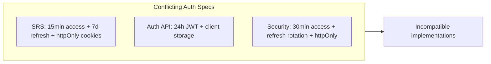
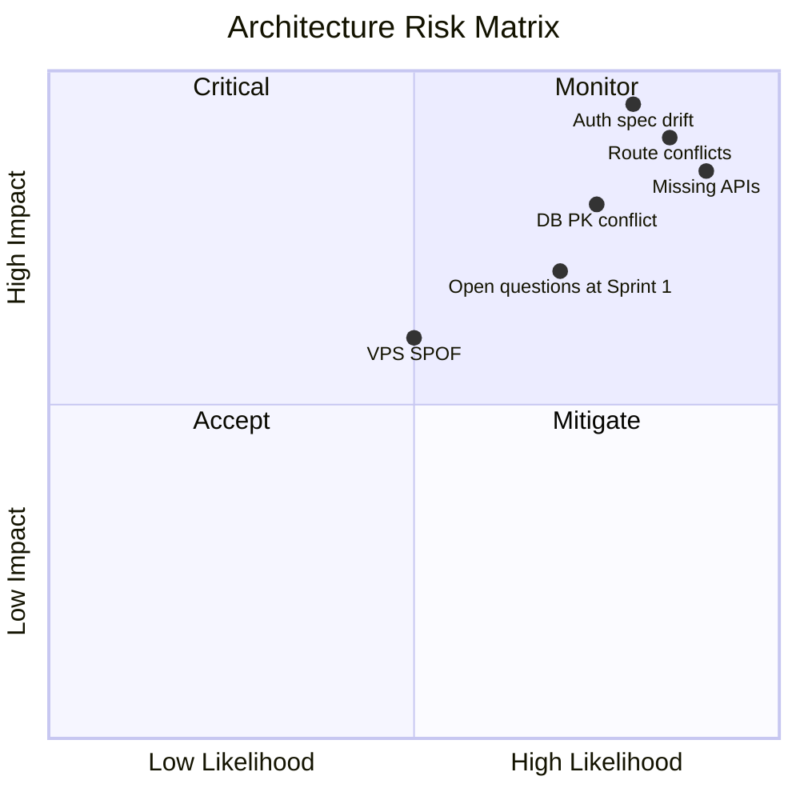

# Architecture Review — FounderOS v1.0

| Field | Value |
|-------|-------|
| **Review ID** | AR-FOUNDEROS-2026-001 |
| **Reviewers** | Principal Software Architect, Staff FE/BE Architects, Database Architect, DevOps, Security |
| **Date** | 2026-06-29 |
| **Verdict** | **Architecture conceptually sound; specification integrity insufficient for build**

---

## Executive Architecture Summary

FounderOS v1.0 proposes a **modern, defensible three-tier architecture**:

- **Presentation:** Next.js 15 on Vercel (SSR/SSG/ISR)
- **Application:** FastAPI on Hostinger VPS (Docker)
- **Data:** PostgreSQL 16 + Redis 7 + filesystem media

The **separation of concerns**, **API-first design**, **CMS-driven content**, and **module boundaries** align with stated commercial SaaS goals. The architecture is **appropriate for a single-tenant v1.0** with documented paths to multi-tenancy.

The primary risk is not architectural vision — it is **specification drift** across layers that would cause incompatible implementations by frontend, backend, and DevOps teams working in parallel.

---

## Architecture Strengths

### 1. Layered backend design

SRS and Backend_Architecture mandate `routes → services → repositories → models`. This supports testability, module isolation, and future tenant scoping middleware.

### 2. Rendering strategy alignment with SEO goals

Per-page SSR/SSG/ISR choices (static legal, ISR blog/products) correctly balance performance and freshness for a content-heavy founder platform.

### 3. Caching architecture

Redis for API cache, rate limits, and token blacklist plus CDN edge caching is appropriate for 100K pageviews/month target on VPS infrastructure.

### 4. Security architecture depth

Dedicated security documents (Authentication, Authorization, CSP, Rate Limits, Audit, Compliance) exceed typical MVP documentation. RBAC permission strings per module are well-scoped.

### 5. Module registry pattern (CMS)

CMS block registry with domain module extensions (Blog, Products, Portfolio) is the correct extensibility primitive for white-label without monolith coupling.

### 6. Deployment topology clarity

Cloudflare → Vercel/Hostinger split is documented with diagrams in PROJECT_SCOPE, SRS, and Deployment_Architecture.

### 7. Future extensibility documentation

`14_Future/` (Multi_Tenant, Plugin_System, White_Label, Marketplace) provides credible v2.0+ direction without over-building v1.0.

---

## Architecture Weaknesses

### 1. URL and routing authority gap (Critical)

Three parallel route definitions exist:

| Source | Example Routes |
|--------|----------------|
| PROJECT_SCOPE | `/media`, `/privacy`, `/cookie-policy` |
| Sitemap + Page specs | `/technology`, `/legal/privacy`, `/legal/cookies` |
| IA diagram | Technology, Licensing under Legal |

**Impact:** Frontend routing, sitemap generation, canonical URLs, and navigation components cannot be implemented without reconciliation.

### 2. Authentication architecture undefined at contract level (Critical)

**Impact:** Session management, XSS exposure, admin UX (re-login), and Redis token store design are blocked.

### 3. Database identity strategy conflict (Critical)

| Document | PK Strategy |
|----------|-------------|
| SRS-FR-03.1 | UUID primary keys |
| Entities.md | SERIAL integer on users, roles, permissions |

**Impact:** ORM models, API ID types (string vs int), and future multi-tenant row-level security migrations.

### 4. API surface incomplete (Critical)

Documented modules without API contracts:

| Module | Missing API |
|--------|-------------|
| CMS | CMS_API |
| Search | Search_API |
| Newsletter | Newsletter_API |
| SEO | SEO_API |
| Gallery | Gallery_API |
| Notifications | Notifications_API |
| Users/Roles/Permissions | Admin Identity API |

**Impact:** Frontend `lib/api.ts` cannot be fully typed; contract tests impossible; CMS publish flow unspecified.

### 5. Integration API fragmentation (High)

Module docs reference unified `Integrations_API.md`. Actual docs split GitHub_API and YouTube_API. No invalidation/webhook patterns unified.

### 6. Background processing ambiguity (High)

SRS system diagram includes `WORKER` container. SRS-FR-02.10 defers Celery to v1.5. Newsletter sync, email delivery, and GitHub cache invalidation need explicit v1.0 async model.

### 7. Media storage path inconsistency (High)

| Document | Path |
|----------|------|
| SRS-FR-05.1 | `/data/media/{tenant_id}/{year}/{month}/` |
| Media_API | `/var/media/{tenant}/YYYY/MM/` |

**Impact:** Docker volume mounts, backup scripts, Nginx static serving.

### 8. Health check fragmentation (Medium)

`/health` vs `/api/v1/health` — affects load balancers, uptime monitors, and CI deploy gates.

### 9. BFF pattern undecided (Medium)

SRS open question on Next.js API routes vs direct FastAPI calls affects CORS, cookie domains, and CSRF strategy.

---

## Scalability Assessment

### v1.0 capacity targets (adequate)

| Dimension | Target | Assessment |
|-----------|--------|------------|
| Pageviews/month | 100K | Achievable with CDN + Redis |
| Concurrent users | 500 | Single VPS with caching sufficient |
| API p95 | < 200ms | Achievable with connection pooling |
| Media storage | 50GB | Filesystem OK for v1.0 |

### Scale path (credible)

Scalability.md documents horizontal API replicas, read replicas (v2.0), S3 migration (v1.5), and CDN API caching. **Assessment: PASS for documented scale path.**

### Bottleneck risks

1. **VPS single point of failure** — mitigated by DR docs but not HA
2. **Filesystem media on VPS** — migration to object storage required before multi-tenant scale
3. **PostgreSQL full-text search** — may need Elasticsearch/OpenSearch at scale (not documented)

---

## Future SaaS Readiness

| Capability | v1.0 Status | Readiness |
|------------|-------------|-----------|
| Multi-tenant data model | tenant_id in paths; single tenant deploy | **Architecture-ready** |
| Tenant provisioning | Manual | **Not ready** |
| Billing/subscriptions | Out of scope | **Not ready** |
| Custom domains | Manual DNS v1.0 | **Partial** |
| Per-tenant branding | Settings module | **Ready** |
| Per-tenant content isolation | Single DB single tenant | **N/A v1.0** |
| Control plane | v2.0 | **Not ready** |
| API versioning | /api/v1 documented | **Ready** |

**SaaS Readiness Score: 4/10 for commercial SaaS; 7/10 for white-label single-tenant replication**

---

## Plugin Readiness

Plugin_System.md (v2.5) defines:

- Block type registration via CMS registry
- Hook points for modules
- Version compatibility manifest

**v1.0 assessment:** CMS block registry provides **foundation** for plugins. No runtime plugin loader, sandbox, or marketplace infrastructure. **Plugin readiness: 3/10 for v1.0; architecture seeds extensibility.**

---

## White-Label Readiness

| Question | Answer |
|----------|--------|
| Can branding change without code? | **Partial** — logo, colors, theme via Settings; not all tokens validated |
| Can themes change? | **Yes** — dark/light/system documented |
| Can domains change? | **Manual** — v1.0; automation v1.5 |
| Multiple founders supported? | **No** — single tenant; architecture-ready |
| Plugins introducible? | **No** — v2.5 |
| Custom modules addable? | **Yes** — module pattern documented |
| Agencies manage multiple sites? | **No** — separate deployments per tenant |

**White-Label Readiness: FAIL for commercial SaaS claims; PASS for single-tenant re-deployment with engineering support**

---

## Risk Analysis

| Risk | Likelihood | Impact | Mitigation |
|------|------------|--------|------------|
| Parallel teams implement incompatible routes | High | High | URL Authority Document (P0) |
| Security misconfiguration (JWT in localStorage) | High | Critical | Auth contract freeze |
| CMS implementation blocked | High | High | CMS_API.md |
| Second tenant deployment > 2 weeks | Medium | Medium | Deployment runbook + Settings validation |
| SEO regression from route churn | High | High | Freeze routes before FE Sprint 2 |
| Scope creep to personal site | Medium | High | Enforce PROJECT_SCOPE |

---

## Architecture Decision Records Required

Before implementation, the board mandates ADRs for:

| ADR | Topic | Blocking Sprint |
|-----|-------|-----------------|
| ADR-001 | Canonical URL structure | Sprint 0 |
| ADR-002 | Authentication token lifecycle and storage | Sprint 2 |
| ADR-003 | Primary key strategy (UUID) | Sprint 0 |
| ADR-004 | BFF vs direct API | Sprint 1 |
| ADR-005 | Technology vs Media page | Sprint 0 |
| ADR-006 | Monorepo vs polyrepo | Sprint 0 |
| ADR-007 | Blog editor (Markdown vs WYSIWYG) | Sprint 3 |

---

## Architecture Review Verdict

| Area | Verdict |
|------|---------|
| System topology | **APPROVED** |
| Module boundaries | **APPROVED** |
| Frontend architecture | **CONDITIONAL** |
| Backend architecture | **CONDITIONAL** |
| Database architecture | **REJECTED** (PK conflict) |
| API architecture | **REJECTED** (incomplete) |
| Security architecture | **REJECTED** (auth conflict) |
| Deployment architecture | **CONDITIONAL** |
| Scalability path | **APPROVED** |
| SaaS / white-label claims | **REJECTED** (overstated for v1.0) |

**Overall: Architecture vision APPROVED; architecture specification REJECTED for implementation.**
