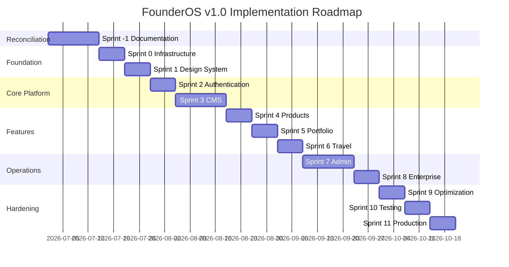
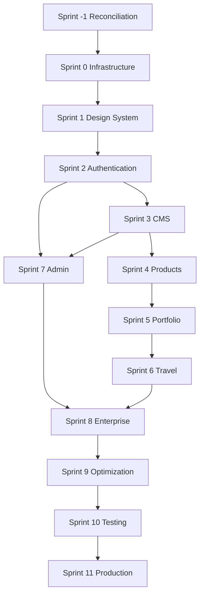

# Implementation Roadmap — FounderOS v1.0

| Field | Value |
|-------|-------|
| **Document ID** | ROADMAP-IMPL-2026-001 |
| **Derived From** | FounderOS Documentation Suite v1.0 |
| **Status** | **DRAFT — Pending Documentation Reconciliation (Sprint −1)** |
| **Timeline** | 14 weeks (2w reconciliation + 12w implementation) |
| **Team** | 2 FE, 2 BE, 1 Designer, 1 PM, 0.5 DevOps |

> **Prerequisite:** Complete [Sprint −1](#sprint--1--documentation-reconciliation) and pass Phase 1.5 Re-Audit per [IMPLEMENTATION_READINESS.md](./IMPLEMENTATION_READINESS.md) before Sprint 0 begins.

---

## Roadmap Overview

---

## Sprint −1 — Documentation Reconciliation

| Field | Value |
|-------|-------|
| **Duration** | 2 weeks |
| **Dependencies** | Audit reports (this phase) |
| **Blocking** | All implementation sprints |

### Objectives

1. Resolve all P0 documentation blocking issues
2. Achieve ≥10/12 quality gate pass on re-audit
3. Publish ADRs for architectural decisions
4. Fix cross-reference integrity

### Deliverables

- URL Authority Document
- ADR-001 through ADR-007
- CMS_API, Search_API, Newsletter_API, SEO_API, Gallery_API, Users_API
- Reconciled Entities.md (UUID PKs)
- Unified Authentication contract
- Fixed cross-references (85 → 0)

### Acceptance Criteria

- [ ] Zero P0 issues in DOCUMENTATION_AUDIT_REPORT.md
- [ ] Cross-reference integrity ≥ 99%
- [ ] All 18 modules have API documentation
- [ ] PROJECT_SCOPE routes match Sitemap and page specs
- [ ] Phase 1.5 Re-Audit scheduled and passed

### Definition of Done

- Enterprise Architecture Review Board approves documentation for freeze
- PRD/SRS status updated from "Approved" to "Locked" (see FREEZE_REPORT.md)
- Implementation team kickoff authorized

---

## Sprint 0 — Infrastructure

| Field | Value |
|-------|-------|
| **Duration** | 1 week |
| **Dependencies** | Sprint −1 complete |
| **Docs** | `13_Deployment/`, `04_Architecture/Deployment_Architecture.md`, `Folder_Structure.md` |

### Objectives

1. Repository scaffolding (monorepo or polyrepo per ADR-006)
2. Docker Compose local development stack
3. CI/CD pipeline skeleton
4. Environment variable management

### Deliverables

- `frontend/` and `backend/` project scaffolding per SRS folder structure
- Docker Compose: PostgreSQL 16, Redis 7, FastAPI, Nginx
- GitHub Actions: lint, type-check, test placeholders
- `.env.example` for all documented environment variables
- Health check endpoint (standardized path per ADR)

### Acceptance Criteria

- [ ] `docker compose up` starts full local stack
- [ ] `GET /api/v1/health` returns 200
- [ ] CI runs on PR with lint + build
- [ ] Alembic initialized with empty migration
- [ ] README implementation section added (not doc README)

### Definition of Done

- DevOps sign-off on local and staging topology
- All engineers can run stack in < 1 hour per SRS TG5
- Secrets documented; no credentials in repo

---

## Sprint 1 — Design System

| Field | Value |
|-------|-------|
| **Duration** | 1 week |
| **Dependencies** | Sprint 0 |
| **Docs** | `03_Design_System/`, `01_Brand/` |

### Objectives

1. Implement design tokens as CSS variables
2. Install and configure shadcn/ui primitives
3. Build layout shell (Header, Footer, Section)
4. Dark mode via next-themes

### Deliverables

- Tailwind config with design tokens from Design_Tokens.md
- shadcn/ui: Button, Card, Form, Dialog, Table, Toast
- Root layout with skip-to-content link
- Storybook or component preview (optional)

### Acceptance Criteria

- [ ] All token values match Design_Tokens.md
- [ ] Dark/light/system theme toggle works
- [ ] Responsive breakpoints per Responsive_System.md
- [ ] axe-core passes on layout shell
- [ ] No arbitrary colors outside token system

### Definition of Done

- Designer sign-off on component primitives
- Frontend lint + type-check pass
- Component documentation in code matches design system specs

---

## Sprint 2 — Authentication

| Field | Value |
|-------|-------|
| **Duration** | 1 week |
| **Dependencies** | Sprint 0, Sprint 1 (admin shell) |
| **Docs** | `11_Security/Authentication.md`, `08_API/Authentication_API.md`, `06_Modules/Authentication.md` |

### Objectives

1. JWT authentication with refresh token rotation
2. RBAC middleware and permission decorators
3. Admin login page and auth-gated admin routes
4. Seed default roles and super admin

### Deliverables

- `POST /api/v1/auth/login`, `POST /api/v1/auth/refresh`, `POST /api/v1/auth/logout`, `GET /api/v1/auth/me`
- Users, roles, permissions tables (UUID PKs)
- Admin login UI at `/admin/login`
- Redis token blacklist / refresh store
- Rate limiting on login endpoint

### Acceptance Criteria

- [ ] Auth contract matches ADR-002 exactly
- [ ] RBAC denies unauthorized mutations with 403
- [ ] Inactive users cannot login
- [ ] bcrypt cost ≥ 12
- [ ] No tokens in localStorage (httpOnly refresh per ADR)
- [ ] Bootstrap admin seed script works

### Definition of Done

- Security architect sign-off
- Integration tests for auth flows pass
- OWASP auth checklist satisfied

---

## Sprint 3 — CMS

| Field | Value |
|-------|-------|
| **Duration** | 2 weeks |
| **Dependencies** | Sprint 2 |
| **Docs** | `06_Modules/CMS.md`, `08_API/CMS_API.md`, `07_Admin/Content.md` |

### Objectives

1. Page + Block content model
2. Draft/publish workflow with revision history
3. Block registry for domain modules
4. Admin content editor UI

### Deliverables

- CMS API: pages CRUD, blocks CRUD, publish, revisions, preview token
- PostgreSQL tables: pages, blocks, revisions
- Admin content list and block editor
- Cache invalidation on publish
- Legal page templates (Privacy, Terms, Cookies)

### Acceptance Criteria

- [ ] Draft content not visible on public routes
- [ ] Publish invalidates Redis cache within 2s
- [ ] Revision history per ADR limit (10 or 50 — resolved in Sprint −1)
- [ ] Block registry accepts module registrations
- [ ] CMS-driven Home hero section renders on `/`

### Definition of Done

- All static page content served from CMS
- Editor can publish legal pages without code deploy
- CMS integration tests pass

---

## Sprint 4 — Products

| Field | Value |
|-------|-------|
| **Duration** | 1 week |
| **Dependencies** | Sprint 3 |
| **Docs** | `06_Modules/Product_Manager.md`, `08_API/Products_API.md`, `05_Pages/Products.md`, `05_Pages/Product_Details.md` |

### Objectives

1. Product CRUD and publishing
2. Flagship product designation
3. Public products list and detail pages
4. Product JSON-LD schema

### Deliverables

- Products API per contract
- `/products` and `/products/[slug]` pages (ISR 3600s)
- Admin products tab in Content admin
- CMS block type `product-showcase`

### Acceptance Criteria

- [ ] Only published products on public routes
- [ ] One flagship product enforced
- [ ] Product detail renders features, screenshots, architecture JSON
- [ ] JSON-LD Product schema validates
- [ ] Lighthouse Performance ≥ 90 on /products

### Definition of Done

- Product module integration tests pass
- PM validates product page against spec

---

## Sprint 5 — Portfolio

| Field | Value |
|-------|-------|
| **Duration** | 1 week |
| **Dependencies** | Sprint 4 |
| **Docs** | `06_Modules/Portfolio_Manager.md`, `08_API/Portfolio_API.md`, `05_Pages/Portfolio.md`, `05_Pages/Case_Studies.md` |

### Objectives

1. Portfolio items and case studies
2. Category filtering
3. Gallery integration for case study media
4. Related products linking

### Deliverables

- Portfolio API per contract
- `/portfolio`, `/case-studies`, `/case-studies/[slug]` pages
- Admin portfolio/case study management

### Acceptance Criteria

- [ ] Portfolio grid with category filter
- [ ] Case study detail: challenge, solution, results, metrics
- [ ] Unpublished items return 404
- [ ] Gallery images render with alt text

### Definition of Done

- Portfolio E2E smoke test passes
- Cross-links to products work

---

## Sprint 6 — Travel

| Field | Value |
|-------|-------|
| **Duration** | 1 week |
| **Dependencies** | Sprint 5 |
| **Docs** | `06_Modules/Travel_Manager.md`, `06_Modules/Gallery.md`, `08_API/Travel_API.md`, `05_Pages/Travel.md`, `05_Pages/Media.md` |

### Objectives

1. Travel log entries with galleries
2. Media page with YouTube embeds
3. GitHub open source integration
4. Resolve Technology vs Media page per ADR-005

### Deliverables

- Travel API + Gallery API
- `/travel`, `/travel/[slug]` pages
- `/media` page (or `/technology` per ADR)
- `/open-source` with GitHub API sync
- YouTube API integration

### Acceptance Criteria

- [ ] Travel entries with photo galleries
- [ ] YouTube videos embed on media page
- [ ] GitHub repos sync on settings save
- [ ] Gallery reorder API works
- [ ] Optional travel module can be disabled via settings

### Definition of Done

- Integration tests for GitHub and YouTube pass
- Media uploads respect size/type limits

---

## Sprint 7 — Admin

| Field | Value |
|-------|-------|
| **Duration** | 2 weeks |
| **Dependencies** | Sprint 2, Sprint 3 |
| **Docs** | `07_Admin/`, `08_API/Users_API.md`, `08_API/Settings_API.md`, `08_API/Analytics_API.md` |

### Objectives

1. Complete admin panel (11 sections)
2. User, role, permission management
3. Media library admin
4. SEO, settings, logs, analytics, monitoring

### Deliverables

- Admin routes: dashboard, users, roles, permissions, content, media, SEO, settings, logs, analytics, monitoring
- Users/Roles/Permissions API
- Media upload and folder management
- SEO metadata editor
- Settings: branding, integrations, theme
- Analytics dashboard (Plausible/GA4 per ADR)

### Acceptance Criteria

- [ ] All 11 admin sections functional with RBAC
- [ ] Permission matrix UI works
- [ ] Media upload with alt text required
- [ ] SEO per-page meta editable
- [ ] Settings save updates site branding without redeploy
- [ ] Logs viewer shows admin actions

### Definition of Done

- Admin QA script passes all FR-200 requirements
- RBAC enforced on every admin route

---

## Sprint 8 — Enterprise

| Field | Value |
|-------|-------|
| **Duration** | 1 week |
| **Dependencies** | Sprint 7 |
| **Docs** | `05_Pages/Enterprise.md`, `05_Pages/Acquisition.md`, `05_Pages/Contact.md`, `08_API/Contact_API.md`, `06_Modules/Contact_Manager.md`, `06_Modules/Newsletter.md` |

### Objectives

1. Enterprise and acquisition conversion pages
2. Contact form with email delivery
3. Newsletter signup
4. Global site search
5. Testimonials page

### Deliverables

- `/enterprise`, `/acquisition`, `/contact`, `/testimonials` pages
- Contact API with inquiry types (contact, acquisition)
- SMTP email notifications
- Newsletter API + signup on Home
- Search API + search UI
- Honeypot spam protection

### Acceptance Criteria

- [ ] Contact form delivers email within 60s
- [ ] Acquisition inquiry flagged in admin
- [ ] NDA acknowledgment on acquisition form
- [ ] Global search across products, blog, portfolio
- [ ] Testimonials CMS-managed with ordering
- [ ] Rate limiting on all forms

### Definition of Done

- Enterprise buyer journey E2E test passes
- Email delivery verified in staging

---

## Sprint 9 — Optimization

| Field | Value |
|-------|-------|
| **Duration** | 1 week |
| **Dependencies** | Sprint 8 |
| **Docs** | `04_Architecture/Caching_Strategy.md`, `04_Architecture/Scalability.md`, `10_SEO/`, `13_Deployment/Cloudflare.md` |

### Objectives

1. Performance optimization pass
2. SEO hardening (sitemap, robots, JSON-LD, canonical)
3. CDN and cache tuning
4. Image optimization pipeline

### Deliverables

- `sitemap.xml` and `robots.ts` per Sitemap spec
- JSON-LD on all applicable pages
- Redis cache tuning for hot endpoints
- WebP image conversion on upload
- Cloudflare CDN configuration
- 404 page

### Acceptance Criteria

- [ ] Lighthouse Performance ≥ 90 on Home, Products, Blog
- [ ] Lighthouse SEO ≥ 95 on all public pages
- [ ] Core Web Vitals pass
- [ ] Sitemap validates; 0 admin URLs included
- [ ] Canonical URLs correct per URL Authority
- [ ] API p95 < 200ms under 100 rps (k6)

### Definition of Done

- Performance_Testing.md checklist complete
- SEO architect sign-off

---

## Sprint 10 — Testing

| Field | Value |
|-------|-------|
| **Duration** | 1 week |
| **Dependencies** | Sprint 9 |
| **Docs** | `12_Testing/` |

### Objectives

1. Achieve coverage targets
2. E2E critical path suite
3. Accessibility audit
4. Security scan

### Deliverables

- Unit tests: ≥ 80% backend, ≥ 70% frontend
- Integration tests for all API domains
- Playwright E2E: auth, CMS publish, contact, product publish
- axe-core CI on key pages
- OWASP ZAP baseline scan
- WCAG 2.1 AA audit report

### Acceptance Criteria

- [ ] All test suites pass in CI
- [ ] E2E smoke < 10 minutes
- [ ] Zero critical/high security findings
- [ ] WCAG 2.1 AA audit passed
- [ ] Flaky test rate < 2%

### Definition of Done

- QA Director sign-off
- Release candidate tagged

---

## Sprint 11 — Production Release

| Field | Value |
|-------|-------|
| **Duration** | 1 week |
| **Dependencies** | Sprint 10 |
| **Docs** | `13_Deployment/`, `PROJECT_SCOPE.md` acceptance criteria |

### Objectives

1. Production deployment
2. Backup and DR validation
3. Monitoring and alerting
4. Launch checklist

### Deliverables

- Production deploy: Vercel (FE) + Hostinger (BE)
- Cloudflare DNS, CDN, WAF, SSL
- Automated daily DB + media backup
- Uptime monitoring and alerts
- Production smoke test
- DR drill (backup restore)

### Acceptance Criteria

- [ ] All PROJECT_SCOPE v1.0 release gate checkboxes satisfied
- [ ] All PRD AC-01 through AC-10 verified
- [ ] Docker deployment reproducible from docs
- [ ] Analytics tracking verified
- [ ] 99.9% uptime monitoring active
- [ ] Runbook documented for on-call

### Definition of Done

- Production live with CMS content
- CTO/PM launch sign-off
- Post-launch monitoring for 72 hours
- v1.0 retrospective scheduled

---

## Dependency Graph

---

## Risk Buffer

| Sprint | Buffer | Rationale |
|--------|--------|-----------|
| Sprint −1 | +3 days | API doc authoring |
| Sprint 3 | +3 days | CMS complexity |
| Sprint 7 | +3 days | Admin breadth |
| Sprint 10 | +2 days | Security remediation |

**Total timeline with buffer: 16 weeks**

---

## Related Documents

- [IMPLEMENTATION_READINESS.md](./IMPLEMENTATION_READINESS.md)
- [PROJECT_SCOPE.md](./PROJECT_SCOPE.md)
- [docs/00_Project/07_Roadmap.md](./docs/00_Project/07_Roadmap.md)
