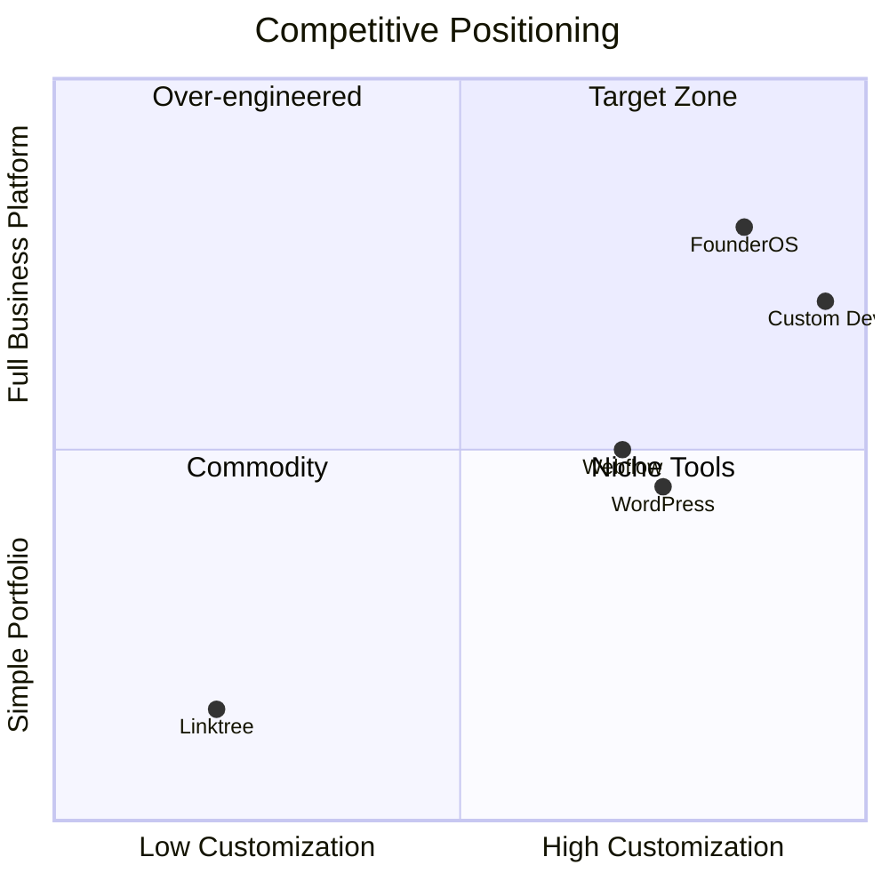

# Product Requirements Document (PRD)
# Founder Portfolio Platform — FounderOS v1.0

| Field | Value |
|-------|-------|
| Document ID | PRD-FOUNDEROS-001 |
| Version | 1.0 |
| Status | Approved for Development |
| Author | Product Management |
| Last Updated | 2026-06-29 |

## Purpose

Define **what** FounderOS v1.0 delivers from a product perspective — features, user needs, business outcomes, and measurable success criteria. This PRD is the authoritative product reference for engineering, design, QA, and go-to-market teams.

## Scope

This PRD covers v1.0 of the Founder Portfolio Platform: a single-tenant, white-label-ready digital identity platform. Multi-tenant SaaS, marketplace, and AI assistant features are documented in [docs/14_Future/](docs/14_Future/Roadmap.md) and excluded from v1.0 delivery.

## Business Context

### Problem Statement

Founders, SaaS CEOs, and entrepreneurs need a **credible digital presence** that goes beyond a static portfolio. They must showcase products, publish thought leadership, manage media, attract enterprise buyers, and handle acquisition inquiries — without rebuilding from scratch for each new venture or client.

### Market Opportunity

| Segment | Size Estimate | Pain Point |
|---------|---------------|------------|
| Startup founders | 500K+ globally | No unified founder identity platform |
| SaaS companies | 30K+ | Product pages disconnected from founder brand |
| Agencies/consultants | 100K+ | Cannot resell portfolio infrastructure |
| Creators/travel bloggers | 2M+ | CMS tools too generic or too narrow |

### Competitive Positioning

FounderOS differentiates by combining **founder branding + product showcase + enterprise acquisition + CMS** in one modular, white-label platform — not a website builder, not a link-in-bio tool, not a generic CMS.

## Goals

| # | Goal | Metric | Target |
|---|------|--------|--------|
| G1 | Launch credible founder identity | Time to first deployment | < 2 weeks (tenant #2) |
| G2 | Enable self-service content management | Admin tasks without engineering | 100% CMS coverage |
| G3 | Drive enterprise inquiries | Acquisition form submissions | Baseline in month 1 |
| G4 | Achieve technical excellence | Lighthouse scores | ≥ 90 performance |
| G5 | Prepare for commercialization | Architecture multi-tenant readiness | Documented + reviewed |

---

## Functional Requirements

### FR-100: Public Website

#### FR-101: Home Page
- Hero section with founder headline, subheadline, CTA (CMS-driven)
- Featured products carousel (max 6)
- Portfolio highlights (max 4)
- Latest blog posts (max 3)
- Testimonials strip (max 3)
- Newsletter signup
- Social proof metrics (optional, CMS-driven)

#### FR-102: About Page
- Founder biography (rich text)
- Timeline/milestones
- Skills and expertise tags
- Team section (optional)
- Press/media mentions

#### FR-103: Products
- Product listing with filter by category, status
- Product detail: name, description, features, screenshots, pricing model, links, SEO metadata
- AI product showcase badge (optional flag per product)

#### FR-104: Portfolio & Case Studies
- Portfolio grid with category filter
- Case study detail: challenge, solution, results, metrics, gallery
- Related products linking

#### FR-105: Blog
- Post listing with pagination, category/tag filter
- Post detail: rich content, author, date, reading time, related posts
- RSS feed generation

#### FR-106: Travel
- Travel log entries with location, date, gallery
- Map visualization (optional)
- Category filtering (adventure, food, culture, etc.)

#### FR-107: Media
- Media library public gallery
- YouTube video embed section
- Podcast/audio section (future-ready)

#### FR-108: Open Source
- GitHub repository listing with stars, language, description
- Auto-sync from GitHub API

#### FR-109: Testimonials
- Testimonial cards with author, role, company, avatar, rating
- CMS-managed ordering

#### FR-110: Contact
- Contact form: name, email, subject, message
- Inquiry type selector
- Honeypot spam protection
- Email notification to admin

#### FR-111: Enterprise
- Enterprise value proposition sections
- Service offerings
- CTA to contact/acquisition

#### FR-112: Acquisition Portal
- M&A-focused landing page
- Confidential inquiry form with NDA acknowledgment
- Company metrics display (CMS-driven, optional)

#### FR-113: Legal Pages
- Privacy Policy, Terms of Service, Cookie Policy (CMS-managed rich text)

### FR-200: Admin Panel

#### FR-201: Dashboard
- Key metrics: pageviews, form submissions, content counts
- Recent activity feed
- Quick actions

#### FR-202: User Management
- CRUD users with email, name, role assignment
- Invite flow via email
- Deactivate (soft delete)

#### FR-203: Role & Permission Management
- Predefined roles: Super Admin, Admin, Editor, Viewer
- Custom role creation with granular permissions
- Permission matrix UI

#### FR-204: Content Management
- Unified content editor for all CMS-managed pages
- Draft/publish workflow
- Revision history (last 10 versions)

#### FR-205: Media Management
- Upload images, videos, documents
- Folder organization
- Alt text, captions
- Bulk upload

#### FR-206: SEO Management
- Per-page meta title, description, OG image
- Sitemap preview
- Robots.txt editor

#### FR-207: Settings
- Site name, tagline, logo, favicon
- Social links
- Theme selection (light/dark/system default)
- Brand colors override
- Integration credentials (GitHub, YouTube, SMTP, Analytics)

#### FR-208: Analytics
- Pageview charts (7d, 30d, 90d)
- Top pages, referrers
- Form submission tracking

#### FR-209: Logs & Monitoring
- Application error logs
- API request logs (admin only)
- Health check status

### FR-300: Integrations

| Integration | Capability |
|-------------|------------|
| GitHub | List public repos, sync stats |
| YouTube | Embed channel videos, sync metadata |
| Newsletter | Email capture, export subscribers |
| Analytics | Plausible/GA4 event tracking |
| SMTP | Contact/acquisition email delivery |

### FR-400: Search
- Global site search across products, blog, portfolio, pages
- Autocomplete suggestions
- Result highlighting

---

## Non-functional Requirements

| ID | Category | Requirement |
|----|----------|-------------|
| NFR-01 | Performance | LCP < 2.5s, TTI < 3.5s on 4G |
| NFR-02 | Availability | 99.9% uptime |
| NFR-03 | Security | OWASP Top 10, HTTPS, RBAC |
| NFR-04 | Accessibility | WCAG 2.1 AA |
| NFR-05 | SEO | Core Web Vitals pass, valid structured data |
| NFR-06 | Scalability | 100K pageviews/month per tenant |
| NFR-07 | Maintainability | Modular architecture, documented APIs |
| NFR-08 | Portability | Docker deployment, env-based config |
| NFR-09 | Data integrity | Soft deletes, audit timestamps |
| NFR-10 | Backup | Daily automated DB + media backup |

---

## User Stories

### Primary Personas

See [03_User_Personas.md](docs/00_Project/03_User_Personas.md) for full persona definitions.

| ID | Persona | Story | Priority |
|----|---------|-------|----------|
| US-001 | Founder Alex | As a founder, I want a home page that showcases my products and credibility so investors take me seriously | P0 |
| US-002 | Founder Alex | As a founder, I want to publish blog posts without touching code | P0 |
| US-003 | SaaS CEO Sam | As a SaaS CEO, I want product pages with features and pricing so prospects can evaluate my offering | P0 |
| US-004 | Enterprise Buyer | As an enterprise buyer, I want an acquisition inquiry form so I can express interest confidentially | P0 |
| US-005 | Admin Editor | As a content editor, I want a media library so I can reuse images across pages | P0 |
| US-006 | Agency Owner | As an agency owner, I want to rebrand the platform for each client | P1 |
| US-007 | Travel Creator | As a travel blogger, I want travel log entries with photo galleries | P1 |
| US-008 | Developer | As a developer, I want my GitHub repos displayed automatically | P1 |
| US-009 | Visitor | As a visitor, I want to search across all content | P1 |
| US-010 | Admin | As an admin, I want role-based access so editors cannot change settings | P0 |

---

## UX Requirements

- **Navigation:** Sticky header, mobile hamburger, footer sitemap — [Navigation.md](docs/02_UX/Navigation.md)
- **Responsive:** Mobile-first, 4 breakpoints — [Responsive_System.md](docs/03_Design_System/Responsive_System.md)
- **Dark mode:** System preference + manual toggle — [Dark_Mode.md](docs/03_Design_System/Dark_Mode.md)
- **Motion:** Subtle entrance animations, reduced-motion support — [Motion_Guidelines.md](docs/01_Brand/Motion_Guidelines.md)
- **Forms:** Inline validation, clear error states — [Forms.md](docs/03_Design_System/Forms.md)
- **Loading:** Skeleton screens for data-dependent sections — [Loading_States.md](docs/03_Design_System/Loading_States.md)
- **Empty states:** Helpful messaging when no content exists

---

## Technical Considerations

- **Frontend:** Next.js 15 App Router with SSR/SSG per page requirements
- **Backend:** FastAPI with OpenAPI auto-documentation
- **Database:** PostgreSQL with SQLAlchemy ORM
- **Cache:** Redis for API responses, session data, rate limiting
- **Media:** Filesystem storage v1.0, S3-compatible v1.5
- **Deployment:** Frontend on Vercel, backend on Hostinger VPS via Docker

See [System_Architecture.md](docs/04_Architecture/System_Architecture.md) for full architecture.

---

## Security Considerations

- JWT authentication with httpOnly cookies
- RBAC with granular permissions per module
- Input validation on all API endpoints
- Rate limiting on auth and form endpoints
- CSP headers via Cloudflare
- Audit logging for admin actions
- No PII in application logs

See [docs/11_Security/](docs/11_Security/Authentication.md) for complete security specification.

---

## Acceptance Criteria

### Release Criteria (v1.0)

| # | Criterion | Verification |
|---|-----------|--------------|
| AC-01 | All FR-100 pages live with CMS content | Manual QA checklist |
| AC-02 | All FR-200 admin sections functional | Admin QA script |
| AC-03 | RBAC enforced on all admin routes | Security test suite |
| AC-04 | Contact form delivers email within 60s | Integration test |
| AC-05 | GitHub repos sync on settings save | Integration test |
| AC-06 | Lighthouse Performance ≥ 90 (Home) | Automated CI |
| AC-07 | WCAG 2.1 AA audit pass | axe-core CI |
| AC-08 | JSON-LD validates on Products, Blog | Google Rich Results Test |
| AC-09 | Docker deployment from docs succeeds | Fresh VPS test |
| AC-10 | Backup restore tested successfully | DR drill |

---

## Future Enhancements

| Version | Features |
|---------|----------|
| v1.5 | Custom domains, S3 media, WYSIWYG editor, i18n |
| v2.0 | Multi-tenant SaaS, billing, tenant provisioning |
| v2.5 | Plugin system, marketplace |
| v3.0 | AI assistant, mobile app, advanced analytics |

See [docs/14_Future/Roadmap.md](docs/14_Future/Roadmap.md).

---

## Open Questions

| ID | Question | Owner | Due |
|----|----------|-------|-----|
| OQ-01 | Blog editor: Markdown vs WYSIWYG? | PM + Design | Sprint 1 |
| OQ-02 | Default analytics provider? | PM | Sprint 1 |
| OQ-03 | Newsletter: built-in vs ConvertKit? | PM | Sprint 2 |
| OQ-04 | Travel map: Mapbox vs static? | Design | Sprint 3 |
| OQ-05 | Acquisition form: file upload for pitch deck? | PM | Sprint 4 |

---

## Dependencies

| Document | Relationship |
|----------|--------------|
| [PROJECT_SCOPE.md](PROJECT_SCOPE.md) | Scope boundaries |
| [SOFTWARE_REQUIREMENTS_SPECIFICATION.md](SOFTWARE_REQUIREMENTS_SPECIFICATION.md) | Technical specification |
| [docs/00_Project/](docs/00_Project/00_Project_Vision.md) | Vision and strategy |
| [docs/05_Pages/](docs/05_Pages/Home.md) | Page-level requirements |
| [docs/06_Modules/](docs/06_Modules/CMS.md) | Module specifications |

## Glossary

| Term | Definition |
|------|------------|
| Tenant | A white-label deployment instance |
| CMS | Content Management System |
| RBAC | Role-Based Access Control |
| CTA | Call to Action |
| OG | Open Graph (social sharing metadata) |
| NDA | Non-Disclosure Agreement |

## Revision History

| Version | Date | Author | Changes |
|---------|------|--------|---------|
| 1.0 | 2026-06-29 | Product Management | Initial PRD |
