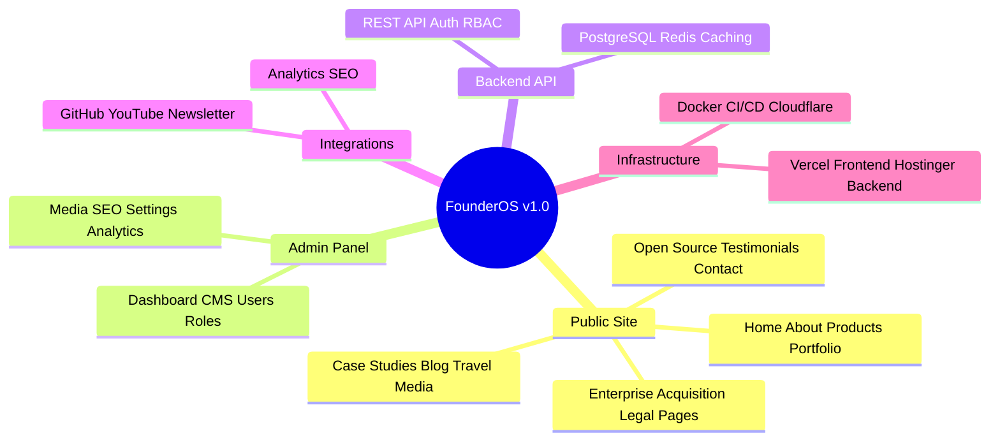
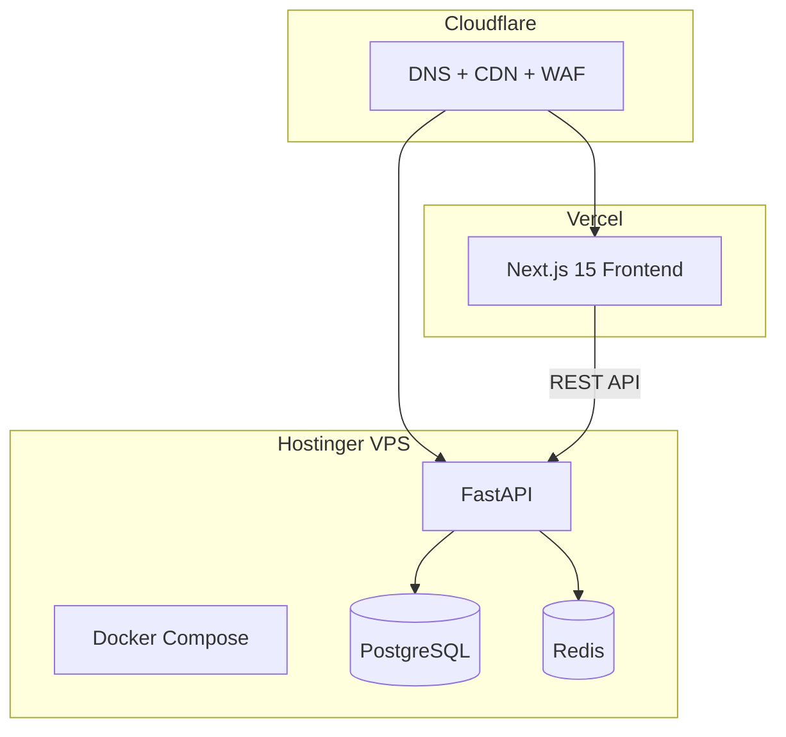

# Project Scope — Founder Portfolio Platform (FounderOS) v1.0

## Purpose

Define explicit boundaries, deliverables, assumptions, constraints, and exclusions for FounderOS v1.0. This document prevents scope creep and ensures all stakeholders share a common understanding of what v1.0 includes and excludes.

## Scope

### In Scope — v1.0

### Out of Scope — v1.0

| Exclusion | Rationale | Target Release |
|-----------|-----------|----------------|
| Multi-tenant SaaS control plane | Architecture-ready, not implemented | v2.0 |
| Plugin marketplace | Extensibility designed, not built | v2.5 |
| AI Assistant chat widget | Documented in future | v2.0 |
| Native mobile apps | Responsive web sufficient | v3.0 |
| E-commerce / payments | Licensing portal is inquiry-only | v2.0 |
| Real-time collaboration | Not required for CMS v1 | v2.5 |
| Custom domain automation | Manual DNS setup for v1 | v1.5 |
| SSO / SAML enterprise auth | Email + OAuth sufficient for v1 | v2.0 |

## Business Context

FounderOS v1.0 delivers a **single-tenant white-label-ready** deployment. The architecture supports future multi-tenancy without requiring v1.0 to implement tenant management, billing, or provisioning automation.

**Commercial intent:** v1.0 proves the product for the founding tenant (first founder deployment) while documentation and architecture enable rapid replication for paying customers in v1.5+.

## Goals

| # | Goal | Success Indicator |
|---|------|-------------------|
| G1 | Launch production-ready public site | All pages in `docs/05_Pages/` live |
| G2 | Enable non-technical content management | CMS covers 100% editable content |
| G3 | Demonstrate enterprise credibility | Enterprise + Acquisition pages functional |
| G4 | Achieve performance and SEO baselines | Lighthouse ≥ 90, structured data valid |
| G5 | Establish reusable architecture | Second deployment < 2 weeks |

## Functional Requirements

### Public Website (19 pages)

> **URL Authority:** Canonical routes are defined in [URL_AUTHORITY.md](URL_AUTHORITY.md). All specs MUST align with that document.

| Page | Route | Module Dependencies |
|------|-------|---------------------|
| Home | `/` | CMS, Products, Portfolio, Blog, Testimonials |
| About | `/about` | CMS, Media |
| Products | `/products` | Product Manager |
| Product Details | `/products/[slug]` | Product Manager, SEO |
| Portfolio | `/portfolio` | Portfolio Manager |
| Case Studies | `/case-studies` | Portfolio Manager, CMS |
| Blog | `/blog` | Blog Manager |
| Travel | `/travel` | Travel Manager, Gallery |
| Media | `/media` | Media Manager, YouTube |
| Open Source | `/open-source` | GitHub |
| Testimonials | `/testimonials` | CMS |
| Contact | `/contact` | Contact Manager |
| Enterprise | `/enterprise` | CMS, Contact Manager |
| Acquisition | `/acquisition` | CMS, Contact Manager |
| Privacy | `/legal/privacy` | CMS |
| Terms | `/legal/terms` | CMS |
| Cookie | `/legal/cookies` | CMS |
| Licensing | `/legal/licensing` | CMS |
| 404 | `/not-found` | CMS |

### Admin Panel (11 sections)

Dashboard, Users, Roles, Permissions, Content, Media, SEO, Settings, Logs, Analytics, Monitoring — per `docs/07_Admin/`.

### Backend Modules (18 modules)

Per `docs/06_Modules/` — Authentication, CMS, Product Manager, Portfolio Manager, Blog Manager, Travel Manager, Media Manager, Gallery, YouTube, GitHub, Contact Manager, Newsletter, Analytics, SEO, Search, Settings, Notifications, File Manager.

### API Surface

REST API per `docs/08_API/` — 18 API domains with OpenAPI documentation (see [URL_AUTHORITY.md](URL_AUTHORITY.md) API inventory).

## Non-functional Requirements

| Category | Requirement |
|----------|-------------|
| Availability | 99.9% uptime (excluding planned maintenance) |
| Performance | LCP < 2.5s, FID < 100ms, CLS < 0.1 |
| Scalability | Support 100K monthly pageviews per tenant |
| Security | OWASP Top 10 mitigated, HTTPS everywhere |
| Accessibility | WCAG 2.1 AA compliance |
| SEO | Valid JSON-LD, sitemap, robots.txt |
| Maintainability | Modular architecture, 80% test coverage |
| Portability | Docker-based deployment on any VPS |

## User Stories

### Epic: Public Site Launch

| ID | Story | Priority |
|----|-------|----------|
| E1-US1 | As a visitor, I can view the founder's products and portfolio | P0 |
| E1-US2 | As a visitor, I can read blog posts and travel content | P0 |
| E1-US3 | As an enterprise buyer, I can submit an acquisition inquiry | P0 |
| E1-US4 | As a visitor, I can contact the founder via form | P0 |

### Epic: Content Management

| ID | Story | Priority |
|----|-------|----------|
| E2-US1 | As an admin, I can create/edit/publish blog posts | P0 |
| E2-US2 | As an admin, I can manage products and portfolio items | P0 |
| E2-US3 | As an admin, I can upload and organize media | P0 |
| E2-US4 | As an admin, I can configure SEO metadata per page | P1 |

### Epic: Administration

| ID | Story | Priority |
|----|-------|----------|
| E3-US1 | As a super admin, I can manage users and roles | P0 |
| E3-US2 | As an admin, I can view analytics dashboard | P1 |
| E3-US3 | As an admin, I can configure site settings and branding | P0 |

## UX Requirements

- Responsive design: mobile-first, breakpoints per [Responsive_System.md](docs/03_Design_System/Responsive_System.md).
- Dark mode support per [Dark_Mode.md](docs/03_Design_System/Dark_Mode.md).
- Consistent navigation per [Navigation.md](docs/02_UX/Navigation.md).
- Page transitions per [Animation_System.md](docs/03_Design_System/Animation_System.md).

## Technical Considerations

### Deployment Topology (v1.0)

### Assumptions

| ID | Assumption |
|----|------------|
| A1 | Single tenant per deployment in v1.0 |
| A2 | English-only content in v1.0 (i18n architecture-ready) |
| A3 | Media stored on VPS filesystem (S3-compatible in v1.5) |
| A4 | Email delivery via SMTP (SendGrid/Resend) |
| A5 | One super admin seeded at deployment |

### Constraints

| ID | Constraint |
|----|------------|
| C1 | Budget: Hostinger VPS tier (4GB RAM minimum) |
| C2 | Timeline: v1.0 MVP in 12 weeks |
| C3 | Team: 2 frontend, 2 backend, 1 designer, 1 PM |
| C4 | No vendor lock-in beyond documented stack |

### Risks

| Risk | Impact | Mitigation |
|------|--------|------------|
| Scope creep from "personal site" requests | High | Enforce this document |
| Performance on VPS | Medium | Redis caching, CDN |
| SEO regression from SPA patterns | Medium | SSR/SSG via Next.js |
| Security misconfiguration | High | Follow `docs/11_Security/` |

## Security Considerations

- Authentication: JWT + httpOnly cookies ([Authentication.md](docs/11_Security/Authentication.md))
- Authorization: RBAC with granular permissions ([Authorization.md](docs/11_Security/Authorization.md))
- All forms: CSRF protection, rate limiting, input validation
- Media uploads: type validation, size limits, virus scanning (v1.5)
- HTTPS: enforced via Cloudflare + Let's Encrypt

## Acceptance Criteria

### v1.0 Release Gate

- [ ] All 19 public pages render with CMS content
- [ ] All 11 admin sections functional with RBAC
- [ ] All API endpoints documented and tested
- [ ] Lighthouse Performance ≥ 90 on Home, Products, Blog
- [ ] Lighthouse Accessibility ≥ 95 on all public pages
- [ ] WCAG 2.1 AA audit passed
- [ ] Security penetration test passed (no critical/high)
- [ ] Docker deployment documented and reproducible
- [ ] Backup and disaster recovery procedures tested
- [ ] Analytics tracking verified on all key pages
- [ ] SEO: valid sitemap, robots.txt, JSON-LD on all applicable pages
- [ ] Contact and acquisition forms deliver emails
- [ ] GitHub and YouTube integrations display live data

## Future Enhancements

See [docs/14_Future/Roadmap.md](docs/14_Future/Roadmap.md) for v1.5, v2.0, and v3.0 scope.

## Open Questions

| ID | Question | Impact | Decision By |
|----|----------|--------|-------------|
| OQ-1 | Newsletter provider: ConvertKit vs custom? | Medium | Week 2 |
| OQ-2 | Image CDN: Cloudflare Images vs self-hosted? | Medium | Week 4 |
| OQ-3 | Blog editor: Markdown vs WYSIWYG? | High | Week 1 |
| OQ-4 | Analytics: Plausible vs GA4 vs both? | Low | Week 2 |

## Dependencies

- [PRODUCT_REQUIREMENTS.md](PRODUCT_REQUIREMENTS.md)
- [SOFTWARE_REQUIREMENTS_SPECIFICATION.md](SOFTWARE_REQUIREMENTS_SPECIFICATION.md)
- [docs/00_Project/07_Roadmap.md](docs/00_Project/07_Roadmap.md)
- [docs/04_Architecture/System_Architecture.md](docs/04_Architecture/System_Architecture.md)
