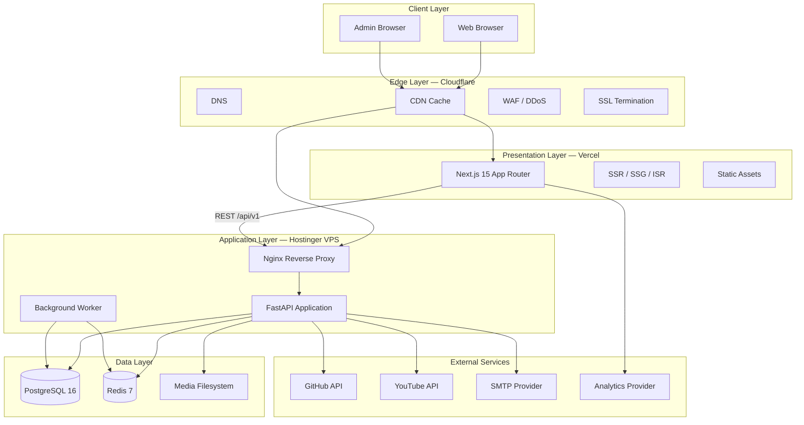
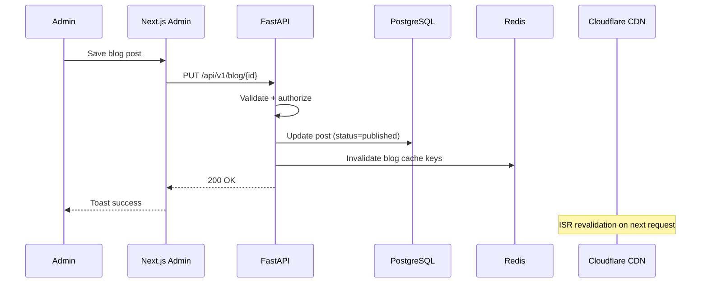

# Software Requirements Specification (SRS)
# Founder Portfolio Platform — FounderOS v1.0

| Field | Value |
|-------|-------|
| Document ID | SRS-FOUNDEROS-001 |
| Version | 1.0 |
| Status | Approved for Development |
| Author | Engineering Architecture |
| Last Updated | 2026-06-29 |

## Purpose

Define **how** FounderOS v1.0 is built — system architecture, interfaces, data models, API contracts, deployment topology, and technical constraints. This SRS enables an engineering team to implement the platform without additional architectural discovery.

## Scope

Technical specification for v1.0 single-tenant deployment. Multi-tenant implementation details are in [docs/14_Future/Multi_Tenant.md](docs/14_Future/Multi_Tenant.md) — v1.0 architecture MUST NOT preclude multi-tenancy.

## Business Context

FounderOS is a modular digital identity platform requiring:
- **Separation of concerns** between presentation (Next.js), business logic (FastAPI), and data (PostgreSQL)
- **CMS-driven content** — zero hardcoded tenant content in source code
- **White-label readiness** — branding, theme, and content configurable via Settings module
- **Enterprise credibility** — performance, security, SEO, and accessibility at production grade

## Goals

| # | Technical Goal | Measure |
|---|----------------|---------|
| TG1 | Modular, testable architecture | 80% code coverage |
| TG2 | API-first design | 100% features accessible via REST |
| TG3 | Performance at scale | p95 API < 200ms, LCP < 2.5s |
| TG4 | Secure by default | Zero critical OWASP findings |
| TG5 | Deployable in < 1 hour | Docker Compose + documented env |
| TG6 | Observable | Structured logging, health checks |

---

## System Overview



---

## Functional Requirements

### SRS-FR-01: Frontend Application

| ID | Requirement |
|----|-------------|
| SRS-FR-01.1 | Next.js 15 App Router with TypeScript strict mode |
| SRS-FR-01.2 | Server Components default; Client Components only when interactivity required |
| SRS-FR-01.3 | SSG for static pages (About, Legal); ISR for blog/products (revalidate: 3600s) |
| SRS-FR-01.4 | SSR for admin panel (auth-gated) |
| SRS-FR-01.5 | API client layer in `lib/api.ts` with typed responses |
| SRS-FR-01.6 | shadcn/ui components with TailwindCSS design tokens |
| SRS-FR-01.7 | Framer Motion for page transitions and scroll animations |
| SRS-FR-01.8 | SEO metadata via `lib/seo.ts` helper per page |
| SRS-FR-01.9 | Dark mode via `next-themes` with system preference detection |
| SRS-FR-01.10 | Error boundaries on all route segments |

### SRS-FR-02: Backend Application

| ID | Requirement |
|----|-------------|
| SRS-FR-02.1 | FastAPI with async endpoints |
| SRS-FR-02.2 | SQLAlchemy 2.0 async ORM with Alembic migrations |
| SRS-FR-02.3 | Pydantic v2 schemas for request/response validation |
| SRS-FR-02.4 | Layered architecture: routes → services → repositories → models |
| SRS-FR-02.5 | JWT authentication with access token (30 min) and refresh token rotation (7 days) |
| SRS-FR-02.6 | RBAC middleware on all protected endpoints |
| SRS-FR-02.7 | OpenAPI 3.1 auto-generated at `/api/v1/docs` |
| SRS-FR-02.8 | Structured JSON logging (structlog) |
| SRS-FR-02.9 | Health check endpoint: `/api/v1/health` |
| SRS-FR-02.10 | Background tasks via FastAPI BackgroundTasks (v1.0); Celery (v1.5) |

### SRS-FR-03: Database

| ID | Requirement |
|----|-------------|
| SRS-FR-03.1 | PostgreSQL 16 with UUID primary keys |
| SRS-FR-03.2 | All tables include: `id`, `created_at`, `updated_at`, `deleted_at` (soft delete) |
| SRS-FR-03.3 | Foreign keys with ON DELETE RESTRICT (soft delete preferred) |
| SRS-FR-03.4 | JSONB columns for flexible CMS content blocks |
| SRS-FR-03.5 | Full-text search via PostgreSQL `tsvector` |
| SRS-FR-03.6 | Alembic migrations version-controlled |
| SRS-FR-03.7 | Seed script for default roles, permissions, settings |

### SRS-FR-04: Caching

| ID | Requirement |
|----|-------------|
| SRS-FR-04.1 | Redis for API response cache (TTL: 300s default) |
| SRS-FR-04.2 | Redis for rate limiting counters |
| SRS-FR-04.3 | Redis for session/token blacklist |
| SRS-FR-04.4 | Cache invalidation on content publish/update |
| SRS-FR-04.5 | CDN cache headers on public API GET endpoints |

### SRS-FR-05: Media Storage

| ID | Requirement |
|----|-------------|
| SRS-FR-05.1 | Filesystem storage at `/data/media/{tenant_id}/{year}/{month}/` |
| SRS-FR-05.2 | Max upload size: 10MB images, 100MB video |
| SRS-FR-05.3 | Allowed types: JPEG, PNG, WebP, GIF, SVG, MP4, PDF |
| SRS-FR-05.4 | Image processing: resize, WebP conversion on upload |
| SRS-FR-05.5 | Media served via Nginx with cache headers |

### SRS-FR-06: API Design

| ID | Requirement |
|----|-------------|
| SRS-FR-06.1 | Base path: `/api/v1` |
| SRS-FR-06.2 | JSON request/response bodies |
| SRS-FR-06.3 | Pagination: `?page=1&per_page=20` (max 100) |
| SRS-FR-06.4 | Sorting: `?sort=created_at&order=desc` |
| SRS-FR-06.5 | Filtering: `?status=published&category=saas` |
| SRS-FR-06.6 | Error format: `{ "error": { "code": "...", "message": "...", "details": [] } }` |
| SRS-FR-06.7 | HTTP status codes: 200, 201, 204, 400, 401, 403, 404, 409, 422, 429, 500 |

---

## Non-functional Requirements

### Performance

| Metric | Target | Measurement |
|--------|--------|-------------|
| API p50 latency | < 50ms | Prometheus histogram |
| API p95 latency | < 200ms | Prometheus histogram |
| API p99 latency | < 500ms | Prometheus histogram |
| LCP (Home) | < 2.5s | Lighthouse CI |
| FID | < 100ms | Lighthouse CI |
| CLS | < 0.1 | Lighthouse CI |
| TTI | < 3.5s | Lighthouse CI |
| DB query p95 | < 50ms | Slow query log |

### Scalability

| Dimension | v1.0 Capacity | Scale Path |
|-----------|---------------|------------|
| Concurrent users | 500 | Horizontal API replicas |
| Pageviews/month | 100K | CDN + Redis cache |
| Media storage | 50GB | S3 migration v1.5 |
| Database size | 10GB | Read replicas v2.0 |
| API requests/sec | 100 | Load balancer + replicas |

### Reliability

| Requirement | Target |
|-------------|--------|
| Uptime | 99.9% (8.76h downtime/year) |
| RPO (Recovery Point Objective) | 24 hours |
| RTO (Recovery Time Objective) | 4 hours |
| Backup frequency | Daily automated |
| Health check interval | 30 seconds |

---

## User Stories (Technical)

| ID | Story |
|----|-------|
| TS-01 | As a frontend developer, I want typed API clients so I catch integration errors at compile time |
| TS-02 | As a backend developer, I want repository pattern so I can test business logic without DB |
| TS-03 | As a DevOps engineer, I want Docker Compose so I deploy with one command |
| TS-04 | As a QA engineer, I want OpenAPI spec so I generate contract tests |
| TS-05 | As a security engineer, I want audit logs so I trace admin actions |

---

## UX Requirements (Technical)

| Requirement | Implementation |
|-------------|----------------|
| Skeleton loading | React Suspense + skeleton components |
| Optimistic updates | Admin form submissions |
| Toast notifications | shadcn/ui Sonner for success/error |
| Form validation | Zod schemas (frontend) + Pydantic (backend) |
| Image optimization | Next.js Image component with WebP |
| Font loading | `next/font` with display: swap |

---

## Technical Considerations

### Frontend Folder Structure

```
frontend/
├── src/
│   ├── app/                    # Next.js App Router
│   │   ├── (public)/           # Public route group
│   │   ├── (admin)/            # Admin route group (auth-gated)
│   │   ├── api/                # Next.js API routes (BFF if needed)
│   │   ├── layout.tsx
│   │   └── globals.css
│   ├── components/
│   │   ├── ui/                 # shadcn/ui primitives
│   │   ├── layout/             # Header, Footer, Section
│   │   ├── forms/              # Contact, Inquiry forms
│   │   ├── modules/            # Module-specific components
│   │   ├── motion/             # Framer Motion wrappers
│   │   └── seo/                # Analytics, metadata
│   ├── lib/
│   │   ├── api.ts              # API client
│   │   ├── seo.ts              # SEO helpers
│   │   ├── constants.ts        # App constants
│   │   └── utils.ts            # Utilities
│   └── types/                  # TypeScript type definitions
├── public/                     # Static assets
├── Dockerfile
└── package.json
```

### Backend Folder Structure

```
backend/
├── app/
│   ├── api/
│   │   ├── routes/             # FastAPI route handlers
│   │   └── deps.py             # Dependency injection
│   ├── core/
│   │   ├── config.py           # Settings (pydantic-settings)
│   │   ├── database.py         # DB engine, session
│   │   ├── security.py         # JWT, password hashing
│   │   └── cache.py            # Redis client
│   ├── models/                 # SQLAlchemy models
│   ├── schemas/                # Pydantic schemas
│   ├── services/               # Business logic
│   ├── repositories/           # Data access layer
│   └── main.py                 # FastAPI app entry
├── alembic/                    # Database migrations
├── tests/
├── Dockerfile
└── requirements.txt
```

### Environment Variables

| Variable | Layer | Required | Description |
|----------|-------|----------|-------------|
| `DATABASE_URL` | Backend | Yes | PostgreSQL connection string |
| `REDIS_URL` | Backend | Yes | Redis connection string |
| `SECRET_KEY` | Backend | Yes | JWT signing key (256-bit) |
| `SMTP_HOST` | Backend | Yes | Email server host |
| `SMTP_USER` | Backend | Yes | Email auth user |
| `SMTP_PASSWORD` | Backend | Yes | Email auth password |
| `GITHUB_TOKEN` | Backend | No | GitHub API token |
| `YOUTUBE_API_KEY` | Backend | No | YouTube Data API key |
| `NEXT_PUBLIC_API_URL` | Frontend | Yes | Backend API base URL |
| `NEXT_PUBLIC_SITE_URL` | Frontend | Yes | Public site URL |
| `NEXT_PUBLIC_ANALYTICS_ID` | Frontend | No | Analytics tracking ID |

### Data Flow: Content Publish



---

## Security Considerations

| Control | Implementation | Reference |
|---------|----------------|-----------|
| Authentication | JWT (access: 30min, refresh: 7d, httpOnly refresh cookie) | [Authentication.md](docs/11_Security/Authentication.md) |
| Authorization | RBAC middleware | [Authorization.md](docs/11_Security/Authorization.md) |
| Input validation | Pydantic + Zod | [Validation.md](docs/11_Security/Validation.md) |
| Rate limiting | Redis sliding window | [Rate_Limits.md](docs/11_Security/Rate_Limits.md) |
| CSP | Cloudflare + Next.js headers | [CSP.md](docs/11_Security/CSP.md) |
| Encryption | TLS 1.3, bcrypt passwords | [Encryption.md](docs/11_Security/Encryption.md) |
| Secrets | Environment variables only | [Secrets.md](docs/11_Security/Secrets.md) |
| Audit | Admin action logging | [Audit.md](docs/11_Security/Audit.md) |

---

## Acceptance Criteria

| # | Criterion | Test Method |
|---|-----------|-------------|
| AC-01 | All API endpoints match `docs/08_API/` contracts | Contract tests |
| AC-02 | Database schema matches `docs/09_Database/` | Migration diff test |
| AC-03 | Frontend builds without TypeScript errors | `tsc --noEmit` |
| AC-04 | Backend test suite passes with ≥ 80% coverage | pytest + coverage |
| AC-05 | E2E tests pass for critical flows | Playwright CI |
| AC-06 | Docker Compose up deploys full stack | Fresh machine test |
| AC-07 | API p95 < 200ms under 100 rps load | k6 load test |
| AC-08 | Lighthouse Performance ≥ 90 | CI pipeline |
| AC-09 | No critical/high security findings | OWASP ZAP scan |
| AC-10 | OpenAPI spec validates | Swagger validator |

---

## Future Enhancements

| Area | Enhancement | Version |
|------|-------------|---------|
| API | GraphQL gateway | v2.0 |
| API | Webhook system | v1.5 |
| Database | Read replicas | v2.0 |
| Database | Multi-tenant row-level security | v2.0 |
| Cache | CDN edge caching for API | v1.5 |
| Media | S3-compatible object storage | v1.5 |
| Workers | Celery task queue | v1.5 |
| Frontend | React Server Actions for forms | v1.5 |
| Observability | OpenTelemetry tracing | v1.5 |

---

## Open Questions

| ID | Question | Impact |
|----|----------|--------|
| OQ-01 | BFF pattern via Next.js API routes or direct API calls? | Frontend architecture |
| OQ-02 | Alembic vs raw SQL migrations for complex indexes? | DB workflow |
| OQ-03 | Monorepo vs separate frontend/backend repos? | CI/CD |
| OQ-04 | Image processing: Pillow vs sharp (via worker)? | Media pipeline |

---

## Dependencies

| Document | Purpose |
|----------|---------|
| [PRODUCT_REQUIREMENTS.md](PRODUCT_REQUIREMENTS.md) | Product features |
| [PROJECT_SCOPE.md](PROJECT_SCOPE.md) | Scope boundaries |
| [docs/04_Architecture/](docs/04_Architecture/System_Architecture.md) | Detailed architecture |
| [docs/08_API/](docs/08_API/Authentication_API.md) | API contracts |
| [docs/09_Database/](docs/09_Database/ERD.md) | Data model |
| [docs/13_Deployment/](docs/13_Deployment/Docker.md) | Deployment guide |

## Glossary

| Term | Definition |
|------|------------|
| BFF | Backend-for-Frontend pattern |
| ISR | Incremental Static Regeneration |
| SSG | Static Site Generation |
| SSR | Server-Side Rendering |
| ORM | Object-Relational Mapping |
| RBAC | Role-Based Access Control |
| RPO | Recovery Point Objective |
| RTO | Recovery Time Objective |

## Revision History

| Version | Date | Author | Changes |
|---------|------|--------|---------|
| 1.0 | 2026-06-29 | Engineering Architecture | Initial SRS |
