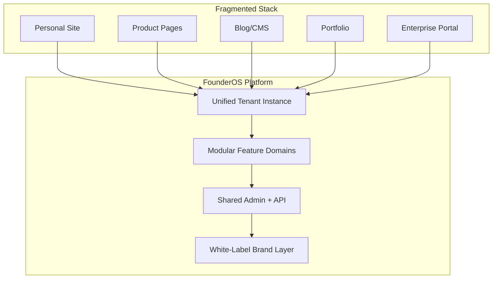
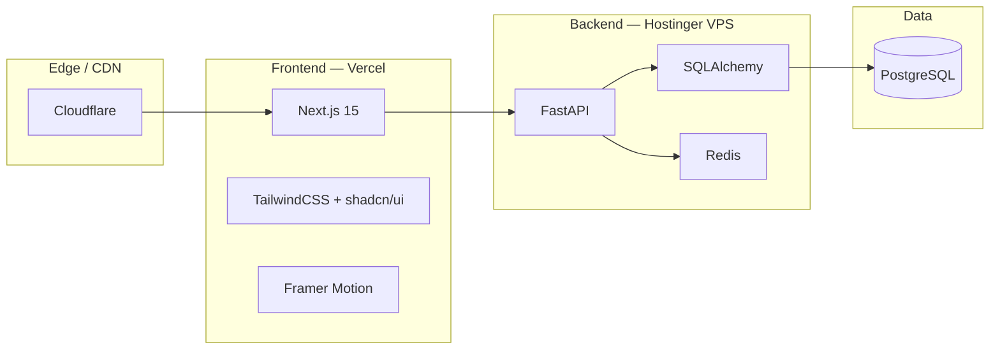

# FounderOS v1.0 — Project Vision

| Field | Value |
|-------|-------|
| **Document ID** | DOC-00-00 |
| **Product** | Founder Portfolio Platform (FounderOS) |
| **Version** | 1.0 |
| **Status** | Approved |
| **Last Updated** | 2026-06-29 |
| **Owner** | Product Leadership |
| **Related** | [Project Goals](01_Project_Goals.md) · [Mission](../01_Brand/Mission.md) · [Vision](../01_Brand/Vision.md) · [Product Strategy](06_Product_Strategy.md) |

---

## Purpose

This document defines the **north-star vision** for FounderOS v1.0 — a reusable, multi-tenant, white-label Founder Portfolio Platform. It establishes why the product exists, what problem it solves at the highest level, and how success is framed for founders, operators, and engineering teams building on the platform.

The vision serves as the **decision filter** for all product, design, and technical choices across the documentation suite. When trade-offs arise, teams should ask: *Does this move us closer to becoming the default digital operating system for founder-led brands?*

---

## Scope

### In Scope

| Area | Description |
|------|-------------|
| Strategic intent | Long-term product direction for v1.0 and v1.x |
| Problem definition | Market gap and opportunity framing |
| Value proposition | Benefits for tenants, end visitors, and operators |
| Platform boundaries | What FounderOS is and is not |
| Alignment artifacts | Links to goals, strategy, roadmap, and brand |

### Out of Scope

| Area | Description |
|------|-------------|
| Feature-level specs | Covered in [PRODUCT_REQUIREMENTS.md](../../PRODUCT_REQUIREMENTS.md) and module docs |
| Implementation details | Covered in architecture and API documentation |
| Pricing tables | Covered in [Business Model](05_Business_Model.md) |
| Sprint-level delivery | Covered in [Roadmap](07_Roadmap.md) |

---

## Business Context

### Market Landscape

Founders, SaaS companies, AI startups, agencies, and creators need a **credible digital presence** that goes beyond a static landing page. Today they stitch together:

- Personal websites (Webflow, Framer, WordPress)
- Product marketing sites (separate CMS)
- Blog and content (Ghost, Substack)
- Portfolio and case studies (Notion, Behance)
- Enterprise acquisition pages (custom one-offs)
- Analytics and SEO tooling (fragmented)

This fragmentation creates **brand inconsistency**, **operational overhead**, and **missed conversion opportunities** — especially when investors, enterprise buyers, or press evaluate a founder in a single session.

### Opportunity

FounderOS consolidates founder branding, product showcase, portfolio, CMS, blog, travel/creator tools, media library, AI product showcase, enterprise acquisition portal, contact management, analytics, SEO, and administration into **one modular, white-label platform**.

### Strategic Positioning

FounderOS is positioned as a **commercial SaaS product** and **licensable platform**, not a one-off personal website. The reference implementation (Soumen Karmakar portfolio) validates the product; the documentation enables any team to deploy independent tenant instances.

**Primary buyers:** Startup founders, SaaS companies, AI companies, entrepreneurs, consultants, agencies.

**Secondary buyers:** Creators, travel bloggers, YouTubers, product designers, software engineers.

---

## Goals

| # | Goal | Success Indicator |
|---|------|-------------------|
| G1 | Become the default digital identity layer for founder-led brands | Tenant NPS ≥ 50; repeat deployments via agencies |
| G2 | Ship v1.0 as implementation-ready, not discovery-dependent | Zero blocking discovery sessions for engineering |
| G3 | Enable white-label deployment with branding/content changes only | New tenant live in &lt; 2 weeks (config-only) |
| G4 | Establish modular boundaries for independent licensing | Each module documented with API + acceptance criteria |
| G5 | Prepare multi-tenant SaaS commercialization path | Tenant isolation and billing hooks documented |

---

## Functional Requirements

| ID | Requirement | Priority |
|----|-------------|----------|
| FR-V-01 | Platform must support full founder digital identity: home, about, products, portfolio, case studies, blog, contact, enterprise | Must |
| FR-V-02 | Platform must be deployable as independent white-label tenant instances | Must |
| FR-V-03 | Admin must manage all public content without code changes | Must |
| FR-V-04 | Modules (blog, portfolio, products, travel, open-source, testimonials, legal) must be independently enableable | Should |
| FR-V-05 | Enterprise acquisition portal must support structured inquiry workflows | Must |
| FR-V-06 | SEO, analytics, and social metadata must be first-class | Must |
| FR-V-07 | Platform must expose REST API for headless and integration use cases | Should |
| FR-V-08 | Documentation must be sufficient for third-party implementation teams | Must |

---

## Non-functional Requirements

| ID | Requirement | Target |
|----|-------------|--------|
| NFR-V-01 | Public pages LCP | &lt; 2.5s on 4G |
| NFR-V-02 | API p95 latency | &lt; 200ms (cached reads) |
| NFR-V-03 | Uptime (production tenant) | 99.9% |
| NFR-V-04 | Accessibility | WCAG 2.1 AA |
| NFR-V-05 | Security baseline | OWASP Top 10 mitigations documented |
| NFR-V-06 | Documentation completeness | All required sections per doc standard |
| NFR-V-07 | White-label theming | CSS variables + config; no fork required |
| NFR-V-08 | Horizontal scale path | Stateless API + Redis cache + CDN |

---

## User Stories

### Tenant / Founder

| ID | Story | Acceptance |
|----|-------|------------|
| US-V-01 | As a **founder**, I want one platform for my brand, products, and content so that visitors perceive a cohesive professional identity | Single domain, unified nav, consistent design tokens |
| US-V-02 | As a **SaaS CEO**, I want an enterprise acquisition page so that strategic buyers can initiate structured conversations | Enterprise form, CRM webhook, admin visibility |
| US-V-03 | As an **agency operator**, I want to clone and rebrand the platform for clients so that I can deliver faster than custom builds | White-label config, brand docs, deployment guide |

### End Visitor

| ID | Story | Acceptance |
|----|-------|------------|
| US-V-04 | As a **prospective investor**, I want to understand the founder, products, and traction in one session | Home → About → Products → Case Studies flow |
| US-V-05 | As an **enterprise buyer**, I want clear product positioning and a trustworthy contact path | Enterprise page, legal pages, testimonials |

### Engineering / Operations

| ID | Story | Acceptance |
|----|-------|------------|
| US-V-06 | As a **backend engineer**, I want clear API contracts so that I can implement without ambiguity | OpenAPI-aligned docs in 08_API |
| US-V-07 | As a **DevOps engineer**, I want Docker + Cloudflare + Vercel deployment paths documented | 13_Deployment suite complete |

---

## UX Requirements

| ID | Requirement | Rationale |
|----|-------------|-----------|
| UX-V-01 | First impression within 3 seconds: who, what, why | Founder credibility is time-boxed |
| UX-V-02 | Navigation must reflect tenant-enabled modules only | Avoid empty or broken routes |
| UX-V-03 | Mobile-first responsive layouts on all public pages | Majority traffic is mobile/social referral |
| UX-V-04 | Motion must enhance, not distract (see [Motion Guidelines](../01_Brand/Motion_Guidelines.md)) | Premium feel without performance cost |
| UX-V-05 | Forms must provide clear validation and success states | Conversion-critical paths |
| UX-V-06 | Dark/light theme support via design tokens | Brand flexibility + accessibility |
| UX-V-07 | Consistent page templates: hero, section, CTA, footer | White-label predictability |

---

## Technical Considerations

### Architecture Summary

| Consideration | Approach |
|---------------|----------|
| Frontend hosting | Vercel for Next.js 15 SSR/ISR and edge caching |
| API hosting | FastAPI on Hostinger VPS via Docker |
| Database | PostgreSQL 16 with SQLAlchemy ORM |
| Caching | Redis for session, rate limit, hot reads |
| Multi-tenancy (v1.x) | Single-tenant per deployment; schema hooks for future |
| Content delivery | ISR for blog/products; static for legal |
| Observability | Structured logging, health endpoints, analytics integration |

### Technology Stack

| Layer | Technology |
|-------|------------|
| Frontend | Next.js 15, TypeScript, TailwindCSS, shadcn/ui, Framer Motion |
| Backend | FastAPI, PostgreSQL, SQLAlchemy, Redis |
| Infrastructure | Docker, Cloudflare, Vercel, Hostinger VPS |

---

## Security Considerations

| Control | Requirement |
|---------|-------------|
| Authentication | JWT-based admin auth; bcrypt password hashing |
| Authorization | Role-based admin access (admin, editor) |
| Transport | TLS everywhere; HSTS via Cloudflare |
| Input validation | Pydantic schemas server-side; Zod client-side |
| Rate limiting | Redis-backed limits on contact/enterprise forms |
| Secrets | Environment variables; no secrets in repo |
| CORS | Strict origin allowlist per tenant |
| Content security | CSP headers; sanitized rich text in CMS |
| Dependency hygiene | Regular audit in CI pipeline |

See [Security Architecture](../04_Architecture/Security_Architecture.md) for full control matrix.

---

## Assumptions

| ID | Assumption |
|----|------------|
| A-V-01 | v1.0 ships as single-tenant per deployment; multi-tenant SaaS is v1.x |
| A-V-02 | Reference tenant content validates modules; not all modules required per tenant |
| A-V-03 | English is primary locale; i18n is future enhancement |
| A-V-04 | Admin users are trusted; public site is read-heavy |
| A-V-05 | Cloudflare handles DNS, SSL, and DDoS for production tenants |

---

## Risks

| Risk | Impact | Mitigation |
|------|--------|------------|
| Scope creep across modules | High | Modular boundaries; MVP per module in roadmap |
| White-label insufficient without code | Medium | Theme tokens, config schema, brand docs |
| Performance on VPS under load | Medium | Redis cache, CDN, horizontal API scaling path |
| Documentation drift from implementation | High | CHANGELOG, doc ownership, acceptance checklists |
| Security on public forms | High | Rate limiting, CAPTCHA option, input sanitization |

---

## Dependencies

| Dependency | Type | Notes |
|------------|------|-------|
| [Project Goals](01_Project_Goals.md) | Internal | Tactical decomposition of vision |
| [Product Strategy](06_Product_Strategy.md) | Internal | Go-to-market alignment |
| [Brand Guidelines](../01_Brand/Brand_Guidelines.md) | Internal | Visual and voice consistency |
| Vercel | External | Frontend hosting |
| Hostinger VPS | External | API and database hosting |
| Cloudflare | External | DNS, CDN, security |
| PostgreSQL 16 | External | Primary datastore |
| Redis | External | Cache and rate limiting |

---

## Glossary

| Term | Definition |
|------|------------|
| **FounderOS** | Codename for the Founder Portfolio Platform |
| **Tenant** | A white-label deployment instance (one founder/company) |
| **Module** | Self-contained feature domain (Blog, Portfolio, Products, etc.) |
| **White-label** | Deployment with branding, theme, and content changes only |
| **Acquisition Portal** | Enterprise-facing page for M&A and partnership inquiries |
| **Digital identity layer** | Unified public presence spanning brand, product, and content |

---

## Acceptance Criteria

- [ ] Vision statement is actionable and referenced in product decisions
- [ ] All functional and non-functional requirements trace to roadmap items
- [ ] User stories cover tenant, visitor, and engineering personas
- [ ] Architecture diagram aligns with deployment documentation
- [ ] Security baseline references detailed security docs
- [ ] Cross-links to goals, strategy, brand, and roadmap are valid
- [ ] Assumptions and risks are reviewed quarterly

---

## Future Enhancements

| Enhancement | Target Phase | Notes |
|-------------|--------------|-------|
| Multi-tenant SaaS control plane | v1.x | Central tenant provisioning and billing |
| AI-assisted content generation | v1.2 | Draft blog posts, product descriptions |
| Marketplace for modules | v2.0 | Third-party module licensing |
| Native mobile admin app | v2.x | Content management on mobile |
| Advanced analytics dashboard | v1.1 | Funnel, attribution, A/B testing |
| Internationalization (i18n) | v1.2 | Locale routing and CMS translations |

---

## Open Questions

| # | Question | Owner | Status |
|---|----------|-------|--------|
| OQ-V-01 | Should v1.0 include a visual site builder or config-only theming? | Product | Open — config-only for v1.0 |
| OQ-V-02 | What is the minimum module set for "Founder Lite" SKU? | Product | Open |
| OQ-V-03 | Is headless-only mode a v1.0 requirement or v1.1? | Engineering | Leaning v1.1 |
| OQ-V-04 | Agency reseller portal in v1.0 or v1.x? | Business | Leaning v1.x |

---

## Related Documents

| Document | Relationship |
|----------|--------------|
| [01_Project_Goals](01_Project_Goals.md) | Tactical goals derived from this vision |
| [02_Target_Audience](02_Target_Audience.md) | Audience segmentation |
| [03_User_Personas](03_User_Personas.md) | Detailed persona profiles |
| [05_Business_Model](05_Business_Model.md) | Commercial model |
| [06_Product_Strategy](06_Product_Strategy.md) | Product-market fit strategy |
| [07_Roadmap](07_Roadmap.md) | Delivery timeline |
| [Mission](../01_Brand/Mission.md) | Brand mission statement |
| [Vision](../01_Brand/Vision.md) | Brand vision statement |
| [PRODUCT_REQUIREMENTS.md](../../PRODUCT_REQUIREMENTS.md) | Feature-level PRD |

---

*Documentation © FounderOS v1.0. Implementation rights subject to product licensing terms.*
