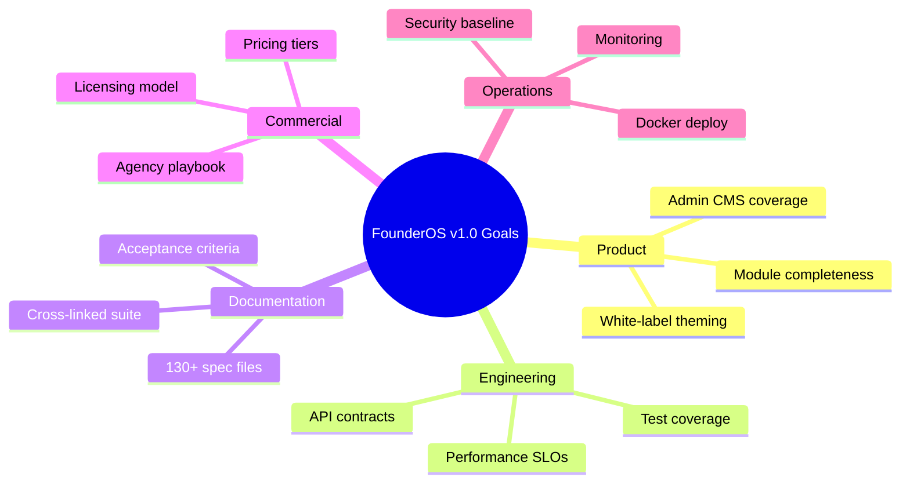
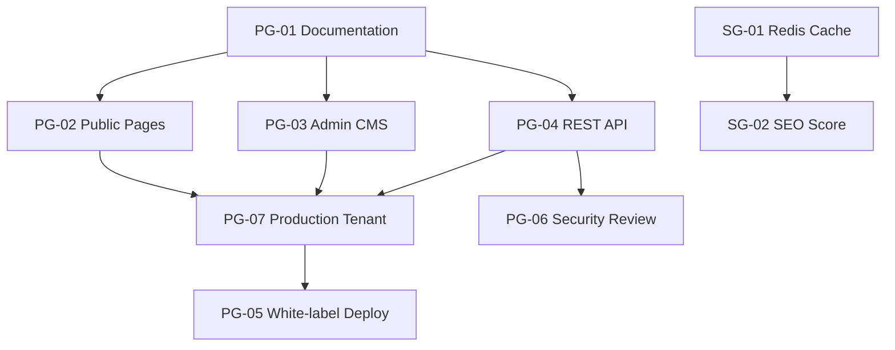

# FounderOS v1.0 — Project Goals

| Field | Value |
|-------|-------|
| **Document ID** | DOC-00-01 |
| **Product** | Founder Portfolio Platform (FounderOS) |
| **Version** | 1.0 |
| **Status** | Approved |
| **Last Updated** | 2026-06-29 |
| **Owner** | Product Leadership |
| **Related** | [Project Vision](00_Project_Vision.md) · [Roadmap](07_Roadmap.md) · [KPIs](08_KPIs.md) · [Success Metrics](09_Success_Metrics.md) |

---

## Purpose

This document translates the [Project Vision](00_Project_Vision.md) into **measurable, time-bound project goals** for FounderOS v1.0. Goals define what "done" means for documentation, platform capabilities, commercial readiness, and operational excellence.

Goals are organized by domain (Product, Engineering, Documentation, Commercial, Operations) and mapped to KPIs in [08_KPIs](08_KPIs.md) and success metrics in [09_Success_Metrics](09_Success_Metrics.md).

---

## Scope

### In Scope

- v1.0 delivery goals across all platform domains
- Documentation completeness targets
- Quality and performance benchmarks
- Commercial readiness criteria
- Cross-functional ownership assignments

### Out of Scope

- v2.0+ strategic initiatives (see [Roadmap](07_Roadmap.md))
- Individual sprint backlog items
- Hiring and organizational goals

---

## Business Context

FounderOS v1.0 is the **foundational release** that proves the platform is:

1. **Buildable** — An engineering team can implement from docs alone
2. **Deployable** — Docker + Cloudflare + Vercel + VPS path is documented
3. **Sellable** — Business model, licensing, and white-label paths exist
4. **Operable** — Security, testing, monitoring, and runbooks are defined

Without explicit goals, teams risk shipping a reference site instead of a **reusable product platform**.

---

## Goals

### Primary Goals (v1.0 Must-Have)

| ID | Goal | Owner | Target Date |
|----|------|-------|-------------|
| PG-01 | Complete implementation-ready documentation suite | Product + Eng | Q3 2026 |
| PG-02 | Deliver all core public pages with acceptance criteria | Product + Design | Q3 2026 |
| PG-03 | Deliver admin CMS for all editable content types | Engineering | Q3 2026 |
| PG-04 | Ship REST API with authentication and CRUD for all modules | Engineering | Q3 2026 |
| PG-05 | Achieve white-label deployment in &lt; 2 weeks (config-only) | DevOps + Product | Q4 2026 |
| PG-06 | Pass security review against documented control matrix | Security | Q3 2026 |
| PG-07 | Reference tenant (Soumen Karmakar) live in production | DevOps | Q3 2026 |

### Secondary Goals (v1.0 Should-Have)

| ID | Goal | Owner | Target Date |
|----|------|-------|-------------|
| SG-01 | Redis caching layer for hot API reads | Engineering | Q3 2026 |
| SG-02 | SEO score ≥ 90 on Lighthouse for core pages | Frontend | Q3 2026 |
| SG-03 | Agency deployment playbook published | Product | Q4 2026 |
| SG-04 | Module enable/disable per tenant via config | Engineering | Q4 2026 |
| SG-05 | Analytics integration (GA4 / Plausible) documented | Product | Q3 2026 |

### Stretch Goals (v1.0 Nice-to-Have)

| ID | Goal | Owner | Target Date |
|----|------|-------|-------------|
| ST-01 | Headless API-only deployment mode | Engineering | Q4 2026 |
| ST-02 | Automated visual regression tests | QA | Q4 2026 |
| ST-03 | Starter templates for 3 verticals (SaaS, Agency, Creator) | Design | Q4 2026 |

---

## Functional Requirements

| ID | Requirement | Maps To |
|----|-------------|---------|
| FR-G-01 | Every public page documented in 05_Pages with acceptance criteria | PG-02 |
| FR-G-02 | Every module documented in 06_Modules with API surface | PG-03, PG-04 |
| FR-G-03 | Admin panel documented in 07_Admin with role matrix | PG-03 |
| FR-G-04 | Database schema documented with ERD in 09_Database | PG-04 |
| FR-G-05 | Deployment runbooks for Docker, Vercel, VPS, Cloudflare | PG-05, PG-07 |
| FR-G-06 | Test strategy with coverage targets in 12_Testing | PG-06 |
| FR-G-07 | Brand system complete in 01_Brand for white-label | PG-05 |
| FR-G-08 | Business licensing terms in 05_Business_Model | Commercial readiness |

---

## Non-functional Requirements

| ID | Requirement | Target | Maps To |
|----|-------------|--------|---------|
| NFR-G-01 | Documentation files cross-linked with zero broken links | 100% | PG-01 |
| NFR-G-02 | Each doc contains all required sections per standard | 100% | PG-01 |
| NFR-G-03 | Public page LCP | &lt; 2.5s | SG-02 |
| NFR-G-04 | API test coverage (backend) | ≥ 80% | PG-04 |
| NFR-G-05 | Frontend E2E coverage (critical paths) | ≥ 90% | PG-02 |
| NFR-G-06 | Mean time to deploy new tenant | &lt; 2 weeks | PG-05 |
| NFR-G-07 | Security vulnerabilities (critical/high) in production | 0 | PG-06 |
| NFR-G-08 | Uptime SLO | 99.9% | PG-07 |

---

## User Stories

### Product Manager

| ID | Story | Goal |
|----|-------|------|
| US-G-01 | As a **PM**, I want every feature traced from vision → goal → requirement → acceptance criteria so that scope is auditable | PG-01 |
| US-G-02 | As a **PM**, I want a roadmap with dependencies so that I can communicate delivery dates | PG-01 |

### Engineering Lead

| ID | Story | Goal |
|----|-------|------|
| US-G-03 | As an **eng lead**, I want API contracts before implementation so that frontend and backend can parallelize | PG-04 |
| US-G-04 | As an **eng lead**, I want performance budgets documented so that we don't ship slow pages | SG-02 |

### Agency Partner

| ID | Story | Goal |
|----|-------|------|
| US-G-05 | As an **agency**, I want a white-label checklist so that I can onboard a client in under two weeks | PG-05, SG-03 |

### Founder / Tenant

| ID | Story | Goal |
|----|-------|------|
| US-G-06 | As a **founder**, I want to edit all site content without a developer so that I can iterate my brand quickly | PG-03 |
| US-G-07 | As a **founder**, I want my site live with SSL and CDN so that I appear professional to investors | PG-07 |

---

## UX Requirements

| ID | Requirement | Goal Alignment |
|----|-------------|----------------|
| UX-G-01 | Design system tokens documented for white-label override | PG-05 |
| UX-G-02 | All forms meet accessibility and error-state standards | PG-02 |
| UX-G-03 | Admin UX documented with wireframe-level flows | PG-03 |
| UX-G-04 | Mobile navigation tested on iOS Safari and Chrome Android | PG-02 |
| UX-G-05 | Page load skeleton states for async content | SG-02 |
| UX-G-06 | Consistent CTA patterns across all conversion pages | PG-02 |

---

## Technical Considerations

### Goal Dependency Graph

### Engineering Milestones

| Milestone | Deliverable | Goals |
|-----------|-------------|-------|
| M1 — Foundation | Docker compose, DB schema, auth | PG-04, PG-06 |
| M2 — Content API | CRUD for products, blog, portfolio, case studies | PG-03, PG-04 |
| M3 — Public Frontend | All 05_Pages implemented | PG-02 |
| M4 — Admin Panel | 07_Admin implemented | PG-03 |
| M5 — Production | Cloudflare + Vercel + VPS live | PG-07 |
| M6 — White-label | Config schema + brand override | PG-05 |

### Technology Alignment

| Goal | Technology |
|------|------------|
| PG-02, PG-03 | Next.js 15, TypeScript, TailwindCSS, shadcn/ui |
| PG-04 | FastAPI, SQLAlchemy, PostgreSQL, Redis |
| PG-05, PG-07 | Docker, Cloudflare, Vercel, Hostinger VPS |
| SG-02 | Next.js ISR, Cloudflare CDN |
| UX-G-01 | Design tokens in globals.css + config |

---

## Security Considerations

| Goal | Security Requirement |
|------|---------------------|
| PG-06 | OWASP Top 10 mitigations documented and verified |
| PG-04 | JWT auth, RBAC, input validation on all endpoints |
| PG-07 | TLS, HSTS, CSP headers in production |
| PG-03 | Admin session timeout, audit log for content changes |
| PG-05 | Secrets management guide for multi-tenant deployments |

---

## Assumptions

| ID | Assumption |
|----|------------|
| A-G-01 | Core team can dedicate full-time to v1.0 through Q3 2026 |
| A-G-02 | Reference tenant content is available for validation |
| A-G-03 | Hostinger VPS meets initial traffic; scale path documented |
| A-G-04 | No PCI scope in v1.0 (no payment processing on platform) |
| A-G-05 | Goals reviewed bi-weekly in product sync |

---

## Risks

| Risk | Affected Goals | Mitigation |
|------|----------------|------------|
| Documentation volume delays implementation | PG-01 | Prioritize docs for M1–M3 milestones first |
| Admin scope exceeds v1.0 | PG-03 | MVP admin: CRUD + publish; advanced workflows v1.1 |
| VPS single point of failure | PG-07 | Document failover and backup procedures |
| White-label gaps require code forks | PG-05 | Enforce config-only theming in design reviews |
| Security review finds critical issues late | PG-06 | Security review at M2, not M5 |

---

## Dependencies

| Dependency | Goals Affected |
|------------|----------------|
| [00_Project_Vision](00_Project_Vision.md) | All — vision is parent |
| [07_Roadmap](07_Roadmap.md) | PG-01 through PG-07 — timeline |
| [08_KPIs](08_KPIs.md) | All — measurement |
| [Brand Guidelines](../01_Brand/Brand_Guidelines.md) | PG-05, SG-03 |
| [Deployment Architecture](../04_Architecture/Deployment_Architecture.md) | PG-05, PG-07 |
| External: Vercel, Hostinger, Cloudflare | PG-07 |

---

## Glossary

| Term | Definition |
|------|------------|
| **Primary Goal** | Must-have for v1.0 release |
| **Secondary Goal** | Should-have; may slip to v1.0.1 |
| **Stretch Goal** | Nice-to-have; not release-blocking |
| **Milestone** | Engineering delivery checkpoint |
| **White-label deploy** | New tenant without application code changes |

---

## Acceptance Criteria

### Documentation Goals (PG-01)

- [ ] All directories in README structure populated
- [ ] Every document includes required sections per standard
- [ ] Cross-links validated (no 404s within docs)
- [ ] CHANGELOG updated for each doc batch

### Product Goals (PG-02, PG-03)

- [ ] All pages in 05_Pages have acceptance criteria checklists
- [ ] Admin can CRUD all content types without code deploy
- [ ] Module enable/disable works via tenant config

### Engineering Goals (PG-04, PG-06)

- [ ] OpenAPI spec generated and matches 08_API docs
- [ ] Backend test coverage ≥ 80%
- [ ] Security control matrix signed off

### Operations Goals (PG-05, PG-07)

- [ ] Reference tenant accessible via production URL with SSL
- [ ] New tenant deployment completed in &lt; 2 weeks using playbook
- [ ] Monitoring and alerting configured

### Commercial Goals

- [ ] Licensing tiers documented in [05_Business_Model](05_Business_Model.md)
- [ ] Agency playbook published (SG-03)

---

## Future Enhancements

| Enhancement | Related Goal | Phase |
|-------------|--------------|-------|
| Multi-tenant control plane | PG-05 evolution | v1.x |
| Automated tenant provisioning | PG-05 | v1.1 |
| Self-serve signup and billing | Commercial | v1.2 |
| AI content assistant in admin | PG-03 | v1.2 |
| Performance budget CI gate | SG-02 | v1.1 |

---

## Open Questions

| # | Question | Impact | Status |
|---|----------|--------|--------|
| OQ-G-01 | Is 80% backend coverage the right bar for v1.0? | PG-04 | Open |
| OQ-G-02 | Should PG-07 require staging environment or prod-only? | PG-07 | Leaning staging + prod |
| OQ-G-03 | Agency playbook: PDF export or docs-only? | SG-03 | Open |
| OQ-G-04 | Module disable: 404 or hidden nav only? | SG-04 | Open |

---

## Related Documents

| Document | Relationship |
|----------|--------------|
| [00_Project_Vision](00_Project_Vision.md) | Parent vision document |
| [07_Roadmap](07_Roadmap.md) | Timeline for goal delivery |
| [08_KPIs](08_KPIs.md) | Quantitative goal measurement |
| [09_Success_Metrics](09_Success_Metrics.md) | Qualitative and business success |
| [06_Product_Strategy](06_Product_Strategy.md) | Strategic context for goals |
| [PROJECT_SCOPE.md](../../PROJECT_SCOPE.md) | Scope boundaries |

---

*Documentation © FounderOS v1.0.*
