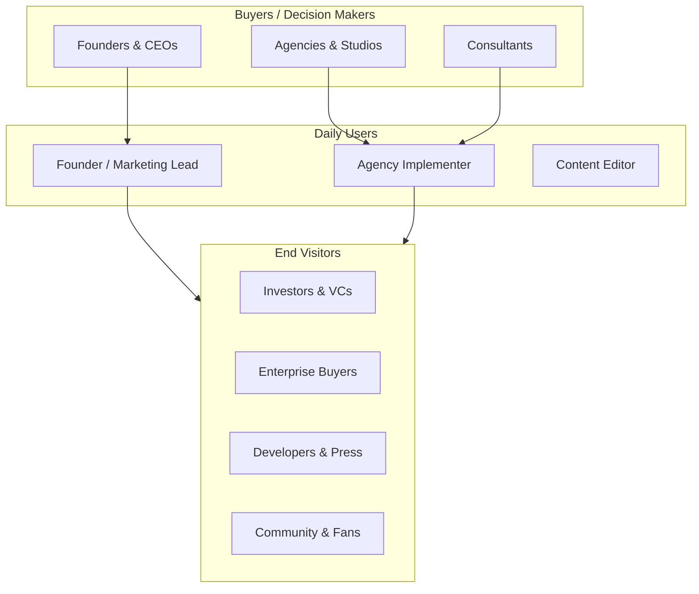

# FounderOS v1.0 — Target Audience

| Field | Value |
|-------|-------|
| **Document ID** | DOC-00-02 |
| **Product** | Founder Portfolio Platform (FounderOS) |
| **Version** | 1.0 |
| **Status** | Approved |
| **Last Updated** | 2026-06-29 |
| **Owner** | Product Marketing |
| **Related** | [User Personas](03_User_Personas.md) · [User Journey](04_User_Journey.md) · [Business Model](05_Business_Model.md) · [Brand Positioning](../01_Brand/Brand_Positioning.md) |

---

## Purpose

This document defines the **target audience segments** for FounderOS v1.0 — who we build for, who buys, who uses, and who influences purchase decisions. Audience definition drives feature prioritization, messaging in [Brand Voice](../01_Brand/Brand_Voice.md), UX flows in [User Journey](04_User_Journey.md), and commercial packaging in [Business Model](05_Business_Model.md).

---

## Scope

### In Scope

- Primary and secondary audience segments
- Buyer vs. user vs. influencer mapping
- Segment needs, pain points, and willingness to pay
- Geographic and firmographic filters
- Anti-personas (who we do not target in v1.0)

### Out of Scope

- Detailed persona narratives (see [03_User_Personas](03_User_Personas.md))
- Competitive battlecards
- Paid acquisition channel strategy

---

## Business Context

FounderOS is a **B2B2C platform**: agencies and consultants resell to founders; founders serve end visitors (investors, customers, press). Understanding this three-layer audience prevents building features only for one layer.

### Market Sizing (Directional)

| Segment | TAM Estimate | SAM (v1.0) | SOM (Year 1) |
|---------|--------------|------------|--------------|
| Startup founders (global) | 100M+ | 500K (tech-enabled) | 500 tenants |
| SaaS / AI companies | 30K+ new/year | 10K (need product pages) | 100 tenants |
| Digital agencies | 50K+ globally | 5K (white-label capable) | 50 partners |
| Creators / consultants | 50M+ | 1M (professional tier) | 200 tenants |

*Estimates are directional for planning; not audited market research.*

---

## Goals

| # | Goal | Metric |
|---|------|--------|
| G1 | Prioritize features for primary segments | 80% of v1.0 scope serves primary |
| G2 | Enable agency resale channel | Agency playbook + white-label in v1.0 |
| G3 | Optimize conversion paths for investor and enterprise visitors | Enterprise portal + case studies |
| G4 | Avoid scope dilution from anti-personas | Explicit out-of-scope segments |

---

## Audience Segments

### Tier 1 — Primary Audience (Build & Sell First)

| Segment | Description | Key Pain | FounderOS Value |
|---------|-------------|----------|-----------------|
| **Tech Founders** | Solo or small-team founders building SaaS, AI, or dev tools | Fragmented web stack; no time to maintain | One platform: brand + product + blog + enterprise |
| **SaaS CEOs** | Seed to Series B companies needing credible product marketing | Separate marketing site + docs + blog | Unified product showcase + case studies + acquisition |
| **AI Company Founders** | LLM/app startups needing trust and demo surfaces | Fast-moving product; site lags releases | CMS + product module + AI showcase |
| **Agencies & Studios** | Web/dev agencies serving founder clients | Custom builds are slow and unprofitable | White-label platform; deploy in weeks |
| **Entrepreneur Consultants** | Coaches, advisors with personal brand + offerings | LinkedIn-only presence insufficient | Professional portfolio + contact + testimonials |

### Tier 2 — Secondary Audience (Support in v1.0, Expand in v1.x)

| Segment | Description | Key Pain | FounderOS Value |
|---------|-------------|----------|-----------------|
| **Travel Creators** | Bloggers, YouTubers with travel content | Generic blogs lack map/media features | Travel module + media library |
| **Open Source Maintainers** | Engineers with OSS projects needing visibility | GitHub profile ≠ marketing site | Open-source module + portfolio |
| **Product Designers** | Designers showcasing case studies | Behance/Dribbble lack ownership | Portfolio + case study templates |
| **Software Engineers** | Senior engineers building personal brand | Resume sites are static | Dynamic portfolio + blog + products |

### Tier 3 — Influencers (Do Not Build For Directly)

| Segment | Role | Engagement |
|---------|------|------------|
| **VCs & Angels** | Evaluate founders via site | End visitors; inform enterprise + about pages |
| **Enterprise Procurement** | Evaluate vendors | End visitors; inform enterprise portal |
| **Tech Press** | Cover launches | End visitors; inform press kit (future) |
| **Developer Community** | Discover tools | End visitors; inform open-source module |

### Anti-Personas (v1.0 Out of Scope)

| Anti-Persona | Reason |
|--------------|--------|
| Large enterprise marketing teams (50+ users) | Need enterprise CMS (Contentful-scale); not v1.0 |
| E-commerce merchants | Need cart/checkout; different product category |
| Local SMB (restaurants, salons) | Need bookings/maps; not founder-focused |
| Hobby bloggers | Price-sensitive; Substack/Ghost sufficient |
| Non-technical users wanting drag-drop builder | v1.0 is config + admin, not Webflow competitor |

---

## Functional Requirements

| ID | Requirement | Segment |
|----|-------------|---------|
| FR-TA-01 | Product showcase with features, pricing hints, CTAs | SaaS CEOs, AI Founders |
| FR-TA-02 | Case study templates with metrics and outcomes | Tech Founders, Agencies |
| FR-TA-03 | Enterprise acquisition portal with structured forms | SaaS CEOs, Enterprise Buyers |
| FR-TA-04 | Blog with categories, tags, SEO | All primary |
| FR-TA-05 | Portfolio / project gallery | Designers, Engineers |
| FR-TA-06 | Travel content with destinations and media | Travel Creators |
| FR-TA-07 | Open-source project listings with GitHub integration | OSS Maintainers |
| FR-TA-08 | Testimonials and social proof module | Consultants, Agencies |
| FR-TA-09 | White-label branding via config (no code fork) | Agencies |
| FR-TA-10 | Admin CMS for non-technical content editors | Founders, Marketing Leads |

---

## Non-functional Requirements

| ID | Requirement | Segment Rationale |
|----|-------------|-------------------|
| NFR-TA-01 | Professional visual quality (premium, not template-y) | Founders judged by site quality |
| NFR-TA-02 | Fast load on mobile (social referral traffic) | Creators, community visitors |
| NFR-TA-03 | SEO optimized for founder name + product keywords | All primary |
| NFR-TA-04 | Accessibility WCAG 2.1 AA | Enterprise buyers, inclusivity |
| NFR-TA-05 | Deployable in &lt; 2 weeks for agencies | Agency channel |
| NFR-TA-06 | English-first; extensible for i18n | Global founders |

---

## User Stories

| ID | Story | Segment |
|----|-------|---------|
| US-TA-01 | As a **tech founder**, I want investors to understand my product in 60 seconds on my homepage | Tech Founders |
| US-TA-02 | As a **SaaS CEO**, I want enterprise buyers to request demos through a dedicated portal | SaaS CEOs |
| US-TA-03 | As an **agency**, I want to rebrand the platform for each client without forking code | Agencies |
| US-TA-04 | As a **travel creator**, I want to showcase destinations with photos and itineraries | Travel Creators |
| US-TA-05 | As an **OSS maintainer**, I want my projects listed with stars, docs links, and descriptions | OSS Maintainers |
| US-TA-06 | As a **consultant**, I want testimonials and case studies on one domain | Consultants |
| US-TA-07 | As a **VC**, I want to quickly find traction signals (products, case studies, blog) | Influencers |
| US-TA-08 | As a **marketing lead**, I want to publish blog posts without engineering | All primary |

---

## UX Requirements

| ID | Requirement | Audience |
|----|-------------|----------|
| UX-TA-01 | Homepage answers: Who are you? What do you build? Why trust you? | All visitors |
| UX-TA-02 | Navigation adapts to enabled modules per tenant | Agencies (multi-vertical) |
| UX-TA-03 | Enterprise page tone: formal, trustworthy, low-friction CTA | Enterprise Buyers |
| UX-TA-04 | Portfolio/case studies scannable with metrics | VCs, Enterprise |
| UX-TA-05 | Blog readable on mobile with share metadata | Community, Press |
| UX-TA-06 | Contact forms with role/intent selection | All conversion paths |
| UX-TA-07 | Admin UI approachable for non-technical editors | Marketing Leads |
| UX-TA-08 | Brand customization via documented token overrides | Agencies |

---

## Technical Considerations

| Consideration | Audience Impact |
|---------------|-----------------|
| Module enable/disable per tenant | Agencies deploy different configs per vertical |
| GitHub API integration | OSS Maintainers need live repo stats |
| Structured data (JSON-LD) | SEO for founder name and product discovery |
| Webhook integrations (CRM, Slack) | SaaS CEOs route enterprise leads |
| Media library with CDN | Travel Creators, Designers need rich media |
| Role-based admin (admin vs. editor) | Marketing teams with multiple editors |

### Segment → Module Matrix

| Module | Tech Founder | SaaS CEO | Agency | Creator | OSS | Designer |
|--------|:---:|:---:|:---:|:---:|:---:|:---:|
| Home / About | ✓ | ✓ | ✓ | ✓ | ✓ | ✓ |
| Products | ✓ | ✓ | ○ | ○ | ✓ | ○ |
| Portfolio | ✓ | ○ | ✓ | ○ | ✓ | ✓ |
| Case Studies | ✓ | ✓ | ✓ | ○ | ○ | ✓ |
| Blog | ✓ | ✓ | ✓ | ✓ | ✓ | ○ |
| Enterprise | ○ | ✓ | ○ | ○ | ○ | ○ |
| Travel | ○ | ○ | ○ | ✓ | ○ | ○ |
| Open Source | ✓ | ○ | ○ | ○ | ✓ | ○ |
| Testimonials | ✓ | ✓ | ✓ | ✓ | ○ | ✓ |
| Contact | ✓ | ✓ | ✓ | ✓ | ✓ | ✓ |

✓ = primary need · ○ = optional

---

## Security Considerations

| Concern | Audience | Mitigation |
|---------|----------|------------|
| Enterprise form spam | SaaS CEOs | Rate limiting, optional CAPTCHA |
| Admin access by non-technical users | Marketing Leads | Simple auth, session timeout, MFA future |
| PII in contact submissions | All | Encryption at rest, retention policy |
| Agency multi-tenant isolation (v1.x) | Agencies | Tenant-scoped data (future) |
| Public exposure of draft content | Editors | Publish workflow, preview tokens |

---

## Assumptions

| ID | Assumption |
|----|------------|
| A-TA-01 | Primary audience is English-speaking, globally distributed |
| A-TA-02 | Founders have budget $50–500/month for digital presence |
| A-TA-03 | Agencies charge clients $2K–20K for site deployment |
| A-TA-04 | Most founders are semi-technical (can follow deployment docs) |
| A-TA-05 | Travel and OSS modules are differentiators, not core revenue |

---

## Risks

| Risk | Impact | Mitigation |
|------|--------|------------|
| Building for too many segments | Scope creep | Tier 1 priority; module optional |
| Agency channel slow to adopt | Revenue miss | Agency playbook, partner pricing |
| Founders prefer no-code builders | Competitive loss | Position as premium, dev-friendly |
| Enterprise visitors need SOC2 badges | Deal loss | Document security; SOC2 in v1.x roadmap |
| Creator segment low willingness to pay | Low ROI | Secondary tier; don't over-invest |

---

## Dependencies

| Dependency | Notes |
|------------|-------|
| [03_User_Personas](03_User_Personas.md) | Persona depth per segment |
| [04_User_Journey](04_User_Journey.md) | Journey maps per segment |
| [05_Business_Model](05_Business_Model.md) | Pricing per segment |
| [Brand Positioning](../01_Brand/Brand_Positioning.md) | Messaging per segment |
| [06_Modules](../06_Modules/) | Feature mapping |

---

## Glossary

| Term | Definition |
|------|------------|
| **Primary audience** | Tier 1 segments that drive v1.0 prioritization |
| **Buyer** | Person who approves purchase or license |
| **User** | Person who operates admin or deploys platform |
| **End visitor** | Public site consumer (investor, customer, fan) |
| **Anti-persona** | Segment explicitly excluded from v1.0 scope |
| **Agency channel** | Resellers who white-label for clients |

---

## Acceptance Criteria

- [ ] All Tier 1 segments mapped to modules and pages
- [ ] Anti-personas documented and acknowledged in roadmap
- [ ] Segment → module matrix reviewed by product
- [ ] User stories exist for each Tier 1 segment
- [ ] Agency white-label path documented end-to-end
- [ ] Cross-links to personas, journey, and business model valid

---

## Future Enhancements

| Enhancement | Segment | Phase |
|-------------|---------|-------|
| Vertical starter kits (SaaS, Agency, Creator) | Agencies, Founders | v1.1 |
| Multi-language support | Global founders | v1.2 |
| Press kit / media page | Press influencers | v1.1 |
| Partner portal for agencies | Agencies | v1.x |
| Self-serve onboarding | Tech Founders | v1.2 |
| SOC2 / compliance badges | Enterprise Buyers | v1.x |

---

## Open Questions

| # | Question | Status |
|---|----------|--------|
| OQ-TA-01 | Should we market explicitly to AI companies or fold into SaaS? | Open — separate landing optional |
| OQ-TA-02 | Minimum viable agency partner count for Year 1? | Open — target 10 |
| OQ-TA-03 | Creator tier: separate SKU or module pack? | Open |
| OQ-TA-04 | Geographic focus: US/EU first or global day one? | Leaning global English |

---

## Related Documents

| Document | Relationship |
|----------|--------------|
| [03_User_Personas](03_User_Personas.md) | Detailed persona profiles |
| [04_User_Journey](04_User_Journey.md) | Journey maps |
| [05_Business_Model](05_Business_Model.md) | Monetization per segment |
| [06_Product_Strategy](06_Product_Strategy.md) | GTM alignment |
| [Brand Positioning](../01_Brand/Brand_Positioning.md) | Market positioning |

---

*Documentation © FounderOS v1.0.*
