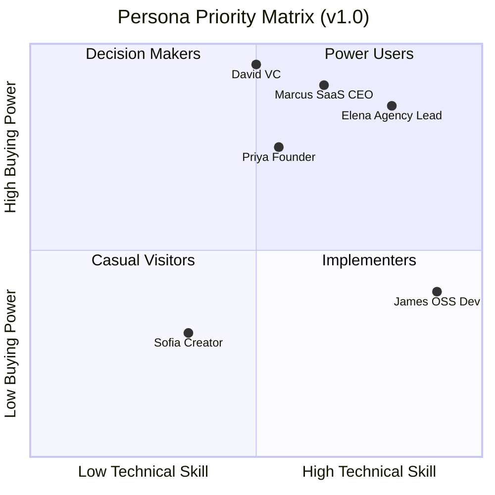

# FounderOS v1.0 — User Personas

| Field | Value |
|-------|-------|
| **Document ID** | DOC-00-03 |
| **Product** | Founder Portfolio Platform (FounderOS) |
| **Version** | 1.0 |
| **Status** | Approved |
| **Last Updated** | 2026-06-29 |
| **Owner** | Product Design |
| **Related** | [Target Audience](02_Target_Audience.md) · [User Journey](04_User_Journey.md) · [Brand Voice](../01_Brand/Brand_Voice.md) |

---

## Purpose

This document provides **research-backed user personas** for FounderOS v1.0. Personas humanize the [Target Audience](02_Target_Audience.md) segments and guide product, UX, content, and engineering decisions. Every feature should trace to at least one persona need.

---

## Scope

### In Scope

- Six primary personas (buyer/user layers)
- Two influencer personas (end visitor layer)
- Demographics, goals, frustrations, behaviors, tech comfort
- Persona → feature mapping
- Design and content implications

### Out of Scope

- Ethnographic research raw data
- Persona photography (use [Photography](../01_Brand/Photography.md) guidelines)
- HR/recruiting personas

---

## Business Context

FounderOS serves a **multi-sided market**. Personas represent the humans at each layer — not abstract "users." Product teams should reference personas in sprint planning, design reviews, and acceptance testing.

---

## Goals

| # | Goal |
|---|------|
| G1 | Every v1.0 module justified by ≥1 persona need |
| G2 | UX reviews reference persona scenarios |
| G3 | Content and brand voice aligned to persona expectations |
| G4 | Test scenarios derived from persona journeys |

---

## Persona Catalog

### Persona 1: Priya — The Tech Founder

| Attribute | Detail |
|-----------|--------|
| **Role** | Solo founder / technical CEO |
| **Age** | 28–38 |
| **Company** | Pre-seed to Seed SaaS or AI startup |
| **Location** | Bangalore, SF, London, remote |
| **Tech comfort** | High — can read docs, deploy Docker |
| **Budget** | $100–300/month for tools |
| **Buying trigger** | Fundraise prep, launch, investor meetings |

**Goals:**
- Look credible to investors in one site visit
- Showcase product without hiring a marketing team
- Publish technical blog posts to build authority
- Capture enterprise partnership inquiries

**Frustrations:**
- Spent weekends on Webflow instead of product
- Blog on Ghost, product page on Notion — brand feels fragmented
- No time to maintain separate analytics and SEO

**Behaviors:**
- Discovers tools via Twitter/X, Hacker News, founder communities
- Evaluates platforms by reading docs and viewing reference sites
- Prefers config-over-code; will customize CSS if needed

**FounderOS modules:** Home, About, Products, Blog, Case Studies, Enterprise, Contact, Open Source

**Quote:** *"I need one site that makes us look like a real company — not a side project."*

---

### Persona 2: Marcus — The SaaS CEO

| Attribute | Detail |
|-----------|--------|
| **Role** | CEO / Co-founder of B2B SaaS |
| **Age** | 32–45 |
| **Company** | Seed to Series B, 5–50 employees |
| **Tech comfort** | Medium — delegates engineering |
| **Budget** | $500–2K/month marketing stack |
| **Buying trigger** | Enterprise sales motion, rebrand, acquisition interest |

**Goals:**
- Convert website visitors to demo requests and enterprise leads
- Present case studies with measurable outcomes
- Maintain consistent brand across product marketing
- Enable marketing hire to manage content without dev bottleneck

**Frustrations:**
- Marketing site diverged from actual product
- Enterprise buyers ask for materials not on the website
- Agency rebuilds are expensive and slow

**Behaviors:**
- Buys through demo calls or agency recommendation
- Cares about conversion metrics and lead routing
- Needs admin access for marketing team

**FounderOS modules:** Products, Case Studies, Enterprise, Testimonials, Blog, Contact, Legal

**Quote:** *"When a Fortune 500 prospect visits our site, it can't look like a startup experiment."*

---

### Persona 3: Elena — The Agency Lead

| Attribute | Detail |
|-----------|--------|
| **Role** | Founder / Delivery Lead at digital agency |
| **Age** | 30–50 |
| **Company** | 5–30 person agency serving startups |
| **Tech comfort** | Very high — ships client projects weekly |
| **Budget** | Licenses platform; charges client $5K–25K |
| **Buying trigger** | Client needs founder site fast; margin pressure on custom builds |

**Goals:**
- Deploy client sites in 1–2 weeks, not 6–8
- White-label without exposing underlying platform
- Standardize delivery with repeatable playbook
- Upsell modules (blog, enterprise portal) per client

**Frustrations:**
- Every founder site is a custom Next.js project — unprofitable
- Clients want ongoing CMS access; handoff is messy
- Brand guidelines vary wildly per client

**Behaviors:**
- Evaluates white-label depth, deployment docs, API extensibility
- Buys platform license or per-deployment fee
- Trains junior devs on deployment playbook

**FounderOS modules:** All modules (config per client), Brand system, Deployment docs

**Quote:** *"I need a platform I can rebrand Monday and ship to a client by Friday."*

---

### Persona 4: James — The Open Source Developer

| Attribute | Detail |
|-----------|--------|
| **Role** | Senior engineer / OSS maintainer |
| **Age** | 25–40 |
| **Company** | Employed + side projects, or indie hacker |
| **Tech comfort** | Very high |
| **Budget** | $0–50/month (price-sensitive) |
| **Buying trigger** | Project traction, job search, conference speaking |

**Goals:**
- Showcase OSS projects with live GitHub stats
- Write technical blog posts
- Build personal brand for career or sponsorship
- Link portfolio to consulting availability

**Frustrations:**
- GitHub profile isn't a marketing site
- README badges don't tell a story
- Static resume sites feel outdated

**Behaviors:**
- Self-serves from docs; minimal support tolerance
- Values open APIs and self-hosting option
- Shares site on dev communities

**FounderOS modules:** Portfolio, Open Source, Blog, About, Contact, Media

**Quote:** *"My projects have 10K stars but my personal site looks like 2015."*

---

### Persona 5: Sofia — The Travel Creator

| Attribute | Detail |
|-----------|--------|
| **Role** | Travel blogger / YouTuber |
| **Age** | 24–35 |
| **Company** | Solo creator brand |
| **Tech comfort** | Low–medium |
| **Budget** | $30–100/month |
| **Buying trigger** | Sponsorship deals, audience growth, media kit needs |

**Goals:**
- Beautiful destination showcases with photos
- Blog with travel narratives and affiliate links
- Professional contact page for brand deals
- Social-proof testimonials from partners

**Frustrations:**
- WordPress themes look generic
- Instagram isn't owned media
- No single link for sponsors to evaluate her brand

**Behaviors:**
- Discovers via creator communities, Instagram, YouTube
- Needs simple admin; intimidated by Docker
- Cares deeply about visual aesthetics

**FounderOS modules:** Travel, Blog, Testimonials, About, Contact, Media Library

**Quote:** *"Brands Google me before offering deals — my site has to match my Instagram quality."*

---

### Persona 6: Rachel — The Marketing Editor

| Attribute | Detail |
|-----------|--------|
| **Role** | Marketing manager / content lead (works for Marcus or Priya) |
| **Age** | 26–40 |
| **Tech comfort** | Low — uses CMS, not code |
| **Budget** | N/A (employee) |
| **Buying trigger** | Hired to run content; needs tool access |

**Goals:**
- Publish and edit blog posts, case studies, product copy
- Preview before publish
- Upload images to media library
- Not break the site layout

**Frustrations:**
- Depends on engineering for every content change
- Previous CMS was either too complex or too limited
- Fear of publishing broken content

**Behaviors:**
- Uses admin daily; needs &lt; 30 min training
- Expects familiar patterns (WordPress-like)
- Rarely touches settings or theme

**FounderOS modules:** Admin CMS (all content types), Media Library

**Quote:** *"Just let me publish a blog post without filing a Jira ticket."*

---

### Influencer Persona 7: David — The VC Partner

| Attribute | Detail |
|-----------|--------|
| **Role** | Partner at early-stage VC |
| **Relationship** | End visitor evaluating founders |
| **Time on site** | 2–5 minutes |
| **Decision influence** | High — shapes founder credibility perception |

**Goals (as visitor):**
- Understand founder background and thesis
- See product traction signals (customers, case studies)
- Assess professionalism and attention to detail
- Find contact path if interested

**UX implications:** Scannable homepage, clear about, metrics in case studies, no broken links

---

### Influencer Persona 8: Corporate Buyer — Lisa

| Attribute | Detail |
|-----------|--------|
| **Role** | VP Procurement / Innovation at enterprise |
| **Relationship** | End visitor evaluating SaaS vendor |
| **Time on site** | 5–10 minutes |
| **Decision influence** | High — vendor shortlisting |

**Goals (as visitor):**
- Understand product fit and security posture
- Review case studies from similar companies
- Initiate structured inquiry (not generic contact form)
- Access legal/compliance pages

**UX implications:** Enterprise portal, testimonials, legal pages, professional tone

---

## Functional Requirements

| ID | Requirement | Persona |
|----|-------------|---------|
| FR-P-01 | One-click publish workflow in admin | Rachel |
| FR-P-02 | GitHub repo sync for OSS stats | James |
| FR-P-03 | Enterprise inquiry form with company fields | Marcus, Lisa |
| FR-P-04 | Travel destination pages with image galleries | Sofia |
| FR-P-05 | Tenant config for module enable/disable | Elena |
| FR-P-06 | Product pages with feature lists and CTAs | Priya, Marcus |
| FR-P-07 | Case study template with metrics block | Marcus, David |
| FR-P-08 | Preview URL for draft content | Rachel |
| FR-P-09 | Brand token override without code | Elena |
| FR-P-10 | Docker one-command local dev | Priya, James, Elena |

---

## Non-functional Requirements

| ID | Requirement | Persona |
|----|-------------|---------|
| NFR-P-01 | Admin learnable in &lt; 30 minutes | Rachel, Sofia |
| NFR-P-02 | Public site LCP &lt; 2.5s | David (impatient evaluator) |
| NFR-P-03 | Mobile-perfect layouts | Sofia, David |
| NFR-P-04 | Deployment docs readable by semi-technical founder | Priya |
| NFR-P-05 | White-label deploy &lt; 2 weeks | Elena |
| NFR-P-06 | Accessible forms and navigation | Lisa (enterprise compliance culture) |

---

## User Stories

| ID | Story | Persona |
|----|-------|---------|
| US-P-01 | As **Priya**, I want to deploy my site with Docker Compose so that I can go live this weekend | Priya |
| US-P-02 | As **Marcus**, I want marketing to publish case studies so that I don't bottleneck the team | Marcus, Rachel |
| US-P-03 | As **Elena**, I want to swap logos and colors via config so that each client looks unique | Elena |
| US-P-04 | As **James**, I want GitHub stars displayed on my OSS page so that visitors see traction | James |
| US-P-05 | As **Sofia**, I want a travel gallery page so that sponsors see my visual quality | Sofia |
| US-P-06 | As **Rachel**, I want to preview a blog post before publishing so that I don't ship typos | Rachel |
| US-P-07 | As **David**, I want to scan the homepage in 30 seconds so that I can decide if I'm interested | David |
| US-P-08 | As **Lisa**, I want an enterprise inquiry form so that I can initiate vendor evaluation formally | Lisa |

---

## UX Requirements

| ID | Requirement | Persona |
|----|-------------|---------|
| UX-P-01 | Homepage hero: name, one-liner, primary CTA | Priya, David |
| UX-P-02 | Admin: sidebar nav grouped by content type | Rachel |
| UX-P-03 | Admin: WYSIWYG or markdown editor for blog | Rachel, James |
| UX-P-04 | Enterprise page: distinct visual treatment (more formal) | Marcus, Lisa |
| UX-P-05 | Travel pages: image-forward, minimal text density | Sofia |
| UX-P-06 | OSS page: repo cards with language, stars, links | James |
| UX-P-07 | Error states in plain language (no stack traces) | Sofia, Rachel |
| UX-P-08 | Deployment wizard or checklist in docs | Elena, Priya |

---

## Technical Considerations

| Persona | Technical Need | Implementation |
|---------|----------------|----------------|
| Priya | Self-host option | Docker + VPS docs |
| Marcus | CRM webhook on enterprise form | FastAPI webhook endpoint |
| Elena | Multi-client config schema | Tenant YAML/JSON config |
| James | GitHub API | Integrations module |
| Sofia | Image optimization | Next.js Image + CDN |
| Rachel | Safe admin (no layout break) | Structured content fields, not free HTML everywhere |

---

## Security Considerations

| Persona | Concern | Control |
|---------|---------|---------|
| Rachel | Accidental publish of draft | Draft/published status, confirmation |
| Elena | Client data isolation (v1.x) | Tenant-scoped DB (future) |
| Marcus | Enterprise lead PII | Encrypted storage, access logging |
| Lisa | Vendor security evaluation | Security page, HTTPS, legal docs |
| James | API token exposure | Env-based secrets, no client-side keys |

---

## Assumptions

| ID | Assumption |
|----|------------|
| A-P-01 | Personas are composites from founder community patterns |
| A-P-02 | Rachel persona applies to any tenant with a marketing hire |
| A-P-03 | Sofia may need assisted deployment (agency or managed service) |
| A-P-04 | David and Lisa never use admin — public UX only |

---

## Risks

| Risk | Persona | Mitigation |
|------|---------|------------|
| Admin too complex for Rachel/Sofia | Rachel, Sofia | UX testing, simplified MVP admin |
| James churns on price | James | OSS tier or self-host only |
| Elena hits white-label limits | Elena | Brand token system, roadmap transparency |
| David bounces on slow site | David | Performance budgets |

---

## Dependencies

| Dependency | Notes |
|------------|-------|
| [02_Target_Audience](02_Target_Audience.md) | Segment definitions |
| [04_User_Journey](04_User_Journey.md) | Persona journey maps |
| [07_Admin](../07_Admin/) | Rachel persona primary surface |
| [01_Brand](../01_Brand/) | Elena, Sofia visual needs |

---

## Glossary

| Term | Definition |
|------|------------|
| **Buyer persona** | Decision maker who purchases or licenses |
| **User persona** | Daily operator of the platform |
| **Influencer persona** | End visitor who shapes outcomes |
| **Composite persona** | Amalgam of real user patterns, not one individual |

---

## Acceptance Criteria

- [ ] Six user personas + two influencer personas documented
- [ ] Each persona mapped to modules and user stories
- [ ] UX requirements trace to persona needs
- [ ] Sprint planning template references persona IDs
- [ ] QA test scenarios include David (2-min scan) and Rachel (publish flow)

---

## Future Enhancements

| Enhancement | Persona | Phase |
|-------------|---------|-------|
| Onboarding wizard tuned per persona | All | v1.1 |
| Sofia-friendly managed deploy | Sofia | v1.1 |
| Agency multi-tenant dashboard | Elena | v1.x |
| VC-specific "traction" homepage template | David | v1.1 |
| Editor role permissions granularity | Rachel | v1.0.1 |

---

## Open Questions

| # | Question | Status |
|---|----------|--------|
| OQ-P-01 | Do we need a separate "Consultant" persona or fold into Priya? | Folded into Priya for v1.0 |
| OQ-P-02 | James persona: free tier or paid only? | Open |
| OQ-P-03 | User testing with real Sofia/Rachel prototypes? | Planned post-M3 |

---

## Related Documents

| Document | Relationship |
|----------|--------------|
| [02_Target_Audience](02_Target_Audience.md) | Segment framework |
| [04_User_Journey](04_User_Journey.md) | Persona journeys |
| [Brand Voice](../01_Brand/Brand_Voice.md) | Tone per persona |
| [06_Product_Strategy](06_Product_Strategy.md) | GTM per persona |

---

*Documentation © FounderOS v1.0.*
