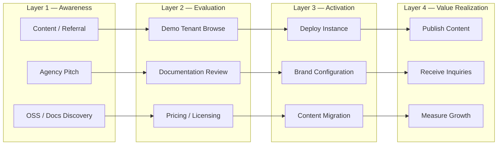
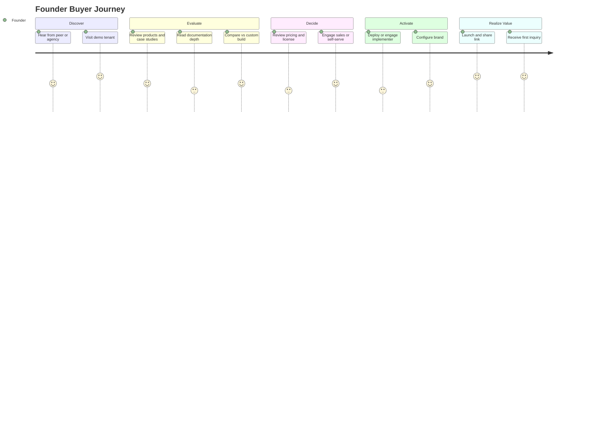
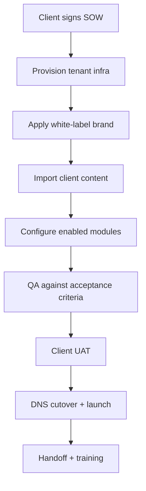
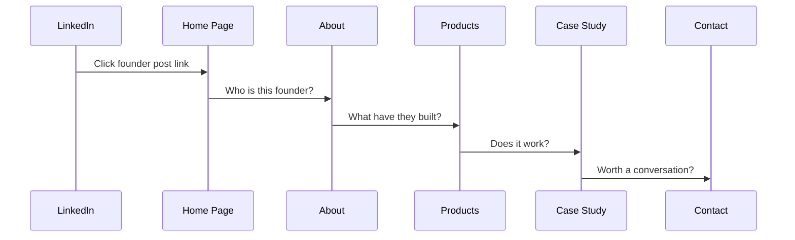
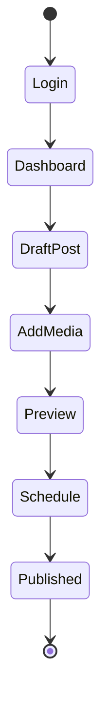
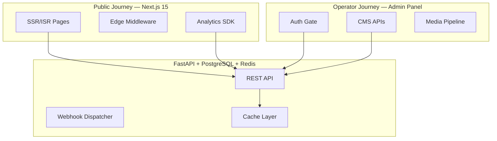

# FounderOS v1.0 — User Journey

| Field | Value |
|-------|-------|
| **Document ID** | DOC-00-04 |
| **Product** | Founder Portfolio Platform (FounderOS) |
| **Version** | 1.0 |
| **Status** | Approved |
| **Last Updated** | 2026-06-29 |
| **Owner** | Product Design |
| **Related** | [User Personas](03_User_Personas.md) · [Target Audience](02_Target_Audience.md) · [User Flows](../02_UX/User_Flows.md) · [Product Strategy](06_Product_Strategy.md) |

---

## Purpose

This document maps **end-to-end user journeys** across all stakeholder layers of FounderOS v1.0 — from first awareness through deployment, daily content operations, and end-visitor conversion. Journeys translate [User Personas](03_User_Personas.md) into actionable sequences that inform UX design, feature prioritization, analytics instrumentation, and acceptance testing.

Journeys are the **behavioral spine** connecting product strategy to interface design. Every public page and admin workflow should trace to at least one journey stage defined here.

---

## Scope

### In Scope

| Area | Description |
|------|-------------|
| Buyer journeys | Founder, agency, and consultant evaluation-to-purchase paths |
| Implementer journeys | Technical setup, white-label configuration, go-live |
| Operator journeys | Daily CMS, media, and module management |
| End-visitor journeys | Investor, enterprise buyer, developer, and press discovery paths |
| Journey metrics | Stage definitions for funnel analytics and KPI linkage |
| Cross-journey touchpoints | Email, webhooks, SEO entry points, social referrals |

### Out of Scope

| Area | Description |
|------|-------------|
| Wireframe-level UI | See [Wireframes](../02_UX/Wireframes.md) |
| Sprint backlog items | See [Roadmap](07_Roadmap.md) |
| Paid acquisition campaigns | Future GTM documentation |
| v2.0 multi-tenant self-serve signup | See [Future Enhancements](#future-enhancements) |

---

## Business Context

FounderOS operates across **four journey layers** that rarely align in timing. A founder may discover the platform through an agency, deploy over two weeks, then serve investors who land via a single LinkedIn post. Product and UX teams must optimize each layer without breaking adjacent ones.

### Why Journeys Matter for v1.0

| Stakeholder | Journey Risk if Undefined | Business Impact |
|-------------|---------------------------|-----------------|
| Founder buyer | Abandons during setup complexity | Lost license revenue |
| Agency implementer | Rebuilds instead of configures | Slower resale cycle |
| Content editor | Avoids admin panel | Stale public site |
| Enterprise visitor | Cannot find acquisition path | Missed deal flow |
| Investor visitor | Bounces before credibility established | Weaker fundraising signal |

---

## Goals

| # | Goal | Success Indicator |
|---|------|-------------------|
| G1 | Map all v1.0 personas to at least one primary journey | 100% persona coverage in journey tables |
| G2 | Define measurable stage gates for funnel analytics | Events documented per stage |
| G3 | Align UX flows with journey critical paths | [User Flows](../02_UX/User_Flows.md) cross-referenced |
| G4 | Identify friction points for roadmap prioritization | Friction log linked to [Roadmap](07_Roadmap.md) |
| G5 | Support white-label journey consistency | Brand layer applied at activation, not rebuild |

---

## Functional Requirements

| ID | Requirement | Priority | Journey |
|----|-------------|----------|---------|
| FR-UJ-01 | Public site must support direct entry from any enabled module URL (blog post, product, case study) | Must | End-visitor |
| FR-UJ-02 | Home page must communicate founder identity within first viewport | Must | Investor, press |
| FR-UJ-03 | Enterprise acquisition page must be reachable within ≤2 clicks from home | Must | Enterprise buyer |
| FR-UJ-04 | Contact and newsletter forms must confirm submission with clear next steps | Must | All visitors |
| FR-UJ-05 | Admin onboarding checklist must guide first-time tenant setup | Should | Implementer |
| FR-UJ-06 | Module enable/disable must update navigation without broken routes | Must | Operator |
| FR-UJ-07 | Media upload → publish flow must complete without engineering support | Must | Content editor |
| FR-UJ-08 | White-label brand config must preview before publish | Should | Implementer |
| FR-UJ-09 | Analytics events must fire at defined journey stage gates | Should | All layers |
| FR-UJ-10 | RSS, sitemap, and OG metadata must support content discovery entry | Must | Developer, press |

---

## Non-functional Requirements

| ID | Requirement | Target |
|----|-------------|--------|
| NFR-UJ-01 | Time to first meaningful paint on social referral landing | < 1.8s LCP |
| NFR-UJ-02 | Form submission feedback latency | < 500ms perceived |
| NFR-UJ-03 | Admin task completion without page reload (where applicable) | SPA-like responsiveness |
| NFR-UJ-04 | Journey documentation cross-link integrity | 0 broken internal links |
| NFR-UJ-05 | Mobile journey parity | 100% critical paths on mobile |
| NFR-UJ-06 | Accessibility on conversion paths | WCAG 2.1 AA on forms and nav |

---

## User Stories

### Buyer / Decision Maker

| ID | Story | Acceptance |
|----|-------|------------|
| US-UJ-01 | As a **founder**, I want to evaluate a live demo tenant in <10 minutes so that I can assess fit before committing | Demo tenant linked from docs; core pages browsable |
| US-UJ-02 | As an **agency lead**, I want a documented clone-and-rebrand path so that I can quote client timelines accurately | Deployment + brand docs complete |
| US-UJ-03 | As a **consultant**, I want licensing clarity before technical evaluation so that I avoid wasted engineering time | [Business Model](05_Business_Model.md) accessible from README |

### Implementer / Operator

| ID | Story | Acceptance |
|----|-------|------------|
| US-UJ-04 | As an **implementer**, I want a sequenced setup guide (infra → brand → content) so that go-live is predictable | Checklist in deployment docs |
| US-UJ-05 | As a **content editor**, I want to publish a blog post without touching code so that I maintain publishing cadence | CMS blog module fully admin-driven |
| US-UJ-06 | As a **marketing lead**, I want to update hero copy and CTAs independently so that campaigns ship same-day | CMS home sections editable |

### End Visitor

| ID | Story | Acceptance |
|----|-------|------------|
| US-UJ-07 | As an **investor**, I want founder → products → traction in one session so that I can form a diligence hypothesis | Linked navigation; case studies with metrics |
| US-UJ-08 | As an **enterprise buyer**, I want a dedicated acquisition path with trust signals so that I can initiate procurement conversation | Enterprise page + legal + testimonials |
| US-UJ-09 | As a **developer**, I want open-source and product technical pages so that I can evaluate integration fit | OSS module + product detail pages |

---

## UX Requirements

| ID | Requirement | Rationale |
|----|-------------|-----------|
| UX-UJ-01 | Every journey stage must have a clear primary CTA | Reduces decision fatigue on high-intent paths |
| UX-UJ-02 | Breadcrumb or contextual back-navigation on deep content pages | Supports non-linear investor browsing |
| UX-UJ-03 | Empty states must guide next action (e.g., "Add your first product") | Activation journey completion |
| UX-UJ-04 | Error states on forms must preserve user input | Conversion path recovery |
| UX-UJ-05 | Social share previews must match destination content | Referral journey integrity |
| UX-UJ-06 | Admin journeys must mirror mental model: Content → Media → Settings | See [Information Architecture](../02_UX/Information_Architecture.md) |
| UX-UJ-07 | Motion on scroll-entry must not block content readability | See [Motion Guidelines](../01_Brand/Motion_Guidelines.md) |

---

## Journey Maps

### Journey 1: Founder Buyer — Evaluate to License

| Stage | Touchpoints | Emotions | Opportunities | Metrics |
|-------|-------------|----------|---------------|---------|
| Discover | LinkedIn, agency referral, conference | Curious, skeptical | Strong demo tenant, social proof | Referral source, demo visits |
| Evaluate | Demo site, docs, PRD | Analytical, time-pressed | Fast credibility, clear differentiation | Pages/session, doc depth |
| Decide | Pricing page, sales call | Risk-aware | ROI framing vs custom build | Quote requests, license sign |
| Activate | Docker deploy, admin setup | Impatient, hopeful | Checklist, brand preview | Time to go-live |
| Realize Value | Public launch, inbound leads | Proud, validated | Analytics dashboard, inquiry alerts | Inquiries, traffic growth |

### Journey 2: Agency Implementer — Clone to Client Go-Live

| Stage | Duration Target | Key Artifacts | Failure Mode |
|-------|-----------------|---------------|--------------|
| Provision | Day 1 | Docker compose, env config | Missing secrets, wrong region |
| Brand | Day 2–3 | [Color System](../01_Brand/Color_System.md), [Logo Guidelines](../01_Brand/Logo_Guidelines.md) | Off-brand assets, contrast failures |
| Content | Day 3–7 | CMS entries, media library | Unoptimized images, broken links |
| QA | Day 7–8 | [Acceptance Criteria](#acceptance-criteria) checklist | SEO gaps, form failures |
| Launch | Day 9–10 | DNS, SSL, monitoring | Cache stale content |

### Journey 3: Investor End-Visitor — Social Link to Conviction

| Step | User Intent | Required UX Element | Drop-off Risk |
|------|-------------|---------------------|---------------|
| 1 — Land | Validate relevance | Hero headline + social proof | Generic or slow page |
| 2 — About | Assess credibility | Bio, timeline, press | Thin or outdated content |
| 3 — Products | Understand offering | Clear positioning, screenshots | Jargon-heavy copy |
| 4 — Proof | Verify traction | Metrics in case studies | Missing numbers |
| 5 — Convert | Initiate contact | Low-friction form or calendar | Hidden contact path |

### Journey 4: Enterprise Buyer — Procurement Intent

| Stage | Pages | Trust Signals | Conversion Goal |
|-------|-------|---------------|-----------------|
| Discovery | Home, Products | Client logos, compliance mentions | Continue exploration |
| Evaluation | Enterprise portal, Legal | SLA references, security posture | Form start |
| Intent | Acquisition form | Field-level guidance, privacy link | Form submit |
| Follow-up | Email confirmation | Clear SLA for human response | Meeting booked |

### Journey 5: Content Editor — Weekly Publishing Cadence

---

## Technical Considerations

| Area | Consideration | Reference |
|------|---------------|-----------|
| Analytics instrumentation | Stage-gate events (`journey_stage_*`) in tenant analytics config | [System Architecture](../04_Architecture/System_Architecture.md) |
| Deep linking | Next.js dynamic routes for all content types; canonical URLs | [Canonical](../10_SEO/Canonical.md) |
| Session continuity | Redis-backed sessions for admin journeys | [Caching Strategy](../04_Architecture/Caching_Strategy.md) |
| Form handling | FastAPI validation + webhook dispatch for inquiry journeys | [Authentication API](../08_API/Authentication_API.md) |
| Preview mode | Draft content preview without public cache pollution | [CMS Module](../06_Modules/CMS.md) |
| Multi-tenant readiness | Journey events scoped by `tenant_id` for future SaaS | [Database Architecture](../04_Architecture/Database_Architecture.md) |

---

## Security Considerations

| ID | Consideration | Journey Impact |
|----|---------------|----------------|
| SEC-UJ-01 | Admin journey must enforce MFA-ready auth for production tenants | Prevents content hijacking |
| SEC-UJ-02 | Enterprise form submissions must be rate-limited and CAPTCHA-protected | Prevents spam on high-value path |
| SEC-UJ-03 | PII in contact journeys must be encrypted at rest | GDPR/CCPA readiness |
| SEC-UJ-04 | Preview URLs must not leak draft content to unauthenticated users | Competitive intelligence risk |
| SEC-UJ-05 | Webhook payloads for inquiry journeys must be signed | CRM integration integrity |

---

## Acceptance Criteria

| # | Criterion | Verification Method |
|---|-----------|---------------------|
| AC-UJ-01 | All six personas from [03_User_Personas](03_User_Personas.md) mapped to ≥1 journey | Persona-journey matrix review |
| AC-UJ-02 | Investor critical path (Home → About → Products → Case Study) completable in ≤5 clicks | UX walkthrough |
| AC-UJ-03 | Enterprise path reachable in ≤2 clicks from home when module enabled | Automated link audit |
| AC-UJ-04 | Content editor can publish blog post without code deploy | Admin E2E test |
| AC-UJ-05 | Agency implementer can complete brand config using brand docs only | Dry-run deployment |
| AC-UJ-06 | Journey stage analytics events documented and implementable | Analytics spec review |
| AC-UJ-07 | Mobile critical journeys pass accessibility audit | WCAG scan on conversion paths |

---

## Future Enhancements

| Enhancement | Target Version | Journey Benefit |
|-------------|----------------|-----------------|
| Self-serve tenant signup and provisioning | v2.0 | Compress buyer activation journey |
| In-app onboarding wizard with progress persistence | v1.1 | Reduce implementer time-to-go-live |
| AI-assisted content migration from WordPress/Webflow | v1.2 | Accelerate content journey |
| Personalized visitor journeys based on referrer segment | v2.0 | Higher conversion per visitor type |
| Journey analytics dashboard in admin | v1.1 | Operator visibility into funnel health |
| Multi-language journey localization | v2.0 | Global founder audience |

---

## Open Questions

| # | Question | Owner | Decision By |
|---|----------|-------|-------------|
| OQ-UJ-01 | Should demo tenant be a shared sandbox or per-prospect isolated instance? | Product | Q3 2026 |
| OQ-UJ-02 | What is the SLA for enterprise inquiry human response displayed to visitors? | GTM | Pre-launch |
| OQ-UJ-03 | Do we instrument journey stages via first-party analytics only or support GA4/Mixpanel export? | Engineering | Sprint 3 |
| OQ-UJ-04 | Should admin onboarding checklist be blocking (gates publish) or advisory? | Product Design | Sprint 2 |
| OQ-UJ-05 | How do agency white-label journeys differ when agency hides FounderOS brand entirely? | Legal + Brand | Q3 2026 |

---

## Cross-Reference Index

| Document | Relationship |
|----------|--------------|
| [03_User_Personas](03_User_Personas.md) | Persona source for journey actors |
| [02_UX/User_Flows](../02_UX/User_Flows.md) | Screen-level flow detail |
| [06_Product_Strategy](06_Product_Strategy.md) | Strategic prioritization of journey friction |
| [08_KPIs](08_KPIs.md) | Quantitative journey stage targets |
| [09_Success_Metrics](09_Success_Metrics.md) | Outcome metrics per journey layer |
| [01_Brand/Brand_Guidelines](../01_Brand/Brand_Guidelines.md) | Visual consistency across touchpoints |
