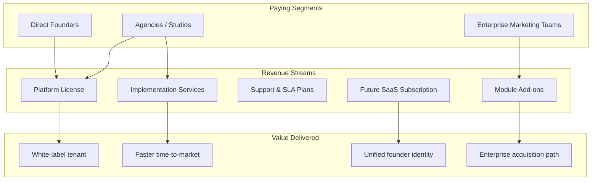
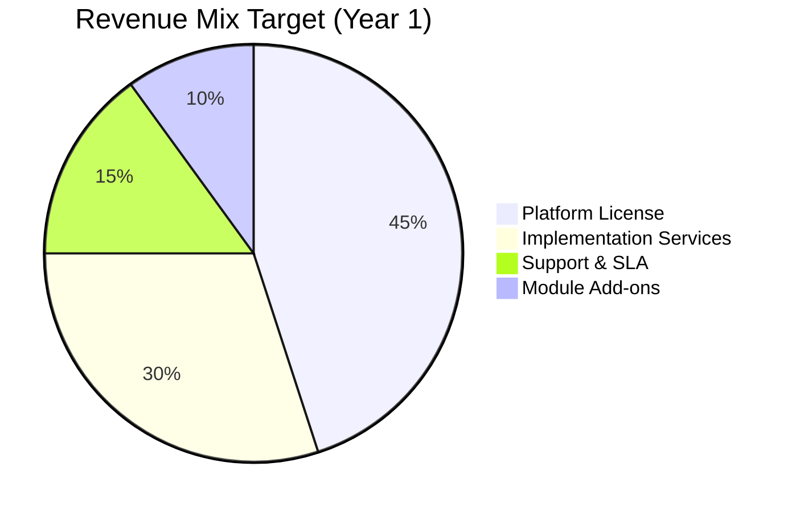
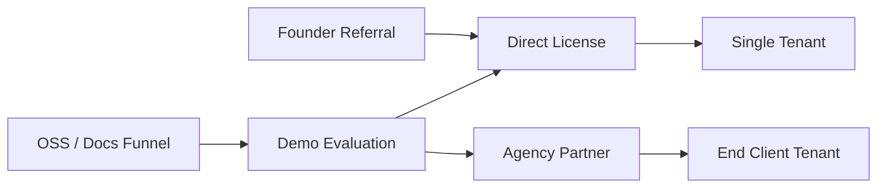
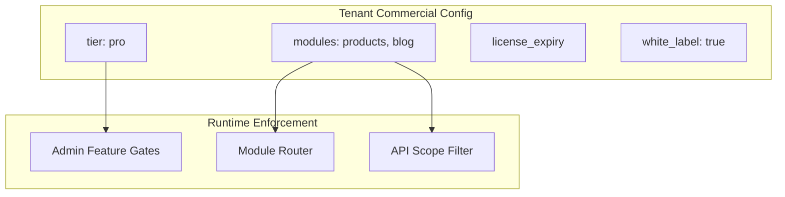

# FounderOS v1.0 — Business Model

| Field | Value |
|-------|-------|
| **Document ID** | DOC-00-05 |
| **Product** | Founder Portfolio Platform (FounderOS) |
| **Version** | 1.0 |
| **Status** | Approved |
| **Last Updated** | 2026-06-29 |
| **Owner** | Product Leadership / GTM |
| **Related** | [Product Strategy](06_Product_Strategy.md) · [Target Audience](02_Target_Audience.md) · [KPIs](08_KPIs.md) · [Roadmap](07_Roadmap.md) |

---

## Purpose

This document defines the **commercial model** for FounderOS v1.0 — how the platform generates revenue, who pays, what they receive, and how value is captured across licensing, services, and future SaaS expansion. It aligns product packaging with [Target Audience](02_Target_Audience.md) segments and informs pricing, sales motions, and engineering tenancy priorities.

The business model is a **living commercial architecture**, not a price list. Engineering and product teams use it to understand which capabilities are monetization-critical versus table stakes.

---

## Scope

### In Scope

| Area | Description |
|------|-------------|
| Revenue streams | License, implementation, support, future SaaS |
| Customer segments | Founders, agencies, enterprises, creators |
| Pricing philosophy | Value-based tiers and packaging logic |
| Unit economics framework | CAC, LTV, margin assumptions |
| Channel strategy | Direct, agency resale, OSS funnel |
| Competitive moat | Why customers pay vs alternatives |
| v1.0 commercial readiness | What must exist to sell |

### Out of Scope

| Area | Description |
|------|-------------|
| Legal contracts and MSAs | Legal team artifacts |
| Exact list prices in all currencies | Sales operations |
| Tax and invoicing implementation | Finance systems |
| v2.0 billing microservice design | Future architecture doc |

---

## Business Context

FounderOS is positioned as a **reusable commercial platform**, not a single portfolio site. The reference tenant validates product-market fit; the business model enables **repeatable revenue** through licensing and agency resale.

### Market Problem → Revenue Opportunity

| Pain | Current Spend | FounderOS Capture |
|------|---------------|-------------------|
| Custom founder site rebuild | $15K–$80K one-time | License + implementation fee |
| Fragmented CMS + marketing stack | $200–$2K/month | Consolidated platform value |
| Agency custom dev per client | $10K–$50K per project | White-label license multiplier |
| Enterprise acquisition microsites | $5K–$25K per campaign | Module-enabled upsell |

### Strategic Positioning vs Alternatives

| Alternative | Cost Model | FounderOS Advantage |
|-------------|------------|---------------------|
| Custom agency build | High capex, slow | 70% faster deployment with docs-driven setup |
| Webflow / Framer | Low capex, limited platform depth | Full CMS, enterprise module, API |
| WordPress + plugins | Low capex, high maintenance | Opinionated architecture, security baseline |
| Notion / link-in-bio | Minimal cost, low credibility | Professional founder-grade presence |

---

## Goals

| # | Goal | Success Indicator |
|---|------|-------------------|
| G1 | Define clear v1.0 monetization paths before engineering freeze | Approved revenue model doc |
| G2 | Enable agency resale with margin-friendly licensing | Agency tier documented |
| G3 | Align module packaging with willingness to pay | Module → tier mapping complete |
| G4 | Prepare unit economics for investor/GTM conversations | LTV:CAC framework defined |
| G5 | Document path from license model to SaaS without re-architecture | Tenancy hooks in roadmap |

---

## Functional Requirements

| ID | Requirement | Priority | Commercial Impact |
|----|-------------|----------|-------------------|
| FR-BM-01 | Platform must support license tier feature gating via configuration | Must | Enables tiered packaging |
| FR-BM-02 | Module enable/disable must be tenant-configurable | Must | Upsell and agency packaging |
| FR-BM-03 | White-label must allow removal of FounderOS attribution | Must | Agency resale requirement |
| FR-BM-04 | Documentation must include agency implementation playbook | Must | Reduces services cost |
| FR-BM-05 | Enterprise acquisition module must be separately licensable | Should | Premium tier differentiation |
| FR-BM-06 | API access must be tier-gated for headless use cases | Should | Pro/Enterprise upsell |
| FR-BM-07 | Usage metering hooks for future SaaS billing | Should | v2.0 readiness |
| FR-BM-08 | License compliance artifacts (attribution, restrictions) documented | Must | Legal protection |

---

## Non-functional Requirements

| ID | Requirement | Target |
|----|-------------|--------|
| NFR-BM-01 | New tenant provisioning time (agency) | < 2 weeks config-only |
| NFR-BM-02 | License verification must not impact runtime performance | Zero per-request license check in v1.0 |
| NFR-BM-03 | Commercial documentation completeness | All tiers and segments defined |
| NFR-BM-04 | Gross margin on license (target) | > 80% at scale |
| NFR-BM-05 | Support ticket ratio per tenant | < 2/month post-launch |

---

## User Stories

### Buyer

| ID | Story | Acceptance |
|----|-------|------------|
| US-BM-01 | As a **founder**, I want transparent tier comparison so that I choose the right package without sales friction | Tier matrix published |
| US-BM-02 | As an **agency owner**, I want volume licensing so that per-client margin is predictable | Agency tier with multi-tenant rights |
| US-BM-03 | As an **enterprise marketing lead**, I want enterprise module only so that I do not pay for unused features | À la carte module licensing |

### Operator

| ID | Story | Acceptance |
|----|-------|------------|
| US-BM-04 | As a **platform operator**, I want feature flags per tenant so that license tiers are enforceable | Config-driven module gates |
| US-BM-05 | As **finance**, I want clear SKU definitions so that invoicing maps to product | SKU table in this doc |

### End Visitor

| ID | Story | Acceptance |
|----|-------|------------|
| US-BM-06 | As an **enterprise buyer**, I want a credible acquisition experience so that I trust the vendor | Enterprise module quality regardless of tier visibility |

---

## UX Requirements

| ID | Requirement | Rationale |
|----|-------------|-----------|
| UX-BM-01 | Pricing and tier information must be scannable (comparison table) | Buyer journey efficiency |
| UX-BM-02 | Upgrade paths in admin must be clear when feature is tier-gated | Reduces support burden |
| UX-BM-03 | White-label tenants must not expose platform branding on public site | Agency client trust |
| UX-BM-04 | Enterprise module UX must justify premium positioning | Willingness to pay |
| UX-BM-05 | Demo tenant must represent highest-tier experience for evaluation | Conversion optimization |

---

## Revenue Model

### Primary Revenue Streams (v1.0)

| Stream | Description | Buyer | Pricing Model |
|--------|-------------|-------|---------------|
| **Platform License** | Right to deploy one white-label tenant instance | Founder, agency | Annual or perpetual |
| **Implementation** | Setup, brand, content migration, training | Agency, founder | Fixed SOW or hourly |
| **Support & SLA** | Priority support, uptime SLA, security patches | All paid tiers | Annual add-on |
| **Module Add-ons** | Enterprise portal, travel, OSS showcase, advanced analytics | Segment-specific | Per-module annual |

### Licensing Tiers (v1.0 Framework)

| Tier | Target Segment | Included Modules | Deployment | Support |
|------|----------------|------------------|------------|---------|
| **Starter** | Solo founders, creators | Core pages, blog, portfolio, contact | Self-serve + docs | Community |
| **Professional** | SaaS founders, consultants | + Products, case studies, media manager, SEO suite | Assisted setup | Email, 48h SLA |
| **Agency** | Studios, dev shops | All Pro modules + multi-tenant rights, white-label | Partner onboarding | Priority, 24h SLA |
| **Enterprise** | Funded startups, corp innovation | All modules + enterprise acquisition, API, custom SLA | Dedicated implementation | Named CSM |

### Module Packaging Matrix

| Module | Starter | Pro | Agency | Enterprise |
|--------|---------|-----|--------|------------|
| Home / About / Contact | ✓ | ✓ | ✓ | ✓ |
| Blog / CMS | ✓ | ✓ | ✓ | ✓ |
| Portfolio / Case Studies | ✓ | ✓ | ✓ | ✓ |
| Products | — | ✓ | ✓ | ✓ |
| Media Manager | — | ✓ | ✓ | ✓ |
| Enterprise Acquisition | — | Add-on | ✓ | ✓ |
| Travel / Creator | — | Add-on | Add-on | ✓ |
| Open Source Showcase | — | Add-on | ✓ | ✓ |
| REST API (headless) | — | — | ✓ | ✓ |
| Analytics Dashboard | Basic | ✓ | ✓ | Advanced |

### Channel Strategy

| Channel | Motion | Margin Profile | Scale Potential |
|---------|--------|----------------|-----------------|
| Direct | Inbound + outbound to founders | High margin | Medium |
| Agency | Partner program, certification | Medium margin, high volume | High |
| Enterprise | Account-based sales | High ACV, longer cycle | Medium |
| OSS funnel | Documentation + reference implementation | Low immediate, high LTV | High long-term |

---

## Unit Economics Framework

| Metric | Definition | v1.0 Target | Notes |
|--------|------------|-------------|-------|
| **ACV** | Average contract value (license + year-1 services) | $8K–$25K | Varies by tier |
| **CAC** | Cost to acquire paying tenant | < $3K direct; < $1.5K agency | Agency amortizes across clients |
| **LTV** | ACV × retention years × gross margin | > 3× CAC | Target 3-year retention |
| **Gross Margin** | License revenue minus hosting/support COGS | > 80% | Improves at SaaS scale |
| **Payback Period** | Months to recover CAC | < 12 months | Critical for bootstrap path |
| **Implementation Attach Rate** | % licenses with paid setup | > 60% year 1 | Services bridge to product maturity |

---

## Technical Considerations

| Area | Consideration | Reference |
|------|---------------|-----------|
| Feature gating | `tenant.config.enabled_modules[]` drives nav and API exposure | [System Architecture](../04_Architecture/System_Architecture.md) |
| License metadata | Store tier and expiry in tenant config; no runtime phone-home in v1.0 | [Database Architecture](../04_Architecture/Database_Architecture.md) |
| Metering hooks | Log API call volume, storage, bandwidth per tenant for future billing | [API Architecture](../04_Architecture/API_Architecture.md) |
| Multi-tenant isolation | Agency tier requires logical isolation for client tenants | [Roadmap](07_Roadmap.md) v1.x |
| Deployment economics | Docker on VPS vs Vercel affects COGS per tier | [Backend Architecture](../04_Architecture/Backend_Architecture.md) |

---

## Security Considerations

| ID | Consideration | Commercial Impact |
|----|---------------|-------------------|
| SEC-BM-01 | License keys must not be embedded in client-side bundles | Prevents piracy |
| SEC-BM-02 | Agency multi-tenant deployments require strict data isolation | Client trust, legal liability |
| SEC-BM-03 | Enterprise tier SLA requires security patch SLA documented | Contractual obligation |
| SEC-BM-04 | Payment and PII for licensing handled outside application in v1.0 | PCI scope reduction |

---

## Acceptance Criteria

| # | Criterion | Verification |
|---|-----------|--------------|
| AC-BM-01 | All four licensing tiers defined with module matrix | Stakeholder sign-off |
| AC-BM-02 | Agency resale path documented end-to-end | Partner playbook exists |
| AC-BM-03 | Feature gating mechanism specified in architecture | Engineering review |
| AC-BM-04 | Unit economics framework complete with targets | Finance review |
| AC-BM-05 | Competitive positioning table aligned with [Product Strategy](06_Product_Strategy.md) | Product review |
| AC-BM-06 | Revenue streams mapped to v1.0 roadmap deliverables | Roadmap cross-check |

---

## Future Enhancements

| Enhancement | Version | Business Impact |
|-------------|---------|-----------------|
| Self-serve SaaS billing (Stripe/Paddle) | v2.0 | Recurring revenue, lower CAC |
| Usage-based pricing (API calls, storage) | v2.0 | Aligns cost with value |
| Marketplace for themes and modules | v2.5 | Platform ecosystem revenue share |
| Certified agency directory | v1.2 | Channel lead generation |
| Revenue share on enterprise leads generated via platform | v2.0 | Network effects monetization |

---

## Open Questions

| # | Question | Owner | Decision By |
|---|----------|-------|-------------|
| OQ-BM-01 | Perpetual vs annual-only licensing for v1.0? | Leadership | Q3 2026 |
| OQ-BM-02 | Revenue share % for agency partners on license resale? | GTM | Partner program launch |
| OQ-BM-03 | Is open-source core required for funnel, or docs-only? | Engineering + Legal | Q3 2026 |
| OQ-BM-04 | Minimum agency commitment (seats, tenants/year)? | Sales | Partner program launch |
| OQ-BM-05 | Paddle vs Stripe for future SaaS given tax complexity? | Finance | v2.0 planning |

---

## Cross-Reference Index

| Document | Relationship |
|----------|--------------|
| [06_Product_Strategy](06_Product_Strategy.md) | Strategic bets informing packaging |
| [08_KPIs](08_KPIs.md) | Commercial KPI targets |
| [07_Roadmap](07_Roadmap.md) | Monetization feature delivery timeline |
| [02_Target_Audience](02_Target_Audience.md) | Segment willingness to pay |
| [01_Brand/Brand_Positioning](../01_Brand/Brand_Positioning.md) | Premium positioning justification |
