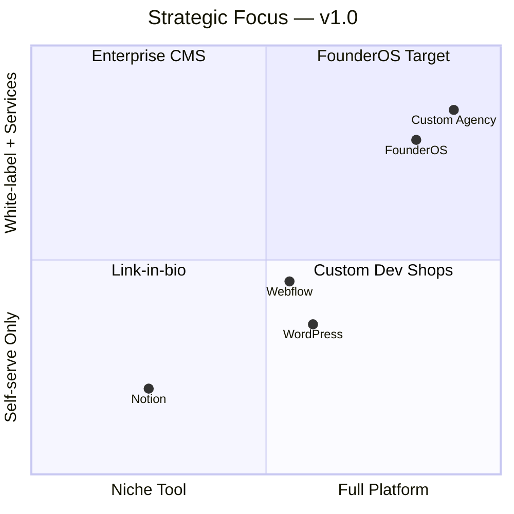
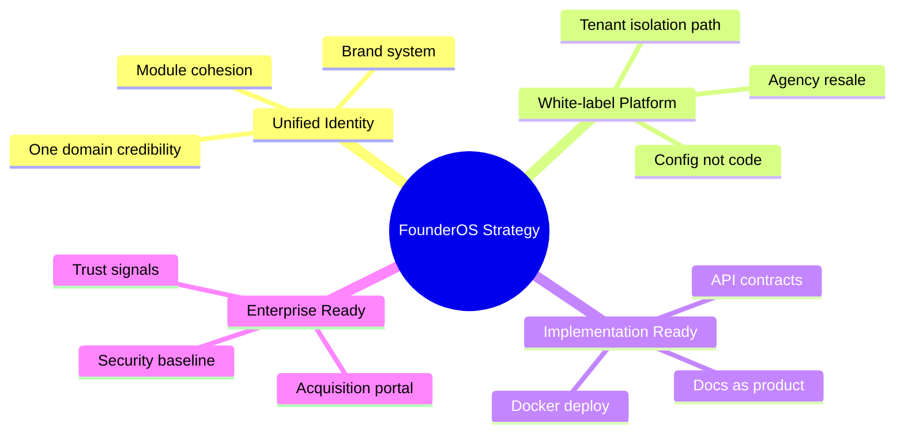
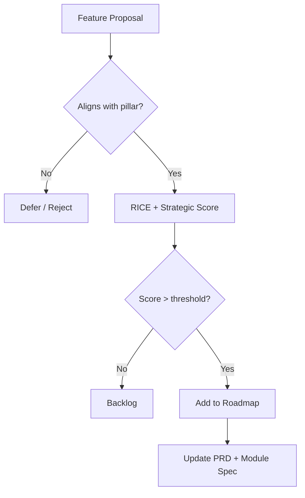

# FounderOS v1.0 — Product Strategy

| Field | Value |
|-------|-------|
| **Document ID** | DOC-00-06 |
| **Product** | Founder Portfolio Platform (FounderOS) |
| **Version** | 1.0 |
| **Status** | Approved |
| **Last Updated** | 2026-06-29 |
| **Owner** | Product Leadership |
| **Related** | [Project Vision](00_Project_Vision.md) · [Business Model](05_Business_Model.md) · [Roadmap](07_Roadmap.md) · [Brand Positioning](../01_Brand/Brand_Positioning.md) |

---

## Purpose

This document articulates **how FounderOS wins** in the market — strategic bets, differentiation pillars, prioritization framework, and competitive moat for v1.0 and the v1.x horizon. It bridges [Project Vision](00_Project_Vision.md) and executable [Roadmap](07_Roadmap.md) decisions.

Product strategy answers: *Where do we play? How do we win? What do we deliberately not build?*

---

## Scope

### In Scope

| Area | Description |
|------|-------------|
| Strategic pillars | Core bets that define the product |
| Differentiation | Why FounderOS vs alternatives |
| Prioritization framework | How features get ranked |
| Segment strategy | Which audiences win first |
| Platform vs point solution | Boundary decisions |
| v1.0 strategic non-goals | Explicit exclusions |
| Competitive response playbook | High-level positioning |

### Out of Scope

| Area | Description |
|------|-------------|
| Sprint-level backlog | Engineering ticketing |
| Detailed financial forecasts | Finance models |
| Marketing campaign plans | GTM execution docs |
| v3.0+ speculative bets | Future roadmap doc |

---

## Business Context

The founder identity market is **fragmented and underserved**. No dominant platform owns the intersection of personal brand, product marketing, enterprise acquisition, and modular CMS for technical founders. Incumbents optimize for one job — site builders for design, CMS for content, link-in-bio for social — leaving high-intent visitors with disjointed experiences.

FounderOS strategy: **own the founder-led business identity layer** and expand through modular licensing and agency distribution.

### Strategic Context Table

| Force | Impact on Strategy | Response |
|-------|-------------------|----------|
| AI commoditizing content creation | More sites, higher quality bar for differentiation | Platform depth + enterprise trust, not just CMS |
| Agency consolidation | Fewer partners, higher volume per partner | Agency tier + implementation playbook |
| Founder fundraising pressure | Credibility signals matter more | Case studies, metrics, enterprise path |
| Security/regulatory scrutiny | Enterprise buyers demand posture | Security-first architecture docs |
| Multi-tenant SaaS expectation | Buyers expect self-serve eventually | Document path; ship license model first |

---

## Goals

| # | Goal | Success Indicator |
|---|------|-------------------|
| G1 | Establish three differentiation pillars measurable in product | Pillar → feature mapping complete |
| G2 | Win primary segment (tech founders + agencies) before expanding to creators | 70% early revenue from primary |
| G3 | Ship platform complete enough for agency resale in v1.0 | Agency tier go-live |
| G4 | Maintain strategic focus — reject scope creep | Non-goals enforced in PRD |
| G5 | Build documentation moat competitors cannot easily replicate | 130+ spec files shipped |

---

## Strategic Pillars

### Pillar 1: Unified Founder Identity

**Bet:** Founders lose deals when their personal brand, products, and proof are scattered across domains and tools.

| Element | v1.0 Expression | Metric |
|---------|-----------------|--------|
| Single-domain experience | All modules under one nav | Bounce rate on cross-module navigation |
| Cohesive design system | Shared tokens across pages | Brand audit pass rate |
| Narrative flow | Home → About → Products → Proof | Session depth |

### Pillar 2: White-Label Platform Economics

**Bet:** Agencies and consultants will resell if deployment is faster and margin is better than custom builds.

| Element | v1.0 Expression | Metric |
|---------|-----------------|--------|
| Config-driven branding | CSS variables, logo, typography | Time to rebrand < 3 days |
| Module packaging | Tier-gated features | Agency attach rate |
| Documentation completeness | No discovery sessions required | Implementation hours per tenant |

### Pillar 3: Implementation-Ready Documentation

**Bet:** Documentation depth is a **competitive moat** — reduces services cost and enables third-party implementation.

| Element | v1.0 Expression | Metric |
|---------|-----------------|--------|
| Spec completeness | All required doc sections | Doc audit score |
| Cross-linked suite | Zero orphan documents | Link integrity checks |
| Acceptance criteria per module | Testable definitions | QA pass rate first deploy |

### Pillar 4: Enterprise Acquisition Readiness

**Bet:** Funded founders need a credible path for strategic buyers, not just a contact form.

| Element | v1.0 Expression | Metric |
|---------|-----------------|--------|
| Dedicated enterprise portal | Structured inquiry workflow | Enterprise form conversion |
| Trust layer | Legal, testimonials, security mentions | Enterprise page engagement |
| Admin visibility | Inquiry management in admin | Response time SLA |

---

## Functional Requirements

| ID | Requirement | Priority | Pillar |
|----|-------------|----------|--------|
| FR-PS-01 | All public modules must share design tokens and navigation patterns | Must | Unified Identity |
| FR-PS-02 | Tenant branding must be achievable without forking codebase | Must | White-label |
| FR-PS-03 | Every module must have standalone spec with acceptance criteria | Must | Documentation |
| FR-PS-04 | Enterprise acquisition module must support webhook CRM integration | Must | Enterprise Ready |
| FR-PS-05 | Module enable/disable must not require code deployment | Must | White-label |
| FR-PS-06 | API must expose headless consumption for Pro+ tiers | Should | Platform depth |
| FR-PS-07 | SEO suite must be first-class across all content types | Must | Unified Identity |
| FR-PS-08 | Reference tenant must demonstrate full platform capability | Must | GTM |
| FR-PS-09 | Admin must cover 100% of public content surfaces | Must | Self-serve operations |
| FR-PS-10 | Security controls documented per OWASP baseline | Must | Enterprise Ready |

---

## Non-functional Requirements

| ID | Requirement | Target |
|----|-------------|--------|
| NFR-PS-01 | Lighthouse performance (public pages) | ≥ 90 |
| NFR-PS-02 | Documentation coverage of v1.0 features | 100% |
| NFR-PS-03 | New tenant go-live (config-only) | < 2 weeks |
| NFR-PS-04 | API contract stability during v1.x | No breaking changes without major version |
| NFR-PS-05 | Competitive feature parity on core founder journey | Home, About, Products, Blog, Contact |
| NFR-PS-06 | Platform uptime (production tenants) | 99.9% |

---

## User Stories

| ID | Story | Acceptance |
|----|-------|------------|
| US-PS-01 | As a **product leader**, I want prioritization criteria so that we reject low-impact features | Framework published and used in reviews |
| US-PS-02 | As a **founder buyer**, I want one platform that replaces 3+ tools so that I save operational cost | Module consolidation demonstrated |
| US-PS-03 | As an **agency**, I want white-label deployment in days not months so that I improve project margin | Agency playbook validated |
| US-PS-04 | As an **investor visitor**, I want coherent founder narrative so that I assess team quality quickly | Journey audit pass |
| US-PS-05 | As an **engineering lead**, I want strategic non-goals documented so that scope debates are short | Non-goals in PRD aligned |

---

## UX Requirements

| ID | Requirement | Rationale |
|----|-------------|-----------|
| UX-PS-01 | Premium visual language consistent with [Brand Guidelines](../01_Brand/Brand_Guidelines.md) | Supports premium pricing |
| UX-PS-02 | Progressive disclosure — show enabled modules only | White-label flexibility |
| UX-PS-03 | Founder credibility within 3-second first impression | Strategic pillar: identity |
| UX-PS-04 | Enterprise UX must feel distinct from consumer blog UX | Segment-appropriate trust |
| UX-PS-05 | Admin efficiency for solo operators — minimal clicks to publish | Primary user retention |

---

## Prioritization Framework

### RICE-Adapted Scoring for FounderOS

| Factor | Weight | Definition |
|--------|--------|------------|
| **Reach** | 25% | % of target segments affected |
| **Impact** | 30% | Effect on conversion, retention, or ACV |
| **Confidence** | 20% | Evidence quality (persona, journey, data) |
| **Effort** | 15% | Engineering + doc cost |
| **Strategic Fit** | 10% | Alignment with pillars |

### v1.0 Priority Stack (Frozen)

| Rank | Initiative | Pillar | Rationale |
|------|------------|--------|-----------|
| 1 | Core public pages + CMS | Unified Identity | Table stakes |
| 2 | Products + Portfolio modules | Unified Identity | Differentiation vs link-in-bio |
| 3 | White-label brand system | White-label | Agency GTM |
| 4 | Enterprise acquisition portal | Enterprise Ready | ACV driver |
| 5 | SEO + metadata suite | Unified Identity | Organic acquisition |
| 6 | Docker deployment path | Documentation | Implementation ready |
| 7 | REST API contracts | Platform depth | Headless + integrations |
| 8 | Travel / OSS modules | Segment expansion | Secondary segments |

### Strategic Non-Goals (v1.0)

| Non-Goal | Rationale | Revisit |
|----------|-----------|---------|
| Full multi-tenant SaaS self-serve | License model first; reduce billing complexity | v2.0 |
| Native mobile apps | Web-first; responsive sufficient | v3.0+ |
| Built-in email marketing automation | Integrate via webhooks; not core | Partner ecosystem |
| Generic page builder (drag-drop) | Opinionated templates faster to ship | v2.x if demanded |
| Marketplace / theme store | Requires ecosystem scale | v2.5 |

---

## Technical Considerations

| Area | Strategic Implication | Reference |
|------|----------------------|-----------|
| Modular monolith | Enables module licensing without microservice overhead | [Backend Architecture](../04_Architecture/Backend_Architecture.md) |
| Next.js 15 App Router | SEO + performance for identity pillar | [Frontend Architecture](../04_Architecture/Frontend_Architecture.md) |
| PostgreSQL multi-tenant schema | Future SaaS without rewrite | [Database Architecture](../04_Architecture/Database_Architecture.md) |
| Redis caching | Performance SLO for credibility | [Caching Strategy](../04_Architecture/Caching_Strategy.md) |
| Docker-first deploy | Agency implementation speed | [System Architecture](../04_Architecture/System_Architecture.md) |

---

## Security Considerations

| ID | Consideration | Strategic Link |
|----|---------------|----------------|
| SEC-PS-01 | Security documentation as sales enabler for enterprise tier | Enterprise pillar |
| SEC-PS-02 | Tenant data isolation design for agency multi-client deployments | White-label pillar |
| SEC-PS-03 | OWASP baseline non-negotiable for v1.0 launch | Trust positioning |
| SEC-PS-04 | Audit trail for admin actions supports enterprise procurement | Compliance readiness |

---

## Acceptance Criteria

| # | Criterion | Verification |
|---|-----------|--------------|
| AC-PS-01 | Four strategic pillars documented with feature mapping | Product review |
| AC-PS-02 | Prioritization framework applied to v1.0 roadmap | Roadmap audit |
| AC-PS-03 | Strategic non-goals reflected in PRD exclusions | PRD cross-check |
| AC-PS-04 | Competitive positioning aligned with [Brand Positioning](../01_Brand/Brand_Positioning.md) | Brand review |
| AC-PS-05 | Primary segment (founders + agencies) > 70% of v1.0 feature investment | Effort allocation review |

---

## Future Enhancements

| Enhancement | Strategic Pillar | Timeline |
|-------------|------------------|----------|
| AI content assistant for founders | Unified Identity | v1.2 |
| Self-serve SaaS with billing | White-label Platform | v2.0 |
| Partner certification program | White-label Platform | v1.2 |
| Industry-specific templates (AI, SaaS, OSS) | Unified Identity | v1.1 |
| Competitive intelligence dashboard | GTM tooling | v2.0 |

---

## Open Questions

| # | Question | Owner | Decision By |
|---|----------|-------|-------------|
| OQ-PS-01 | Do we lead GTM with founder direct or agency channel first? | GTM | Q3 2026 |
| OQ-PS-02 | Is travel/creator module in v1.0 or v1.1 given strategic focus? | Product | Sprint planning |
| OQ-PS-03 | How aggressively do we pursue OSS core for developer funnel? | Leadership | Q3 2026 |
| OQ-PS-04 | Should enterprise module be bundled in Pro or remain add-on? | GTM + Finance | Pricing freeze |
| OQ-PS-05 | What is minimum viable API surface for headless tier? | Engineering | API freeze |

---

## Cross-Reference Index

| Document | Relationship |
|----------|--------------|
| [00_Project_Vision](00_Project_Vision.md) | North star source |
| [05_Business_Model](05_Business_Model.md) | Monetization of strategic pillars |
| [07_Roadmap](07_Roadmap.md) | Execution timeline |
| [08_KPIs](08_KPIs.md) | Strategic success measurement |
| [PRODUCT_REQUIREMENTS.md](../../PRODUCT_REQUIREMENTS.md) | Feature-level requirements |
