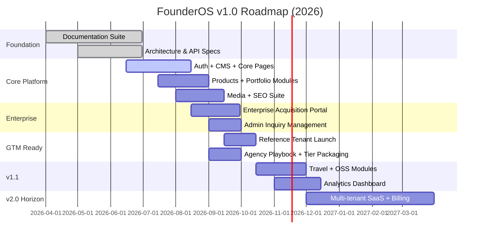
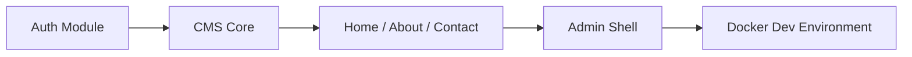
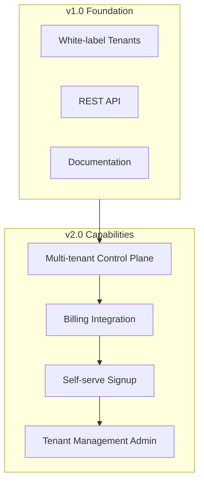
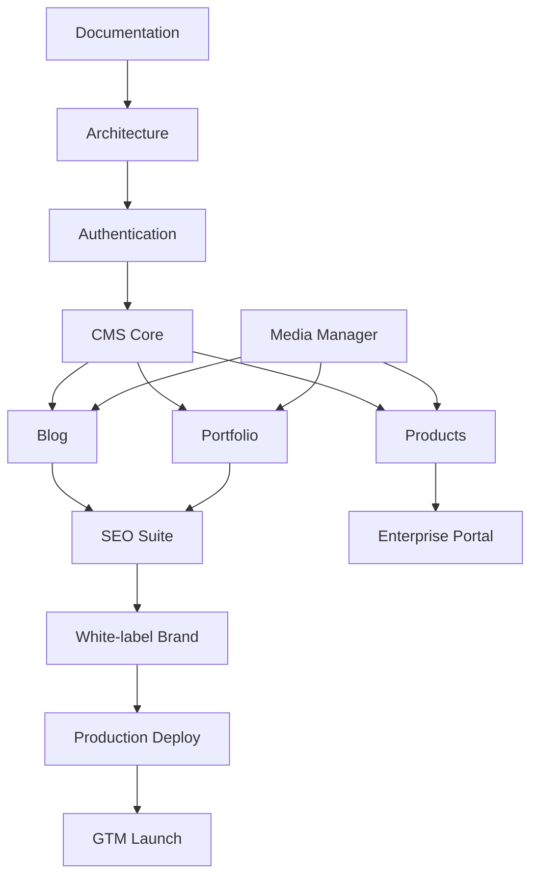

# FounderOS v1.0 — Roadmap

| Field | Value |
|-------|-------|
| **Document ID** | DOC-00-07 |
| **Product** | Founder Portfolio Platform (FounderOS) |
| **Version** | 1.0 |
| **Status** | Approved |
| **Last Updated** | 2026-06-29 |
| **Owner** | Product Leadership |
| **Related** | [Product Strategy](06_Product_Strategy.md) · [Project Goals](01_Project_Goals.md) · [KPIs](08_KPIs.md) · [Business Model](05_Business_Model.md) |

---

## Purpose

This document defines the **delivery roadmap** for FounderOS v1.0 through v1.x — phased milestones, dependencies, release themes, and exit criteria. It translates [Product Strategy](06_Product_Strategy.md) and [Project Goals](01_Project_Goals.md) into a time-sequenced plan engineering, design, and GTM can execute against.

The roadmap is **outcome-oriented**: each phase has measurable exit criteria linked to [KPIs](08_KPIs.md) and [Success Metrics](09_Success_Metrics.md).

---

## Scope

### In Scope

| Area | Description |
|------|-------------|
| v1.0 launch phases | Documentation, platform, GTM readiness |
| v1.x enhancement themes | Post-launch priorities |
| v2.0 horizon | Multi-tenant SaaS, billing |
| Cross-functional dependencies | Eng, design, docs, DevOps |
| Risk register | Roadmap-level risks |
| Milestone exit criteria | Definition of done per phase |

### Out of Scope

| Area | Description |
|------|-------------|
| Daily sprint boards | Engineering project management |
| Individual engineer assignments | Team management |
| v3.0+ speculative features | Annual planning cycle |

---

## Business Context

FounderOS v1.0 must prove **three hypotheses** before scaling GTM:

1. **Buildable** — A third-party team can implement from documentation alone
2. **Sellable** — License + agency model generates repeatable revenue
3. **Deployable** — Docker-based path delivers production tenants reliably

The roadmap sequences work to de-risk these hypotheses in order.

---

## Goals

| # | Goal | Target Date | KPI Link |
|---|------|-------------|----------|
| G1 | Complete v1.0 documentation suite | 2026-06-30 | DOC-KPI-01 |
| G2 | Ship reference tenant to production | 2026-10-15 | DEP-KPI-01 |
| G3 | Agency tier commercially ready | 2026-10-01 | REV-KPI-02 |
| G4 | First paying non-reference tenant live | 2026-11-30 | REV-KPI-01 |
| G5 | v2.0 multi-tenant architecture approved | 2027-01-31 | PLAT-KPI-01 |

---

## Functional Requirements

Roadmap phases deliver functional capabilities incrementally. Requirements below map to release phases.

| ID | Requirement | Phase | Priority |
|----|-------------|-------|----------|
| FR-RM-01 | Authentication (admin login, session, RBAC basics) | v1.0 Alpha | Must |
| FR-RM-02 | CMS for home, about, contact, legal pages | v1.0 Alpha | Must |
| FR-RM-03 | Blog module (CRUD, categories, RSS) | v1.0 Beta | Must |
| FR-RM-04 | Portfolio + case studies module | v1.0 Beta | Must |
| FR-RM-05 | Products module with categories | v1.0 Beta | Must |
| FR-RM-06 | Media manager with upload + optimization | v1.0 Beta | Must |
| FR-RM-07 | Enterprise acquisition portal + webhooks | v1.0 RC | Must |
| FR-RM-08 | SEO metadata suite (OG, Twitter, schema) | v1.0 RC | Must |
| FR-RM-09 | White-label brand configuration | v1.0 RC | Must |
| FR-RM-10 | Docker compose production deployment | v1.0 GA | Must |
| FR-RM-11 | Travel creator module | v1.1 | Should |
| FR-RM-12 | Open source showcase module | v1.1 | Should |
| FR-RM-13 | Admin analytics dashboard | v1.1 | Should |
| FR-RM-14 | Self-serve tenant provisioning | v2.0 | Could |
| FR-RM-15 | Stripe/Paddle billing integration | v2.0 | Could |

---

## Non-functional Requirements

| ID | Requirement | Phase | Target |
|----|-------------|-------|--------|
| NFR-RM-01 | Lighthouse performance | v1.0 GA | ≥ 90 |
| NFR-RM-02 | API p95 latency (cached) | v1.0 Beta | < 200ms |
| NFR-RM-03 | Test coverage (backend) | v1.0 RC | ≥ 80% |
| NFR-RM-04 | Documentation link integrity | v1.0 GA | 100% |
| NFR-RM-05 | Uptime SLO | v1.0 GA | 99.9% |
| NFR-RM-06 | WCAG 2.1 AA (public) | v1.0 GA | Pass audit |

---

## User Stories

| ID | Story | Phase | Acceptance |
|----|-------|-------|------------|
| US-RM-01 | As a **docs consumer**, I want complete specs before coding starts so that I avoid rework | Foundation | Doc audit pass |
| US-RM-02 | As a **founder**, I want reference tenant live so that I can evaluate real product | GTM Ready | Public URL live |
| US-RM-03 | As an **agency**, I want second tenant deployed from docs only so that resale is proven | v1.0 GA | Tenant #2 < 2 weeks |
| US-RM-04 | As **product**, I want phased releases so that we ship value incrementally | All phases | Alpha → GA criteria met |
| US-RM-05 | As **DevOps**, I want Docker path before GA so that deploy is repeatable | v1.0 RC | Compose prod validated |

---

## UX Requirements

| ID | Requirement | Phase |
|----|-------------|-------|
| UX-RM-01 | Core page templates finalized before module expansion | Alpha |
| UX-RM-02 | Admin IA stable before v1.0 Beta (no nav restructure) | Beta |
| UX-RM-03 | Brand system applied before reference tenant launch | RC |
| UX-RM-04 | Mobile audit before GA | RC |
| UX-RM-05 | Enterprise portal UX review before GTM | RC |

---

## Release Phases

### Phase 0: Foundation (Complete)

| Deliverable | Status | Exit Criteria |
|-------------|--------|---------------|
| Project + brand docs | ✓ | All 00_Project, 01_Brand complete |
| Architecture suite | ✓ | System, FE, BE, DB, API docs |
| PRD + SRS | ✓ | Approved for development |
| UX foundation | ✓ | IA, flows, navigation |

### Phase 1: v1.0 Alpha — Core Platform

| Milestone | Dependencies | Exit Criteria |
|-----------|--------------|---------------|
| Admin auth working | Database schema | Login, session, logout |
| CMS drives home page | Auth, API | Hero + CTA editable |
| Dev Docker stack | Compose file | `docker compose up` works |

**Target:** 2026-08-15

### Phase 2: v1.0 Beta — Content Modules

| Module | Dependencies | Exit Criteria |
|--------|--------------|---------------|
| Blog | CMS, Media | Publish, RSS, SEO meta |
| Portfolio | Media | Grid, case study detail |
| Products | Media | Listing, detail, filters |
| Media Manager | S3/local storage | Upload, resize, CDN path |

**Target:** 2026-09-15

### Phase 3: v1.0 RC — Enterprise + Polish

| Workstream | Exit Criteria |
|------------|---------------|
| Enterprise portal | Form, webhook, admin list |
| SEO suite | OG, Twitter, schema, sitemap |
| White-label brand | Color, logo, typography config |
| Performance pass | Lighthouse ≥ 90 |
| Security pass | OWASP checklist |

**Target:** 2026-10-01

### Phase 4: v1.0 GA — Launch

| Milestone | Exit Criteria |
|-----------|---------------|
| Reference tenant live | Production deploy, monitoring |
| Tenant #2 (docs-only deploy) | < 2 weeks, no code fork |
| Agency playbook published | Partner-ready |
| v1.0 changelog | All features documented |

**Target:** 2026-10-15

### Phase 5: v1.1 — Expansion

| Theme | Features |
|-------|----------|
| Creator segment | Travel module, gallery enhancements |
| Developer segment | OSS showcase module |
| Operator tools | Analytics dashboard, admin UX polish |
| Commercial | First 5 paying tenants |

**Target:** 2026-12-15

### Phase 6: v2.0 — SaaS Platform

| Capability | Dependency | Target |
|------------|------------|--------|
| Tenant control plane | v1.0 tenant config model | Q1 2027 |
| Billing (Stripe/Paddle) | Control plane | Q1 2027 |
| Self-serve signup | Billing | Q2 2027 |

---

## Dependency Map

---

## Technical Considerations

| Phase | Technical Focus | Stack |
|-------|-----------------|-------|
| Alpha | Schema, auth, API scaffolding | FastAPI, PostgreSQL, Redis |
| Beta | Content APIs, media pipeline, ISR | Next.js 15, FastAPI |
| RC | Caching, CDN, security hardening | Cloudflare, Redis |
| GA | Monitoring, backups, runbooks | Docker, VPS/Vercel |
| v2.0 | Tenant isolation, billing webhooks | PostgreSQL RLS, Stripe |

See [System Architecture](../04_Architecture/System_Architecture.md), [Backend Architecture](../04_Architecture/Backend_Architecture.md).

---

## Security Considerations

| Phase | Security Milestone |
|-------|-------------------|
| Alpha | Auth hardening, password policy, session security |
| Beta | File upload validation, SSRF prevention on media |
| RC | OWASP Top 10 audit, rate limiting on forms |
| GA | Security runbook, incident response doc |
| v2.0 | Tenant isolation audit, SOC2 readiness path |

---

## Acceptance Criteria

| # | Criterion | Phase |
|---|-----------|-------|
| AC-RM-01 | All v1.0 FR-RM items shipped and tested | GA |
| AC-RM-02 | Reference tenant meets all NFR targets | GA |
| AC-RM-03 | Second tenant deployed from docs in < 2 weeks | GA |
| AC-RM-04 | Roadmap risks reviewed monthly | Ongoing |
| AC-RM-05 | v1.1 scope locked before GA | RC |
| AC-RM-06 | v2.0 architecture RFC approved before v1.1 complete | v1.1 |

---

## Risk Register

| Risk | Likelihood | Impact | Mitigation |
|------|------------|--------|------------|
| Scope creep delays GA | High | High | Non-goals enforced; [Product Strategy](06_Product_Strategy.md) |
| Agency channel slower than direct | Medium | Medium | Parallel direct GTM |
| Media pipeline complexity | Medium | High | MVP local storage; S3 in RC |
| Multi-tenant rework in v2.0 | Medium | High | Tenant ID in schema from v1.0 |
| Documentation drift from implementation | High | Medium | CHANGELOG + doc review gate |

---

## Future Enhancements

| Item | Version | Notes |
|------|---------|-------|
| AI content generation | v1.2 | Post-GA content velocity |
| Theme marketplace | v2.5 | Ecosystem play |
| Mobile admin app | v3.0 | Operator convenience |
| Global CDN edge rendering | v1.2 | Performance at scale |

---

## Open Questions

| # | Question | Owner | Decision By |
|---|----------|-------|-------------|
| OQ-RM-01 | GA date fixed or scope-driven? | Leadership | RC phase |
| OQ-RM-02 | v1.1 travel module in or out given resource constraints? | Product | Post-Beta review |
| OQ-RM-03 | Single VPS vs split FE/BE hosting for GA reference tenant? | DevOps | RC |
| OQ-RM-04 | Do we need mobile admin for v1.0 agency handoff? | Product Design | GA scope freeze |
| OQ-RM-05 | v2.0 billing provider: Stripe vs Paddle? | Finance | Q4 2026 |

---

## Cross-Reference Index

| Document | Relationship |
|----------|--------------|
| [01_Project_Goals](01_Project_Goals.md) | Goal source |
| [06_Product_Strategy](06_Product_Strategy.md) | Strategic prioritization |
| [08_KPIs](08_KPIs.md) | Phase exit measurements |
| [09_Success_Metrics](09_Success_Metrics.md) | Outcome validation |
| [PRODUCT_REQUIREMENTS.md](../../PRODUCT_REQUIREMENTS.md) | Feature requirements |
