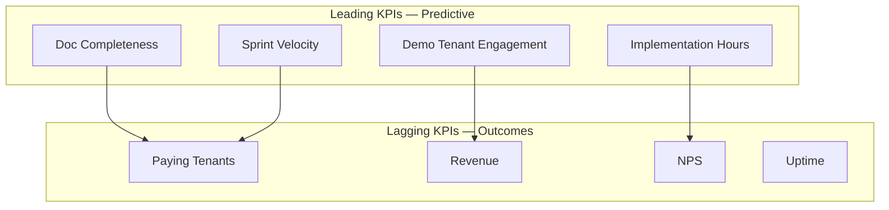
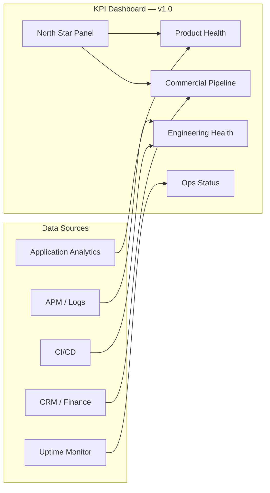

# FounderOS v1.0 — KPIs

| Field | Value |
|-------|-------|
| **Document ID** | DOC-00-08 |
| **Product** | Founder Portfolio Platform (FounderOS) |
| **Version** | 1.0 |
| **Status** | Approved |
| **Last Updated** | 2026-06-29 |
| **Owner** | Product Leadership |
| **Related** | [Project Goals](01_Project_Goals.md) · [Success Metrics](09_Success_Metrics.md) · [Business Model](05_Business_Model.md) · [Roadmap](07_Roadmap.md) |

---

## Purpose

This document defines **Key Performance Indicators (KPIs)** for FounderOS v1.0 — the quantitative measures used to track progress toward [Project Goals](01_Project_Goals.md) across product, engineering, documentation, commercial, and operational domains.

KPIs are **leading and lagging indicators** reviewed at phase gates defined in [Roadmap](07_Roadmap.md). They differ from [Success Metrics](09_Success_Metrics.md), which focus on outcome validation post-launch.

---

## Scope

### In Scope

| Area | Description |
|------|-------------|
| KPI taxonomy | Product, engineering, docs, revenue, ops |
| Targets | v1.0 baseline and GA targets |
| Measurement methods | How each KPI is collected |
| Review cadence | Weekly, monthly, phase-gate |
| Ownership | DRI per KPI category |
| Dashboard requirements | What to instrument |

### Out of Scope

| Area | Description |
|------|-------------|
| Individual engineer velocity metrics | Team management |
| Vanity metrics without actionability | Excluded by definition |
| v2.0 SaaS metrics detail | Future commercial doc |

---

## Business Context

Without KPIs, FounderOS risks shipping **documentation without a product** or **a product without commercial traction**. KPIs align cross-functional teams on what "on track" means during the v1.0 delivery window and first 90 days post-GA.

### KPI Hierarchy

| Level | Audience | Examples |
|-------|----------|----------|
| **North Star** | Leadership | Active paying tenants, platform NPS |
| **Domain** | Functional leads | Lighthouse score, doc coverage, ACV |
| **Operational** | Sprint teams | Story points, bug escape rate, link checks |

---

## Goals

| # | Goal | KPI |
|---|------|-----|
| G1 | Track v1.0 delivery health objectively | Phase-gate KPI dashboard |
| G2 | Enable data-driven roadmap reprioritization | Leading indicator coverage |
| G3 | Align commercial and product metrics | Revenue + activation KPIs linked |
| G4 | Establish baseline for v1.1 improvement | GA snapshot documented |
| G5 | Support investor/partner reporting | North star + unit economics KPIs |

---

## Functional Requirements

| ID | Requirement | Priority |
|----|-------------|----------|
| FR-KPI-01 | Admin must expose basic traffic and form submission counts | Must |
| FR-KPI-02 | Deployment runbook must include uptime monitoring setup | Must |
| FR-KPI-03 | Documentation CI must report link integrity score | Should |
| FR-KPI-04 | Tenant config must log module enablement for packaging analytics | Should |
| FR-KPI-05 | Enterprise form must emit conversion events | Must |
| FR-KPI-06 | Analytics config must support UTM attribution on key pages | Should |
| FR-KPI-07 | Changelog must track doc version for completeness KPI | Must |

---

## Non-functional Requirements

| ID | Requirement | Target |
|----|-------------|--------|
| NFR-KPI-01 | KPI data freshness (production) | < 24h lag |
| NFR-KPI-02 | Dashboard load time | < 3s |
| NFR-KPI-03 | KPI definitions stable during v1.x | No redefinition without version bump |
| NFR-KPI-04 | Measurement error tolerance | ± 5% for traffic metrics |

---

## User Stories

| ID | Story | Acceptance |
|----|-------|------------|
| US-KPI-01 | As **product leadership**, I want a weekly KPI dashboard so that I spot drift early | Dashboard spec + data sources |
| US-KPI-02 | As **engineering**, I want performance KPIs in CI so that regressions are caught | Lighthouse CI gate |
| US-KPI-03 | As **GTM**, I want pipeline KPIs tied to demo engagement so that I prioritize leads | UTM + demo analytics |
| US-KPI-04 | As **DevOps**, I want uptime KPI alerting so that SLA breaches are immediate | Monitoring configured |

---

## UX Requirements

| ID | Requirement |
|----|-------------|
| UX-KPI-01 | Admin analytics views must be readable by non-technical founders |
| UX-KPI-02 | KPI-related empty states must explain how to improve metric |
| UX-KPI-03 | Public performance must not degrade due to analytics scripts |

---

## KPI Catalog

### North Star KPIs

| ID | KPI | Definition | v1.0 GA Target | Owner |
|----|-----|------------|----------------|-------|
| NS-01 | **Active Paying Tenants** | Tenants with valid license in production | ≥ 3 (incl. reference) | GTM |
| NS-02 | **Platform NPS** | NPS survey of tenant operators | ≥ 40 | Product |
| NS-03 | **Time to Tenant #2** | Days from docs handoff to production (no code fork) | ≤ 14 | Engineering |

### Product KPIs

| ID | KPI | Definition | Target | Measurement |
|----|-----|------------|--------|-------------|
| PRD-KPI-01 | Module coverage | % PRD modules shipped | 100% at GA | PRD checklist |
| PRD-KPI-02 | CMS self-serve rate | % content updates without engineering | 100% | Support ticket ratio |
| PRD-KPI-03 | Enterprise form conversion | Submissions / unique enterprise page views | ≥ 2% | Analytics |
| PRD-KPI-04 | Session depth (reference tenant) | Avg pages per session | ≥ 3.5 | Analytics |
| PRD-KPI-05 | Mobile traffic share | % sessions mobile | Track baseline | Analytics |

### Engineering KPIs

| ID | KPI | Definition | Target | Measurement |
|----|-----|------------|--------|-------------|
| ENG-KPI-01 | Lighthouse Performance | Median score across public pages | ≥ 90 | CI + manual audit |
| ENG-KPI-02 | API p95 latency | Cached read endpoints | < 200ms | APM |
| ENG-KPI-03 | Test coverage (backend) | Line coverage | ≥ 80% | pytest-cov |
| ENG-KPI-04 | Bug escape rate | P1/P2 bugs found post-release / total | < 10% | Issue tracker |
| ENG-KPI-05 | Build success rate | CI pipeline | ≥ 95% | GitHub Actions |

### Documentation KPIs

| ID | KPI | Definition | Target | Measurement |
|----|-----|------------|--------|-------------|
| DOC-KPI-01 | Spec file count | Total markdown specs | ≥ 130 | File count |
| DOC-KPI-02 | Link integrity | % internal links valid | 100% | CI link checker |
| DOC-KPI-03 | Section completeness | % docs with all required sections | 100% | Doc audit script |
| DOC-KPI-04 | Cross-link density | Avg related links per doc | ≥ 4 | Manual sample |
| DOC-KPI-05 | CHANGELOG currency | Days since last doc update at GA | ≤ 7 | Git history |

### Commercial KPIs

| ID | KPI | Definition | v1.0 90-day Target | Measurement |
|----|-----|------------|-------------------|-------------|
| REV-KPI-01 | License revenue | Recognized license revenue | ≥ $25K | Finance |
| REV-KPI-02 | Agency partners signed | Active agency tier partners | ≥ 2 | CRM |
| REV-KPI-03 | ACV | Average contract value | $8K–$25K | Finance |
| REV-KPI-04 | Implementation attach rate | % licenses with paid setup | ≥ 60% | CRM |
| REV-KPI-05 | Demo-to-opportunity rate | Sales opportunities / demo requests | ≥ 30% | CRM |

### Operational KPIs

| ID | KPI | Definition | Target | Measurement |
|----|-----|------------|--------|-------------|
| OPS-KPI-01 | Uptime | Production availability | 99.9% | Monitoring |
| OPS-KPI-02 | MTTR | Mean time to resolve P1 | < 4h | Incident log |
| OPS-KPI-03 | Deploy frequency | Production deploys per month | ≥ 2 | CI/CD |
| OPS-KPI-04 | Backup success rate | Scheduled backup completion | 100% | Ops checklist |
| OPS-KPI-05 | Security patch SLA | Days to patch critical CVE | < 7 | Security log |

### Platform Readiness KPIs

| ID | KPI | Definition | Target | Measurement |
|----|-----|------------|--------|-------------|
| PLAT-KPI-01 | Tenant isolation design review | Architecture sign-off for v2.0 | Complete by Q1 2027 | RFC status |
| PLAT-KPI-02 | Feature gate coverage | % modules behind config flags | 100% | Code audit |
| PLAT-KPI-03 | API contract coverage | % endpoints documented in 08_API | 100% | OpenAPI diff |

---

## KPI Dashboard Structure

### Review Cadence

| Cadence | KPIs Reviewed | Audience |
|---------|---------------|----------|
| Daily | OPS-KPI-01, ENG-KPI-05 | DevOps, Eng lead |
| Weekly | ENG-KPI-01–04, PRD-KPI-01, DOC-KPI-02 | Product + Engineering |
| Bi-weekly | REV-KPI-01–05, NS-01 | Leadership + GTM |
| Phase gate | All domain KPIs | Full stakeholder review |
| Monthly | NS-02, PRD-KPI-03–05 | Board / investor update |

---

## Technical Considerations

| Area | Implementation | Reference |
|------|----------------|-----------|
| Analytics events | `analytics.track()` with KPI event names | [System Architecture](../04_Architecture/System_Architecture.md) |
| Performance CI | Lighthouse CI on PR merge | [Frontend Architecture](../04_Architecture/Frontend_Architecture.md) |
| APM | FastAPI middleware timing | [Backend Architecture](../04_Architecture/Backend_Architecture.md) |
| Uptime | External ping + SSL monitor | Deployment docs |
| Doc link CI | Markdown link checker in GitHub Actions | README doc standard |

---

## Security Considerations

| ID | Consideration |
|----|---------------|
| SEC-KPI-01 | Analytics must not collect PII without consent |
| SEC-KPI-02 | KPI dashboards must be access-controlled |
| SEC-KPI-03 | Incident metrics must not expose exploit details publicly |

---

## Acceptance Criteria

| # | Criterion | Verification |
|---|-----------|--------------|
| AC-KPI-01 | All KPIs have definition, target, owner, measurement | Catalog audit |
| AC-KPI-02 | North star KPIs measurable at GA | Instrumentation check |
| AC-KPI-03 | Phase-gate review uses KPI dashboard | Process documented |
| AC-KPI-04 | KPIs linked to [Success Metrics](09_Success_Metrics.md) outcomes | Cross-reference review |
| AC-KPI-05 | Baseline snapshot captured at GA | Archive in CHANGELOG |

---

## Future Enhancements

| Enhancement | KPI Impact |
|-------------|------------|
| Real-time KPI dashboard in admin | Faster operator feedback |
| Automated anomaly detection on NS-01 | Earlier churn signal |
| Cohort analysis by tenant tier | Packaging optimization |
| v2.0 MRR/churn KPIs | SaaS transition |

---

## Open Questions

| # | Question | Owner | Decision By |
|---|----------|-------|-------------|
| OQ-KPI-01 | First-party analytics only or GA4 required? | Product | Sprint 3 |
| OQ-KPI-02 | NPS survey timing: 30 or 60 days post-launch? | Product | GA |
| OQ-KPI-03 | Who owns KPI dashboard tooling (Metabase, Grafana, custom)? | DevOps | Beta |
| OQ-KPI-04 | Public benchmark publishing for marketing? | GTM | Post-GA |

---

## Cross-Reference Index

| Document | Relationship |
|----------|--------------|
| [09_Success_Metrics](09_Success_Metrics.md) | Outcome metrics derived from KPIs |
| [01_Project_Goals](01_Project_Goals.md) | Goal → KPI mapping |
| [07_Roadmap](07_Roadmap.md) | Phase-gate KPI reviews |
| [05_Business_Model](05_Business_Model.md) | Commercial KPI context |
