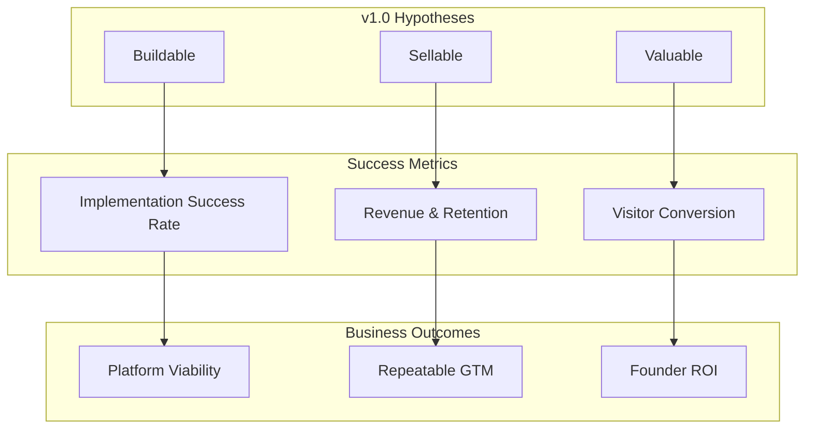
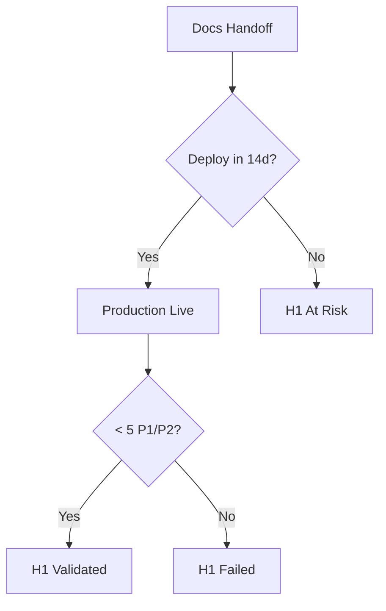

# FounderOS v1.0 — Success Metrics

| Field | Value |
|-------|-------|
| **Document ID** | DOC-00-09 |
| **Product** | Founder Portfolio Platform (FounderOS) |
| **Version** | 1.0 |
| **Status** | Approved |
| **Last Updated** | 2026-06-29 |
| **Owner** | Product Leadership |
| **Related** | [KPIs](08_KPIs.md) · [Project Goals](01_Project_Goals.md) · [User Journey](04_User_Journey.md) · [Business Model](05_Business_Model.md) |

---

## Purpose

This document defines **success metrics** — the outcome measures that determine whether FounderOS v1.0 achieved its intended impact for founders, agencies, end visitors, and the platform business. Unlike [KPIs](08_KPIs.md), which track delivery health and leading indicators, success metrics answer: *Did we solve the problem we set out to solve?*

Success metrics are evaluated at **90-day, 180-day, and 12-month** horizons post-GA.

---

## Scope

### In Scope

| Area | Description |
|------|-------------|
| Outcome metrics | Business, product, user, technical success |
| Success criteria by stakeholder layer | Buyers, operators, visitors |
| Measurement windows | 90d / 180d / 12mo |
| Failure definitions | What constitutes miss |
| Hypothesis validation | v1.0 core bets |
| Baseline establishment | Reference tenant benchmarks |

### Out of Scope

| Area | Description |
|------|-------------|
| Sprint velocity | Engineering KPIs |
| Real-time operational alerts | Ops KPIs |
| v2.0 SaaS success metrics | Future commercial review |

---

## Business Context

FounderOS v1.0 must validate three core hypotheses from [Project Vision](00_Project_Vision.md):

| Hypothesis | Success Question | Primary Metric |
|------------|------------------|----------------|
| **H1: Buildable** | Can a third party build from docs? | Tenant #2 deployment success |
| **H2: Sellable** | Will customers pay for the platform? | Paying tenant count + revenue |
| **H3: Valuable** | Do end visitors convert on founder sites? | Inquiry and engagement rates |

---

## Goals

| # | Goal | Success Metric |
|---|------|----------------|
| G1 | Prove platform is implementation-ready | ≥ 1 third-party tenant live |
| G2 | Prove commercial viability | ≥ 5 paying tenants at 12mo |
| G3 | Prove founder ROI | ≥ 10% inquiry uplift vs prior site |
| G4 | Prove visitor value | Session depth ≥ 3.5 pages |
| G5 | Prove operational reliability | 99.9% uptime over 90d |

---

## Functional Requirements

Success measurement depends on product capabilities that must exist at GA:

| ID | Requirement | Priority |
|----|-------------|----------|
| FR-SM-01 | Contact and enterprise forms must persist submissions with timestamp | Must |
| FR-SM-02 | Analytics must track page views, sessions, and conversion events | Must |
| FR-SM-03 | Admin must display inquiry count and traffic summary | Must |
| FR-SM-04 | Tenant onboarding must capture baseline metrics (optional prior site) | Should |
| FR-SM-05 | NPS survey mechanism for tenant operators | Should |
| FR-SM-06 | Export capability for success review data (CSV/JSON) | Should |

---

## Non-functional Requirements

| ID | Requirement | Target |
|----|-------------|--------|
| NFR-SM-01 | Metric data retention | ≥ 13 months |
| NFR-SM-02 | Success report generation time | < 5 min manual export |
| NFR-SM-03 | Metric accuracy vs ground truth | ± 5% |

---

## User Stories

| ID | Story | Acceptance |
|----|-------|------------|
| US-SM-01 | As a **founder**, I want to see if my site generates inquiries so that I justify the platform investment | Inquiry dashboard |
| US-SM-02 | As **leadership**, I want hypothesis pass/fail at 90 days so that we decide v1.1 investment | Success review template |
| US-SM-03 | As an **agency**, I want client success metrics so that I prove ROI in retainers | Per-tenant reporting |
| US-SM-04 | As a **visitor**, I want fast credible experience so that I complete my journey | Performance + depth metrics |

---

## UX Requirements

| ID | Requirement |
|----|-------------|
| UX-SM-01 | Success-related admin views use plain language, not engineering jargon |
| UX-SM-02 | Conversion paths optimized for measurable completion |
| UX-SM-03 | Thank-you states confirm successful conversion for accurate tracking |

---

## Success Metrics Framework

### Metric Types

| Type | Definition | Example |
|------|------------|---------|
| **Adoption** | Did target users deploy and use? | Paying tenants, active admins |
| **Engagement** | Do visitors find value? | Session depth, return rate |
| **Conversion** | Do journeys complete? | Form submissions, enterprise leads |
| **Satisfaction** | Do users recommend? | NPS, support sentiment |
| **Efficiency** | Is delivery economical? | Implementation hours, CAC payback |
| **Reliability** | Does platform stay up? | Uptime, MTTR |

---

## Stakeholder Success Metrics

### Layer 1: Platform Business Success

| Metric | 90-Day | 180-Day | 12-Month | Failure Threshold |
|--------|--------|---------|----------|-------------------|
| Paying tenants (excl. reference) | ≥ 1 | ≥ 3 | ≥ 5 | 0 at 180d |
| License + services revenue | ≥ $10K | ≥ $50K | ≥ $150K | < $5K at 90d |
| Agency partners active | ≥ 1 | ≥ 2 | ≥ 5 | 0 at 180d |
| Platform NPS | ≥ 30 | ≥ 40 | ≥ 50 | < 0 at 90d |
| Tenant retention (annual) | — | ≥ 80% | ≥ 85% | < 60% at 12mo |

### Layer 2: Implementation Success (H1: Buildable)

| Metric | Target | Measurement |
|--------|--------|-------------|
| Third-party tenant deployed from docs | ≥ 1 by GA+30d | Deployment log |
| Implementation time (tenant #2) | ≤ 14 days | Project timeline |
| Engineering support hours for tenant #2 | ≤ 8 hours | Support tickets |
| Doc-related blockers during implementation | 0 P0 | Retrospective |
| Post-deploy defect rate (tenant #2) | < 5 P1/P2 in 30d | Issue tracker |

### Layer 3: Founder / Tenant Operator Success

| Metric | Target | Window |
|--------|--------|--------|
| Admin weekly active usage | ≥ 1 session/week | 90d post-launch |
| Content publish frequency | ≥ 2 posts/month (blog-enabled) | 90d |
| Time to first publish (new tenant) | ≤ 7 days | Onboarding |
| Operator task success without support | ≥ 90% tasks | 90d survey |
| Perceived ROI (survey) | ≥ 4/5 | 90d |

### Layer 4: End Visitor Success (H3: Valuable)

| Metric | Target | Benchmark |
|--------|--------|-----------|
| Avg session duration | ≥ 2:30 | Industry: ~2:00 |
| Pages per session | ≥ 3.5 | [User Journey](04_User_Journey.md) |
| Bounce rate (home) | < 45% | Baseline at GA |
| Contact form completion rate | ≥ 15% of starts | Funnel analytics |
| Enterprise form completion rate | ≥ 25% of starts | Enterprise journey |
| Mobile session parity | Mobile depth ≥ 80% of desktop | Segment analysis |

### Layer 5: Technical Success

| Metric | Target | Window |
|--------|--------|--------|
| Uptime | 99.9% | 90d rolling |
| Lighthouse performance | ≥ 90 median | Monthly audit |
| Security incidents (P0/P1) | 0 | 90d |
| Mean time to patch (critical CVE) | < 7 days | Ongoing |
| API error rate | < 0.1% | 90d |

---

## Journey-Linked Success Metrics

| Journey | Stage | Success Metric | Target |
|---------|-------|----------------|--------|
| Founder buyer | Evaluate → License | Demo-to-close rate | ≥ 20% |
| Agency implementer | Deploy → Go-live | On-time delivery rate | ≥ 90% |
| Content editor | Draft → Publish | Publish cycle time | < 2 hours |
| Investor visitor | Land → Depth | ≥ 3 pages/session | 35% of sessions |
| Enterprise buyer | Enterprise page → Submit | Form completion | ≥ 2% of views |

---

## Success Review Template

### 90-Day Post-GA Review

| Section | Questions |
|---------|-----------|
| H1 Buildable | Tenant #2 live? Blockers? |
| H2 Sellable | Revenue? Paying count? |
| H3 Valuable | Conversion rates? Session depth? |
| Ops | Uptime? Incidents? |
| Decision | Continue v1.1 scope / adjust / pause? |

### Scoring Rubric

| Score | Definition |
|-------|------------|
| **Exceed** | Metric > 120% of target |
| **Meet** | Metric 90–120% of target |
| **Miss** | Metric 70–89% of target |
| **Fail** | Metric < 70% of target |

**Overall v1.0 success:** ≥ 80% of critical metrics at Meet or Exceed.

---

## Technical Considerations

| Area | Requirement |
|------|-------------|
| Event schema | Standardize `success_event_*` naming |
| Baseline capture | Store GA-day snapshot in tenant config |
| Export | Admin API endpoint for metrics export |
| Privacy | Anonymize visitor metrics in reports |

References: [System Architecture](../04_Architecture/System_Architecture.md), [Caching Strategy](../04_Architecture/Caching_Strategy.md).

---

## Security Considerations

| ID | Consideration |
|----|---------------|
| SEC-SM-01 | Success exports must exclude raw PII by default |
| SEC-SM-02 | Aggregated metrics must not enable cross-tenant inference |
| SEC-SM-03 | Survey responses stored with consent record |

---

## Acceptance Criteria

| # | Criterion | Verification |
|---|-----------|--------------|
| AC-SM-01 | All hypotheses mapped to measurable success metrics | Framework audit |
| AC-SM-02 | 90/180/12mo targets defined for critical metrics | Table completeness |
| AC-SM-03 | Failure thresholds defined for go/no-go decisions | Leadership sign-off |
| AC-SM-04 | Success review template ready before GA | Process doc |
| AC-SM-05 | Baseline captured at reference tenant GA | Snapshot archived |

---

## Future Enhancements

| Enhancement | Success Impact |
|-------------|----------------|
| Automated success scorecard in admin | Faster tenant ROI visibility |
| Cohort benchmarking across tenants | Network effect insights |
| AI-generated success narratives for founders | GTM storytelling |
| Integration with CRM for closed-won attribution | H2 validation accuracy |

---

## Open Questions

| # | Question | Owner | Decision By |
|---|----------|-------|-------------|
| OQ-SM-01 | How to measure inquiry uplift without prior site baseline? | Product | GA |
| OQ-SM-02 | Include reference tenant in success aggregates or exclude? | Leadership | 90d review |
| OQ-SM-03 | Minimum sample size before publishing aggregate benchmarks? | GTM | 12mo |
| OQ-SM-04 | Weight commercial vs product metrics in overall success score? | Leadership | 90d review |

---

## Cross-Reference Index

| Document | Relationship |
|----------|--------------|
| [08_KPIs](08_KPIs.md) | Leading indicators feeding success outcomes |
| [01_Project_Goals](01_Project_Goals.md) | Strategic goal alignment |
| [04_User_Journey](04_User_Journey.md) | Journey-stage metrics |
| [05_Business_Model](05_Business_Model.md) | Revenue success targets |
| [07_Roadmap](07_Roadmap.md) | GA timing for measurement windows |
