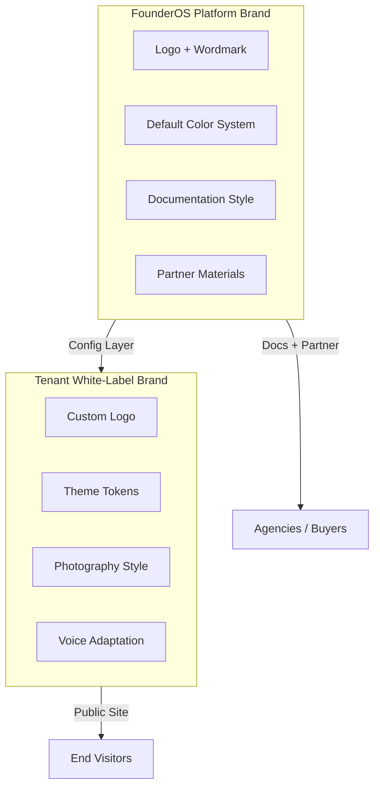
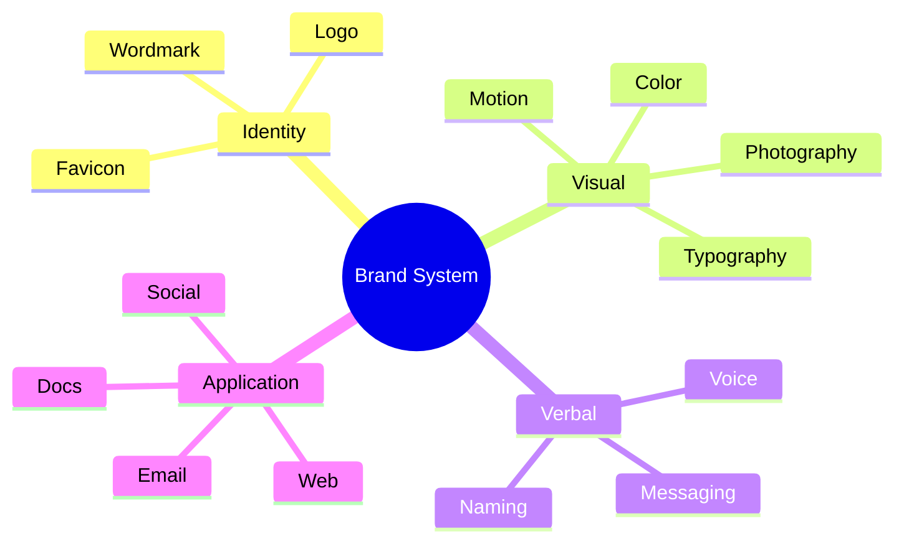

# FounderOS v1.0 — Brand Guidelines

| Field | Value |
|-------|-------|
| **Document ID** | DOC-01-00 |
| **Product** | Founder Portfolio Platform (FounderOS) |
| **Version** | 1.0 |
| **Status** | Approved |
| **Last Updated** | 2026-06-29 |
| **Owner** | Brand & Design |
| **Related** | [Brand Positioning](Brand_Positioning.md) · [Color System](Color_System.md) · [Typography](Typography.md) · [Logo Guidelines](Logo_Guidelines.md) · [Mission](Mission.md) |

---

## Purpose

This document is the **master brand reference** for FounderOS v1.0 — the rules governing how the platform brand and white-label tenant brands express identity across digital touchpoints. It ensures consistency for the reference tenant, marketing materials, documentation, and agency resale implementations.

Brand guidelines translate [Mission](Mission.md) and [Vision](Vision.md) into **actionable design and communication standards**.

---

## Scope

### In Scope

| Area | Description |
|------|-------------|
| Brand architecture | Platform vs tenant brand layers |
| Visual identity system | Logo, color, type, imagery, motion |
| Voice and tone | Summary with link to [Brand Voice](Brand_Voice.md) |
| Application contexts | Web, docs, social, email, presentations |
| White-label rules | What tenants customize vs inherit |
| Quality checklist | Brand audit criteria |

### Out of Scope

| Area | Description |
|------|-------------|
| Component-level UI specs | [Design System](../03_Design_System/Design_System.md) |
| Page wireframes | [02_UX](../02_UX/Wireframes.md) |
| Legal trademark filings | Legal team |

---

## Business Context

FounderOS serves **two brand layers**:

1. **Platform brand (FounderOS)** — Used in documentation, partner materials, and optional attribution
2. **Tenant brand (white-label)** — The founder's or client's public identity

Agency resale requires tenants to **replace platform branding entirely** on public surfaces while optionally retaining platform attribution in admin or license compliance contexts.

---

## Goals

| # | Goal | Success Indicator |
|---|------|-------------------|
| G1 | Single source of truth for brand decisions | Zero conflicting brand docs |
| G2 | Enable white-label in < 3 days without designer | Token-based theming |
| G3 | Premium perception supporting Pro/Enterprise pricing | Brand audit pass |
| G4 | Accessibility compliance across brand applications | WCAG contrast pass |
| G5 | Agency partners can rebrand clients confidently | Partner brand checklist |

---

## Functional Requirements

| ID | Requirement | Priority |
|----|-------------|----------|
| FR-BG-01 | Tenant must configure logo, colors, typography via admin or config | Must |
| FR-BG-02 | Default FounderOS brand assets shipped for platform contexts | Must |
| FR-BG-03 | Dark and light theme variants supported | Must |
| FR-BG-04 | Brand preview before publish in admin | Should |
| FR-BG-05 | Favicon and OG image generation from tenant brand | Must |
| FR-BG-06 | CSS variable export for custom tenant overrides | Must |
| FR-BG-07 | Brand compliance checklist in agency playbook | Should |

---

## Non-functional Requirements

| ID | Requirement | Target |
|----|-------------|--------|
| NFR-BG-01 | Brand asset load impact on LCP | < 100ms incremental |
| NFR-BG-02 | Logo SVG file size | < 15KB |
| NFR-BG-03 | Theme switch without layout shift | CLS < 0.1 |
| NFR-BG-04 | Brand doc cross-link integrity | 100% |

---

## User Stories

| ID | Story | Acceptance |
|----|-------|------------|
| US-BG-01 | As an **agency designer**, I want clear brand rules so that client sites feel premium | Guidelines complete |
| US-BG-02 | As a **founder**, I want to apply my brand without code so that I launch quickly | Admin brand config |
| US-BG-03 | As a **visitor**, I want cohesive visual experience so that I trust the founder | Cross-page consistency |
| US-BG-04 | As **marketing**, I want platform brand assets for collateral | Asset pack defined |

---

## UX Requirements

| ID | Requirement | Reference |
|----|-------------|-----------|
| UX-BG-01 | Visual hierarchy: logo → headline → CTA → content | All public templates |
| UX-BG-02 | Consistent spacing scale across pages | Design tokens |
| UX-BG-03 | Brand motion subtle and performant | [Motion Guidelines](Motion_Guidelines.md) |
| UX-BG-04 | Photography supports credibility not decoration | [Photography](Photography.md) |
| UX-BG-05 | Error and empty states use brand colors correctly | Component audit |

---

## Brand Architecture

### Brand Hierarchy

| Level | Name | Usage |
|-------|------|-------|
| L1 | Master brand | FounderOS platform, docs, partner deck |
| L2 | Tenant brand | Public website, emails, social |
| L3 | Module sub-brand | Optional product logos within tenant site |
| L4 | Campaign | Time-bound landing variants |

### Core Brand Elements

| Element | Document | Platform Default | Tenant Override |
|---------|----------|------------------|-----------------|
| Logo | [Logo Guidelines](Logo_Guidelines.md) | FounderOS mark | Required |
| Color | [Color System](Color_System.md) | Indigo/slate palette | Required |
| Typography | [Typography](Typography.md) | Inter + display pair | Recommended |
| Photography | [Photography](Photography.md) | Authentic founder imagery | Required |
| Motion | [Motion Guidelines](Motion_Guidelines.md) | Subtle fade/slide | Optional |
| Voice | [Brand Voice](Brand_Voice.md) | Confident, clear | Adapt tone |

---

## Application Standards

### Web (Public Site)

| Context | Rule |
|---------|------|
| Header | Tenant logo left; nav center/right; max height 40px |
| Hero | One primary message; single primary CTA |
| Footer | Legal links required; social icons optional |
| Cards | Consistent radius, shadow, border per design tokens |

### Documentation

| Context | Rule |
|---------|------|
| Platform docs | FounderOS branding; neutral prose |
| Tenant help (future) | Tenant brand optional |

### Social & Email

| Context | Rule |
|---------|------|
| OG images | 1200×630; tenant logo + headline |
| Email | Plain-text fallback; brand colors in header only |

---

## White-Label Compliance Checklist

| # | Item | Pass Criteria |
|---|------|---------------|
| 1 | Tenant logo on all public pages | No FounderOS logo on public site |
| 2 | Primary color contrast ≥ 4.5:1 on text | WCAG AA |
| 3 | Typography loaded with font-display swap | No FOIT > 1s |
| 4 | Favicon and OG image tenant-specific | Verified in browser + debugger |
| 5 | Voice matches founder persona | [Brand Voice](Brand_Voice.md) review |
| 6 | Photography authentic to tenant | No stock clichés |

---

## Technical Considerations

| Area | Implementation |
|------|----------------|
| Theme tokens | CSS variables: `--color-primary`, `--font-display`, etc. |
| Next.js | `theme.config.ts` or tenant DB settings |
| Assets | SVG logo preferred; WebP/AVIF for photography |
| CDN | Brand assets cached at edge |

See [Frontend Architecture](../04_Architecture/Frontend_Architecture.md), [Design System](../03_Design_System/Design_System.md).

---

## Security Considerations

| ID | Consideration |
|----|---------------|
| SEC-BG-01 | Uploaded logos validated (type, size) to prevent XSS |
| SEC-BG-02 | External font sources must use SRI or trusted CDN |
| SEC-BG-03 | Brand asset URLs must not expose internal paths |

---

## Acceptance Criteria

| # | Criterion | Verification |
|---|-----------|--------------|
| AC-BG-01 | All brand sub-docs cross-linked from this master doc | Link audit |
| AC-BG-02 | Default theme passes WCAG AA contrast | Automated scan |
| AC-BG-03 | White-label checklist validated on tenant #2 | Agency dry-run |
| AC-BG-04 | Brand assets defined for platform marketing | Asset inventory |

---

## Future Enhancements

| Enhancement | Benefit |
|-------------|---------|
| Brand kit ZIP export from admin | Agency handoff |
| AI brand consistency checker | Automated audit |
| Theme marketplace | Ecosystem revenue |
| Real-time brand preview on all page types | Faster iteration |

---

## Open Questions

| # | Question | Owner | Decision By |
|---|----------|-------|-------------|
| OQ-BG-01 | Mandatory "Powered by FounderOS" footer on Starter tier? | GTM + Legal | Pricing freeze |
| OQ-BG-02 | Provide Figma brand kit for agencies? | Design | v1.1 |
| OQ-BG-03 | Standard photography library for tenants without assets? | Design | GA |

---

## Cross-Reference Index

| Document | Relationship |
|----------|--------------|
| [Brand_Positioning](Brand_Positioning.md) | Market positioning |
| [Brand_Voice](Brand_Voice.md) | Verbal identity |
| [Mission](Mission.md) | Brand purpose |
| [Vision](Vision.md) | Brand aspiration |
| [06_Product_Strategy](../00_Project/06_Product_Strategy.md) | Strategic brand role |
