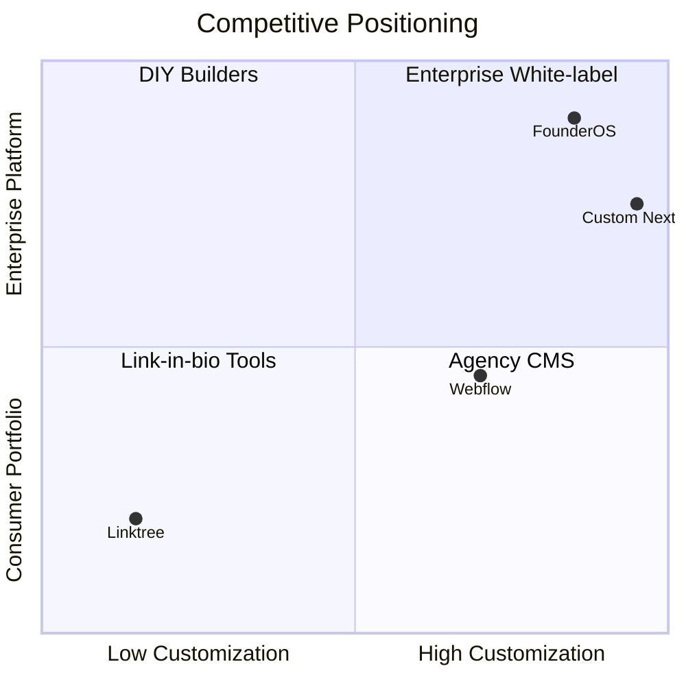

# FounderOS v1.0 — Brand Positioning

| Field | Value |
|-------|-------|
| **Document ID** | DOC-01-01 |
| **Product** | Founder Portfolio Platform (FounderOS) |
| **Version** | 1.0 |
| **Status** | Approved |
| **Last Updated** | 2026-06-29 |
| **Owner** | Brand / Product |
| **Related** | [Brand Guidelines](Brand_Guidelines.md) · [Mission](Mission.md) · [Vision](Vision.md) · [Brand Voice](Brand_Voice.md) · [Product Strategy](../00_Project/06_Product_Strategy.md) |

---

## Purpose

Define how FounderOS is positioned in the market — target segments, competitive differentiation, value propositions, and messaging pillars — so all product, marketing, and white-label communications speak with one strategic voice.

---

## Scope

### In Scope

- Market category definition
- Target audience segments and positioning statements
- Competitive landscape and differentiation
- Value propositions by persona
- Messaging hierarchy (master brand vs. tenant)
- Positioning for enterprise, agency, and solo-founder buyers

### Out of Scope

- Paid media campaign creative
- Tenant-specific positioning (configured per deployment)
- Pricing page copy (see [Business Model](../00_Project/05_Business_Model.md))

---

## Business Context

FounderOS competes at the intersection of **founder identity**, **enterprise credibility**, and **white-label SaaS**. Buyers are not shopping for a generic portfolio template — they need a platform that signals technical depth, scales to enterprise sales motions, and can be rebranded for agencies serving multiple founders.

| Segment | Pain | FounderOS Answer |
|---------|------|------------------|
| **Solo technical founder** | Portfolio looks dated; hard to maintain | API-driven CMS, premium design system |
| **Agency** | Rebuild founder sites per client | White-label tokens, multi-tenant ready |
| **Enterprise buyer** | Needs credibility + acquisition funnel | Enterprise page, case studies, compliance |
| **Open-source community** | Wants transparency | OSS page, GitHub integration |

---

## Goals

| # | Goal | Success Signal |
|---|------|----------------|
| G1 | Clear category ownership | "Founder identity platform" used consistently |
| G2 | Differentiate from template sites | Enterprise + white-label cited in 80% of sales decks |
| G3 | Support dual messaging (platform vs. tenant) | Zero brand confusion in partner onboarding |
| G4 | Align product roadmap to positioning | Every v1.0 feature maps to a pillar |

---

## Functional Requirements

| ID | Requirement | Priority |
|----|-------------|----------|
| FR-BP-01 | Positioning statement SHALL appear in README and marketing hero | P0 |
| FR-BP-02 | Each persona SHALL have a documented value proposition | P0 |
| FR-BP-03 | Competitive differentiators SHALL be listed in Enterprise page spec | P0 |
| FR-BP-04 | White-label positioning SHALL document "Powered by" removal tiers | P1 |
| FR-BP-05 | Messaging pillars SHALL map to site sections (Home, Products, Enterprise) | P0 |

---

## Non-functional Requirements

| ID | Requirement | Target |
|----|-------------|--------|
| NFR-BP-01 | Positioning docs readable by non-designers | Plain language, no jargon walls |
| NFR-BP-01 | Cross-link density | ≥ 3 related docs per page |
| NFR-BP-03 | Review cadence | Quarterly with product strategy |

---

## User Stories

| ID | As a… | I want… | So that… |
|----|-------|---------|----------|
| US-BP-001 | Product marketer | a single positioning doc | campaigns stay consistent |
| US-BP-002 | Agency partner | clear white-label value props | I sell FounderOS to clients |
| US-BP-003 | Enterprise buyer | proof we are platform-grade | I justify procurement |
| US-BP-004 | Designer | messaging pillars | visual hierarchy matches strategy |

---

## UX Requirements

- **Home hero** must reflect primary positioning: enterprise-grade founder identity.
- **Enterprise page** leads with differentiation table, not feature laundry list.
- **About page** reinforces founder credibility and mission alignment.
- **Admin co-brand** optional; never contradict tenant primary positioning.
- Tone on public pages follows [Brand Voice](Brand_Voice.md).

---

## Technical Considerations

- Positioning metadata may surface in `og:title` / `og:description` via [Metadata](../10_SEO/Metadata.md).
- Tenant `settings.brand.positioning` JSON field (future) for custom taglines.
- i18n: positioning strings externalized for white-label locales (v1.1).

---

## Security Considerations

- Competitive intelligence in internal docs — not exposed via public API.
- Tenant positioning overrides validated server-side; no XSS in custom taglines.

---

## Acceptance Criteria

- [ ] Positioning statement documented and approved
- [ ] Four personas mapped to value propositions
- [ ] Messaging pillars linked to Home, Enterprise, Products pages
- [ ] Competitive quadrant reviewed by product lead
- [ ] White-label tier rules documented
- [ ] Cross-links to Mission, Vision, Brand Voice verified

---

## Future Enhancements

- Dynamic positioning A/B tests on hero copy
- Partner-branded sales one-pagers generated from positioning API
- Localization packs for EU/APAC enterprise markets

---

## Open Questions

| # | Question | Owner |
|---|----------|-------|
| OQ-1 | Lead with "FounderOS" or "Founder Portfolio Platform" externally? | Brand |
| OQ-2 | Include pricing comparison table on Enterprise page? | Product |
| OQ-3 | Co-brand "Powered by" default on or off for Agency tier? | Sales |
