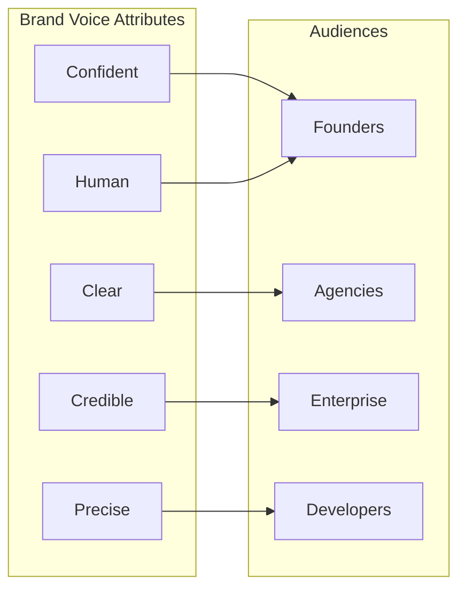
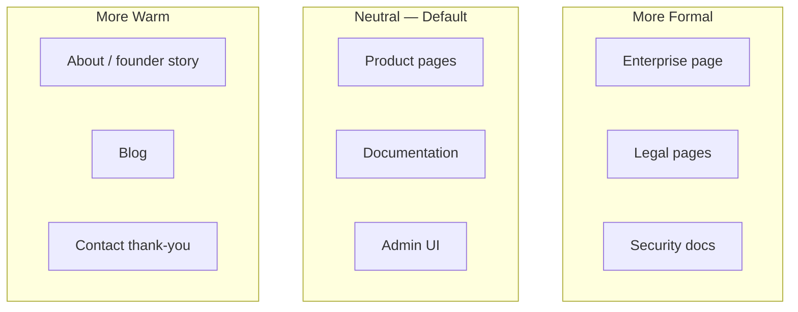

# FounderOS v1.0 — Brand Voice

| Field | Value |
|-------|-------|
| **Document ID** | DOC-01-02 |
| **Product** | Founder Portfolio Platform (FounderOS) |
| **Version** | 1.0 |
| **Status** | Approved |
| **Last Updated** | 2026-06-29 |
| **Owner** | Brand & Content |
| **Related** | [Brand Guidelines](Brand_Guidelines.md) · [Brand Positioning](Brand_Positioning.md) · [Mission](Mission.md) · [User Personas](../00_Project/03_User_Personas.md) |

---

## Purpose

This document defines the **verbal identity** of FounderOS — tone, vocabulary, grammar, messaging patterns, and channel-specific adaptations. Voice ensures platform marketing, documentation, default UI copy, and tenant guidance sound coherent and premium.

Voice is how the brand **feels in words**. Tenants adapt voice to their founder persona while inheriting structural patterns (clarity, brevity, credibility).

---

## Scope

### In Scope

| Area | Description |
|------|-------------|
| Voice attributes | Core personality traits |
| Tone spectrum | Contextual adjustments |
| Vocabulary | Preferred and banned terms |
| Grammar and style | Numbers, capitalization, punctuation |
| Channel guides | Web, docs, email, social, admin UI |
| Tenant adaptation rules | White-label voice flexibility |
| Before/after examples | Copy transformations |

### Out of Scope

| Area | Description |
|------|-------------|
| Full content calendar | Marketing ops |
| Legal/compliance copy | Legal review |
| Tenant blog editorial | Tenant responsibility |

---

## Business Context

FounderOS audiences range from **technical founders** to **enterprise procurement**. Voice must be **confident and clear** without startup hype or enterprise stiffness. Poor voice erodes the premium positioning defined in [Brand Positioning](Brand_Positioning.md).

---

## Goals

| # | Goal | Indicator |
|---|------|-----------|
| G1 | Consistent voice across platform touchpoints | Copy audit pass |
| G2 | Tenants can adapt voice without breaking clarity | Adaptation guide used |
| G3 | UI microcopy reduces support tickets | Error message clarity |
| G4 | Enterprise copy builds trust not hype | Enterprise page review |
| G5 | Documentation readable by implementers | Doc readability score |

---

## Functional Requirements

| ID | Requirement | Priority |
|----|-------------|----------|
| FR-BV-01 | Default UI strings must follow voice guide | Must |
| FR-BV-02 | Error messages must be human-readable with action steps | Must |
| FR-BV-03 | Form labels and validation copy must be concise | Must |
| FR-BV-04 | CMS must support rich text without voice-breaking HTML defaults | Should |
| FR-BV-05 | Enterprise form copy must use institutional tone variant | Must |
| FR-BV-06 | Documentation prose must follow style guide | Must |

---

## Non-functional Requirements

| ID | Requirement | Target |
|----|-------------|--------|
| NFR-BV-01 | Hero headline word count | ≤ 12 words |
| NFR-BV-02 | Button label word count | ≤ 3 words |
| NFR-BV-03 | Error message reading level | Grade 8 or below |
| NFR-BV-04 | i18n-ready string externalization | 100% UI strings |

---

## User Stories

| ID | Story | Acceptance |
|----|-------|------------|
| US-BV-01 | As a **visitor**, I want clear language so that I understand the founder's offer quickly | Hero scan test |
| US-BV-02 | As a **content editor**, I want microcopy examples so that admin UI stays consistent | String catalog |
| US-BV-03 | As an **enterprise buyer**, I want professional tone so that I trust the vendor | Enterprise copy review |
| US-BV-04 | As a **developer**, I want precise docs so that I implement without guessing | Doc style compliance |

---

## UX Requirements

| ID | Requirement |
|----|-------------|
| UX-BV-01 | Primary CTA verbs: action-oriented (Start, Request, Explore) |
| UX-BV-02 | Empty states explain what to do next in one sentence |
| UX-BV-03 | Success toasts confirm outcome + optional next step |
| UX-BV-04 | Avoid jargon in public UI; technical terms OK in docs/API |
| UX-BV-05 | Headlines sentence case; product names title case |

---

## Voice Attributes

| Attribute | Definition | Sounds Like | Does Not Sound Like |
|-----------|------------|-------------|---------------------|
| **Confident** | Assured without arrogance | "Built for founders who ship." | "We're the best ever." |
| **Clear** | Plain language, short sentences | "Deploy in two weeks." | "Leverage synergistic paradigms." |
| **Credible** | Evidence-based claims | "130+ implementation specs." | "Revolutionary game-changer." |
| **Human** | Conversational professionalism | "You shouldn't need an engineer to publish a post." | Corporate boilerplate |
| **Precise** | Specific over vague | "Enterprise acquisition portal with CRM webhooks." | "Powerful enterprise features." |

### Tone Spectrum by Context

| Context | Tone Adjustment | Example |
|---------|-----------------|---------|
| Enterprise | +Formal, +Precise | "Submit a confidential acquisition inquiry." |
| Blog | +Warm, +Human | "Here's what we learned shipping v1." |
| Admin errors | +Clear, +Helpful | "Upload failed. Use JPG or PNG under 5MB." |
| Docs | +Precise, neutral | "The endpoint returns 404 when the slug is not found." |

---

## Vocabulary

### Preferred Terms

| Use | Instead Of |
|-----|------------|
| Founder identity platform | Website builder |
| Tenant | Customer site (internal) |
| Module | Plugin |
| Deploy | Go live |
| White-label | Rebrandable |
| Implementation-ready | Turnkey (overused) |

### Banned or Avoid

| Avoid | Why |
|-------|-----|
| Revolutionary, disruptive, game-changing | Hype; erodes credibility |
| Simple (unless proven) | Dismisses complexity |
| Just / merely | Minimizes value |
| Synergy, leverage (as verbs) | Corporate cliché |
| Ninja, rockstar, guru | Unprofessional |

---

## Grammar & Style Rules

| Rule | Standard |
|------|----------|
| Headlines | Sentence case |
| Product name | FounderOS (no space); "Founder Portfolio Platform" in formal docs |
| Numbers | Numerals for 2+; spell out one |
| Oxford comma | Yes |
| Contractions | OK in marketing and blog; avoid in legal/enterprise |
| Acronyms | Spell out on first use in docs |
| Button labels | No periods; title case for 2+ words |

---

## Channel Guidelines

### Public Website

| Element | Guideline | Example |
|---------|-----------|---------|
| Hero headline | Who + outcome | "Build products. Tell your story. Close deals." |
| Subhead | How + differentiation | "One white-label platform for founder-led brands." |
| CTA | Verb + object | "Explore the platform" |
| Testimonials | Specific outcomes | "Cut our launch time from 6 weeks to 10 days." |

### Documentation

- Second person ("you") for instructions
- Active voice
- Present tense for behavior descriptions
- Imperative for steps: "Configure the environment variables."

### Admin UI

- Short labels; helper text for complexity
- Errors: what happened + how to fix
- Confirmations: past tense outcome

### Enterprise

- No exclamation marks
- Formal salutations in email templates
- Privacy and confidentiality language prominent

---

## Tenant Voice Adaptation

| Layer | Tenant Control | Platform Constraint |
|-------|----------------|---------------------|
| Personality | Full (witty, academic, bold) | Must remain clear |
| Vocabulary | Industry-specific terms encouraged | No misleading claims |
| Tone | Adjust per [User Personas](../00_Project/03_User_Personas.md) | Enterprise module stays formal |
| Structure | Hero formula recommended | CTA required on key pages |

---

## Before / After Examples

| Context | ❌ Before | ✓ After |
|---------|----------|---------|
| Hero | "The ultimate disruptive platform for modern entrepreneurs!" | "Your brand, products, and proof — one platform." |
| CTA | "Click here" | "Request a demo" |
| Error | "Error 422" | "Enter a valid email address." |
| Enterprise | "Let's chat!!!" | "Submit a confidential inquiry." |
| Feature | "Powerful CMS capabilities" | "Publish posts, products, and case studies without code." |

---

## Technical Considerations

| Area | Implementation |
|------|----------------|
| i18n | Externalize strings; voice guide per locale (future) |
| CMS defaults | Seed copy follows voice guide |
| AI content (future) | Prompt templates include voice attributes |

---

## Security Considerations

| ID | Consideration |
|----|---------------|
| SEC-BV-01 | Voice must not overpromise security capabilities |
| SEC-BV-02 | Phishing-aware copy in auth flows (no urgency manipulation) |

---

## Acceptance Criteria

| # | Criterion | Verification |
|---|-----------|--------------|
| AC-BV-01 | Voice attributes documented with examples | Content review |
| AC-BV-02 | UI string catalog reviewed against guide | Engineering audit |
| AC-BV-03 | Enterprise copy tone distinct from marketing | Page review |
| AC-BV-04 | Tenant adaptation rules in agency playbook | Partner review |

---

## Future Enhancements

| Enhancement | Benefit |
|-------------|---------|
| AI voice linter for CMS content | Consistency at scale |
| Locale-specific voice guides | Global expansion |
| Industry voice packs (AI, SaaS, OSS) | Faster tenant onboarding |

---

## Open Questions

| # | Question | Owner | Decision By |
|---|----------|-------|-------------|
| OQ-BV-01 | Allow humor in default platform marketing? | Brand | GTM launch |
| OQ-BV-02 | Formal "Founder Portfolio Platform" vs casual "FounderOS" in enterprise? | Marketing | Enterprise page freeze |
| OQ-BV-03 | Provide tenant copy templates per persona? | Content | v1.1 |

---

## Cross-Reference Index

| Document | Relationship |
|----------|--------------|
| [Brand_Guidelines](Brand_Guidelines.md) | Master brand system |
| [Brand_Positioning](Brand_Positioning.md) | Messaging source |
| [03_User_Personas](../00_Project/03_User_Personas.md) | Audience voice needs |
| [04_User_Journey](../00_Project/04_User_Journey.md) | Contextual tone per stage |
