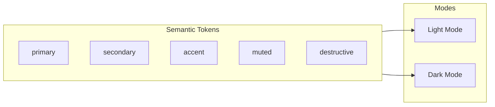

# FounderOS v1.0 — Color System

| Field | Value |
|-------|-------|
| **Document ID** | DOC-01-06 |
| **Product** | Founder Portfolio Platform (FounderOS) |
| **Version** | 1.0 |
| **Status** | Approved |
| **Last Updated** | 2026-06-29 |
| **Owner** | Brand / Design |
| **Related** | [Brand Guidelines](Brand_Guidelines.md) · [Typography](Typography.md) · [Design System](../03_Design_System/Design_System.md) |

---

## Purpose

This document defines the **color system** for FounderOS v1.0 — palettes, semantic tokens, dark mode, accessibility contrast, and white-label override rules. Color communicates brand personality, hierarchy, and interactive state.

---

## Scope

### In Scope

- Default (reference) color palette
- Semantic color tokens
- Light and dark mode mappings
- shadcn/ui theme integration
- White-label override schema
- Accessibility contrast requirements
- Usage do's and don'ts

### Out of Scope

- Tenant-specific palettes (per-deployment config)
- Data visualization color scales (v1.2 analytics)
- Print color (CMYK)

---

## Business Context

FounderOS default palette targets **premium tech-founder aesthetic**: confident blues, clean neutrals, purposeful accent. Tenants override via CSS variables while preserving semantic token structure (primary, destructive, muted, etc.).



---

## Goals

| # | Goal |
|---|------|
| G1 | WCAG AA contrast on all text/background pairs |
| G2 | Light and dark mode parity |
| G3 | White-label color swap without breaking semantics |
| G4 | shadcn/ui theme fully tokenized |
| G5 | Color communicates hierarchy, not decoration |

---

## Default Palette (Reference Tenant)

### Primary — Blue

| Token | Light Mode HSL | Hex (approx) | Usage |
|-------|----------------|--------------|-------|
| `--primary` | 220 90% 56% | #2563EB | CTAs, links, focus rings |
| `--primary-foreground` | 0 0% 100% | #FFFFFF | Text on primary |

### Accent — Teal

| Token | Light Mode HSL | Hex (approx) | Usage |
|-------|----------------|--------------|-------|
| `--accent` | 160 84% 39% | #10B981 | Highlights, badges, success hints |
| `--accent-foreground` | 0 0% 100% | #FFFFFF | Text on accent |

### Neutrals

| Token | Light HSL | Dark HSL | Usage |
|-------|-----------|----------|-------|
| `--background` | 0 0% 100% | 224 71% 4% | Page background |
| `--foreground` | 224 71% 4% | 210 40% 98% | Primary text |
| `--card` | 0 0% 100% | 224 71% 6% | Card surfaces |
| `--card-foreground` | 224 71% 4% | 210 40% 98% | Card text |
| `--muted` | 220 14% 96% | 215 28% 17% | Subtle backgrounds |
| `--muted-foreground` | 220 9% 46% | 215 20% 65% | Secondary text |
| `--border` | 220 13% 91% | 215 28% 17% | Borders, dividers |
| `--input` | 220 13% 91% | 215 28% 17% | Input borders |
| `--ring` | 220 90% 56% | 220 90% 56% | Focus ring |

### Semantic

| Token | Light HSL | Usage |
|-------|-----------|-------|
| `--destructive` | 0 84% 60% | Errors, delete actions |
| `--destructive-foreground` | 0 0% 100% | Text on destructive |
| `--success` | 160 84% 39% | Success states (maps to accent) |
| `--warning` | 38 92% 50% | Warnings |
| `--info` | 220 90% 56% | Informational (maps to primary) |

---

## Color Usage Matrix

| Surface | Token | Text Token |
|---------|-------|------------|
| Page background | `--background` | `--foreground` |
| Card / panel | `--card` | `--card-foreground` |
| Primary button | `--primary` | `--primary-foreground` |
| Secondary button | `--secondary` | `--secondary-foreground` |
| Ghost button hover | `--muted` | `--foreground` |
| Input field | `--background` | `--foreground` |
| Disabled | `--muted` | `--muted-foreground` |
| Link | `--primary` | — |
| Link hover | `--primary` (80% opacity) | — |

---

## Functional Requirements

| ID | Requirement |
|----|-------------|
| FR-CS-01 | All colors defined as HSL CSS custom properties |
| FR-CS-02 | shadcn/ui theme uses semantic tokens exclusively |
| FR-CS-03 | Dark mode via `class="dark"` on `<html>` |
| FR-CS-04 | Tenant override: `--primary`, `--accent`, `--background` minimum |
| FR-CS-05 | Focus ring visible on all interactive elements |
| FR-CS-06 | Destructive color only for destructive actions |
| FR-CS-07 | Chart/data colors deferred to v1.2 |

---

## Non-functional Requirements

| ID | Requirement | Target |
|----|-------------|--------|
| NFR-CS-01 | Body text contrast | ≥ 4.5:1 |
| NFR-CS-02 | Large text contrast (≥18px bold / 24px) | ≥ 3:1 |
| NFR-CS-03 | UI component contrast | ≥ 3:1 (WCAG AA non-text) |
| NFR-CS-04 | Color not sole indicator of state | Icon/text accompany color |
| NFR-CS-05 | Dark mode contrast parity | Same ratios as light |

---

## User Stories

| ID | Story |
|----|-------|
| US-CS-01 | As a **visitor**, I want sufficient contrast so that I can read in bright sunlight |
| US-CS-02 | As an **agency**, I want to set client brand colors via config |
| US-CS-03 | As a **dark mode user**, I want comfortable reading at night |
| US-CS-04 | As a **colorblind user**, I want state changes indicated beyond color alone |

---

## UX Requirements

| ID | Requirement |
|----|-------------|
| UX-CS-01 | Primary CTA uses `--primary`; max one primary CTA per viewport |
| UX-CS-02 | Accent used sparingly (badges, highlights, not full sections) |
| UX-CS-03 | Muted backgrounds for alternating sections |
| UX-CS-04 | Error states: red border + icon + message (not color alone) |
| UX-CS-05 | Success states: green icon + message |
| UX-CS-06 | Theme toggle in header (if dark mode enabled) |

---

## White-label Override

```yaml
# tenant.brand.yml
colors:
  primary: "220 90% 56%"        # HSL values only (no hsl() wrapper)
  primary_foreground: "0 0% 100%"
  accent: "160 84% 39%"
  accent_foreground: "0 0% 100%"
  # Optional: full override
  background: "0 0% 100%"
  foreground: "224 71% 4%"
```

```css
/* Applied at runtime */
:root {
  --primary: hsl(var(--tenant-primary, 220 90% 56%));
}
```

### Preset Themes (v1.1)

| Preset | Primary | Accent | Audience |
|--------|---------|--------|----------|
| **Founder Blue** (default) | Blue 220 | Teal 160 | SaaS, AI |
| **Agency Violet** | Violet 262 | Amber 38 | Agencies, creative |
| **Creator Coral** | Rose 350 | Orange 25 | Creators, travel |
| **Enterprise Slate** | Slate 215 | Blue 220 | Enterprise SaaS |

---

## Technical Considerations

### globals.css Structure

```css
@layer base {
  :root {
    --background: 0 0% 100%;
    --foreground: 224 71% 4%;
    --primary: 220 90% 56%;
    --primary-foreground: 0 0% 100%;
  /* ... full token set */
  }

  .dark {
    --background: 224 71% 4%;
    --foreground: 210 40% 98%;
  /* ... dark overrides */
  }
}
```

### Tailwind Integration

```typescript
colors: {
  background: 'hsl(var(--background))',
  foreground: 'hsl(var(--foreground))',
  primary: {
    DEFAULT: 'hsl(var(--primary))',
    foreground: 'hsl(var(--primary-foreground))',
  },
  // ...
},
```

---

## Security Considerations

| Concern | Mitigation |
|---------|------------|
| CSS injection via tenant colors | Validate HSL format server-side |
| Contrast failure on custom colors | Optional contrast checker in admin (v1.1) |

---

## Color Do's and Don'ts

### Do

- ✅ Use semantic tokens (`bg-primary`, `text-muted-foreground`)
- ✅ Test both light and dark mode
- ✅ Verify contrast with WebAIM checker
- ✅ Use opacity modifiers for hover states (`primary/90`)

### Don't

- ❌ Hardcode hex values in components
- ❌ Use primary color for large background fills
- ❌ Rely on color alone for errors/success
- ❌ Mix hex and HSL in same codebase
- ❌ Use more than 2 chromatic colors per page (primary + accent)

---

## Assumptions

| ID | Assumption |
|----|------------|
| A-CS-01 | HSL format preferred for shadcn compatibility |
| A-CS-02 | Most tenants change primary + accent only |
| A-CS-03 | Dark mode opt-in per tenant |

---

## Risks

| Risk | Mitigation |
|------|------------|
| Tenant colors fail contrast | Admin contrast warning |
| Dark mode broken on custom colors | Provide dark palette generator (v1.1) |
| Color inconsistency across pages | Token-only policy in code review |

---

## Dependencies

| Dependency | Notes |
|------------|-------|
| [Typography](Typography.md) | Text on colored surfaces |
| [Brand_Guidelines](Brand_Guidelines.md) | Token architecture |
| shadcn/ui | Theme format |
| TailwindCSS | Utility mapping |

---

## Glossary

| Term | Definition |
|------|------------|
| **Semantic token** | Named color by purpose (primary), not value (blue) |
| **HSL** | Hue, Saturation, Lightness color model |
| **Foreground** | Text/icon color paired with a surface token |
| **Contrast ratio** | Luminance difference between text and background |

---

## Acceptance Criteria

- [ ] Full light and dark token sets documented
- [ ] Semantic usage matrix complete
- [ ] White-label override schema defined
- [ ] WCAG AA contrast verified on default palette
- [ ] shadcn/ui integration pattern documented
- [ ] Do's and don'ts checklist included

---

## Future Enhancements

| Enhancement | Phase |
|-------------|-------|
| Admin color picker with contrast preview | v1.1 |
| Preset theme library | v1.1 |
| OKLCH color space migration | v2.0 |
| Analytics chart palette | v1.2 |

---

## Open Questions

| # | Question | Status |
|---|----------|--------|
| OQ-CS-01 | Force dark mode default for tech aesthetic? | No — respect system preference |
| OQ-CS-02 | Allow tenant custom destructive color? | No — keep semantic red |

---

## Related Documents

| Document | Relationship |
|----------|--------------|
| [Brand_Guidelines](Brand_Guidelines.md) | Master system |
| [Typography](Typography.md) | Text contrast |
| [Motion_Guidelines](Motion_Guidelines.md) | Color transitions |
| [03_Design_System](../03_Design_System/) | Component colors |

---

*Documentation © FounderOS v1.0.*
