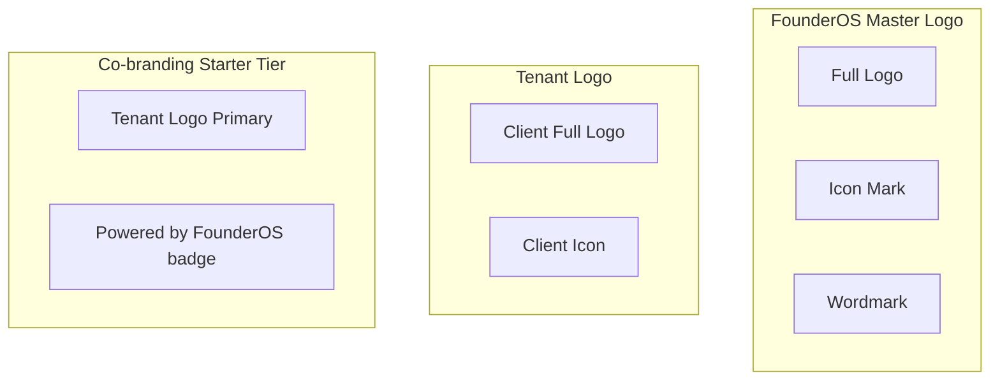
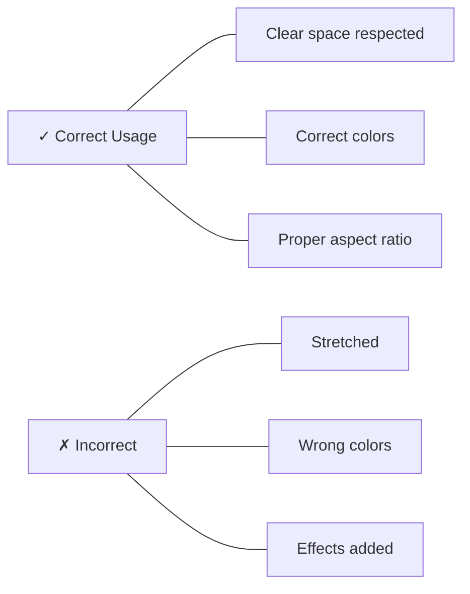

# FounderOS v1.0 — Logo Guidelines

| Field | Value |
|-------|-------|
| **Document ID** | DOC-01-09 |
| **Product** | Founder Portfolio Platform (FounderOS) |
| **Version** | 1.0 |
| **Status** | Approved |
| **Last Updated** | 2026-06-29 |
| **Owner** | Brand / Design |
| **Related** | [Brand Guidelines](Brand_Guidelines.md) · [Color System](Color_System.md) · [Typography](Typography.md) |

---

## Purpose

This document defines **logo usage standards** for the FounderOS master brand and provides **white-label logo guidelines** for tenant deployments. The logo is the most recognizable brand asset — consistent usage builds trust; misuse erodes it.

---

## Scope

### In Scope

- FounderOS master logo specifications
- Logo variants (primary, icon, wordmark)
- Clear space, minimum size, color versions
- Incorrect usage examples
- Tenant logo replacement guidelines
- Favicon and app icon standards
- Co-branding ("Powered by FounderOS") rules

### Out of Scope

- Tenant logo design (tenant responsibility)
- Trademark registration process
- Merchandise/print applications

---

## Business Context

FounderOS operates **dual logo contexts**:

| Context | Logo | Visibility |
|---------|------|------------|
| **Master brand** | FounderOS logo | Platform marketing, docs, partner materials |
| **Tenant site** | Tenant logo | All public pages, OG images, favicon |
| **Co-brand** | Tenant primary + optional "Powered by" | Starter tier only |



---

## Goals

| # | Goal |
|---|------|
| G1 | Master logo used consistently on platform materials |
| G2 | Tenants replace logo via config without code changes |
| G3 | Logo renders crisply on all devices and densities |
| G4 | Clear space and minimum size prevent illegibility |
| G5 | Co-branding rules enforce tier licensing |

---

## FounderOS Master Logo

### Logo Concept

The FounderOS master logo combines a **geometric mark** (stylized "F" monogram suggesting forward motion / building) with the **wordmark** "FounderOS" set in Inter Semibold.

| Variant | Composition | Primary Use |
|---------|-------------|-------------|
| **Full logo** | Mark + wordmark horizontal | Website header, documents |
| **Icon mark** | Monogram only | Favicon, app icon, social avatar |
| **Wordmark** | "FounderOS" text only | Narrow contexts, footer |
| **Stacked** | Mark above wordmark | Square formats, social |

### Logo Files

| File | Format | Size | Usage |
|------|--------|------|-------|
| `founderos-logo-full-light.svg` | SVG | Vector | Light backgrounds |
| `founderos-logo-full-dark.svg` | SVG | Vector | Dark backgrounds |
| `founderos-icon-light.svg` | SVG | Vector | Favicon source (light) |
| `founderos-icon-dark.svg` | SVG | Vector | Favicon source (dark) |
| `founderos-logo-full-light.png` | PNG @2x | 400×80px | Email, fallback |
| `founderos-icon-512.png` | PNG | 512×512px | App icon source |

*Asset files located in `/public/brand/founderos/` (master brand only).*

---

## Logo Color Versions

| Version | Mark Color | Wordmark Color | Background |
|---------|------------|----------------|------------|
| **Primary (light bg)** | `--primary` (Blue) | `--foreground` | White/light |
| **Primary (dark bg)** | `--primary` (Blue) | `--foreground` (light) | Dark |
| **Monochrome dark** | `#000000` | `#000000` | Light only |
| **Monochrome light** | `#FFFFFF` | `#FFFFFF` | Dark only |
| **Single color** | `--primary` | `--primary` | When color logo not possible |

---

## Clear Space

Minimum clear space around the logo = **height of the mark** on all sides.

```
        ┌─── X ───┐
        │         │
    X ─ │  [LOGO] │ ─ X
        │         │
        └─── X ───┘

    X = height of icon mark
```

| Variant | Clear Space |
|---------|-------------|
| Full logo | 1× mark height all sides |
| Icon only | 0.5× mark width all sides |
| Wordmark | 0.5× cap height all sides |

---

## Minimum Size

| Variant | Print | Digital |
|---------|-------|---------|
| Full logo | 30mm wide | 120px wide |
| Icon mark | 10mm | 24px (favicon minimum) |
| Wordmark | 25mm wide | 100px wide |

Below minimum sizes, use **icon mark only**.

---

## Functional Requirements

| ID | Requirement |
|----|-------------|
| FR-LG-01 | Tenant logo swap via `tenant.brand.logo` config |
| FR-LG-02 | SVG preferred; PNG @2x fallback |
| FR-LG-03 | Light and dark logo variants per tenant |
| FR-LG-04 | Favicon auto-generated from icon (32, 180, 512px) |
| FR-LG-05 | Logo in header links to homepage |
| FR-LG-06 | OG image includes tenant logo |
| FR-LG-07 | "Powered by FounderOS" badge on Starter tier footer |
| FR-LG-08 | Badge removable on Pro+ tier |

---

## Non-functional Requirements

| ID | Requirement | Target |
|----|-------------|--------|
| NFR-LG-01 | Logo render crisp on retina | SVG or @2x PNG |
| NFR-LG-02 | Logo file size | SVG ≤ 10KB; PNG ≤ 50KB |
| NFR-LG-03 | Favicon visible at 16×16 | Simplified icon mark |
| NFR-LG-04 | Logo load does not block LCP | `priority` only on above-fold |

---

## User Stories

| ID | Story |
|----|-------|
| US-LG-01 | As an **agency**, I want to upload client logos in light/dark variants |
| US-LG-02 | As a **visitor**, I want to recognize the brand immediately in the header |
| US-LG-03 | As a **founder on Pro tier**, I want no FounderOS branding on my site |
| US-LG-04 | As a **designer**, I want clear space rules so that I don't crowd the logo |

---

## UX Requirements

| ID | Requirement |
|----|-------------|
| UX-LG-01 | Logo in header left-aligned; max height 40px (desktop), 32px (mobile) |
| UX-LG-02 | Logo maintains aspect ratio at all sizes |
| UX-LG-03 | Dark mode auto-switches to dark logo variant |
| UX-LG-04 | Footer logo optional; smaller than header (max 28px height) |
| UX-LG-05 | "Powered by" badge: small, muted, footer only |

---

## Tenant Logo Guidelines

### Upload Requirements

| Attribute | Specification |
|-----------|---------------|
| **Format** | SVG (preferred) or PNG with transparency |
| **Variants** | Light background version + dark background version |
| **Max file size** | 500KB per file |
| **Aspect ratio** | Horizontal preferred; max 4:1 width:height |
| **Min width** | 200px (PNG) |

### Tenant Logo Config

```yaml
logo:
  light: "/assets/acme/logo-light.svg"
  dark: "/assets/acme/logo-dark.svg"
  icon: "/assets/acme/icon.svg"       # optional; falls back to light
  favicon: "/assets/acme/favicon.ico"
  alt: "Acme Labs"
```

### Design Recommendations for Tenants

| Do | Don't |
|----|-------|
| Simple, recognizable mark | Overly detailed illustrations |
| Works at 24px (favicon) | Thin lines that disappear small |
| Horizontal layout for header | Vertical-only logos (use stacked in square contexts) |
| Transparent background (PNG/SVG) | White box around logo on dark mode |
| Professional typography in wordmark | Script fonts, excessive gradients |

---

## Co-branding: "Powered by FounderOS"

| Attribute | Specification |
|-----------|---------------|
| **Tier** | Starter / Founder SaaS only |
| **Placement** | Footer, right-aligned or centered |
| **Size** | Max 16px height |
| **Color** | `--muted-foreground` |
| **Content** | "Powered by FounderOS" with small icon mark |
| **Link** | Links to FounderOS marketing site |
| **Removable** | Pro, Growth, Agency tiers |

---

## Incorrect Usage (Master Brand)

| ❌ Don't | Why |
|----------|-----|
| Stretch or distort proportions | Breaks brand recognition |
| Rotate the logo | Unprofessional |
| Change logo colors outside palette | Brand inconsistency |
| Add effects (shadow, glow, outline) | Reduces clarity |
| Place on busy photography without overlay | Illegible |
| Recreate or modify the mark | Trademark integrity |
| Use outdated logo versions | Brand confusion |
| Place logo smaller than minimum size | Illegible |



---

## Favicon Specification

| Size | Format | Usage |
|------|--------|-------|
| 16×16 | ICO / PNG | Browser tab |
| 32×32 | PNG | Browser tab retina |
| 180×180 | PNG | Apple touch icon |
| 512×512 | PNG | PWA manifest |

Generate from simplified icon mark (monogram only, no wordmark).

### Next.js Implementation

```tsx
// app/layout.tsx
export const metadata = {
  icons: {
    icon: '/assets/tenant/favicon.ico',
    apple: '/assets/tenant/apple-touch-icon.png',
  },
};
```

---

## Technical Considerations

| Consideration | Implementation |
|---------------|----------------|
| SVG sanitization | Strip scripts on upload |
| Dark mode swap | CSS `dark:` variant or JS theme check |
| Responsive sizing | `h-8 md:h-10 w-auto` Tailwind pattern |
| Preload | `priority` on header logo image |
| Alt text | Tenant brand name from config |

---

## Security Considerations

| Concern | Mitigation |
|---------|------------|
| SVG XSS in tenant logos | Sanitize SVG uploads server-side |
| Logo hotlinking | Serve from tenant CDN path |
| Trademark infringement | Tenant responsible; ToS clause |

---

## Assumptions

| ID | Assumption |
|----|------------|
| A-LG-01 | Tenants provide their own logo assets |
| A-LG-02 | Master FounderOS logo not shown on Pro+ tenant sites |
| A-LG-03 | Icon mark works at 16px for favicon |

---

## Risks

| Risk | Mitigation |
|------|------------|
| Low-quality tenant logos | Upload guidelines + preview |
| Master brand unknown due to white-label | Separate master brand marketing |
| Logo IP disputes | ToS indemnification clause |

---

## Dependencies

| Dependency | Notes |
|------------|-------|
| [Brand_Guidelines](Brand_Guidelines.md) | Master system |
| [Color_System](Color_System.md) | Logo colors |
| [Typography](Typography.md) | Wordmark font |
| [05_Business_Model](../00_Project/05_Business_Model.md) | Co-brand tier rules |

---

## Glossary

| Term | Definition |
|------|------------|
| **Wordmark** | Text-only logo (company name styled) |
| **Icon mark** | Symbol/monogram without text |
| **Clear space** | Minimum empty area around logo |
| **Co-branding** | Two brands shown together |
| **Favicon** | Browser tab icon |

---

## Acceptance Criteria

- [ ] Master logo variants documented
- [ ] Clear space and minimum size defined
- [ ] Color versions specified
- [ ] Tenant logo upload guidelines complete
- [ ] Co-branding rules tied to licensing tiers
- [ ] Favicon specification documented
- [ ] Incorrect usage examples listed
- [ ] Implementation patterns for Next.js included

---

## Future Enhancements

| Enhancement | Phase |
|-------------|-------|
| Logo upload preview in admin | v1.0.1 |
| Auto favicon generation from upload | v1.1 |
| Logo design template for tenants | v1.1 |
| Brand asset export pack (ZIP) | v1.1 |

---

## Open Questions

| # | Question | Status |
|---|----------|--------|
| OQ-LG-01 | Final FounderOS mark design — geometric F or abstract? | Design in progress |
| OQ-LG-02 | Animated logo for master brand site? | Static only v1.0 |

---

## Related Documents

| Document | Relationship |
|----------|--------------|
| [Brand_Guidelines](Brand_Guidelines.md) | Master brand system |
| [Color_System](Color_System.md) | Logo colors |
| [Typography](Typography.md) | Wordmark typeface |
| [05_Business_Model](../00_Project/05_Business_Model.md) | Tier co-brand rules |

---

*Documentation © FounderOS v1.0.*
