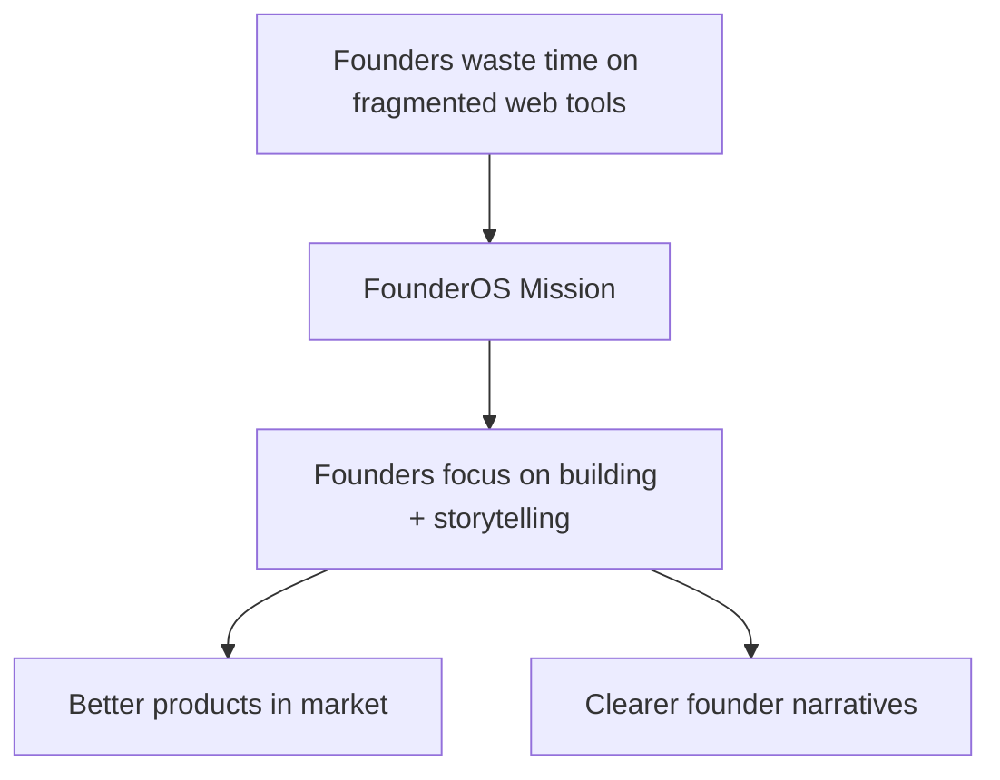
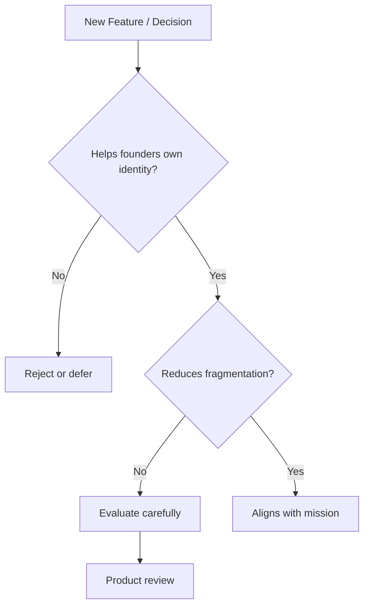

# FounderOS v1.0 — Mission

| Field | Value |
|-------|-------|
| **Document ID** | DOC-01-03 |
| **Product** | Founder Portfolio Platform (FounderOS) |
| **Version** | 1.0 |
| **Status** | Approved |
| **Last Updated** | 2026-06-29 |
| **Owner** | Leadership / Brand |
| **Related** | [Vision](Vision.md) · [Brand Positioning](Brand_Positioning.md) · [Project Vision](../00_Project/00_Project_Vision.md) · [Mission-driven Goals](../00_Project/01_Project_Goals.md) |

---

## Purpose

This document defines the **mission** of FounderOS — the enduring purpose that guides product decisions, hiring, partnerships, and brand expression. Mission answers *why we exist today*; [Vision](Vision.md) answers *where we're going tomorrow*.

---

## Scope

### In Scope

- Mission statement and elaboration
- Mission pillars (how mission manifests in product)
- Mission-to-feature mapping
- Mission alignment criteria for decisions
- Stakeholder communication of mission

### Out of Scope

- Quarterly OKRs (see [KPIs](../00_Project/08_KPIs.md))
- Tenant missions (each founder defines their own)

---

## Business Context

Founders spend disproportionate time on **digital presence infrastructure** instead of building products. The mission addresses this imbalance by providing a complete, reusable platform so founders can **own their narrative** without becoming part-time web developers.

---

## Mission Statement

> **Empower every founder to own a world-class digital identity — so they can be judged for what they build, not how they built their website.**

### Elaboration

FounderOS exists because **credibility is a prerequisite for opportunity**. Investors evaluate websites. Enterprise buyers evaluate websites. Communities discover founders through websites. Yet most founders cobble together tools that drain time, fragment brand, and produce mediocre results.

We provide the **complete founder digital identity platform** — modular, white-label, and documented — so that technical and non-technical founders alike can present their best selves to the world.

---

## Goals

| # | Goal |
|---|------|
| G1 | Every product decision traceable to mission |
| G2 | Mission communicated in all master brand materials |
| G3 | Team can articulate mission in one sentence |
| G4 | Mission resonates with primary personas in feedback |

---

## Mission Pillars

| Pillar | Mission Expression | Product Manifestation |
|--------|-------------------|----------------------|
| **Ownership** | Founders own their domain, data, and brand | Self-host option, exportable content, white-label |
| **Completeness** | One platform replaces fragmented stack | 12+ modules, unified admin |
| **Accessibility** | World-class presence shouldn't require agency budgets | License tiers, docs-first implementation |
| **Craft** | Founders deserve premium quality | Design system, motion, photography standards |
| **Empowerment** | Non-technical team members can manage content | Admin CMS, Rachel persona UX |
| **Transparency** | Implementation shouldn't be a black box | 130+ documentation files |

---

## Functional Requirements

| ID | Requirement | Mission Pillar |
|----|-------------|----------------|
| FR-MS-01 | Content export API for all content types | Ownership |
| FR-MS-02 | All core modules available in base tier | Accessibility |
| FR-MS-03 | Admin CMS for non-technical editors | Empowerment |
| FR-MS-04 | Public documentation free to read | Transparency |
| FR-MS-05 | White-label deployment without vendor lock-in | Ownership |
| FR-MS-06 | Design system ensuring premium defaults | Craft |

---

## Non-functional Requirements

| ID | Requirement | Mission Pillar |
|----|-------------|----------------|
| NFR-MS-01 | Platform usable by semi-technical founders | Accessibility |
| NFR-MS-02 | Documentation readable without sales call | Transparency |
| NFR-MS-03 | Visual quality matches premium agency output | Craft |
| NFR-MS-04 | Data portability (PostgreSQL export) | Ownership |

---

## User Stories

| ID | Story | Pillar |
|----|-------|--------|
| US-MS-01 | As a **founder**, I want to own my domain so that I'm not dependent on a subdomain platform | Ownership |
| US-MS-02 | As a **founder**, I want one tool for everything so that I stop context-switching | Completeness |
| US-MS-03 | As a **solo founder**, I want agency-quality design without agency pricing | Accessibility |
| US-MS-04 | As **Rachel**, I want to manage content without engineering help | Empowerment |
| US-MS-05 | As an **engineer**, I want full docs so that I trust the platform | Transparency |

---

## UX Requirements

| ID | Requirement | Mission Pillar |
|----|-------------|----------------|
| UX-MS-01 | Homepage communicates founder credibility in 3 seconds | Craft |
| UX-MS-02 | Admin approachable for first-time CMS users | Empowerment |
| UX-MS-03 | No "Powered by" on Pro tier (tenant owns brand) | Ownership |
| UX-MS-04 | Docs navigation intuitive without training | Transparency |

---

## Technical Considerations

| Mission Pillar | Technical Enabler |
|----------------|-------------------|
| Ownership | Open stack (Next.js, FastAPI, PostgreSQL); Docker self-host |
| Completeness | Modular monolith architecture |
| Accessibility | Config-driven theming; license tiers |
| Craft | TailwindCSS design tokens, Framer Motion |
| Empowerment | REST API + admin UI abstraction |
| Transparency | Docs mirror code structure |

---

## Security Considerations

| Mission Alignment | Security Practice |
|-------------------|-------------------|
| Ownership | Tenant data isolation (v1.x); export rights |
| Transparency | Security controls documented publicly |
| Empowerment | Admin RBAC; no over-privileged editors |

---

## Mission Alignment Decision Framework

When evaluating a feature, partnership, or policy:

| Question | If No → |
|----------|---------|
| Does this help founders own their digital identity? | Reconsider scope |
| Does this reduce fragmentation? | May be out of scope |
| Does this increase accessibility (lower barrier)? | Price/feature gate review |
| Does this improve craft/quality? | Design review required |
| Does this empower non-technical users? | Admin UX review |
| Does this increase transparency? | Document the decision |

---

## Assumptions

| ID | Assumption |
|----|------------|
| A-MS-01 | Founders value ownership over convenience of closed platforms |
| A-MS-02 | Mission resonates across geographies (English-first) |
| A-MS-03 | Agencies are mission-aligned partners, not competitors |

---

## Risks

| Risk | Mission Impact | Mitigation |
|------|----------------|------------|
| Mission too broad | Unfocused product | Mission pillars as filters |
| Commercial pressure conflicts with accessibility | Brand trust loss | Tiered pricing, not feature starvation |
| White-label erases FounderOS mission visibility | Master brand unknown | Separate master brand marketing |

---

## Dependencies

| Dependency | Notes |
|------------|-------|
| [Vision](Vision.md) | Future direction |
| [Project Vision](../00_Project/00_Project_Vision.md) | Product vision alignment |
| [Brand Positioning](Brand_Positioning.md) | Market expression of mission |

---

## Glossary

| Term | Definition |
|------|------------|
| **Mission** | Enduring purpose — why we exist |
| **Vision** | Aspirational future state |
| **Mission pillar** | Operational expression of mission |

---

## Acceptance Criteria

- [ ] Mission statement approved by leadership
- [ ] Six mission pillars defined with product mapping
- [ ] Decision framework documented
- [ ] User stories trace to pillars
- [ ] Cross-links to vision and project vision valid

---

## Future Enhancements

| Enhancement | Mission Pillar |
|-------------|----------------|
| Open-source community edition | Accessibility, Transparency |
| Scholarship program for underrepresented founders | Accessibility |
| Founder education content series | Empowerment |
| Non-profit tenant tier | Accessibility |

---

## Open Questions

| # | Question | Status |
|---|----------|--------|
| OQ-MS-01 | Free tier aligned with mission or commercial conflict? | Open |
| OQ-MS-02 | Mission statement on tenant sites? | No — tenant mission only |

---

## Related Documents

| Document | Relationship |
|----------|--------------|
| [Vision](Vision.md) | Future aspiration |
| [Brand_Positioning](Brand_Positioning.md) | Market expression |
| [00_Project_Vision](../00_Project/00_Project_Vision.md) | Product vision |
| [Mission](Mission.md) | This document |

---

*Documentation © FounderOS v1.0.*
