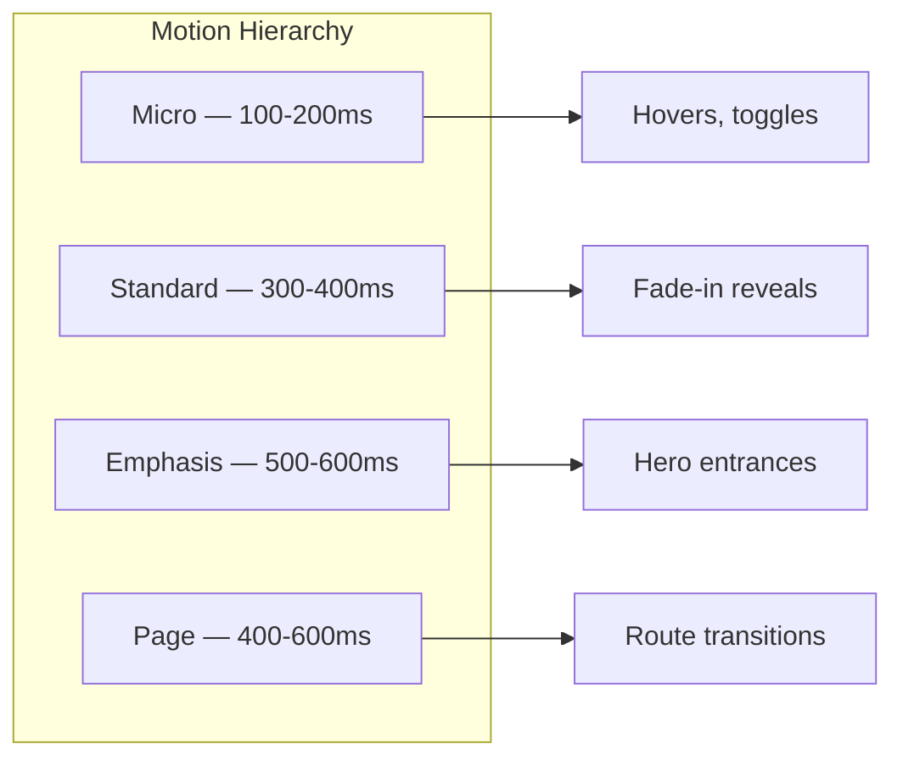

# FounderOS v1.0 — Motion Guidelines

| Field | Value |
|-------|-------|
| **Document ID** | DOC-01-08 |
| **Product** | Founder Portfolio Platform (FounderOS) |
| **Version** | 1.0 |
| **Status** | Approved |
| **Last Updated** | 2026-06-29 |
| **Owner** | Brand / Design |
| **Related** | [Brand Guidelines](Brand_Guidelines.md) · [Design System](../03_Design_System/Design_System.md) · [Frontend Architecture](../04_Architecture/Frontend_Architecture.md) |

---

## Purpose

This document defines **motion and animation guidelines** for FounderOS v1.0 — when, how, and why to animate UI elements using Framer Motion. Motion should enhance perceived quality and guide attention without harming performance or accessibility.

---

## Scope

### In Scope

- Motion principles and philosophy
- Animation tokens (duration, easing)
- Component animation patterns
- Page transition rules
- Reduced motion accessibility
- Performance constraints
- Framer Motion implementation patterns

### Out of Scope

- Video or Lottie animations (v1.x)
- Complex 3D or WebGL (out of scope)
- Admin UI animations (minimal; functional only)

---

## Business Context

Premium founder sites use **subtle, intentional motion** to feel alive — not like static templates. Poor motion (slow, excessive, gratuitous) hurts performance and accessibility. FounderOS standardizes motion via tokens so tenants get premium feel by default.



---

## Goals

| # | Goal |
|---|------|
| G1 | Motion feels premium, not gimmicky |
| G2 | `prefers-reduced-motion` fully respected |
| G3 | Animation does not degrade LCP or CLS |
| G4 | Consistent timing via design tokens |
| G5 | Framer Motion patterns documented for engineers |

---

## Motion Principles

| Principle | Description |
|-----------|-------------|
| **Purposeful** | Every animation serves UX (feedback, hierarchy, continuity) |
| **Subtle** | Users feel quality, not notice animation |
| **Fast** | Most interactions &lt; 300ms |
| **Consistent** | Same easing and duration for same action type |
| **Accessible** | Reduced motion = instant or fade-only |
| **Performant** | Animate `transform` and `opacity` only; avoid layout thrashing |

---

## Animation Tokens

### Duration

| Token | Value | Usage |
|-------|-------|-------|
| `--duration-instant` | 0ms | Reduced motion fallback |
| `--duration-fast` | 150ms | Hover, focus, micro-feedback |
| `--duration-normal` | 300ms | Fade-in, slide-in, expand |
| `--duration-slow` | 500ms | Hero entrance, page transition |
| `--duration-slower` | 700ms | Emphasis only (rare) |

### Easing

| Token | Value | Usage |
|-------|-------|-------|
| `--ease-default` | `cubic-bezier(0.4, 0, 0.2, 1)` | General purpose |
| `--ease-in` | `cubic-bezier(0.4, 0, 1, 1)` | Exit animations |
| `--ease-out` | `cubic-bezier(0, 0, 0.2, 1)` | Enter animations |
| `--ease-spring` | Framer `type: "spring", stiffness: 300, damping: 30` | Playful micro-interactions |

### Distance

| Token | Value | Usage |
|-------|-------|-------|
| `--motion-offset-sm` | 8px | Subtle slide |
| `--motion-offset-md` | 16px | Standard fade-up |
| `--motion-offset-lg` | 32px | Hero entrance |

---

## Animation Patterns

### 1. Fade In (Scroll Reveal)

| Attribute | Value |
|-----------|-------|
| **Usage** | Section content on scroll into viewport |
| **Properties** | `opacity: 0 → 1`, `y: 16px → 0` |
| **Duration** | `--duration-normal` (300ms) |
| **Easing** | `--ease-out` |
| **Trigger** | `whileInView`, `viewport: { once: true, margin: "-100px" }` |
| **Stagger** | 100ms between children (max 5 items) |

```tsx
// Reference pattern — fade-in.tsx
<motion.div
  initial={{ opacity: 0, y: 16 }}
  whileInView={{ opacity: 1, y: 0 }}
  viewport={{ once: true, margin: "-100px" }}
  transition={{ duration: 0.3, ease: [0, 0, 0.2, 1] }}
/>
```

### 2. Hero Entrance

| Attribute | Value |
|-----------|-------|
| **Usage** | Homepage hero on load |
| **Properties** | `opacity: 0 → 1`, `y: 32px → 0` |
| **Duration** | `--duration-slow` (500ms) |
| **Stagger** | Headline → subtext → CTA (150ms each) |
| **Once** | Only on initial load, not route return |

### 3. Hover / Focus

| Attribute | Value |
|-----------|-------|
| **Usage** | Buttons, cards, links |
| **Properties** | `scale: 1 → 1.02` or `y: 0 → -2px` |
| **Duration** | `--duration-fast` (150ms) |
| **Easing** | `--ease-default` |

### 4. Page Transition

| Attribute | Value |
|-----------|-------|
| **Usage** | Route changes (optional per tenant) |
| **Properties** | `opacity: 0 → 1` |
| **Duration** | `--duration-normal` (300ms) |
| **Note** | Keep minimal; avoid layout shift |

### 5. Accordion / Expand

| Attribute | Value |
|-----------|-------|
| **Usage** | FAQ, collapsible sections |
| **Properties** | `height: 0 → auto`, `opacity: 0 → 1` |
| **Duration** | `--duration-normal` |
| **Easing** | `--ease-default` |

### 6. Loading / Skeleton

| Attribute | Value |
|-----------|-------|
| **Usage** | Async content loading |
| **Properties** | Pulse opacity `0.5 → 1 → 0.5` |
| **Duration** | 1.5s loop |
| **Note** | CSS animation preferred over JS for performance |

---

## Functional Requirements

| ID | Requirement |
|----|-------------|
| FR-MG-01 | Framer Motion for scroll reveals and hero animations |
| FR-MG-02 | CSS transitions for hover/focus states |
| FR-MG-03 | `useReducedMotion` hook respected globally |
| FR-MG-04 | Motion disable flag in tenant config |
| FR-MG-05 | Reusable `FadeIn` component in components/motion/ |
| FR-MG-06 | No animation on LCP element (hero text renders immediately) |
| FR-MG-07 | Stagger limited to 5 children max |

---

## Non-functional Requirements

| ID | Requirement | Target |
|----|-------------|--------|
| NFR-MG-01 | Animation frame rate | 60fps |
| NFR-MG-02 | LCP impact from motion | 0ms delay on LCP element |
| NFR-MG-03 | JS bundle (Framer Motion) | Tree-shaken; ≤ 30KB gzipped |
| NFR-MG-04 | Reduced motion compliance | 100% patterns |
| NFR-MG-05 | CLS from animations | 0 |

---

## User Stories

| ID | Story |
|----|-------|
| US-MG-01 | As a **visitor**, I want smooth page feel so that the site feels premium |
| US-MG-02 | As a **vestibular-sensitive user**, I want reduced motion respected |
| US-MG-03 | As a **mobile user**, I want animations that don't drain battery |
| US-MG-04 | As an **engineer**, I want motion patterns I can reuse |

---

## UX Requirements

| ID | Requirement |
|----|-------------|
| UX-MG-01 | Hero text visible immediately (animate container, not text delay) |
| UX-MG-02 | Scroll reveals trigger once, not on every scroll pass |
| UX-MG-03 | No animation on form inputs (except focus ring) |
| UX-MG-04 | Modal: fade + scale from 0.95 (200ms) |
| UX-MG-05 | Toast notifications: slide from edge (200ms) |
| UX-MG-06 | Disable parallax (performance + accessibility) |

---

## Reduced Motion

```tsx
import { useReducedMotion } from 'framer-motion';

const shouldReduceMotion = useReducedMotion();

<motion.div
  initial={shouldReduceMotion ? false : { opacity: 0, y: 16 }}
  animate={{ opacity: 1, y: 0 }}
  transition={{ duration: shouldReduceMotion ? 0 : 0.3 }}
/>
```

| `prefers-reduced-motion: reduce` | Behavior |
|----------------------------------|----------|
| Scroll reveals | Instant appear (no animation) |
| Hero entrance | Instant appear |
| Hover effects | Color change only (no scale) |
| Page transitions | Instant swap |
| Loading skeleton | Static placeholder |

---

## Technical Considerations

### Performance Rules

| Rule | Rationale |
|------|-----------|
| Animate only `transform` and `opacity` | GPU-accelerated |
| Avoid animating `width`, `height`, `top`, `left` | Causes layout reflow |
| Use `will-change: transform` sparingly | Memory cost |
| Lazy load Framer Motion features | Tree shaking |
| `viewport: { once: true }` on scroll animations | Prevent re-trigger |

### Tenant Config

```yaml
motion:
  enabled: true
  reduced_motion_respect: true  # always true; cannot disable
  page_transitions: false       # optional per tenant
  scroll_reveals: true
```

---

## Security Considerations

Motion has minimal security surface. Ensure animation libraries are dependency-audited in CI.

---

## Motion Do's and Don'ts

### Do

- ✅ Use motion tokens for all durations and easing
- ✅ Respect `prefers-reduced-motion`
- ✅ Test on mid-range mobile devices
- ✅ Keep hero text immediately visible
- ✅ Use `FadeIn` wrapper for section reveals

### Don't

- ❌ Animate on every element
- ❌ Use duration &gt; 700ms (except loading loops)
- ❌ Delay LCP content for animation sequencing
- ❌ Use parallax scrolling
- ❌ Auto-play carousel without user control
- ❌ Bounce effects on professional/enterprise pages

---

## Assumptions

| ID | Assumption |
|----|------------|
| A-MG-01 | Framer Motion is the standard animation library |
| A-MG-02 | Tenants keep motion enabled by default |
| A-MG-03 | Enterprise page uses minimal motion |

---

## Risks

| Risk | Mitigation |
|------|------------|
| Performance regression on mobile | Performance budget; test on real devices |
| Over-animation feels unprofessional | Principle: subtle by default |
| Framer Motion bundle size | Lazy import; tree shake |
| Accessibility complaints | Reduced motion mandatory |

---

## Dependencies

| Dependency | Notes |
|------------|-------|
| Framer Motion | Animation library |
| [Design System](../03_Design_System/) | Component patterns |
| [Frontend Architecture](../04_Architecture/Frontend_Architecture.md) | Implementation |
| [Brand_Guidelines](Brand_Guidelines.md) | Motion tokens |

---

## Glossary

| Term | Definition |
|------|------------|
| **LCP** | Largest Contentful Paint — key performance metric |
| **CLS** | Cumulative Layout Shift |
| **Reduced motion** | OS accessibility setting for minimal animation |
| **Stagger** | Sequential delay between child animations |
| **Spring** | Physics-based easing in Framer Motion |

---

## Acceptance Criteria

- [ ] Motion principles and tokens documented
- [ ] Six animation patterns with specs
- [ ] Reduced motion implementation documented
- [ ] Performance rules defined
- [ ] Framer Motion reference patterns included
- [ ] Do's and don'ts checklist complete
- [ ] Tenant config schema for motion

---

## Future Enhancements

| Enhancement | Phase |
|-------------|-------|
| Lottie icon animations | v1.x |
| Motion preview in admin brand settings | v1.1 |
| Page transition template library | v1.1 |
| GSAP for complex timelines (evaluate) | v2.0 |

---

## Open Questions

| # | Question | Status |
|---|----------|--------|
| OQ-MG-01 | Page transitions on by default? | Off by default |
| OQ-MG-02 | Shared layout animations between routes? | Defer to v1.1 |

---

## Related Documents

| Document | Relationship |
|----------|--------------|
| [Brand_Guidelines](Brand_Guidelines.md) | Token system |
| [03_Design_System](../03_Design_System/) | Components |
| [Photography](Photography.md) | Image reveal animations |
| [Frontend Architecture](../04_Architecture/Frontend_Architecture.md) | Code structure |

---

*Documentation © FounderOS v1.0.*
