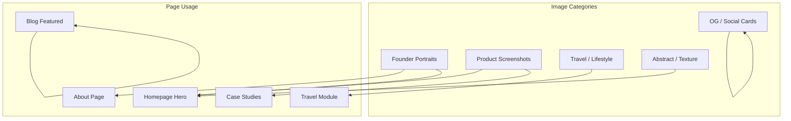
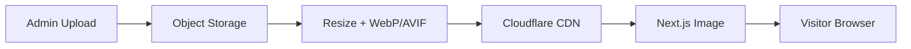

# FounderOS v1.0 — Photography

| Field | Value |
|-------|-------|
| **Document ID** | DOC-01-07 |
| **Product** | Founder Portfolio Platform (FounderOS) |
| **Version** | 1.0 |
| **Status** | Approved |
| **Last Updated** | 2026-06-29 |
| **Owner** | Brand / Design |
| **Related** | [Brand Guidelines](Brand_Guidelines.md) · [Color System](Color_System.md) · [Media Library](../06_Modules/Media_Manager.md) |

---

## Purpose

This document defines **photography and imagery standards** for FounderOS v1.0 — visual style, subject matter, technical specs, and usage rules for public sites, tenant white-label deployments, and platform marketing.

---

## Scope

### In Scope

- Photography style principles
- Image categories and usage contexts
- Technical specifications (format, size, optimization)
- Alt text and accessibility
- Stock vs. authentic imagery guidelines
- OG/social image standards
- Media library organization

### Out of Scope

- Illustration system (v1.1)
- Video production guidelines (v1.x)
- Tenant private assets governance (tenant responsibility)

---

## Business Context

Founders are judged by **visual authenticity**. Generic stock photography signals "template site" and undermines credibility with investors and enterprise buyers. FounderOS photography standards prioritize **real founder imagery** with premium production quality.



---

## Goals

| # | Goal |
|---|------|
| G1 | Reference tenant imagery exemplifies standards |
| G2 | Tenants understand what to shoot/select |
| G3 | All images optimized for web performance |
| G4 | Accessibility: meaningful alt text on all images |
| G5 | OG images drive social click-through |

---

## Photography Style Principles

| Principle | Description | Example |
|-----------|-------------|---------|
| **Authentic** | Real founder, real product, real environments | Founder at desk, not staged handshake |
| **Premium** | High resolution, good lighting, intentional composition | Shallow depth of field portraits |
| **Purposeful** | Every image supports a narrative | Product screenshot shows key feature |
| **Consistent** | Cohesive color grading across site | Warm neutrals or cool tech tone per tenant |
| **Inclusive** | Diverse representation when showing people | Multiple backgrounds, genders, ages |
| **Uncluttered** | Clean backgrounds; subject is clear | Minimal distractions |

### Style Profiles (Tenant Selectable)

| Profile | Mood | Color Grade | Best For |
|---------|------|-------------|----------|
| **Tech Founder** | Confident, focused | Cool neutrals, slight blue | SaaS, AI, engineers |
| **Warm Human** | Approachable, personal | Warm tones, soft light | Consultants, coaches |
| **Adventure** | Energetic, expansive | Vibrant, high saturation | Travel creators |
| **Enterprise** | Professional, restrained | Neutral, high contrast | Enterprise SaaS |
| **Minimal** | Clean, abstract | Monochrome accents | Designers, architects |

---

## Image Categories

### 1. Founder Portraits

| Attribute | Specification |
|-----------|---------------|
| **Usage** | About page, homepage hero, speaker bios |
| **Aspect ratios** | 1:1 (avatar), 4:5 (portrait), 16:9 (hero) |
| **Min resolution** | 1200px on longest edge |
| **Style** | Eye contact or purposeful gaze; natural light preferred |
| **Background** | Blurred environment or solid brand color |
| **Avoid** | Selfies, heavy filters, corporate stock handshakes |

### 2. Product Screenshots

| Attribute | Specification |
|-----------|---------------|
| **Usage** | Products page, case studies, homepage |
| **Aspect ratio** | 16:9 or 16:10 |
| **Min resolution** | 1920px wide |
| **Style** | Clean browser chrome or device mockup; real UI |
| **Treatment** | Subtle shadow, rounded corners (8px), optional gradient border |
| **Avoid** | Outdated UI, lorem ipsum visible, cluttered desktop |

### 3. Travel / Lifestyle

| Attribute | Specification |
|-----------|---------------|
| **Usage** | Travel module, blog featured images |
| **Aspect ratios** | 3:2, 16:9, 1:1 (grid) |
| **Min resolution** | 1600px on longest edge |
| **Style** | Destination-forward; human scale for context |
| **Avoid** | Over-saturated HDR, watermarks |

### 4. Abstract / Texture

| Attribute | Specification |
|-----------|---------------|
| **Usage** | Hero backgrounds, section dividers, empty states |
| **Style** | Subtle gradients, geometric patterns, blurred photography |
| **Opacity** | Background images ≤ 20% opacity over solid base |
| **Avoid** | Busy patterns that reduce text readability |

### 5. OG / Social Images

| Attribute | Specification |
|-----------|---------------|
| **Size** | 1200 × 630px (OG standard) |
| **Format** | PNG or JPEG |
| **Content** | Page title, founder/brand name, optional logo |
| **Typography** | Uses [Typography](Typography.md) scale |
| **Background** | Brand primary gradient or photography with overlay |

---

## Functional Requirements

| ID | Requirement |
|----|-------------|
| FR-PH-01 | Media library supports upload, alt text, and tags |
| FR-PH-02 | Next.js Image component for all public images |
| FR-PH-03 | Responsive `srcset` generation |
| FR-PH-04 | WebP/AVIF format with JPEG fallback |
| FR-PH-05 | OG image per page (static or dynamic) |
| FR-PH-06 | Alt text required before publish (admin validation) |
| FR-PH-07 | Image CDN caching via Cloudflare |

---

## Non-functional Requirements

| ID | Requirement | Target |
|----|-------------|--------|
| NFR-PH-01 | Hero image LCP contribution | &lt; 1.5s |
| NFR-PH-02 | Image file size (hero) | ≤ 200KB optimized |
| NFR-PH-03 | Image file size (inline) | ≤ 100KB optimized |
| NFR-PH-04 | Thumbnail generation | Auto on upload |
| NFR-PH-05 | Max upload size | 10MB (admin) |

---

## User Stories

| ID | Story |
|----|-------|
| US-PH-01 | As a **founder**, I want photography guidance so that my site looks professional |
| US-PH-02 | As **Sofia**, I want travel photos displayed beautifully in galleries |
| US-PH-03 | As a **visitor**, I want fast-loading images on mobile |
| US-PH-04 | As a **screen reader user**, I want descriptive alt text |
| US-PH-05 | As a **marketer**, I want OG images that look good when shared on X |

---

## UX Requirements

| ID | Requirement |
|----|-------------|
| UX-PH-01 | Hero images never obscure headline text (overlay gradient) |
| UX-PH-02 | Product screenshots in consistent mockup frame |
| UX-PH-03 | Gallery grids use consistent aspect ratio per row |
| UX-PH-04 | Lazy load below-fold images |
| UX-PH-05 | Blur placeholder (LQIP) during load |
| UX-PH-06 | Broken image fallback (brand-colored placeholder) |

---

## Technical Considerations

### Optimization Pipeline



| Step | Tool |
|------|------|
| Upload | Admin media library API |
| Processing | Sharp (server) or Cloudflare Images (v1.x) |
| Delivery | `next/image` with Cloudflare CDN |
| Placeholder | `blurDataURL` generated on upload |

### Filename Convention

```
/assets/{tenant}/{category}/{slug}-{width}w.{ext}
Example: /assets/acme/portraits/founder-1200w.webp
```

---

## Security Considerations

| Concern | Mitigation |
|---------|------------|
| Malicious image upload | MIME validation, size limits, virus scan (v1.x) |
| EXIF GPS leakage | Strip EXIF on upload |
| Hotlinking | CDN referrer policy |
| Copyright infringement | Tenant responsibility; DMCA process documented |

---

## Stock Photography Guidelines

When authentic photography is unavailable (interim):

| Do | Don't |
|----|-------|
| Use high-quality, natural-looking stock | Generic "business people pointing at laptop" |
| Unsplash/Pexels with attribution if required | Watermarked stock |
| Match tenant style profile | Mix unrelated styles |
| Replace with authentic ASAP | Leave stock permanently |

**Approved stock sources:** Unsplash, Pexels (free); iStock, Shutterstock (licensed).

---

## Alt Text Guidelines

| Image Type | Alt Text Pattern | Example |
|------------|------------------|---------|
| Portrait | "[Name], [role] of [company]" | "Priya Sharma, CEO of Acme Labs" |
| Product | "[Product name] showing [feature]" | "Acme Dashboard showing analytics view" |
| Decorative | Empty alt (`alt=""`) | Background textures with no meaning |
| Travel | "[Location], [description]" | "Kyoto temple garden in autumn" |
| OG | Auto-generated from page title | N/A (meta, not img alt) |

---

## Assumptions

| ID | Assumption |
|----|------------|
| A-PH-01 | Tenants can provide or shoot own photography |
| A-PH-02 | Reference tenant uses authentic founder photography |
| A-PH-03 | Cloudflare CDN available for image delivery |

---

## Risks

| Risk | Mitigation |
|------|------------|
| Tenants use low-quality images | Guidelines + examples in admin |
| Large images hurt LCP | Enforce optimization pipeline |
| Stock-heavy sites feel generic | Authentic photography emphasis in onboarding |

---

## Dependencies

| Dependency | Notes |
|------------|-------|
| [Brand_Guidelines](Brand_Guidelines.md) | Visual system |
| [Color_System](Color_System.md) | Overlays, OG backgrounds |
| [06_Modules/Media_Library](../06_Modules/Media_Manager.md) | Upload system |
| [10_SEO](../10_SEO/) | OG image SEO |

---

## Glossary

| Term | Definition |
|------|------------|
| **LQIP** | Low Quality Image Placeholder |
| **OG image** | Open Graph social sharing image |
| **EXIF** | Embedded metadata in photos (GPS, camera) |
| **Style profile** | Tenant photography mood preset |

---

## Acceptance Criteria

- [ ] Five image categories with specs documented
- [ ] Five style profiles defined
- [ ] Technical optimization pipeline documented
- [ ] Alt text guidelines with examples
- [ ] OG image standard defined
- [ ] Stock photography do's/don'ts included

---

## Future Enhancements

| Enhancement | Phase |
|-------------|-------|
| Illustration system | v1.1 |
| AI image optimization on upload | v1.1 |
| Dynamic OG image generation API | v1.0.1 |
| Video embed guidelines | v1.x |
| Cloudflare Images integration | v1.x |

---

## Open Questions

| # | Question | Status |
|---|----------|--------|
| OQ-PH-01 | Provide starter image pack for tenants? | v1.1 candidate |
| OQ-PH-02 | AI-generated founder portraits — allow or ban? | Discourage; authentic preferred |

---

## Related Documents

| Document | Relationship |
|----------|--------------|
| [Brand_Guidelines](Brand_Guidelines.md) | Master visual system |
| [Color_System](Color_System.md) | Image overlays |
| [Motion_Guidelines](Motion_Guidelines.md) | Image animations |
| [05_Pages/About](../05_Pages/About.md) | Portrait usage |

---

*Documentation © FounderOS v1.0.*
