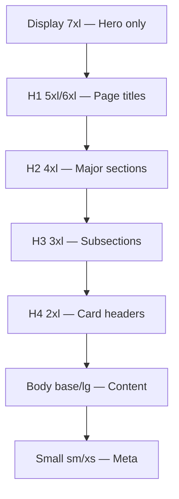

# FounderOS v1.0 — Typography

| Field | Value |
|-------|-------|
| **Document ID** | DOC-01-05 |
| **Product** | Founder Portfolio Platform (FounderOS) |
| **Version** | 1.0 |
| **Status** | Approved |
| **Last Updated** | 2026-06-29 |
| **Owner** | Brand / Design |
| **Related** | [Brand Guidelines](Brand_Guidelines.md) · [Color System](Color_System.md) · [Design System](../03_Design_System/Design_System.md) |

---

## Purpose

This document defines the **typography system** for FounderOS v1.0 — typefaces, scale, weights, line heights, and usage rules for public sites, admin UI, and documentation. Typography is the primary carrier of brand personality and readability.

---

## Scope

### In Scope

- Primary and secondary typefaces
- Type scale (modular scale)
- Weight and style usage
- Line height and letter spacing
- Responsive typography
- White-label font override rules
- Accessibility requirements

### Out of Scope

- Logo typography (see [Logo_Guidelines](Logo_Guidelines.md))
- Code/monospace font for docs (covered here, secondary)

---

## Business Context

FounderOS sites must feel **premium and readable** — investors and enterprise buyers judge attention to detail through typography. A consistent type system enables white-label rebranding by swapping font variables without component changes.

---

## Goals

| # | Goal |
|---|------|
| G1 | Readable on all devices and densities |
| G2 | Premium feel without custom/licensed font dependency |
| G3 | White-label font swap via single config variable |
| G4 | WCAG AA contrast and sizing compliance |
| G5 | Performance: minimal font payload |

---

## Typeface Selection

### Primary: Inter

| Attribute | Value |
|-----------|-------|
| **Family** | Inter |
| **Source** | Google Fonts / `next/font` |
| **Classification** | Neo-grotesque sans-serif |
| **Rationale** | Excellent screen readability, variable font support, free, widely recognized in tech/founder space |
| **Weights used** | 400 (Regular), 500 (Medium), 600 (Semibold), 700 (Bold) |
| **Variable axis** | `opsz`, `wght` |

### Secondary: Inter (same family)

Headings and body use the same family for cohesion. Weight and size differentiation create hierarchy — not font switching.

### Monospace: JetBrains Mono

| Attribute | Value |
|-----------|-------|
| **Family** | JetBrains Mono |
| **Usage** | Code blocks, API docs, technical content, inline code |
| **Weights** | 400, 500 |
| **Source** | Google Fonts / `next/font` |

### White-label Override

```css
/* tenant.brand.yml → CSS variables */
--font-heading: 'Inter', system-ui, sans-serif;
--font-body: 'Inter', system-ui, sans-serif;
--font-mono: 'JetBrains Mono', ui-monospace, monospace;
```

**Recommended alternatives for tenants:**

| Style | Font | Best For |
|-------|------|----------|
| Tech default | Inter | SaaS, AI, engineers |
| Editorial | Source Serif 4 + Inter | Consultants, thought leaders |
| Geometric | DM Sans | Creators, agencies |
| Humanist | Plus Jakarta Sans | Warm founder brands |

---

## Type Scale

Modular scale ratio: **1.250 (Major Third)**

| Token | Size (rem) | Size (px)* | Usage |
|-------|------------|------------|-------|
| `--text-xs` | 0.75rem | 12px | Captions, labels, metadata |
| `--text-sm` | 0.875rem | 14px | Secondary text, form hints |
| `--text-base` | 1rem | 16px | Body copy default |
| `--text-lg` | 1.125rem | 18px | Lead paragraphs, intro text |
| `--text-xl` | 1.25rem | 20px | H5, card titles |
| `--text-2xl` | 1.5rem | 24px | H4, section subtitles |
| `--text-3xl` | 1.875rem | 30px | H3 |
| `--text-4xl` | 2.25rem | 36px | H2 |
| `--text-5xl` | 3rem | 48px | H1 (mobile) |
| `--text-6xl` | 3.75rem | 60px | Hero H1 (desktop) |
| `--text-7xl` | 4.5rem | 72px | Display (optional, hero only) |

*At root 16px base.



---

## Heading Styles

| Element | Size (desktop) | Weight | Line Height | Letter Spacing |
|---------|----------------|--------|-------------|----------------|
| **H1 / Hero** | `--text-6xl` | 700 | 1.1 | -0.02em |
| **H2** | `--text-4xl` | 700 | 1.2 | -0.02em |
| **H3** | `--text-3xl` | 600 | 1.25 | -0.01em |
| **H4** | `--text-2xl` | 600 | 1.3 | 0 |
| **H5** | `--text-xl` | 600 | 1.4 | 0 |
| **H6** | `--text-lg` | 600 | 1.4 | 0 |

### Heading Rules

- One H1 per page (SEO and accessibility)
- No skipped heading levels (H1 → H2 → H3)
- Headings use `--font-heading`; body uses `--font-body`
- Sentence case for headings (not ALL CAPS)

---

## Body Text

| Context | Size | Weight | Line Height | Max Width |
|---------|------|--------|-------------|-----------|
| **Body default** | `--text-base` | 400 | 1.6 | 65ch |
| **Lead paragraph** | `--text-lg` | 400 | 1.6 | 60ch |
| **Small / caption** | `--text-sm` | 400 | 1.5 | — |
| **Label** | `--text-sm` | 500 | 1.4 | — |
| **Button** | `--text-sm` | 500 | 1 | 0.01em |
| **Nav link** | `--text-sm` | 500 | 1 | 0 |

---

## Functional Requirements

| ID | Requirement |
|----|-------------|
| FR-TY-01 | All text uses design tokens (no arbitrary font sizes) |
| FR-TY-02 | `next/font` for Inter and JetBrains Mono (no layout shift) |
| FR-TY-03 | Tenant font override via CSS variables |
| FR-TY-04 | Responsive type scale (hero shrinks on mobile) |
| FR-TY-05 | Prose class for blog/content with typographic defaults |
| FR-TY-06 | Admin UI uses same type scale |

---

## Non-functional Requirements

| ID | Requirement | Target |
|----|-------------|--------|
| NFR-TY-01 | Font payload (woff2) | ≤ 100KB total |
| NFR-TY-02 | CLS from fonts | 0 (next/font) |
| NFR-TY-03 | Minimum body size mobile | 16px (no zoom on iOS) |
| NFR-TY-04 | Contrast ratio body text | ≥ 4.5:1 |
| NFR-TY-05 | Contrast ratio large text (≥18px) | ≥ 3:1 |

---

## User Stories

| ID | Story |
|----|-------|
| US-TY-01 | As a **visitor**, I want readable text on mobile so that I don't pinch-zoom |
| US-TY-02 | As an **agency**, I want to swap fonts via config so that client brand is reflected |
| US-TY-03 | As a **blog reader**, I want comfortable line length so that long posts are easy to read |
| US-TY-04 | As a **low-vision user**, I want text that meets contrast standards |

---

## UX Requirements

| ID | Requirement |
|----|-------------|
| UX-TY-01 | Hero headline max 8 words for impact |
| UX-TY-02 | Blog prose max-width 65ch centered |
| UX-TY-03 | Line length 45–75 characters for body |
| UX-TY-04 | Sufficient spacing between headings and body (≥ `--space-4`) |
| UX-TY-05 | Links visually distinct (underline on hover; color from [Color_System](Color_System.md)) |

---

## Responsive Typography

| Breakpoint | H1 Hero | Body | Adjustment |
|------------|---------|------|------------|
| Mobile (&lt;640px) | `--text-4xl` | `--text-base` | -2 scale steps |
| Tablet (640–1024px) | `--text-5xl` | `--text-base` | -1 scale step |
| Desktop (≥1024px) | `--text-6xl` | `--text-base` | Full scale |
| Wide (≥1536px) | `--text-7xl` (optional) | `--text-lg` (lead) | Display optional |

---

## Technical Considerations

### Implementation (Next.js 15)

```typescript
// app/layout.tsx pattern
import { Inter, JetBrains_Mono } from 'next/font/google';

const inter = Inter({
  subsets: ['latin'],
  variable: '--font-body',
  display: 'swap',
});

const jetbrainsMono = JetBrains_Mono({
  subsets: ['latin'],
  variable: '--font-mono',
  display: 'swap',
});
```

### Tailwind Mapping

```typescript
// tailwind.config.ts
fontFamily: {
  sans: ['var(--font-body)', 'system-ui', 'sans-serif'],
  heading: ['var(--font-heading)', 'var(--font-body)', 'system-ui', 'sans-serif'],
  mono: ['var(--font-mono)', 'ui-monospace', 'monospace'],
},
fontSize: {
  // Maps to --text-* tokens
},
```

---

## Security Considerations

| Concern | Mitigation |
|---------|------------|
| Font CDN integrity | Use `next/font` self-hosted |
| User-uploaded fonts | Validate file types; serve from CDN |

---

## Assumptions

| ID | Assumption |
|----|------------|
| A-TY-01 | Inter is acceptable default for 80%+ tenants |
| A-TY-02 | Latin script sufficient for v1.0 |
| A-TY-03 | Variable font support in target browsers |

---

## Risks

| Risk | Mitigation |
|------|------------|
| Inter feels generic | Premium spacing, weight contrast, photography |
| Tenant fonts break layout | Test with fallback stack |
| CJK expansion needs different scale | i18n typography guide (v1.2) |

---

## Dependencies

| Dependency | Notes |
|------------|-------|
| [Color_System](Color_System.md) | Text color contrast |
| [Brand_Guidelines](Brand_Guidelines.md) | Token system |
| [03_Design_System](../03_Design_System/) | Component text styles |
| next/font | Font loading |

---

## Glossary

| Term | Definition |
|------|------------|
| **Modular scale** | Mathematical ratio between type sizes |
| **ch unit** | Character width — used for line length |
| **CLS** | Cumulative Layout Shift |
| **Variable font** | Single file with weight/axis range |

---

## Acceptance Criteria

- [ ] Typefaces selected with rationale
- [ ] Full type scale documented with tokens
- [ ] Heading and body styles defined
- [ ] Responsive rules documented
- [ ] White-label override mechanism defined
- [ ] Accessibility contrast requirements met
- [ ] Implementation pattern for Next.js documented

---

## Future Enhancements

| Enhancement | Phase |
|-------------|-------|
| Serif pairing preset for editorial tenants | v1.1 |
| CJK font stack (Noto Sans SC/JP) | v1.2 |
| Fluid typography (clamp) | v1.1 |
| Admin font preview in brand settings | v1.1 |

---

## Open Questions

| # | Question | Status |
|---|----------|--------|
| OQ-TY-01 | Display size (7xl) on all heroes or reference only? | Optional per tenant |
| OQ-TY-02 | Source Serif pairing as official preset? | v1.1 candidate |

---

## Related Documents

| Document | Relationship |
|----------|--------------|
| [Brand_Guidelines](Brand_Guidelines.md) | Master brand system |
| [Color_System](Color_System.md) | Text colors |
| [Logo_Guidelines](Logo_Guidelines.md) | Logo type treatment |
| [Design System](../03_Design_System/Design_System.md) | Component typography |

---

*Documentation © FounderOS v1.0.*
