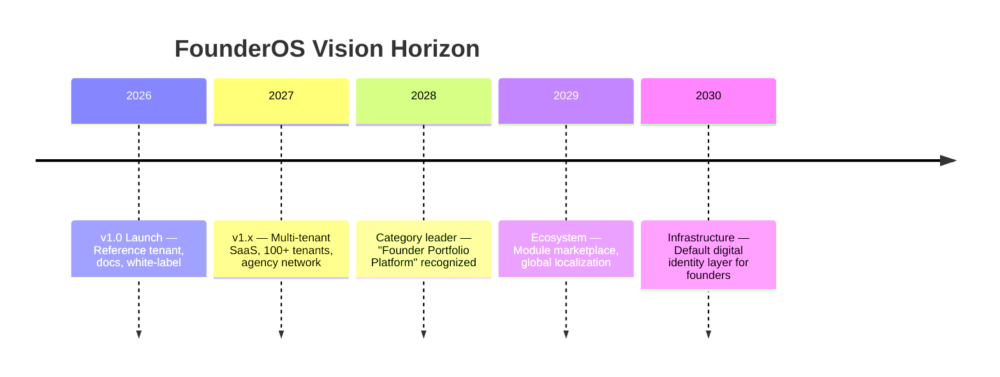
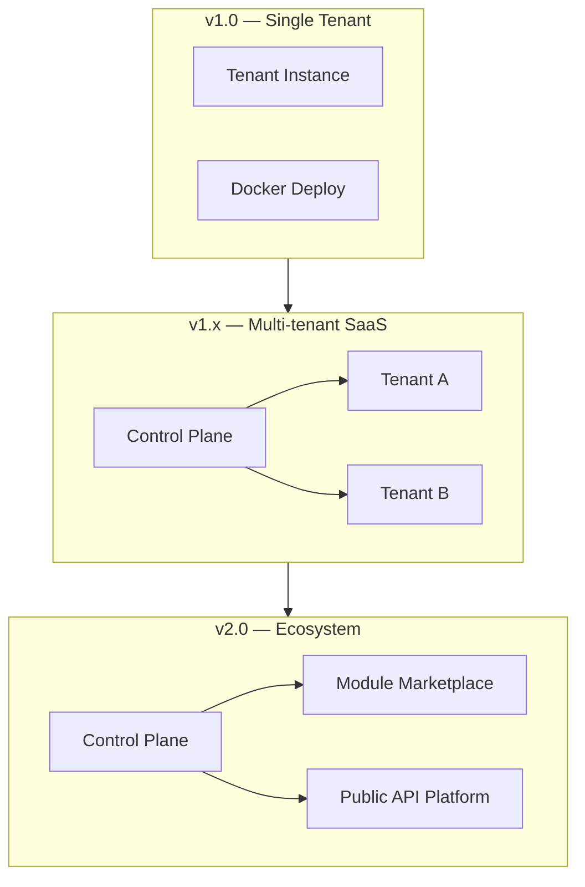

# FounderOS v1.0 — Vision

| Field | Value |
|-------|-------|
| **Document ID** | DOC-01-04 |
| **Product** | Founder Portfolio Platform (FounderOS) |
| **Version** | 1.0 |
| **Status** | Approved |
| **Last Updated** | 2026-06-29 |
| **Owner** | Leadership / Brand |
| **Related** | [Mission](Mission.md) · [Project Vision](../00_Project/00_Project_Vision.md) · [Brand Positioning](Brand_Positioning.md) · [Roadmap](../00_Project/07_Roadmap.md) |

---

## Purpose

This document defines the **brand vision** for FounderOS — the aspirational future state we are building toward. While [Mission](Mission.md) grounds us in present purpose, vision inspires long-term product, brand, and market strategy.

---

## Scope

### In Scope

- Vision statement and 3–5 year horizon
- Vision milestones by phase
- Vision-to-roadmap mapping
- Cultural and market aspirations
- Vision expression in brand and product

### Out of Scope

- Annual financial targets (see [Business Model](../00_Project/05_Business_Model.md))
- v1.0 sprint deliverables

---

## Business Context

The founder economy is expanding: more solo founders, more AI-native companies, more creators becoming entrepreneurs. Digital identity is the **first handshake** in every business relationship. FounderOS vision: become the **default infrastructure** for that handshake worldwide.

---

## Vision Statement

> **A world where every founder — from first-time builders to serial entrepreneurs — has instant access to a world-class digital identity, enabling them to be discovered, trusted, and chosen.**

### Short-form (tagline use)

> **The default digital identity layer for founders.**

---

## Goals

| # | Goal |
|---|------|
| G1 | Vision inspires product roadmap beyond v1.0 |
| G2 | Vision distinguishable from mission (aspiration vs. purpose) |
| G3 | Milestones measurable at each horizon phase |
| G4 | Team alignment on 3-year destination |

---

## Vision Pillars

| Pillar | 2030 State | v1.0 Foundation |
|--------|------------|-----------------|
| **Ubiquity** | FounderOS is the first tool founders install for their brand | Reference tenant, docs |
| **Network** | Agencies, partners, and modules form an ecosystem | Agency playbook, modular architecture |
| **Intelligence** | AI assists founders in content, SEO, and positioning | Documented hooks for v1.2 AI |
| **Global** | Founders worldwide in 10+ languages | English-first, i18n-ready architecture |
| **Trust** | Enterprise and investors recognize FounderOS sites as credible | Premium design, security, legal modules |

---

## Functional Requirements

| ID | Requirement | Vision Pillar |
|----|-------------|---------------|
| FR-VS-01 | Architecture supports multi-tenant SaaS (v1.x) | Ubiquity |
| FR-VS-02 | Module plugin interface documented | Network |
| FR-VS-03 | API-first design for headless and integrations | Network |
| FR-VS-04 | i18n routing hooks in frontend (v1.2) | Global |
| FR-VS-05 | AI content API extension points (v1.2) | Intelligence |
| FR-VS-06 | SOC2-ready security architecture | Trust |

---

## Non-functional Requirements

| ID | Requirement | Vision Pillar |
|----|-------------|---------------|
| NFR-VS-01 | Platform scales to 10K tenants (architecture) | Ubiquity |
| NFR-VS-02 | 99.99% uptime at scale | Trust |
| NFR-VS-03 | &lt; 1 week tenant onboarding (self-serve) | Ubiquity |
| NFR-VS-04 | Module marketplace SLA (v2.0) | Network |

---

## User Stories

| ID | Story | Vision Pillar |
|----|-------|---------------|
| US-VS-01 | As a **first-time founder**, I want to go live in hours so that I start building audience immediately | Ubiquity |
| US-VS-02 | As an **agency**, I want a module marketplace so that I extend client sites without custom code | Network |
| US-VS-03 | As a **founder in India**, I want Hindi support so that my local audience connects | Global |
| US-VS-04 | As a **founder**, I want AI to draft my first blog post so that I overcome blank page syndrome | Intelligence |
| US-VS-05 | As an **enterprise buyer**, I want to trust FounderOS-powered vendor sites | Trust |

---

## UX Requirements

| ID | Requirement | Vision Pillar |
|----|-------------|---------------|
| UX-VS-01 | Onboarding reduces time-to-live each release | Ubiquity |
| UX-VS-02 | Consistent premium quality across all tenants | Trust |
| UX-VS-03 | Admin becomes smarter with AI assistance (v1.2) | Intelligence |
| UX-VS-04 | Locale switcher on public sites (v1.2) | Global |

---

## Technical Considerations

### Vision Architecture Evolution

| Phase | Technical Milestone |
|-------|---------------------|
| v1.0 | Single-tenant, white-label config |
| v1.x | Multi-tenant control plane, Stripe billing |
| v1.2 | i18n, AI content API |
| v2.0 | Module SDK, marketplace, API v2 |

---

## Security Considerations

| Vision Pillar | Security Evolution |
|---------------|-------------------|
| Trust | SOC2 Type II (v1.x) |
| Ubiquity | Tenant isolation at scale |
| Network | Third-party module sandboxing (v2.0) |
| Global | GDPR, data residency options (v1.2) |

---

## Vision Milestones

| Year | Milestone | Metric |
|------|-----------|--------|
| 2026 | v1.0 launch + reference tenant | Production live |
| 2027 | 100+ active tenants, 10+ agencies | [KPIs](../00_Project/08_KPIs.md) |
| 2027 | Multi-tenant SaaS beta | Control plane live |
| 2028 | Category recognition | Inbound press, community mentions |
| 2028 | Module marketplace beta | 5+ third-party modules |
| 2029 | 1,000+ tenants, i18n (5 locales) | Global expansion |
| 2030 | Default founder infrastructure | Top-of-mind in founder surveys |

---

## Assumptions

| ID | Assumption |
|----|------------|
| A-VS-01 | Founder economy continues rapid growth |
| A-VS-02 | Digital identity remains critical for fundraising and sales |
| A-VS-03 | AI augments but doesn't replace founder storytelling |
| A-VS-04 | Agency channel scales faster than direct-only |

---

## Risks

| Risk | Vision Impact | Mitigation |
|------|---------------|------------|
| Category doesn't crystallize | Vision unrealized | Content marketing, category creation |
| Platform commoditization | Race to bottom | Differentiate on modules + docs |
| AI makes websites trivial | Reduced demand | Position as identity layer, not page builder |
| Multi-tenant complexity delays scale | Ubiquity delayed | Phased architecture per roadmap |

---

## Dependencies

| Dependency | Notes |
|------------|-------|
| [Mission](Mission.md) | Purpose foundation |
| [07_Roadmap](../00_Project/07_Roadmap.md) | Tactical path |
| [06_Product_Strategy](../00_Project/06_Product_Strategy.md) | Strategic pillars |
| [00_Project_Vision](../00_Project/00_Project_Vision.md) | Product vision alignment |

---

## Glossary

| Term | Definition |
|------|------------|
| **Brand vision** | Aspirational future state for the brand |
| **Digital identity layer** | Infrastructure for founder public presence |
| **Control plane** | Central system managing multi-tenant instances |
| **Category leader** | Default choice in market segment |

---

## Acceptance Criteria

- [ ] Vision statement and short-form defined
- [ ] Five vision pillars with v1.0 foundations
- [ ] Milestones mapped to years 2026–2030
- [ ] Architecture evolution diagram included
- [ ] Distinguishable from mission and project vision
- [ ] Cross-links valid

---

## Future Enhancements

This document IS the future vision. Updates annually or at major phase transitions.

---

## Open Questions

| # | Question | Status |
|---|----------|--------|
| OQ-VS-01 | 2030 tenant target: 10K or 100K? | Directional 10K+ |
| OQ-VS-02 | Acquisition vs. independent path to vision? | Open strategic |
| OQ-VS-03 | Open-source core as vision accelerator? | Under evaluation |

---

## Mission vs. Vision vs. Project Vision

| Document | Question Answered | Time Horizon |
|----------|-------------------|--------------|
| [Mission](Mission.md) | Why do we exist? | Present, enduring |
| [Vision](Vision.md) (this doc) | What future are we building? | 3–10 years |
| [Project Vision](../00_Project/00_Project_Vision.md) | What does the product achieve? | v1.0 – v1.x |

---

## Related Documents

| Document | Relationship |
|----------|--------------|
| [Mission](Mission.md) | Purpose |
| [00_Project_Vision](../00_Project/00_Project_Vision.md) | Product north star |
| [07_Roadmap](../00_Project/07_Roadmap.md) | Execution path |
| [Brand_Positioning](Brand_Positioning.md) | Market position |

---

*Documentation © FounderOS v1.0.*
