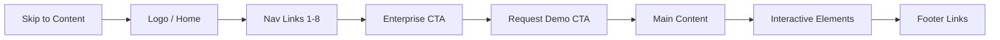

# Accessibility

| Field | Value |
|-------|-------|
| **Product** | Founder Portfolio Platform (FounderOS) |
| **Version** | 1.0 |
| **Document ID** | UX-A11Y-001 |
| **Status** | Approved for Implementation |
| **Last Updated** | 2026-06-29 |
| **Owner** | Product & UX |
| **Related** | [Interaction Principles](./Interaction_Principles.md) · [Navigation](./Navigation.md) · [Forms](../03_Design_System/Forms.md) |

---

## Purpose

Establish accessibility requirements, patterns, and acceptance criteria for FounderOS v1.0 to ensure the platform is usable by people with disabilities and compliant with WCAG 2.1 Level AA — the standard expected of enterprise-grade SaaS products.

---

## Scope

### In Scope

| Area | Coverage |
|------|----------|
| Perceivable | Color contrast, text alternatives, adaptable content |
| Operable | Keyboard navigation, focus management, timing |
| Understandable | Readable, predictable, input assistance |
| Robust | Compatible with assistive technologies |
| Public site | All marketing and content pages |
| Admin panel | Core CMS workflows |
| Forms | Contact, inquiry, admin content forms |
| Motion | Reduced motion preferences |

### Out of Scope

| Area | Rationale |
|------|-----------|
| WCAG AAA compliance | AA is v1.0 target; AAA selective |
| Third-party embed accessibility | Vendor responsibility (noted as risk) |
| PDF accessibility | No PDF generation in v1.0 |

---

## Business Context

Enterprise buyers and government contractors increasingly require **accessibility compliance** in vendor evaluations. A founder portfolio that fails basic accessibility audits undermines credibility. FounderOS targets WCAG 2.1 AA as the minimum bar — matching Stripe, GitHub, and Google design standards.

---

## Goals

| # | Goal | Metric |
|---|------|--------|
| G1 | WCAG 2.1 AA compliance on all public pages | Automated audit 0 critical violations |
| G2 | Lighthouse Accessibility score | ≥ 95 on all core pages |
| G3 | Full keyboard navigability | 100% interactive elements reachable |
| G4 | Screen reader compatibility | NVDA + VoiceOver test pass |

---

## Functional Requirements

| ID | Requirement | Priority |
|----|-------------|----------|
| FR-A11Y-01 | All images SHALL have descriptive `alt` text | P0 |
| FR-A11Y-02 | Skip-to-content link SHALL be first focusable element | P0 |
| FR-A11Y-03 | All interactive elements SHALL be keyboard accessible | P0 |
| FR-A11Y-04 | Focus indicators SHALL be visible on all focusable elements | P0 |
| FR-A11Y-05 | Form errors SHALL be associated with fields via `aria-describedby` | P0 |
| FR-A11Y-06 | Mobile menu SHALL use `aria-expanded` and `aria-label` | P0 |
| FR-A11Y-07 | Page landmarks SHALL include `header`, `nav`, `main`, `footer` | P0 |
| FR-A11Y-08 | Color SHALL NOT be the sole means of conveying information | P0 |
| FR-A11Y-09 | Dialogs SHALL trap focus and restore on close | P0 |
| FR-A11Y-10 | Videos SHALL have captions or transcript link | P1 |
| FR-A11Y-11 | `lang` attribute SHALL be set on `<html>` | P0 |
| FR-A11Y-12 | Heading hierarchy SHALL not skip levels | P0 |

---

## Non-functional Requirements

| ID | Requirement | Target |
|----|-------------|--------|
| NFR-A11Y-01 | Text contrast ratio (normal text) | ≥ 4.5:1 |
| NFR-A11Y-02 | Text contrast ratio (large text ≥18px) | ≥ 3:1 |
| NFR-A11Y-03 | UI component contrast ratio | ≥ 3:1 |
| NFR-A11Y-04 | Touch target size | ≥ 44×44px |
| NFR-A11Y-05 | Motion animation with `prefers-reduced-motion` | Disabled or ≤ 0.01 opacity |
| NFR-A11Y-06 | axe-core automated scan | 0 critical, 0 serious |

---

## User Stories

| ID | As a… | I want to… | So that… |
|----|-------|------------|----------|
| US-A11Y-01 | Keyboard user | Navigate the entire site with Tab/Enter | I don't need a mouse |
| US-A11Y-02 | Screen reader user | Hear meaningful page structure | I understand content hierarchy |
| US-A11Y-03 | Low-vision user | Read text with sufficient contrast | Content is legible |
| US-A11Y-04 | Motor-impaired user | Activate buttons with large touch targets | I can interact on mobile |
| US-A11Y-05 | Vestibular disorder user | Browse without motion sickness | Animations respect my preference |
| US-A11Y-06 | Color-blind user | Distinguish form errors without color alone | I can correct mistakes |

---

## UX Requirements

### Color Contrast Matrix (Dark Theme Default)

| Element | Foreground | Background | Ratio | Pass |
|---------|------------|------------|-------|------|
| Body text | `#fafafa` | `#09090b` | 19.3:1 | ✓ AAA |
| Muted text | `#a1a1aa` | `#09090b` | 8.6:1 | ✓ AAA |
| Accent on dark | `#6366f1` | `#09090b` | 5.1:1 | ✓ AA |
| Button text | `#fafafa` | `#6366f1` | 4.6:1 | ✓ AA |
| Border | `#27272a` | `#09090b` | 1.8:1 | UI only |
| Error text | `#ef4444` | `#09090b` | 5.4:1 | ✓ AA |

See [Color System](../03_Design_System/Color_System.md) for full token contrast audit.

### Keyboard Navigation Map



| Key | Action |
|-----|--------|
| `Tab` | Move to next focusable element |
| `Shift+Tab` | Move to previous focusable element |
| `Enter` / `Space` | Activate button or link |
| `Escape` | Close dialog, mobile menu, dropdown |
| `Arrow keys` | Navigate within tabs, accordion, select |

### Focus Management Rules

| Context | Behavior |
|---------|----------|
| Page load | Focus on skip link (visually hidden until focused) |
| Mobile menu open | Focus trapped in menu; first item focused |
| Dialog open | Focus trapped in dialog; focus returns to trigger on close |
| Route change | Focus moved to `<h1>` or `main` landmark |
| Form error | Focus moved to first invalid field |

### ARIA Landmark Structure

```html
<body>
  <a href="#main" class="sr-only focus:not-sr-only">Skip to content</a>
  <header>...</header>
  <nav aria-label="Main navigation">...</nav>
  <main id="main">...</main>
  <footer>...</footer>
</body>
```

### Heading Hierarchy

| Page | H1 | H2 Examples | H3 Examples |
|------|-----|-------------|-------------|
| Home | Founder name / value prop | Featured Products, Case Studies | Individual card titles |
| Product detail | Product name | Features, Pricing, FAQ | Feature item names |
| Blog post | Article title | — (prose headings start H2) | Sub-sections in article |
| Contact | Contact Us | — | Form section labels |

**Rule:** One H1 per page. No skipping (H1 → H3 without H2).

### Form Accessibility

| Requirement | Implementation |
|-------------|----------------|
| Labels | Every input has visible `<Label>` linked via `htmlFor` |
| Required fields | `aria-required="true"` + visual indicator |
| Errors | `aria-invalid="true"` + `aria-describedby` pointing to error message |
| Error summary | Announce via `role="alert"` on submit with errors |
| Autocomplete | `autocomplete` attributes for name, email, organization |

### Image Alt Text Guidelines

| Image Type | Alt Text Pattern |
|------------|------------------|
| Product screenshot | "{Product name} dashboard showing {feature}" |
| Founder photo | "{Name}, {Title}" |
| Decorative | `alt=""` (empty) |
| Logo | "{Company name} logo" |
| Chart/graph | Describe data trend, not "chart" |

### Motion & Animation

| Rule | Implementation |
|------|----------------|
| Respect `prefers-reduced-motion` | `@media (prefers-reduced-motion: reduce)` disables Framer Motion |
| No auto-playing video with sound | Muted autoplay only; provide controls |
| Parallax | Disabled under reduced motion |
| Skeleton shimmer | Static background under reduced motion |
| Page transitions | Instant (no animation) under reduced motion |

---

## Technical Considerations

| Topic | Guidance |
|-------|----------|
| **shadcn/ui** | Radix primitives include built-in ARIA; do not override |
| **Testing** | `@axe-core/react` in dev; `axe-core/playwright` in CI |
| **eslint** | `eslint-plugin-jsx-a11y` enabled in frontend lint config |
| **Skip link** | Tailwind `sr-only focus:not-sr-only` utility class |
| **Live regions** | Toast notifications use `role="status"` |
| **Color tokens** | Use semantic tokens, not raw hex — ensures theme contrast |

### Testing Checklist

| Tool | Scope | Frequency |
|------|-------|-----------|
| axe DevTools | All pages manual scan | Per PR |
| Lighthouse CI | Core pages automated | Every deploy |
| NVDA (Windows) | Critical flows | Pre-release |
| VoiceOver (macOS) | Critical flows | Pre-release |
| Keyboard-only walkthrough | All pages | Pre-release |

---

## Security Considerations

| Concern | Note |
|---------|------|
| Screen reader exposing hidden admin content | Ensure admin routes return 401, not partial HTML |
| CAPTCHA accessibility | If reCAPTCHA added, provide audio challenge option |
| Error messages | Don't expose stack traces in user-facing error alerts |

---

## Acceptance Criteria

- [ ] Lighthouse Accessibility ≥ 95 on Home, Products, Contact, Blog
- [ ] axe-core 0 critical and 0 serious violations on all public pages
- [ ] Skip-to-content link functional and visible on focus
- [ ] All form fields have associated labels and error announcements
- [ ] Mobile menu has correct ARIA attributes
- [ ] Keyboard navigation completes all [User Flows](./User_Flows.md) without mouse
- [ ] `prefers-reduced-motion` disables Framer Motion animations
- [ ] Color contrast audit passes for all text/UI combinations
- [ ] Heading hierarchy validated (no skipped levels)
- [ ] All images have appropriate alt text

---

## Future Enhancements

| Enhancement | Standard |
|-------------|----------|
| WCAG 2.2 compliance | Focus not obscured, target size |
| i18n + RTL support | `dir="rtl"` layout testing |
| High contrast mode | Windows HC theme compatibility |
| Accessibility statement page | `/legal/accessibility` |
| Automated regression | Pa11y CI on every PR |
| User-reported a11y issues | Feedback widget |

---

## Open Questions

| # | Question | Owner |
|---|----------|-------|
| OQ-A11Y-01 | Target WCAG AAA for any specific criteria? | Product — AA for v1.0 |
| OQ-A11Y-02 | VPAT document required for enterprise sales? | Business |
| OQ-A11Y-03 | Third-party Calendly embed: acceptable a11y risk? | Legal/UX |
| OQ-A11Y-04 | Admin panel: same AA standard or pragmatic A? | Engineering |

---

## Related Documents

- [Interaction Principles](./Interaction_Principles.md)
- [Color System](../03_Design_System/Color_System.md)
- [Forms](../03_Design_System/Forms.md)
- [Animation System](../03_Design_System/Animation_System.md)
- [Dark Mode](../03_Design_System/Dark_Mode.md)
- [11_Security](../11_Security/) — Compliance requirements
