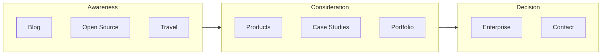

# Content Strategy

| Field | Value |
|-------|-------|
| **Product** | Founder Portfolio Platform (FounderOS) |
| **Version** | 1.0 |
| **Document ID** | UX-CS-001 |
| **Status** | Approved for Implementation |
| **Last Updated** | 2026-06-29 |
| **Owner** | Product & Content |
| **Related** | [Information Architecture](./Information_Architecture.md) · [Content Strategy pages](../05_Pages/Home.md) · [CMS](../06_Modules/CMS.md) · [Metadata](../10_SEO/Metadata.md) |

---

## Purpose

Define the content strategy for FounderOS v1.0 — voice, tone, messaging hierarchy, content types, governance, and quality standards — so every tenant deployment communicates credibility, converts enterprise interest, and scales through the CMS without ad-hoc copy decisions.

---

## Scope

### In Scope

| Area | Coverage |
|------|----------|
| Brand voice and tone | Public site and admin microcopy |
| Messaging framework | Value props, proof points, CTAs |
| Content types | Pages, modules, legal, SEO metadata |
| Editorial workflow | Draft → review → publish |
| White-label content templates | Placeholder and seed content |
| Localization readiness | English-first; i18n hooks documented |
| Content governance | Ownership, review cadence, deprecation |

### Out of Scope

| Area | Rationale |
|------|-----------|
| Visual presentation of content | [Typography System](../03_Design_System/Typography_System.md) |
| API payload shapes | [08_API](../08_API/) |
| Legal text drafting | Tenant/legal counsel responsibility; structure only |

---

## Business Context

FounderOS is a **commercial founder identity platform**. Content must simultaneously persuade investors, educate buyers, and support SEO. White-label tenants swap founder name, product names, and case studies — but the **content architecture** (what to say where) remains constant. Poor content strategy leads to thin pages, duplicate messaging, and weak conversion on [Enterprise](../05_Pages/Enterprise.md) and [Contact](../05_Pages/Contact.md).

---

## Goals

| # | Goal | Metric |
|---|------|--------|
| G1 | Every public page has a defined content purpose and primary CTA | 100% page spec coverage |
| G2 | Consistent voice across all touchpoints | Editorial checklist pass |
| G3 | SEO-optimized titles and descriptions per page type | [Metadata](../10_SEO/Metadata.md) compliance |
| G4 | CMS supports non-technical founders updating core copy | Admin usability test pass |

---

## Functional Requirements

| ID | Requirement | Priority |
|----|-------------|----------|
| FR-CS-01 | Each page SHALL have one primary H1 aligned to search intent | P0 |
| FR-CS-02 | Product pages SHALL include problem, solution, proof, and CTA sections | P0 |
| FR-CS-03 | Case studies SHALL follow Challenge → Approach → Results structure | P0 |
| FR-CS-04 | Blog posts SHALL include author, date, and category metadata | P0 |
| FR-CS-05 | Legal pages SHALL be CMS-editable with version date | P0 |
| FR-CS-06 | Site settings SHALL expose founder bio, tagline, and social links | P0 |
| FR-CS-07 | Empty states SHALL use helpful placeholder copy, not "Lorem ipsum" in production | P1 |
| FR-CS-08 | Testimonials SHALL attribute name, role, and organization | P0 |

---

## Non-functional Requirements

| ID | Requirement | Target |
|----|-------------|--------|
| NFR-CS-01 | Reading level (public marketing) | Grade 8–10 Flesch-Kincaid |
| NFR-CS-02 | Hero headline length | ≤ 12 words |
| NFR-CS-03 | Meta description length | 150–160 characters |
| NFR-CS-04 | Blog post minimum length (SEO) | ≥ 800 words recommended |

---

## User Stories

| ID | As a… | I want to… | So that… |
|----|-------|------------|----------|
| US-CS-01 | Founder | clear templates for each page type | I launch quickly without copywriter |
| US-CS-02 | Enterprise buyer | proof of outcomes on case studies | I trust the vendor |
| US-CS-03 | Investor | concise founder story on About | I assess team credibility |
| US-CS-04 | Content editor | draft and preview before publish | I avoid public mistakes |
| US-CS-05 | SEO lead | unique titles per URL | We rank without cannibalization |

---

## UX Requirements

### Voice and Tone

| Attribute | Guideline | Avoid |
|-----------|-----------|-------|
| **Confident** | State outcomes with evidence | Hyperbole ("revolutionary", "game-changing") |
| **Clear** | Short sentences, active voice | Jargon without definition |
| **Professional** | Enterprise-appropriate register | Casual slang, memes on conversion pages |
| **Human** | Founder perspective where authentic | Generic corporate speak |
| **Helpful** | Guide next step explicitly | Dead-end pages without CTA |

### Tone by Context

| Context | Tone | Example CTA |
|---------|------|-------------|
| Home hero | Aspirational, specific | "Request a demo" |
| Product detail | Informative, benefit-led | "Talk to sales" |
| Blog | Educational, approachable | "Read more" / related product link |
| Enterprise | Formal, trust-building | "Start acquisition conversation" |
| Legal | Neutral, precise | — |
| Admin errors | Direct, actionable | "Check your connection and retry" |

### Messaging Hierarchy

| Level | Content | Placement |
|-------|---------|-----------|
| L1 — Brand promise | One-line value proposition | Home hero, meta title |
| L2 — Pillar messages | 3–4 differentiators | Home features, About |
| L3 — Proof | Metrics, logos, testimonials | Case studies, social proof bands |
| L4 — Detail | Features, specs, FAQs | Product details, support content |
| L5 — Action | Primary and secondary CTAs | Section footers, sticky header |

### Content Type Matrix

| Type | Source | Update Frequency | Owner |
|------|--------|------------------|-------|
| Static page copy | CMS site settings + page blocks | Quarterly | Founder / Marketing |
| Products | Product Manager module | Per release | Product |
| Case studies | CMS | Monthly | Marketing |
| Blog posts | Blog Manager | Weekly–monthly | Founder / Content |
| Portfolio items | Portfolio Manager | As needed | Engineering / Founder |
| Legal | CMS legal entities | Annual or on regulation change | Legal |
| SEO metadata | Per-page + templates | Per publish | SEO / Marketing |

### CTA Copy Standards

| Intent | Primary CTA | Secondary CTA |
|--------|-------------|---------------|
| Demo / sales | Request Demo | View Products |
| Enterprise / M&A | Contact Enterprise | Download overview (future) |
| Content engagement | Read Case Study | Subscribe (future) |
| Open source | View on GitHub | Star repo |
| General contact | Send Message | Schedule call (embed) |

---

## Technical Considerations

| Topic | Guidance |
|-------|----------|
| **CMS** | Rich text via TipTap or similar; sanitize HTML on save |
| **Next.js 15** | `generateMetadata` pulls from API per [Metadata](../10_SEO/Metadata.md) |
| **PostgreSQL** | Content versioning via `updated_at`; full revision history v1.1 |
| **Markdown** | Blog body stored as MD or HTML; consistent renderer |

---

## Security Considerations

| Concern | Rule |
|---------|------|
| XSS in rich content | Server-side sanitization on all CMS HTML |
| PII in testimonials | Consent documented; opt-out process |
| Unpublished drafts | Never exposed on public API routes |

---

## Acceptance Criteria

- [ ] Voice and tone guide reviewed by product owner
- [ ] Every [05_Pages](../05_Pages/Home.md) doc references applicable content sections
- [ ] Seed content package provided for white-label onboarding
- [ ] Meta title/description templates defined per route type
- [ ] Case study template includes measurable results field
- [ ] Legal pages show `last updated` date
- [ ] No duplicate H1/meta titles across static routes

---

## Future Enhancements

| Enhancement | Notes |
|-------------|-------|
| AI-assisted draft generation | Admin-only; human review required |
| Multi-language content | Locale-specific slugs |
| Content calendar in admin | Editorial planning |
| A/B headline testing | Enterprise conversion optimization |

---

## Open Questions

| ID | Question | Owner | Status |
|----|----------|-------|--------|
| OQ-CS-001 | Mandatory case study metrics format (%, $, time saved)? | Product | Open |
| OQ-CS-002 | Founder vs. company voice on About page? | Marketing | Open |
| OQ-CS-003 | User-generated content (comments on blog)? | Product — defer v1.0 | Open |

---

## Related Documents

- [Information Architecture](./Information_Architecture.md)
- [User Journey](../00_Project/04_User_Journey.md)
- [Sitemap](./Sitemap.md)
- [CMS](../06_Modules/CMS.md)
- [Metadata](../10_SEO/Metadata.md)
- [Structured Data](../10_SEO/Structured_Data.md)
- [Home](../05_Pages/Home.md)
- [Enterprise](../05_Pages/Enterprise.md)
