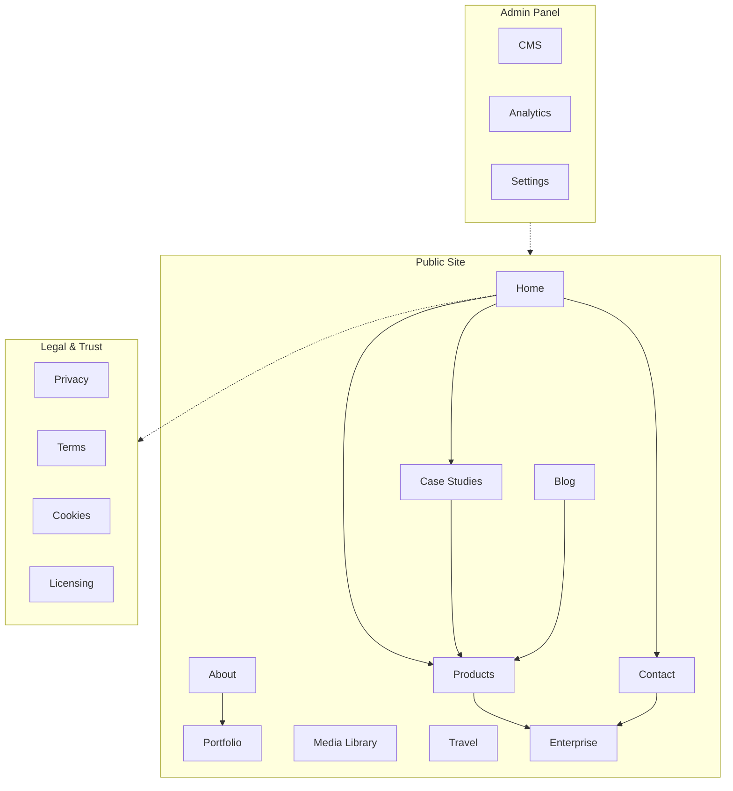
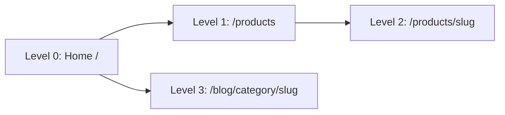

# Information Architecture

| Field | Value |
|-------|-------|
| **Product** | Founder Portfolio Platform (FounderOS) |
| **Version** | 1.0 |
| **Document ID** | UX-IA-001 |
| **Status** | Approved for Implementation |
| **Last Updated** | 2026-06-29 |
| **Owner** | Product & UX |
| **Related** | [Navigation](./Navigation.md) · [Sitemap](./Sitemap.md) · [User Flows](./User_Flows.md) · [Content Strategy](./Content_Strategy.md) |

---

## Purpose

Define the structural organization of content, features, and navigation for FounderOS v1.0 so that users can find information predictably, tenants can white-label without breaking mental models, and engineering teams can implement consistent URL hierarchies, CMS taxonomies, and module boundaries.

This document is the authoritative reference for how information is grouped, labeled, prioritized, and connected across the public site, enterprise portal, and admin panel.

---

## Scope

### In Scope

| Area | Coverage |
|------|----------|
| Public marketing site | Home, Products, Case Studies, Portfolio, Media, About, Blog, Travel, Testimonials, Open Source |
| Conversion surfaces | Contact, Enterprise Acquisition, Demo requests, Licensing inquiries |
| Legal & compliance | Privacy, Terms, Cookies, Licensing |
| Admin panel | Content management, media library, analytics, settings (structural IA only) |
| Content taxonomy | Categories, tags, product types, case study metadata |
| Cross-linking rules | Primary, secondary, and contextual navigation paths |

### Out of Scope

| Area | Rationale |
|------|-----------|
| Visual design specifications | Covered in [Design System](../03_Design_System/Design_System.md) |
| API endpoint design | Covered in [08_API](../08_API/) |
| Database schema | Covered in [09_Database](../09_Database/) |
| Multi-tenant routing at scale | Deferred to [14_Future](../14_Future/) |

---

## Business Context

FounderOS serves founders and companies who need a **single digital identity** that simultaneously:

1. **Establishes credibility** — professional presence for investors, partners, and customers.
2. **Showcases products** — AI/SaaS offerings with licensing and acquisition pathways.
3. **Demonstrates expertise** — portfolio, case studies, blog, and technology stack.
4. **Converts visitors** — contact forms, demo requests, enterprise acquisition funnel.

The information architecture must support **white-label reuse**: the same structural skeleton applies whether the tenant is an AI SaaS founder, a travel creator, or an agency. Only labels, content, and enabled modules change per deployment.

---

## Goals

| # | Goal | Success Metric |
|---|------|----------------|
| G1 | Users reach any primary destination within 2 clicks from Home | 95% task completion in usability testing |
| G2 | Content types are distinguishable by URL and navigation label | Zero ambiguous routes in sitemap audit |
| G3 | Enterprise and licensing paths are discoverable without hunting | Enterprise CTA visible on every page |
| G4 | CMS content maps 1:1 to public IA | No orphan content types in admin |
| G5 | IA supports modular feature toggling per tenant | Disabled modules hidden from nav and sitemap |

---

## Functional Requirements

| ID | Requirement | Priority |
|----|-------------|----------|
| FR-IA-01 | All public pages SHALL belong to exactly one primary content domain (Marketing, Product, Content, Conversion, Legal) | P0 |
| FR-IA-02 | URL structure SHALL follow RESTful, human-readable patterns (`/products/[slug]`, `/blog/[slug]`) | P0 |
| FR-IA-03 | Navigation labels SHALL match page H1 semantics (no "Solutions" linking to unrelated content) | P0 |
| FR-IA-04 | Breadcrumbs SHALL reflect IA hierarchy on all pages deeper than level 2 | P1 |
| FR-IA-05 | Related content blocks SHALL cross-link within the same domain first, then adjacent domains | P1 |
| FR-IA-06 | Admin CMS SHALL organize content by the same taxonomy as public IA | P0 |
| FR-IA-07 | Footer SHALL provide secondary navigation for legal, company, and product links | P0 |
| FR-IA-08 | Search (v1.1) placeholder hooks SHALL be defined in header IA | P2 |
| FR-IA-09 | Module enable/disable per tenant SHALL remove nav items and sitemap entries | P1 |
| FR-IA-10 | Enterprise acquisition SHALL be reachable from Products, Footer, Header CTA, and Contact | P0 |

---

## Non-functional Requirements

| ID | Requirement | Target |
|----|-------------|--------|
| NFR-IA-01 | IA documentation SHALL be maintainable as modules are added | Version-controlled markdown |
| NFR-IA-02 | URL depth SHALL not exceed 4 segments for any public page | Max: `/blog/category/slug` |
| NFR-IA-03 | Navigation item count in primary nav SHALL not exceed 8 items | Cognitive load limit |
| NFR-IA-04 | IA changes SHALL be backward-compatible or include redirect maps | 301 redirects for renamed routes |
| NFR-IA-05 | Content taxonomy SHALL support i18n key structure for future localization | Slug + locale prefix ready |

---

## User Stories

| ID | As a… | I want to… | So that… |
|----|-------|------------|----------|
| US-IA-01 | Prospective customer | Browse products by category | I can evaluate offerings relevant to my use case |
| US-IA-02 | Enterprise buyer | Find acquisition and licensing information quickly | I can initiate a partnership conversation |
| US-IA-03 | Investor | Access case studies and portfolio from one logical path | I can assess track record efficiently |
| US-IA-04 | Blog reader | Discover related products from an article | I can move from thought leadership to product evaluation |
| US-IA-05 | Site admin | Manage content in the same structure visitors see | I don't create orphaned or mislabeled pages |
| US-IA-06 | White-label deployer | Disable Travel module without breaking navigation | My tenant site stays coherent |
| US-IA-07 | Mobile visitor | Access all primary sections from a single menu | I don't miss content on small screens |

---

## UX Requirements

### Content Domain Model

| Domain | Primary Pages | User Intent | Entry Points |
|--------|---------------|-------------|--------------|
| **Marketing** | Home, About, Testimonials | Trust & brand awareness | Direct, social, search |
| **Product** | Products, Product Detail, Open Source, Enterprise | Evaluation & purchase | Nav, case studies, blog CTAs |
| **Proof** | Case Studies, Portfolio, Media | Credibility validation | Nav, About, Home sections |
| **Content** | Blog, Travel | Engagement & SEO | Nav, search, social |
| **Conversion** | Contact, Enterprise | Lead capture | Header CTA, in-page CTAs |
| **Legal** | Privacy, Terms, Cookies, Licensing | Compliance & trust | Footer |

### Labeling Conventions

| Element | Convention | Example |
|---------|------------|---------|
| Nav items | Noun or short noun phrase, Title Case | "Case Studies" not "Our Work" |
| Page titles | `{Page} — {Site Name}` or `{Entity} — {Category} — {Site}` | "AI Customer Ops — Products — Soumen Karmakar" |
| CTAs | Verb-first, outcome-oriented | "Request Demo", "Explore Products" |
| Breadcrumbs | Home → Domain → Entity | Home → Products → AI Customer Ops |

### Hierarchy Depth

| Level | Pattern | Max Items per Parent |
|-------|---------|---------------------|
| 0 | `/` | 1 |
| 1 | `/{domain}` | 12 top-level routes |
| 2 | `/{domain}/{slug}` | Unlimited (paginated lists at L1) |
| 3 | `/{domain}/{taxonomy}/{slug}` | Blog categories only in v1.0 |

---

## Technical Considerations

| Topic | Implementation Guidance |
|-------|------------------------|
| **Next.js App Router** | Route groups: `(marketing)`, `(legal)`, `(admin)` — see [Frontend Architecture](../04_Architecture/Frontend_Architecture.md) |
| **CMS mapping** | Each content type maps to a FastAPI resource and PostgreSQL table |
| **Constants-driven nav** | `NAV_ITEMS` in tenant config drives primary navigation; IA doc is the schema |
| **Dynamic routes** | `[slug]` pages resolve via API with ISR/SSG; 404 for unknown slugs |
| **Metadata** | `generateMetadata` per route using IA-defined title templates |
| **Sitemap generation** | Programmatic sitemap from enabled modules + published content |

### CMS ↔ Public IA Mapping

| CMS Entity | Public Route | List Page |
|------------|--------------|-----------|
| Product | `/products/[slug]` | `/products` |
| Case Study | `/case-studies/[slug]` | `/case-studies` |
| Blog Post | `/blog/[slug]` | `/blog` |
| Portfolio Item | `/portfolio` (section) | `/portfolio` |
| Travel Post | `/travel/[slug]` | `/travel` |
| Testimonial | `/testimonials` | `/testimonials` |
| Legal Page | `/legal/[slug]` | Footer links |
| Site Settings | Global (header, footer, SEO) | N/A |

---

## Security Considerations

| Concern | Mitigation |
|---------|------------|
| Admin IA exposure | Admin routes under `/admin/*` with auth middleware; never linked from public sitemap |
| Unpublished content | Draft status in CMS prevents public route resolution |
| Slug enumeration | Rate limiting on slug lookup endpoints |
| Sensitive enterprise data | Acquisition details gated; public page shows summary only |
| IA injection via CMS | Slug validation regex; no path traversal in user-defined slugs |

---

## Acceptance Criteria

- [ ] Every public route in the [Sitemap](./Sitemap.md) maps to a content domain in this document
- [ ] Primary navigation contains ≤ 8 items and matches IA labeling conventions
- [ ] No page is reachable only via URL (must appear in nav, footer, or contextual link)
- [ ] Breadcrumbs implemented on all Level 2+ pages
- [ ] CMS admin sidebar mirrors content domain structure
- [ ] Module disable removes all IA references (nav, footer, sitemap, internal links)
- [ ] URL depth audit passes (no route > 4 segments)
- [ ] Cross-link matrix documented and implemented for Products ↔ Case Studies ↔ Blog

---

## Future Enhancements

| Enhancement | Target | IA Impact |
|-------------|--------|-----------|
| Global search | v1.1 | Add search results page `/search?q=` |
| Multi-language | v1.2 | Locale prefix `/en/products/[slug]` |
| Product categories | v1.1 | `/products/category/[slug]` Level 2 taxonomy |
| Knowledge base | v2.0 | New domain: `/docs/` with nested hierarchy |
| Partner directory | v2.0 | `/partners/` under Marketing domain |
| Personalized IA | v2.0 | Role-based nav for logged-in enterprise users |

---

## Open Questions

| # | Question | Owner | Decision By |
|---|----------|-------|-------------|
| OQ-IA-01 | Should "Platform" remain a nav item pointing to a flagship product, or become a `/platform` landing page? | Product | Sprint 1 |
| OQ-IA-02 | Is Travel a first-class nav item or footer-only for non-travel tenants? | Product | Tenant config spec |
| OQ-IA-03 | Do testimonials warrant a dedicated page or remain a Home section only? | UX | v1.0 scope lock |
| OQ-IA-04 | Should blog support `/blog/category/[slug]` in v1.0 or defer to v1.1? | Engineering | API design review |
| OQ-IA-05 | How should open-source projects relate to Products IA — subdomain or `/open-source`? | Product | Current: `/open-source` standalone |

---

## Related Documents

- [Navigation](./Navigation.md) — Navigation patterns and component behavior
- [Sitemap](./Sitemap.md) — Complete route inventory
- [User Flows](./User_Flows.md) — Task-based journey maps
- [Content Strategy](./Content_Strategy.md) — Voice, tone, and content governance
- [Design System](../03_Design_System/Design_System.md) — Visual component specifications
- [PRODUCT_REQUIREMENTS.md](../../PRODUCT_REQUIREMENTS.md) — Product-level requirements
