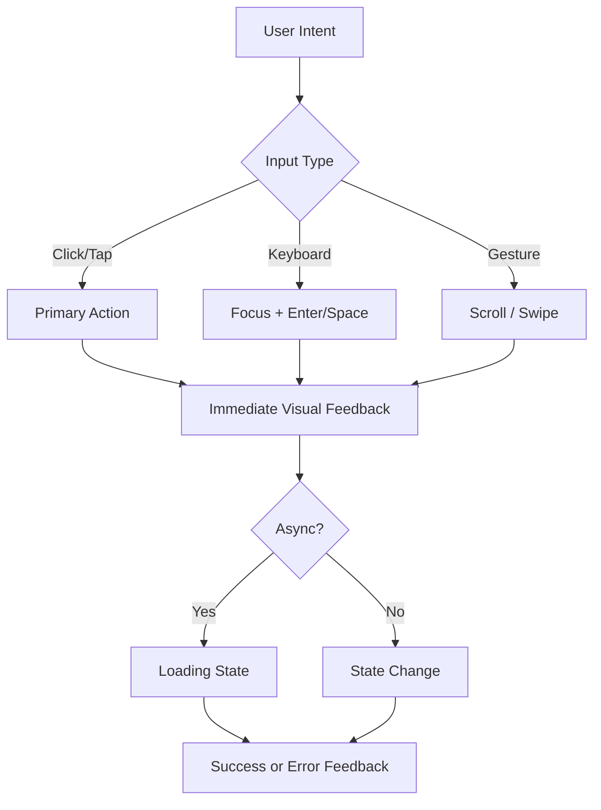

# Interaction Principles

| Field | Value |
|-------|-------|
| **Product** | Founder Portfolio Platform (FounderOS) |
| **Version** | 1.0 |
| **Document ID** | UX-INT-001 |
| **Status** | Approved for Implementation |
| **Last Updated** | 2026-06-29 |
| **Owner** | Product & UX |
| **Related** | [Accessibility](./Accessibility.md) · [Navigation](./Navigation.md) · [Animation System](../03_Design_System/Animation_System.md) · [Design System](../03_Design_System/Design_System.md) |

---

## Purpose

Define the interaction design principles that govern how users engage with FounderOS v1.0 across the public site and admin panel. These principles ensure consistent, predictable, and enterprise-grade behavior for clicks, hovers, focus, gestures, and feedback — independent of tenant branding.

---

## Scope

### In Scope

| Area | Coverage |
|------|----------|
| Click and tap behavior | Buttons, links, cards, list items |
| Hover and focus states | Desktop pointer and keyboard focus |
| Touch gestures | Mobile tap, scroll, swipe where applicable |
| Feedback timing | Loading, success, error response windows |
| Progressive disclosure | Accordions, tabs, dialogs, drawers |
| Form interactions | Validation, submission, inline editing |
| Navigation interactions | Route transitions, active states, back behavior |
| Admin CMS interactions | Create, edit, publish, delete workflows |

### Out of Scope

| Area | Rationale |
|------|-----------|
| Visual token values | Covered in [Design Tokens](../03_Design_System/Design_Tokens.md) |
| Component-level API specs | Covered in individual [03_Design_System](../03_Design_System/) docs |
| Animation keyframe definitions | Covered in [Animation System](../03_Design_System/Animation_System.md) |

---

## Business Context

FounderOS targets founders and SaaS companies selling to **enterprise buyers**. Interaction quality signals product maturity — laggy forms, ambiguous click targets, or inconsistent feedback undermine trust during due diligence. Principles align with patterns used by Stripe, Linear, and Vercel: fast, obvious, forgiving.

---

## Goals

| # | Goal | Metric |
|---|------|--------|
| G1 | Every interactive element provides visible feedback within 100ms | Interaction audit pass |
| G2 | Destructive actions require explicit confirmation | 100% delete/archive flows |
| G3 | Keyboard and pointer parity on all primary flows | [User Flows](./User_Flows.md) keyboard walkthrough |
| G4 | Reduced motion respected globally | `prefers-reduced-motion` compliance |

---

## Functional Requirements

| ID | Requirement | Priority |
|----|-------------|----------|
| FR-INT-01 | Primary actions SHALL use button components, not styled divs | P0 |
| FR-INT-02 | Links SHALL navigate; buttons SHALL trigger actions (no role confusion) | P0 |
| FR-INT-03 | Disabled controls SHALL not fire events and SHALL be visually distinct | P0 |
| FR-INT-04 | Loading states SHALL appear within 200ms of user action | P0 |
| FR-INT-05 | Form submit SHALL disable duplicate submissions until response | P0 |
| FR-INT-06 | Dialogs SHALL close on Escape and overlay click (unless destructive confirm) | P0 |
| FR-INT-07 | Toast notifications SHALL auto-dismiss after 5s (errors persist until dismissed) | P1 |
| FR-INT-08 | Card click targets SHALL meet 44×44px minimum on mobile | P0 |
| FR-INT-09 | Admin publish actions SHALL show success confirmation | P0 |
| FR-INT-10 | External links SHALL open in new tab with accessible indication | P1 |

---

## Non-functional Requirements

| ID | Requirement | Target |
|----|-------------|--------|
| NFR-INT-01 | Perceived response to tap/click | Visual feedback &lt; 100ms |
| NFR-INT-02 | Route transition perceived latency | &lt; 300ms with loading indicator |
| NFR-INT-03 | Form validation feedback | Inline on blur or submit |
| NFR-INT-04 | Animation duration (micro-interactions) | 150–250ms default |

---

## User Stories

| ID | As a… | I want to… | So that… |
|----|-------|------------|----------|
| US-INT-01 | Visitor | know when a button is processing my request | I don't click repeatedly |
| US-INT-02 | Enterprise buyer | clear CTAs on product pages | I can request a demo without hunting |
| US-INT-03 | Keyboard user | predictable focus order | I can complete forms without a mouse |
| US-INT-04 | Admin | confirmation before deleting content | I don't lose work accidentally |
| US-INT-05 | Mobile user | large tap targets on navigation | I don't mis-tap adjacent links |

---

## UX Requirements

### Core Principles

| Principle | Description | Example |
|-----------|-------------|---------|
| **Immediate feedback** | Every action gets a visible response | Button shows spinner on submit |
| **Predictability** | Same control behaves the same everywhere | Primary button always solid accent |
| **Forgiveness** | Destructive actions are reversible or confirmed | Archive vs. permanent delete |
| **Clarity** | One primary action per view section | Single "Request Demo" per hero |
| **Efficiency** | Minimize steps to conversion | Contact form ≤ 5 fields default |
| **Accessibility first** | Pointer enhancements never replace keyboard | Hover tooltip also on focus |

### Interaction Hierarchy

### State Model

| State | Visual Treatment | Cursor | Notes |
|-------|------------------|--------|-------|
| Default | Base token styles | `pointer` on interactive | — |
| Hover | Subtle background/border shift | `pointer` | Desktop only |
| Focus | Visible ring (2px offset) | — | Keyboard required |
| Active/Pressed | Slight scale or darken | `pointer` | &lt; 100ms |
| Disabled | Reduced opacity, no pointer | `not-allowed` | `aria-disabled` |
| Loading | Spinner + disabled | `wait` | Preserve layout width |

### Feedback Patterns

| Event | Component | Duration | Reference |
|-------|-----------|----------|-----------|
| Form success | Toast + optional redirect | 5s auto-dismiss | [Feedback Components](../03_Design_System/Feedback_Components.md) |
| Form error | Inline field errors + summary | Until corrected | [Forms](../03_Design_System/Forms.md) |
| API failure | Toast + retry action | Until dismissed | [Feedback Components](../03_Design_System/Feedback_Components.md) |
| Content saved (admin) | Toast "Saved" | 3s | [CMS](../06_Modules/CMS.md) |
| Navigation | Skeleton or top progress | Route-dependent | [Loading States](../03_Design_System/Loading_States.md) |

### Progressive Disclosure Rules

| Pattern | When to Use | Max Depth |
|---------|-------------|-----------|
| Accordion | FAQ, feature lists | 1 level expanded at a time (default) |
| Tabs | Related content panels | ≤ 6 tabs; overflow to select on mobile |
| Dialog | Focused task (confirm, quick form) | Single purpose per dialog |
| Drawer | Mobile nav, filters | Full-height on mobile |
| Collapsible | Long legal text, advanced options | Chevron + `aria-expanded` |

---

## Technical Considerations

| Topic | Guidance |
|-------|----------|
| **Next.js 15** | Use `useTransition` for non-blocking UI updates on navigation |
| **shadcn/ui** | Radix primitives handle focus trap, `aria-*`; extend via tokens only |
| **TailwindCSS** | State variants (`hover:`, `focus-visible:`, `disabled:`) for consistency |
| **Framer Motion** | Page transitions optional; respect reduced motion |
| **FastAPI** | Optimistic UI discouraged for admin mutations; wait for 2xx |

---

## Security Considerations

| Concern | Interaction Rule |
|---------|------------------|
| CSRF on forms | Public forms use server actions or API with origin validation |
| Double submit | Disable submit button after first click |
| Session timeout (admin) | Show re-auth dialog; preserve draft in local storage |
| Sensitive actions | Re-enter password or confirm phrase for destructive admin ops (v1.1) |

---

## Acceptance Criteria

- [ ] All interactive elements documented in [03_Design_System](../03_Design_System/) follow state model
- [ ] Primary user flows in [User Flows](./User_Flows.md) pass interaction audit
- [ ] No styled `
` used as primary button without `role="button"` and keyboard handler
- [ ] Loading states appear within 200ms on Contact and Enterprise forms
- [ ] Dialogs trap focus and restore on close per [Accessibility](./Accessibility.md)
- [ ] `prefers-reduced-motion` disables non-essential animations
- [ ] Mobile tap targets ≥ 44×44px on navigation and CTAs

---

## Future Enhancements

| Enhancement | Notes |
|-------------|-------|
| Undo toast for admin deletes | Soft-delete with 10s undo window |
| Command palette (⌘K) | Admin quick navigation |
| Haptic feedback on mobile | PWA optional |
| Inline editing on public pages | Admin preview mode only |

---

## Open Questions

| ID | Question | Owner | Status |
|----|----------|-------|--------|
| OQ-INT-001 | Optimistic updates for blog publish in admin? | Engineering | Open |
| OQ-INT-002 | Swipe-to-dismiss on mobile toasts? | UX | Open |
| OQ-INT-003 | Global keyboard shortcuts on public site? | Product | Open |

---

## Related Documents

- [Accessibility](./Accessibility.md)
- [User Flows](./User_Flows.md)
- [Navigation](./Navigation.md)
- [Content Strategy](./Content_Strategy.md)
- [Design System](../03_Design_System/Design_System.md)
- [Buttons](../03_Design_System/Buttons.md)
- [Dialogs](../03_Design_System/Dialogs.md)
- [Feedback Components](../03_Design_System/Feedback_Components.md)
