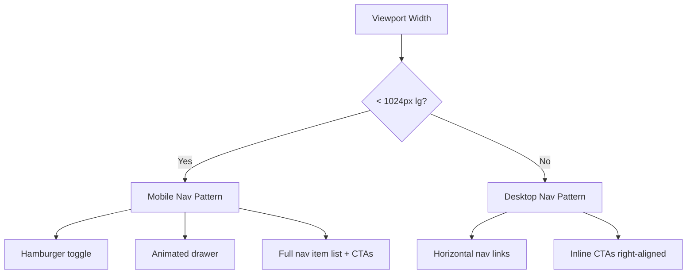
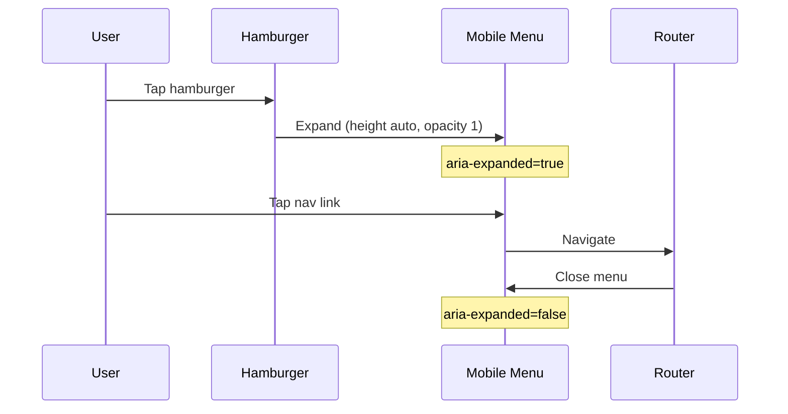

# Navigation

| Field | Value |
|-------|-------|
| **Product** | Founder Portfolio Platform (FounderOS) |
| **Version** | 1.0 |
| **Document ID** | UX-NAV-001 |
| **Status** | Approved for Implementation |
| **Last Updated** | 2026-06-29 |
| **Owner** | Product & UX |
| **Related** | [Information Architecture](./Information_Architecture.md) · [Sitemap](./Sitemap.md) · [Navigation Components](../03_Design_System/Navigation_Components.md) |

---

## Purpose

Specify navigation patterns, behaviors, and requirements for all navigational surfaces in FounderOS v1.0 — primary header, mobile menu, footer, in-page anchors, breadcrumbs, and admin sidebar — ensuring consistent wayfinding across devices and tenant configurations.

---

## Scope

### In Scope

| Surface | Description |
|---------|-------------|
| Global header | Fixed top bar with logo, primary nav, CTAs |
| Mobile navigation | Collapsible drawer triggered by hamburger |
| Footer navigation | Multi-column link groups |
| Breadcrumbs | Hierarchical path on deep pages |
| In-page navigation | Section anchors, tab navigation within pages |
| Admin sidebar | CMS and settings navigation |
| Active state indicators | Current page highlighting |
| CTA placement | Enterprise and Demo request buttons |

### Out of Scope

| Surface | Document |
|---------|----------|
| Visual styling of nav components | [Navigation Components](../03_Design_System/Navigation_Components.md) |
| Admin RBAC per nav item | [11_Security](../11_Security/) |
| Analytics event naming | [06_Modules](../06_Modules/) Analytics module |

---

## Business Context

Navigation is the primary conversion lever on a founder portfolio site. Enterprise buyers and investors form judgments within seconds; cluttered or hidden navigation signals immaturity. FounderOS navigation must feel **enterprise-grade** (Stripe, Linear, Vercel quality) while remaining configurable for white-label tenants with 3–8 primary destinations.

The current reference implementation uses a fixed header with backdrop blur, 8 primary nav items, ghost "Enterprise" CTA, and solid "Request Demo" CTA — this document codifies that pattern as the v1.0 standard.

---

## Goals

| # | Goal | Metric |
|---|------|--------|
| G1 | Primary destinations reachable in 1 tap/click from any page | 100% coverage |
| G2 | Mobile navigation parity with desktop | Same links, same order |
| G3 | Active page always visually indicated | WCAG 2.1 AA contrast on active state |
| G4 | Header remains usable during scroll | Fixed position, no content jump |
| G5 | Keyboard-navigable without mouse | Full tab order, focus visible |

---

## Functional Requirements

| ID | Requirement | Priority |
|----|-------------|----------|
| FR-NAV-01 | Header SHALL be fixed to viewport top on all public pages | P0 |
| FR-NAV-02 | Primary nav items SHALL be driven by tenant `NAV_ITEMS` configuration | P0 |
| FR-NAV-03 | Logo SHALL link to Home (`/`) | P0 |
| FR-NAV-04 | Mobile menu SHALL toggle via hamburger with `aria-expanded` and `aria-label` | P0 |
| FR-NAV-05 | Mobile menu SHALL close on route change | P0 |
| FR-NAV-06 | "Enterprise" CTA SHALL link to `/enterprise` | P0 |
| FR-NAV-07 | "Request Demo" CTA SHALL link to `/contact?type=demo` | P0 |
| FR-NAV-08 | Footer SHALL contain Products, Company, and Legal link groups | P0 |
| FR-NAV-09 | Social links SHALL open in new tab with `rel="noopener noreferrer"` | P0 |
| FR-NAV-10 | Breadcrumbs SHALL appear on Level 2+ pages | P1 |
| FR-NAV-11 | Skip-to-content link SHALL be first focusable element | P0 |
| FR-NAV-12 | Admin nav SHALL be collapsible sidebar with icon + label | P1 |

---

## Non-functional Requirements

| ID | Requirement | Target |
|----|-------------|--------|
| NFR-NAV-01 | Header paint shall not cause CLS | CLS < 0.01 for header |
| NFR-NAV-02 | Mobile menu animation duration | 200–300ms |
| NFR-NAV-03 | Nav config hot-reload in dev | < 1s after constants change |
| NFR-NAV-04 | Touch targets on mobile | Minimum 44×44px |
| NFR-NAV-05 | Header z-index above page content | z-50 minimum |

---

## User Stories

| ID | As a… | I want to… | So that… |
|----|-------|------------|----------|
| US-NAV-01 | Desktop visitor | See all primary sections in the header | I can navigate without opening menus |
| US-NAV-02 | Mobile visitor | Open a full-screen nav menu | I can reach every section on my phone |
| US-NAV-03 | Returning visitor | Recognize which page I'm on | I maintain spatial orientation |
| US-NAV-04 | Enterprise buyer | Find the Enterprise page from any screen | I can start an acquisition inquiry |
| US-NAV-05 | Keyboard user | Tab through nav items logically | I can navigate without a mouse |
| US-NAV-06 | Screen reader user | Hear "Main navigation" landmark | I understand the page structure |
| US-NAV-07 | Site admin | Configure nav items per tenant | White-label sites show relevant links only |

---

## UX Requirements

### Primary Navigation Structure

| Position | Label | Route | Visibility |
|----------|-------|-------|------------|
| Logo | `{SITE.name}` | `/` | Always |
| 1 | Products | `/products` | Default |
| 2 | Platform | `/products/{flagship-slug}` | Default |
| 3 | Case Studies | `/case-studies` | Default |
| 4 | Portfolio | `/portfolio` | Default |
| 5 | Media | `/media` | Default |
| 6 | About | `/about` | Default |
| 7 | Blog | `/blog` | Default |
| 8 | Contact | `/contact` | Default |
| CTA (ghost) | Enterprise | `/enterprise` | Desktop ≥ lg |
| CTA (primary) | Request Demo | `/contact?type=demo` | Desktop ≥ lg |

### Responsive Breakpoints



| Breakpoint | Header Height | Nav Pattern | CTA Visibility |
|------------|---------------|-------------|----------------|
| `< sm` (640px) | 64px (h-16) | Hamburger only | Inside mobile drawer |
| `sm – lg` | 64px | Hamburger only | Inside mobile drawer |
| `≥ lg` (1024px) | 64px | Horizontal links | Inline right |

### Footer Navigation Matrix

| Column | Links |
|--------|-------|
| **Brand** (col-span-2) | Logo, description, LinkedIn, Twitter, GitHub |
| **Products** | All Products, Flagship Product, Enterprise Acquisition, Open Source |
| **Company** | About, Case Studies, Blog, Contact |
| **Legal** (bottom bar) | Privacy, Terms, Cookies, Licensing |

### Active State Rules

| Context | Active Indicator |
|---------|------------------|
| Exact route match | `text-foreground` (full contrast) |
| Child route (e.g., `/products/foo` when on Products) | Parent nav item highlighted |
| Query params ignored for active state | `/contact?type=demo` → Contact active |
| Mobile drawer | Same rules as desktop |

### Mobile Menu Behavior



---

## Technical Considerations

| Topic | Guidance |
|-------|----------|
| **Component** | `Header` in `frontend/src/components/layout/header.tsx` |
| **State** | `useState` for mobile open; Framer Motion `AnimatePresence` for animation |
| **Config** | `NAV_ITEMS` array in `frontend/src/lib/constants.ts` (tenant-overridable) |
| **Active detection** | `usePathname()` from `next/navigation` |
| **Landmarks** | `<header>`, `<nav aria-label="Main navigation">`, `<footer>` |
| **Admin nav** | Separate `AdminSidebar` component under `/admin` layout |
| **Prefetch** | Next.js `<Link>` default prefetch for nav items |

### Navigation Config Schema

```typescript
interface NavItem {
  label: string;      // Display text
  href: string;       // Route path
  external?: boolean; // Opens in new tab
  module?: string;    // Module gate (e.g., "travel")
  icon?: string;      // Optional Lucide icon name (admin)
}
```

---

## Security Considerations

| Concern | Mitigation |
|---------|------------|
| Open redirect via nav href | Validate hrefs against allowlist pattern `^/[a-z0-9-/]+$` |
| XSS in nav labels | Sanitize CMS-driven labels server-side |
| Admin nav exposure | Admin routes excluded from public `NAV_ITEMS` |
| External link safety | `rel="noopener noreferrer"` on all `target="_blank"` links |

---

## Acceptance Criteria

- [ ] Header fixed, backdrop-blur, border-bottom on all public pages
- [ ] 8 primary nav items render in configured order on desktop
- [ ] Mobile hamburger toggles menu with animation and correct ARIA attributes
- [ ] Menu closes on navigation and outside-tap (v1.1)
- [ ] Enterprise and Request Demo CTAs present on desktop and mobile
- [ ] Footer 4-column layout with all link groups per matrix
- [ ] Active state visible on current page nav item
- [ ] Skip-to-content link functional and first in tab order
- [ ] All touch targets ≥ 44px on mobile
- [ ] Lighthouse Accessibility score ≥ 95 for navigation landmarks

---

## Future Enhancements

| Enhancement | Description |
|-------------|-------------|
| Mega menu | Product dropdown with thumbnails on hover (v1.1) |
| Sticky section nav | In-page TOC for long product pages |
| Search in header | Command-K style search overlay |
| Breadcrumb component | Shared shadcn breadcrumb with JSON-LD |
| Nav analytics | Track click heatmaps per nav item |
| Role-based admin nav | Hide CMS sections by RBAC role |

---

## Open Questions

| # | Question | Owner |
|---|----------|-------|
| OQ-NAV-01 | Should mobile menu be full-screen overlay or dropdown below header? | UX — Current: dropdown |
| OQ-NAV-02 | Add "Travel" to primary nav for travel-enabled tenants only? | Product |
| OQ-NAV-03 | Implement scroll-hide header on downward scroll? | UX — Deferred v1.1 |
| OQ-NAV-04 | Breadcrumb on mobile — truncate or hide? | UX |
| OQ-NAV-05 | Admin sidebar: persistent or collapsible to icons only? | Engineering |

---

## Related Documents

- [Information Architecture](./Information_Architecture.md)
- [Sitemap](./Sitemap.md)
- [Accessibility](./Accessibility.md)
- [Navigation Components](../03_Design_System/Navigation_Components.md)
- [Interaction Principles](./Interaction_Principles.md)
- [Responsive System](../03_Design_System/Responsive_System.md)
