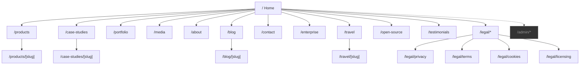
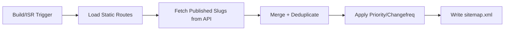

# Sitemap

| Field | Value |
|-------|-------|
| **Product** | Founder Portfolio Platform (FounderOS) |
| **Version** | 1.0 |
| **Document ID** | UX-SM-001 |
| **Status** | Approved for Implementation |
| **Last Updated** | 2026-06-29 |
| **Owner** | Product & UX |
| **Related** | [Information Architecture](./Information_Architecture.md) · [Navigation](./Navigation.md) |

---

## Purpose

Provide the complete, authoritative inventory of all public routes, admin routes, and dynamic URL patterns for FounderOS v1.0. This sitemap drives SEO XML generation, navigation audits, redirect planning, and engineering route implementation.

---

## Scope

### In Scope

- All public marketing and content pages
- Dynamic slug-based routes
- Legal and compliance pages
- Admin panel routes (structural listing)
- SEO metadata templates per route type
- Module-gated routes

### Out of Scope

- API endpoint inventory (see [08_API](../08_API/))
- Third-party integrations (Calendly embeds, etc.)
- Staging/preview URLs

---

## Business Context

A founder portfolio platform's sitemap directly impacts **discoverability** (SEO), **investor due diligence** (can they find case studies?), and **enterprise conversion** (is the acquisition portal indexed?). FounderOS must generate a programmatic `sitemap.xml` from this specification plus published CMS content.

---

## Goals

| # | Goal | Metric |
|---|------|--------|
| G1 | Every public page indexed with correct priority and changefreq | Valid sitemap.xml |
| G2 | No orphan routes (unlinked pages) | 0 orphans in link audit |
| G3 | Admin routes excluded from public sitemap | 0 admin URLs in sitemap.xml |
| G4 | Dynamic content auto-included on publish | ISR sitemap regeneration |

---

## Functional Requirements

| ID | Requirement | Priority |
|----|-------------|----------|
| FR-SM-01 | Static routes SHALL match the inventory in this document | P0 |
| FR-SM-02 | Dynamic routes SHALL resolve published content only | P0 |
| FR-SM-03 | Unpublished/draft content SHALL return 404 on public routes | P0 |
| FR-SM-04 | `sitemap.xml` SHALL be generated at `/sitemap.xml` | P0 |
| FR-SM-05 | `robots.txt` SHALL reference sitemap URL | P0 |
| FR-SM-06 | Legal pages SHALL be included with `changefreq: yearly` | P1 |
| FR-SM-07 | Blog posts SHALL be included with `lastmod` from `updated_at` | P0 |
| FR-SM-08 | Admin routes SHALL be disallowed in `robots.txt` | P0 |

---

## Non-functional Requirements

| ID | Requirement | Target |
|----|-------------|--------|
| NFR-SM-01 | Sitemap generation time | < 2s for 1000 URLs |
| NFR-SM-02 | Sitemap file size | Split at 50,000 URLs per file |
| NFR-SM-03 | Route resolution latency | < 100ms (cached slug lookup) |

---

## User Stories

| ID | As a… | I want to… | So that… |
|----|-------|------------|----------|
| US-SM-01 | Search engine | Crawl all public pages via sitemap.xml | Content gets indexed |
| US-SM-02 | SEO manager | Set priority weights per page type | Important pages rank higher |
| US-SM-03 | Developer | Know every route before implementation | No missing pages at launch |
| US-SM-04 | Content editor | See my new blog post appear in sitemap after publish | SEO stays current |

---

## UX Requirements

### Complete Route Inventory

#### Level 0 — Home

| Route | Page Title Template | Priority | Changefreq | Nav |
|-------|---------------------|----------|------------|-----|
| `/` | `{SITE.title}` | 1.0 | weekly | Logo |

#### Level 1 — Primary Domains

| Route | Page Title | Priority | Changefreq | Nav | Module |
|-------|------------|----------|------------|-----|--------|
| `/products` | Products — {SITE.name} | 0.9 | weekly | ✓ | products |
| `/case-studies` | Case Studies — {SITE.name} | 0.8 | weekly | ✓ | case-studies |
| `/portfolio` | Portfolio — {SITE.name} | 0.8 | monthly | ✓ | portfolio |
| `/media` | Media — {SITE.name} | 0.7 | monthly | ✓ | media |
| `/about` | About — {SITE.name} | 0.8 | monthly | ✓ | about |
| `/blog` | Blog — {SITE.name} | 0.8 | daily | ✓ | blog |
| `/travel` | Travel — {SITE.name} | 0.6 | weekly | Optional | travel |
| `/testimonials` | Testimonials — {SITE.name} | 0.6 | monthly | — | testimonials |
| `/open-source` | Open Source — {SITE.name} | 0.7 | monthly | Footer | open-source |
| `/contact` | Contact — {SITE.name} | 0.7 | monthly | ✓ | contact |
| `/enterprise` | Enterprise Acquisition — {SITE.name} | 0.9 | monthly | CTA | enterprise |

#### Level 2 — Dynamic Content

| Route Pattern | Source | Priority | Changefreq |
|---------------|--------|----------|------------|
| `/products/[slug]` | CMS Product | 0.8 | weekly |
| `/case-studies/[slug]` | CMS Case Study | 0.7 | monthly |
| `/blog/[slug]` | CMS Blog Post | 0.6 | monthly |
| `/travel/[slug]` | CMS Travel Post | 0.5 | monthly |

#### Level 1 — Legal

| Route | Priority | Changefreq | Nav |
|-------|----------|------------|-----|
| `/legal/privacy` | 0.3 | yearly | Footer |
| `/legal/terms` | 0.3 | yearly | Footer |
| `/legal/cookies` | 0.3 | yearly | Footer |
| `/legal/licensing` | 0.5 | yearly | Footer |

#### Admin (Not in Public Sitemap)

| Route | Auth Required | Purpose |
|-------|---------------|---------|
| `/admin` | ✓ | Dashboard |
| `/admin/content/*` | ✓ | CMS management |
| `/admin/media` | ✓ | Media library |
| `/admin/analytics` | ✓ | Analytics dashboard |
| `/admin/settings` | ✓ | Site configuration |

### Visual Sitemap

### SEO Priority Matrix

| Page Type | Priority | Changefreq | Rationale |
|-----------|----------|------------|-----------|
| Home | 1.0 | weekly | Primary entry point |
| Products list + flagship product | 0.9 | weekly | Core conversion |
| Enterprise | 0.9 | monthly | High-value conversion |
| Case Studies, About, Blog list | 0.8 | weekly/daily | Credibility + freshness |
| Product/Case Study detail | 0.7–0.8 | weekly/monthly | Long-tail SEO |
| Blog posts | 0.6 | monthly | Content marketing |
| Media, Open Source | 0.7 | monthly | Technical credibility |
| Travel | 0.5–0.6 | weekly | Niche module |
| Legal | 0.3 | yearly | Compliance only |

---

## Technical Considerations

| Topic | Implementation |
|-------|----------------|
| **Next.js sitemap** | `app/sitemap.ts` exporting `MetadataRoute.Sitemap` |
| **Dynamic entries** | Fetch published slugs from FastAPI at build/ISR time |
| **robots.txt** | `app/robots.ts` with `disallow: /admin` |
| **Canonical URLs** | `NEXT_PUBLIC_SITE_URL` + path |
| **ISR revalidation** | On-demand revalidation when CMS content publishes |
| **404 handling** | `notFound()` for unknown slugs |

### Sitemap Generation Pseudoflow

---

## Security Considerations

| Concern | Mitigation |
|---------|------------|
| Admin URL leakage | `robots.txt` disallow + no admin links in sitemap |
| Draft content indexing | API filters `status=published` only |
| Sensitive slugs | No internal codenames in public slugs |

---

## Acceptance Criteria

- [ ] All 11 Level-1 public routes implemented and linked
- [ ] All 4 dynamic route patterns resolve published content
- [ ] All 4 legal routes accessible from footer
- [ ] `sitemap.xml` validates at Google Search Console
- [ ] `robots.txt` disallows `/admin`
- [ ] Zero orphan pages in Screaming Frog crawl
- [ ] Module-disabled routes return 404 and are excluded from sitemap

---

## Future Enhancements

| Enhancement | Route Impact |
|-------------|--------------|
| Blog categories | `/blog/category/[slug]` |
| Product categories | `/products/category/[slug]` |
| i18n | `/[locale]/...` prefix for all routes |
| Sitemap index | Multiple sitemap files at scale |
| News sitemap | `/news-sitemap.xml` for blog |

---

## Open Questions

| # | Question | Owner |
|---|----------|-------|
| OQ-SM-01 | Include `/testimonials` in primary nav or keep footer-only? | Product |
| OQ-SM-02 | Should `/media` be a single page or split into sub-pages? | Content |
| OQ-SM-03 | Add `/rss.xml` for blog feed? | Engineering — Recommended yes |

---

## Related Documents

- [Information Architecture](./Information_Architecture.md)
- [Navigation](./Navigation.md)
- [Content Strategy](./Content_Strategy.md)
- [SEO Technical](../10_SEO/) specifications
- [05_Pages](../05_Pages/) — Individual page specs
