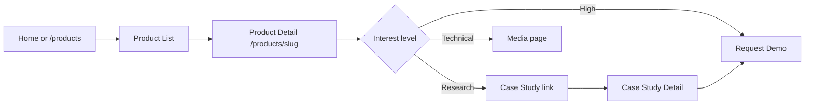
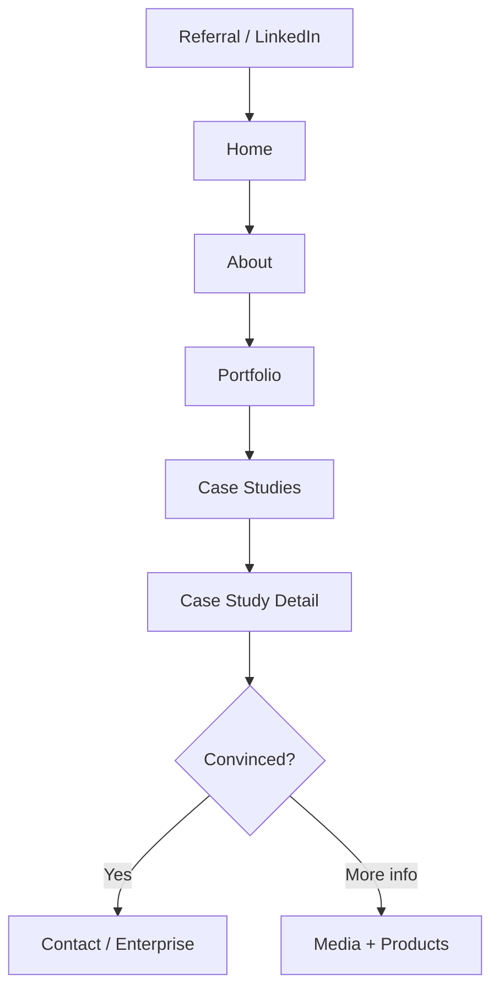

# User Flows

| Field | Value |
|-------|-------|
| **Product** | Founder Portfolio Platform (FounderOS) |
| **Version** | 1.0 |
| **Document ID** | UX-UF-001 |
| **Status** | Approved for Implementation |
| **Last Updated** | 2026-06-29 |
| **Owner** | Product & UX |
| **Related** | [Information Architecture](./Information_Architecture.md) · [Wireframes](./Wireframes.md) · [Navigation](./Navigation.md) |

---

## Purpose

Document end-to-end user journeys for FounderOS v1.0's primary personas, mapping tasks from entry point through conversion or content consumption. These flows guide page design, CTA placement, form design, and analytics event instrumentation.

---

## Scope

### In Scope

| Flow Category | Flows |
|---------------|-------|
| Discovery | Home → Product evaluation, Search/social entry |
| Conversion | Demo request, Contact inquiry, Enterprise acquisition |
| Content | Blog reading, Case study deep-dive |
| Trust-building | About → Portfolio → Case Studies |
| Admin | Content publish workflow |

### Out of Scope

| Flow | Document |
|------|----------|
| Payment/licensing checkout | v2.0 — [14_Future](../14_Future/) |
| Multi-tenant onboarding | v2.0 |
| Authentication flows (public) | v1.0 has no public auth |

---

## Business Context

FounderOS optimizes for three high-value conversion paths:

1. **Demo Request** — SaaS buyers evaluating products for adoption.
2. **Enterprise Acquisition** — Corporates exploring licensing, purchase, or M&A.
3. **General Contact** — Press, partnerships, hiring, and misc. inquiries.

Content flows (blog, case studies) exist to **feed** these conversion paths, not as ends in themselves.

---

## Goals

| # | Goal | Metric |
|---|------|--------|
| G1 | Demo request completable in ≤ 3 steps from any page | Usability test pass |
| G2 | Enterprise flow surfaces licensing options before form | 100% enterprise page coverage |
| G3 | Blog-to-product cross-navigation in every post | CTA in post template |
| G4 | Admin publish flow ≤ 5 steps | Admin usability test |

---

## Functional Requirements

| ID | Requirement | Priority |
|----|-------------|----------|
| FR-UF-01 | Every conversion flow SHALL end with confirmation feedback | P0 |
| FR-UF-02 | Contact form SHALL pre-fill `type` from query param | P0 |
| FR-UF-03 | Enterprise page SHALL link to contact with `type=acquisition` | P0 |
| FR-UF-04 | Product detail SHALL include Demo CTA above fold | P0 |
| FR-UF-05 | Case study SHALL link to related product | P1 |
| FR-UF-06 | Blog post SHALL include author, date, and related posts | P1 |
| FR-UF-07 | Form validation errors SHALL be inline and accessible | P0 |
| FR-UF-08 | Admin publish SHALL preview before going live | P1 |

---

## Non-functional Requirements

| ID | Requirement | Target |
|----|-------------|--------|
| NFR-UF-01 | Form submission response time | < 3s |
| NFR-UF-02 | Flow abandonment tracking | Analytics event per step |
| NFR-UF-03 | Mobile flow parity | Same steps, no extra friction |

---

## User Stories

| ID | As a… | I want to… | So that… |
|----|-------|------------|----------|
| US-UF-01 | SaaS buyer | Request a demo from the product page | I can evaluate the product with my team |
| US-UF-02 | Corporate dev | Explore enterprise acquisition options | I can assess licensing vs. purchase |
| US-UF-03 | Investor | Read case studies then view portfolio | I can validate claims |
| US-UF-04 | Blog reader | Click through to a related product | I can learn more about a solution |
| US-UF-05 | Founder (admin) | Publish a blog post | My audience sees new content |
| US-UF-06 | Press contact | Reach out via contact form | I can request an interview |

---

## UX Requirements

### Persona Summary

| Persona | Primary Flows | Success State |
|---------|---------------|---------------|
| **SaaS Buyer** | Product eval → Demo | Demo request submitted |
| **Enterprise Buyer** | Enterprise → Acquisition inquiry | Acquisition form submitted |
| **Investor** | Case Studies → Portfolio → About | Sufficient trust to reach out |
| **Content Reader** | Blog → Product | Product page visited |
| **Site Admin** | Admin → Create → Publish | Content live on public site |

---

### Flow 1: Demo Request (Primary Conversion)

```mermaid
flowchart TD
    A[Entry: Any page] --> B{How?}
    B -->|Header CTA| C[/contact?type=demo]
    B -->|Product page CTA| C
    B -->|Home hero CTA| C

    C --> D[Contact Form]
    D --> E{Valid?}
    E -->|No| F[Inline errors]
    F --> D
    E -->|Yes| G[Submit to API]
    G --> H{Success?}
    H -->|Yes| I[Confirmation message + email sent]
    H -->|No| J[Error toast + retry]
```

| Step | Screen | Key Elements | Analytics Event |
|------|--------|--------------|-----------------|
| 1 | Any page | "Request Demo" CTA visible | `cta_click` |
| 2 | `/contact?type=demo` | Form with type pre-selected | `form_view` |
| 3 | Form filled | Name, email, company, message | `form_start` |
| 4 | Submit | Loading state on button | `form_submit` |
| 5 | Confirmation | Success message, optional Calendly | `form_success` |

---

### Flow 2: Enterprise Acquisition

```mermaid
flowchart TD
    A[Entry] --> B{Path}
    B -->|Header Enterprise| C[/enterprise]
    B -->|Footer link| C
    B -->|Product page| C

    C --> D[Enterprise Landing Page]
    D --> E[Review: Licensing / Purchase / M&A options]
    E --> F[CTA: Start Conversation]
    F --> G[/contact?type=acquisition]
    G --> H[Acquisition Inquiry Form]
    H --> I[Submit]
    I --> J[Confirmation + follow-up SLA message]
```

| Step | Content Required |
|------|------------------|
| Enterprise landing | Value prop, acquisition types, social proof |
| Form | Company name, role, deal type, budget range, message |
| Confirmation | "We'll respond within 48 hours" SLA |

---

### Flow 3: Product Evaluation



---

### Flow 4: Investor Due Diligence



---

### Flow 5: Blog Content Consumption

```mermaid
flowchart LR
    A[SEO / Social] --> B[/blog/slug]
    B --> C[Read article]
    C --> D[Related posts]
    C --> E[Product CTA banner]
    E --> F[/products/slug]
    F --> G[Request Demo]
```

---

### Flow 6: Admin Content Publish

```mermaid
flowchart TD
    A[/admin login] --> B[Dashboard]
    B --> C[Content > Blog > New]
    C --> D[Fill: title, slug, body, SEO]
    D --> E[Upload featured image]
    E --> F[Preview]
    F --> G{Approve?}
    G -->|Edit| D
    G -->|Publish| H[Status = published]
    H --> I[ISR revalidation]
    I --> J[Live at /blog/slug]
```

---

### Error & Edge Case Flows

| Scenario | Behavior |
|----------|----------|
| API down on form submit | Error toast, preserve form data, retry button |
| Invalid slug | 404 page with link to Home and Products |
| Empty blog/products list | Empty state with admin CTA (admin only) |
| Duplicate form submit | Debounce submit button, idempotency key |
| Mobile form autofill | Support `autocomplete` attributes |

---

## Technical Considerations

| Topic | Guidance |
|-------|----------|
| **Form handling** | `react-hook-form` + `zod` validation; POST to `/api/v1/contact` |
| **Query params** | `type=demo|acquisition|general|press` pre-selects form category |
| **Analytics** | Events via Plausible/GA4 — see Analytics module |
| **Email notification** | Backend sends admin notification on form submit |
| **Rate limiting** | Redis-backed rate limit: 5 submissions/IP/hour |
| **Admin preview** | Preview route `/admin/preview/[type]/[id]` with auth |

---

## Security Considerations

| Concern | Mitigation |
|---------|------------|
| Form spam | Honeypot field + rate limiting + optional reCAPTCHA v3 |
| PII in URLs | No sensitive data in query params beyond `type` |
| CSRF | Same-origin form POST with CSRF token |
| Admin publish | RBAC: only `editor` and `admin` roles can publish |

---

## Acceptance Criteria

- [ ] Demo request flow completable from Home, Product detail, and Header in ≤ 3 clicks
- [ ] Enterprise flow includes dedicated landing before form
- [ ] Contact form pre-fills type from `?type=` query param
- [ ] Form shows inline validation errors with `aria-describedby`
- [ ] Success confirmation displayed after submit (no silent success)
- [ ] Blog posts include product CTA component
- [ ] Case studies link to related product
- [ ] Admin publish triggers ISR and sitemap update
- [ ] All flows tested on mobile viewport (375px)

---

## Future Enhancements

| Flow | Enhancement |
|------|-------------|
| Demo request | Calendly/Cal.com embed post-submit |
| Enterprise | NDA-gated data room access |
| Product eval | Interactive product demo / sandbox |
| Blog | Newsletter signup inline |
| Admin | Scheduled publish + approval workflow |

---

## Open Questions

| # | Question | Owner |
|---|----------|-------|
| OQ-UF-01 | Add multi-step wizard for enterprise form vs. single page? | UX |
| OQ-UF-02 | Post-demo-submit: redirect to Calendly or inline embed? | Product |
| OQ-UF-03 | Require company email domain validation for enterprise? | Security |
| OQ-UF-04 | Admin preview: shareable link with expiring token? | Engineering |

---

## Related Documents

- [Wireframes](./Wireframes.md)
- [Forms](../03_Design_System/Forms.md)
- [Feedback Components](../03_Design_System/Feedback_Components.md)
- [Contact Page](../05_Pages/Contact.md)
- [Enterprise Page](../05_Pages/Enterprise.md)
