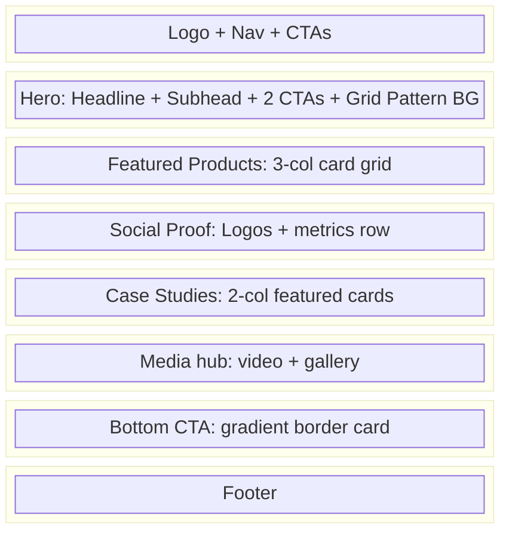

# Wireframes

| Field | Value |
|-------|-------|
| **Product** | Founder Portfolio Platform (FounderOS) |
| **Version** | 1.0 |
| **Document ID** | UX-WF-001 |
| **Status** | Approved for Implementation |
| **Last Updated** | 2026-06-29 |
| **Owner** | Product & UX |
| **Related** | [User Flows](./User_Flows.md) · [Sitemap](./Sitemap.md) · [Design System](../03_Design_System/Design_System.md) |

---

## Purpose

Define low-to-mid fidelity wireframe specifications for FounderOS v1.0's core page templates and reusable section patterns. These wireframes establish layout hierarchy, content zones, and component placement before visual design implementation — serving as the contract between UX, design, and engineering.

---

## Scope

### In Scope

| Template | Priority |
|----------|----------|
| Home | P0 |
| Product List & Detail | P0 |
| Case Study List & Detail | P0 |
| Blog List & Detail | P0 |
| Contact | P0 |
| Enterprise | P0 |
| About, Portfolio, Media | P1 |
| Admin Dashboard | P1 |
| 404 / Error | P1 |

### Out of Scope

| Item | Rationale |
|------|-----------|
| High-fidelity mockups | Figma assets (separate deliverable) |
| Mobile-specific wireframes per page | Covered via responsive annotations |
| Email templates | Separate comms spec |

---

## Business Context

Wireframes for a white-label platform must be **template-driven**, not page-specific. Each wireframe defines zones and components that populate with tenant content. A travel blogger and an AI founder use the same Home template with different hero copy, featured modules, and enabled sections.

---

## Goals

| # | Goal | Metric |
|---|------|--------|
| G1 | Every page in [Sitemap](./Sitemap.md) has a wireframe template | 100% coverage |
| G2 | Consistent section patterns across pages | ≤ 12 unique section types |
| G3 | CTA placement standardized | Hero + sticky header + section-end |
| G4 | Mobile layouts defined via breakpoint annotations | 3 breakpoints per template |

---

## Functional Requirements

| ID | Requirement | Priority |
|----|-------------|----------|
| FR-WF-01 | Every page template SHALL include header and footer zones | P0 |
| FR-WF-02 | Hero sections SHALL support headline, subhead, and dual CTA | P0 |
| FR-WF-03 | List pages SHALL include filter/sort zone (placeholder v1.0) | P2 |
| FR-WF-04 | Detail pages SHALL include metadata bar (date, tags, author) | P1 |
| FR-WF-05 | Contact page SHALL include form + optional sidebar info | P0 |
| FR-WF-06 | All templates SHALL annotate responsive column changes | P0 |

---

## Non-functional Requirements

| ID | Requirement | Target |
|----|-------------|--------|
| NFR-WF-01 | Wireframe fidelity | Low-fi ASCII/Mermaid; mid-fi in Figma |
| NFR-WF-02 | Section max-width | `max-w-7xl` (1280px) content container |
| NFR-WF-03 | Hero min-height | 60vh desktop, auto mobile |

---

## User Stories

| ID | As a… | I want to… | So that… |
|----|-------|------------|----------|
| US-WF-01 | Frontend engineer | Know exact section order per page | I build the right component tree |
| US-WF-02 | Content strategist | See where copy blocks belong | I write to fit the layout |
| US-WF-03 | Designer | Understand grid and spacing zones | I apply tokens correctly |
| US-WF-04 | Product manager | Verify CTAs are above the fold | Conversion is prioritized |

---

## UX Requirements

### Global Chrome

Every public page shares this frame:

```
┌─────────────────────────────────────────────────────────────┐
│  HEADER (fixed, h-64px)                                     │
│  [Logo]  [Nav Links × 8]           [Enterprise] [Demo CTA]  │
├─────────────────────────────────────────────────────────────┤
│                                                             │
│                      PAGE CONTENT                           │
│                   (max-w-7xl, px-6)                         │
│                                                             │
├─────────────────────────────────────────────────────────────┤
│  FOOTER (4-column grid)                                     │
│  [Brand + Social]  [Products]  [Company]  [Legal bar]       │
└─────────────────────────────────────────────────────────────┘
```

---

### Template: Home (`/`)



| Zone | Component | Content Source |
|------|-----------|----------------|
| Hero | `Section` + `FadeIn` | CMS Site Settings |
| Featured Products | `ProductCard` × 3 | CMS Products (featured flag) |
| Social Proof | Logo strip + stat counters | CMS Testimonials / Settings |
| Case Studies | `Card` × 2 | CMS Case Studies (featured) |
| Media | Video + gallery grid | `TECH_STACK` constant or CMS |
| Bottom CTA | `Card` with gradient border | CMS Settings |

**Responsive:** Products 3-col → 2-col (md) → 1-col (sm). Case studies 2-col → 1-col.

---

### Template: Product List (`/products`)

```
┌─────────────────────────────────────────────────┐
│  PAGE HEADER                                    │
│  H1: Products                                   │
│  Subtitle: One-line value proposition           │
├─────────────────────────────────────────────────┤
│  ┌──────────┐  ┌──────────┐  ┌──────────┐      │
│  │ Product  │  │ Product  │  │ Product  │      │
│  │ Card     │  │ Card     │  │ Card     │      │
│  │ [image]  │  │ [image]  │  │ [image]  │      │
│  │ title    │  │ title    │  │ title    │      │
│  │ excerpt  │  │ excerpt  │  │ excerpt  │      │
│  │ [CTA]    │  │ [CTA]    │  │ [CTA]    │      │
│  └──────────┘  └──────────┘  └──────────┘      │
├─────────────────────────────────────────────────┤
│  ENTERPRISE BANNER                              │
│  "Looking for enterprise licensing?" [Learn More] │
└─────────────────────────────────────────────────┘
```

---

### Template: Product Detail (`/products/[slug]`)

| Zone | Order | Content |
|------|-------|---------|
| Breadcrumb | 1 | Home → Products → {Name} |
| Hero | 2 | Product name, tagline, hero image, Demo CTA |
| Features | 3 | 2-col feature grid with icons |
| Showcase | 4 | `ProductShowcase` tabs (screenshots, demo video) |
| Pricing/Licensing | 5 | Licensing tiers or "Contact for pricing" |
| Case Study link | 6 | Related case study card |
| FAQ | 7 | Accordion component |
| Bottom CTA | 8 | Request Demo + Enterprise links |

---

### Template: Case Study Detail (`/case-studies/[slug]`)

```
┌─────────────────────────────────────────┐
│  Breadcrumb                             │
├─────────────────────────────────────────┤
│  HERO                                   │
│  Client logo | Industry tag | Date      │
│  H1: Case study title                   │
│  Key metric callout (e.g., "40% reduction")│
├─────────────────────────────────────────┤
│  BODY (prose, max-w-3xl centered)       │
│  Challenge → Solution → Results         │
├─────────────────────────────────────────┤
│  METRICS ROW (3 stat cards)             │
├─────────────────────────────────────────┤
│  RELATED PRODUCT CARD                   │
├─────────────────────────────────────────┤
│  CTA: "See how we can help you"         │
└─────────────────────────────────────────┘
```

---

### Template: Blog List (`/blog`)

| Zone | Layout |
|------|--------|
| Page header | H1 + subtitle |
| Featured post | Full-width hero card (latest or pinned) |
| Post grid | 3-col cards: image, title, excerpt, date, read time |
| Pagination | Numbered pagination at bottom |

---

### Template: Blog Detail (`/blog/[slug]`)

| Zone | Layout |
|------|--------|
| Article header | Title, author avatar, date, read time, tags |
| Featured image | Full-width within container |
| Article body | Prose typography, max-w-3xl |
| Product CTA banner | Inline card mid-article or end |
| Related posts | 3-col card row |
| Share buttons | Optional row |

---

### Template: Contact (`/contact`)

```
┌──────────────────────┬──────────────────────┐
│  FORM (col-span-2)   │  SIDEBAR             │
│  Type selector       │  Email               │
│  Name                │  Social links        │
│  Email               │  Response SLA        │
│  Company             │  Office location     │
│  Message             │  (optional)          │
│  [Submit]            │                      │
└──────────────────────┴──────────────────────┘
```

Mobile: single column, sidebar below form.

---

### Template: Enterprise (`/enterprise`)

| Zone | Content |
|------|---------|
| Hero | "Partner with {founder}" + acquisition value prop |
| Options grid | 3 cards: License, Purchase, Acquire |
| Process timeline | 4-step horizontal stepper |
| Social proof | Client logos + testimonial |
| FAQ | Enterprise-specific accordion |
| CTA | "Start a Conversation" → contact form |

---

### Template: Admin Dashboard (`/admin`)

```
┌──────────┬────────────────────────────────────┐
│ SIDEBAR  │  MAIN CONTENT                      │
│ Dashboard│  ┌──────┐ ┌──────┐ ┌──────┐       │
│ Content  │  │ KPI  │ │ KPI  │ │ KPI  │       │
│  Blog    │  └──────┘ └──────┘ └──────┘       │
│  Products│  ┌─────────────────────────┐       │
│  Cases   │  │ Recent Activity Table   │       │
│  Media   │  └─────────────────────────┘       │
│  Settings│  ┌─────────────────────────┐       │
│          │  │ Quick Actions           │       │
│          │  └─────────────────────────┘       │
└──────────┴────────────────────────────────────┘
```

---

### Template: 404

| Element | Spec |
|---------|------|
| Status code | Large "404" with gradient text |
| Message | "Page not found" |
| Actions | Links to Home, Products, Contact |
| Illustration | Optional grid pattern background |

---

### Reusable Section Patterns

| Pattern ID | Name | Used On |
|------------|------|---------|
| SEC-01 | Page Header (H1 + subtitle) | All list pages |
| SEC-02 | Hero (headline + dual CTA) | Home, Enterprise, Product detail |
| SEC-03 | Card Grid (3-col) | Products, Blog, Portfolio |
| SEC-04 | Feature Grid (2-col + icons) | Product detail, Media |
| SEC-05 | Stat Row (metrics) | Home, Case study |
| SEC-06 | Prose Body (max-w-3xl) | Blog, Case study, Legal |
| SEC-07 | Bottom CTA Card | Home, Product, Case study |
| SEC-08 | FAQ Accordion | Product, Enterprise |
| SEC-09 | Logo Strip | Home, Enterprise |
| SEC-10 | Breadcrumb | All detail pages |
| SEC-11 | Form Section | Contact |
| SEC-12 | Empty State | List pages with no content |

---

## Technical Considerations

| Topic | Guidance |
|-------|----------|
| **Layout component** | `Section` wrapper with consistent `py-16 md:py-24` |
| **Grid** | Tailwind `grid` with responsive column classes — see [Grid System](../03_Design_System/Grid_System.md) |
| **Animation** | `FadeIn` wrapper on section enter — see [Animation System](../03_Design_System/Animation_System.md) |
| **Prose** | Tailwind Typography plugin for article bodies |
| **Wireframe → Code** | Each SEC-* pattern maps to a React component |

---

## Security Considerations

| Concern | Mitigation |
|---------|------------|
| Admin wireframe exposure | Admin templates not referenced in public Storybook |
| Preview mode leaks | Auth-gated preview routes |

---

## Acceptance Criteria

- [ ] Wireframe exists for all P0 templates (Home, Products, Case Studies, Blog, Contact, Enterprise)
- [ ] All 12 section patterns (SEC-01 to SEC-12) documented
- [ ] Responsive annotations present for 3 breakpoints (sm, md, lg)
- [ ] CTA placement matches [User Flows](./User_Flows.md) conversion paths
- [ ] Admin dashboard wireframe covers sidebar + main content zones
- [ ] Engineering sign-off that wireframes map to implementable components

---

## Future Enhancements

| Enhancement | Wireframe Impact |
|-------------|------------------|
| Product comparison page | Side-by-side feature matrix template |
| Pricing page | Tier comparison table wireframe |
| Media gallery | Masonry grid template for Travel module |
| Component Storybook | Interactive wireframe-to-component mapping |

---

## Open Questions

| # | Question | Owner |
|---|----------|-------|
| OQ-WF-01 | Home: include Travel section for all tenants or module-gated? | Product |
| OQ-WF-02 | Product detail: tabbed showcase vs. scroll sections? | UX — Current: tabs |
| OQ-WF-03 | Blog: sidebar with TOC for long posts? | Content — Deferred v1.1 |
| OQ-WF-04 | Figma wireframe file as source of truth or this doc? | Design |

---

## Related Documents

- [User Flows](./User_Flows.md)
- [Grid System](../03_Design_System/Grid_System.md)
- [Cards](../03_Design_System/Cards.md)
- [05_Pages](../05_Pages/) — Page-level specifications
