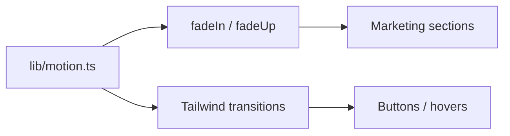

# Animation System

| Field | Value |
|-------|-------|
| **Document ID** | DS-ANIM-001 |
| **Product** | Founder Portfolio Platform (FounderOS v1.0) |
| **Version** | 1.0 |
| **Status** | Approved |
| **Last Updated** | 2026-06-29 |
| **Owner** | Design & Engineering |
| **Related** | [Motion Guidelines](../01_Brand/Motion_Guidelines.md) · [Loading States](./Loading_States.md) · [Design Tokens](./Design_Tokens.md) · [Frontend Architecture](../04_Architecture/Frontend_Architecture.md) |

---

## Purpose

Document the technical animation system for FounderOS — Framer Motion patterns, CSS transitions, tokens, and utilities — implementing brand motion principles in Next.js 15.

---

## Scope

### In Scope

- Framer Motion setup and bundle strategy
- Animation tokens (duration, easing, stagger)
- Reusable motion variants
- Page and component entrance patterns
- `prefers-reduced-motion` implementation
- Performance guidelines

### Out of Scope

- GSAP or canvas animations
- Complex 3D WebGL (future marketing experiments)

---

## Business Context

Framer Motion enables orchestrated marketing animations while Tailwind handles micro-interactions. The system must stay **tree-shakeable** and not bloat admin bundles where motion is minimal.

---

## Goals

| # | Goal | Target |
|---|------|--------|
| G1 | Marketing pages use shared variants | DRY motion code |
| G2 | Admin JS bundle impact | Framer only on public routes |
| G3 | GPU-only properties | transform + opacity |
| G4 | Reduced motion coverage | 100% entrance animations |

---

## Functional Requirements

| ID | Requirement | Priority |
|----|-------------|----------|
| FR-ANIM-01 | Motion tokens SHALL live in `lib/motion.ts` | P0 |
| FR-ANIM-02 | `LazyMotion` + `m` component SHALL be used | P0 |
| FR-ANIM-03 | `useReducedMotion` SHALL gate stagger sequences | P0 |
| FR-ANIM-04 | Layout animations SHALL NOT animate width/height | P0 |
| FR-ANIM-05 | `AnimatePresence` for mount/unmount modals | P0 |

---

## Non-functional Requirements

| ID | Requirement | Target |
|----|-------------|--------|
| NFR-ANIM-01 | Framer chunk (public) | ≤ 25KB gzip |
| NFR-ANIM-02 | Max simultaneous animating nodes | ≤ 20 |
| NFR-ANIM-03 | will-change | applied sparingly |

---

## User Stories

| ID | As a… | I want… | So that… |
|----|-------|---------|----------|
| US-ANIM-001 | Frontend dev | exported variants | I animate consistently |
| US-ANIM-002 | Designer | token table | specs match code |
| US-ANIM-003 | Performance lead | lazy-loaded motion | admin stays fast |
| US-ANIM-004 | a11y user | instant content if reduced motion | I'm not delayed |

---

## UX Requirements

### Token Table

| Token | Duration | Easing |
|-------|----------|--------|
| `fast` | 150ms | ease-out |
| `base` | 250ms | [0.25, 0.1, 0.25, 1] |
| `slow` | 400ms | [0.25, 0.1, 0.25, 1] |
| `stagger` | 60ms | per child |

### Standard Variants

- `fadeIn`: opacity 0 → 1
- `fadeUp`: opacity + translateY(16px) → 0
- `scaleIn`: opacity + scale(0.95) → 1 (modals only)

---

## Technical Considerations

- Package: `framer-motion` with `LazyMotion` and `domAnimation` feature set.
- Client components only where animation required; wrap in `MotionProvider`.
- Intersection Observer hook `useInView` for scroll-triggered reveals.
- CSS: `transition-colors duration-150` on interactive elements.

---

## Security Considerations

- No user-supplied animation keyframes in CMS.
- Motion cannot obscure security warnings or cookie banners.

---

## Acceptance Criteria

- [ ] Token file structure documented
- [ ] Standard variants listed with code references
- [ ] LazyMotion bundle strategy explained
- [ ] Reduced motion hook pattern documented
- [ ] Cross-link to Motion Guidelines

---

## Future Enhancements

- `motion` Storybook stories
- Shared layout transitions between product routes
- Spring physics for drag-and-drop admin

---

## Open Questions

| # | Question | Owner |
|---|----------|-------|
| OQ-1 | framer-motion vs. motion (rebrand) package name? | Engineering |
| OQ-2 | View Transitions API fallback? | Engineering |
| OQ-3 | Animate chart entry in analytics admin? | Design |
