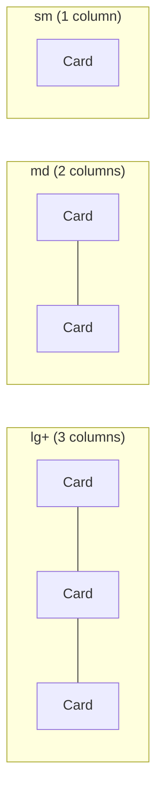

# Cards

| Field | Value |
|-------|-------|
| **Product** | Founder Portfolio Platform (FounderOS) |
| **Version** | 1.0 |
| **Document ID** | DS-CARD-001 |
| **Status** | Approved for Implementation |
| **Last Updated** | 2026-06-29 |
| **Owner** | Design & Engineering |
| **Related** | [Grid System](./Grid_System.md) · [Spacing System](./Spacing_System.md) · [Color System](./Color_System.md) |

---

## Purpose

Define card component variants, anatomy, layout patterns, and usage rules for FounderOS v1.0 — the primary container for products, blog posts, case studies, features, and CTAs.

---

## Scope

### In Scope

- Base Card component (shadcn/ui)
- Card sub-components (Header, Title, Description, Content, Footer)
- Card variants (default, gradient border, glow, interactive)
- Card grid layouts
- Content card templates (product, blog, case study)

### Out of Scope

- Data table cards (see [Tables](./Tables.md))
- Pricing cards (v1.1)

---

## Business Context

Cards are the most reused component in FounderOS — they display products, blog posts, case studies, features, testimonials, and CTAs. Consistent card anatomy ensures visual rhythm across all list and grid pages.

---

## Goals

| # | Goal | Metric |
|---|------|--------|
| G1 | Consistent card anatomy across all content types | 1 base component |
| G2 | Interactive cards clearly distinguishable | Hover state on all clickable cards |
| G3 | Card grids responsive | 3→2→1 column pattern |

---

## Functional Requirements

| ID | Requirement | Priority |
|----|-------------|----------|
| FR-CARD-01 | Cards SHALL use shadcn/ui `Card` component | P0 |
| FR-CARD-02 | Clickable cards SHALL be wrapped in `Link` or have click handler | P0 |
| FR-CARD-03 | Cards SHALL have hover state (border or glow) | P1 |
| FR-CARD-04 | Card images SHALL use `aspect-video` ratio | P1 |
| FR-CARD-05 | Card grids SHALL follow 3→2→1 responsive pattern | P0 |

---

## Non-functional Requirements

| ID | Requirement | Target |
|----|-------------|--------|
| NFR-CARD-01 | Card border radius | `rounded-lg` (12px / `--radius`) |
| NFR-CARD-02 | Card padding | `p-6` (24px) |
| NFR-CARD-03 | Hover transition | 200ms |

---

## User Stories

| ID | As a… | I want to… | So that… |
|----|-------|------------|----------|
| US-CARD-01 | Visitor | Scan card grids quickly | I find relevant content |
| US-CARD-02 | Visitor | Know which cards are clickable | I navigate intuitively |
| US-CARD-03 | Engineer | Compose cards from sub-components | I build consistent layouts |

---

## UX Requirements

### Card Anatomy

```
┌─────────────────────────────────┐
│  CardHeader                     │
│  ┌───────────────────────────┐  │
│  │  CardTitle                │  │
│  │  CardDescription          │  │
│  └───────────────────────────┘  │
├─────────────────────────────────┤
│  CardContent                    │
│  (image, body text, metadata)   │
├─────────────────────────────────┤
│  CardFooter                     │
│  (CTA button, tags, date)       │
└─────────────────────────────────┘
```

### Base Card Styles

| Property | Value | Tailwind |
|----------|-------|----------|
| Background | `bg-card` | `bg-card` |
| Text | `text-card-foreground` | `text-card-foreground` |
| Border | 1px `border-border` | `border` |
| Radius | 12px | `rounded-lg` |
| Padding | 24px | `p-6` |
| Shadow | None (border-based) | — |

### Card Variants

| Variant | Class | Usage |
|---------|-------|-------|
| **Default** | `border bg-card` | Standard content cards |
| **Gradient border** | `gradient-border` | Hero CTAs, featured content |
| **Glow** | `glow` | Highlighted/featured cards |
| **Interactive** | `hover:border-accent/50 transition-colors` | Clickable cards in grids |
| **Muted** | `bg-muted` | Secondary information cards |

### Content Card Templates

#### Product Card

| Zone | Content | Style |
|------|---------|-------|
| Image | Product screenshot | `aspect-video rounded-md object-cover` |
| Title | Product name | `text-xl font-semibold` |
| Description | Excerpt | `text-sm text-muted-foreground` |
| Footer | "Learn More →" link | `text-sm text-accent` |

#### Blog Post Card

| Zone | Content | Style |
|------|---------|-------|
| Image | Featured image | `aspect-video rounded-md object-cover` |
| Title | Post title | `text-lg font-semibold` |
| Description | Excerpt | `text-sm text-muted-foreground line-clamp-2` |
| Footer | Date + read time | `text-xs text-muted-foreground` |

#### Case Study Card

| Zone | Content | Style |
|------|---------|-------|
| Image | Client logo or hero | `aspect-video rounded-md` |
| Title | Case study title | `text-lg font-semibold` |
| Description | Key result metric | `text-sm text-accent font-medium` |
| Footer | Industry tag | Badge component |

#### Feature Card

| Zone | Content | Style |
|------|---------|-------|
| Icon | Lucide icon | `h-8 w-8 text-accent` |
| Title | Feature name | `text-lg font-semibold` |
| Description | Feature description | `text-sm text-muted-foreground` |

#### Stat Card

| Zone | Content | Style |
|------|---------|-------|
| Value | Metric number | `text-3xl font-bold text-accent` |
| Label | Metric description | `text-sm text-muted-foreground` |

#### CTA Card (Bottom of page)

| Zone | Content | Style |
|------|---------|-------|
| Container | Gradient border + glow | `gradient-border glow p-8` |
| Title | Action headline | `text-2xl font-semibold` |
| Description | Supporting text | `text-muted-foreground` |
| Actions | Primary + secondary buttons | Button components |

### Card Grid Layout



Tailwind: `grid gap-6 md:grid-cols-2 lg:grid-cols-3`

### Interactive Card Behavior

| Interaction | Visual Feedback |
|-------------|----------------|
| Hover | Border color shifts to `border-accent/50` |
| Focus (keyboard) | Ring appears on card link |
| Click | Navigate to detail page |
| Image hover | Optional subtle scale `scale-[1.02]` (v1.1) |

### Component API

```tsx
// Sub-components
<Card>
  <CardHeader>
    <CardTitle>Title</CardTitle>
    <CardDescription>Description</CardDescription>
  </CardHeader>
  <CardContent>Content</CardContent>
  <CardFooter>Footer</CardFooter>
</Card>
```

---

## Technical Considerations

| Topic | Implementation |
|-------|----------------|
| **Component** | `frontend/src/components/ui/card.tsx` |
| **Clickable cards** | Wrap entire card in `<Link>` or use `onClick` on card |
| **Image loading** | `next/image` with `fill` + `object-cover` in aspect container |
| **Line clamp** | `line-clamp-2` for excerpt truncation |

---

## Security Considerations

No security implications for card components.

---

## Acceptance Criteria

- [ ] Base Card component with all sub-components
- [ ] Product, blog, case study card templates implemented
- [ ] Card grids follow 3→2→1 responsive pattern
- [ ] Interactive cards have hover border effect
- [ ] CTA card uses gradient-border and glow utilities
- [ ] Card images use aspect-video ratio
- [ ] All clickable cards navigable via keyboard

---

## Future Enhancements

| Enhancement | Card Impact |
|-------------|-------------|
| Pricing cards | Tier comparison layout |
| Testimonial cards | Quote + avatar + company |
| Hover image zoom | Subtle scale on image hover |
| Card skeleton | Loading placeholder matching card anatomy |

---

## Open Questions

| # | Question | Owner |
|---|----------|-------|
| OQ-CARD-01 | Card shadow on hover or border only? | Design — Border only |
| OQ-CARD-02 | Image zoom on hover? | UX — v1.1 |

---

## Related Documents

- [Grid System](./Grid_System.md)
- [Spacing System](./Spacing_System.md)
- [Color System](./Color_System.md)
- [Loading States](./Loading_States.md)
- [Wireframes](../02_UX/Wireframes.md)
