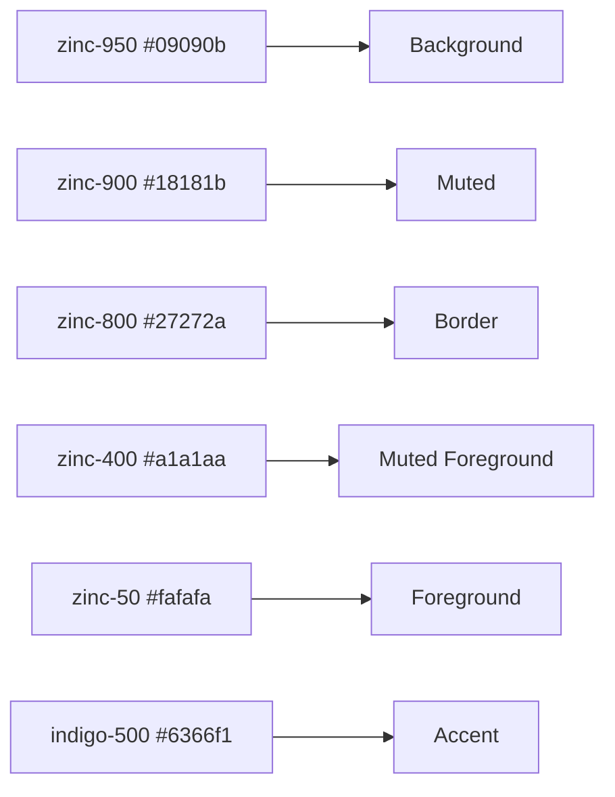

# Color System

| Field | Value |
|-------|-------|
| **Product** | Founder Portfolio Platform (FounderOS) |
| **Version** | 1.0 |
| **Document ID** | DS-COLOR-001 |
| **Status** | Approved for Implementation |
| **Last Updated** | 2026-06-29 |
| **Owner** | Design & Engineering |
| **Related** | [Design Tokens](./Design_Tokens.md) · [Dark Mode](./Dark_Mode.md) · [Accessibility](../02_UX/Accessibility.md) |

---

## Purpose

Define the complete color palette, semantic color roles, contrast requirements, and usage rules for FounderOS v1.0's dark-first visual identity.

---

## Scope

### In Scope

- Core palette (background, foreground, accent)
- Semantic colors (success, warning, error, info)
- Surface colors (card, muted, border)
- Gradient definitions
- Contrast audit
- Color usage rules per component type

### Out of Scope

- Light mode palette (see [Dark Mode](./Dark_Mode.md) for v1.1)
- Data visualization colors
- Image/video color grading

---

## Business Context

FounderOS uses a **dark-first, indigo-accent** palette that signals technical sophistication and aligns with the modern SaaS aesthetic (Vercel, Linear, Stripe dark themes). The limited palette (essentially zinc grays + one accent) ensures white-label tenants can rebrand by changing a single accent color.

---

## Goals

| # | Goal | Metric |
|---|------|--------|
| G1 | WCAG 2.1 AA contrast on all text pairs | Automated audit pass |
| G2 | Single accent color drives brand identity | 1 accent variable |
| G3 | Semantic colors for status feedback | 4 semantic colors defined |

---

## Functional Requirements

| ID | Requirement | Priority |
|----|-------------|----------|
| FR-COLOR-01 | All colors SHALL be defined as CSS custom properties | P0 |
| FR-COLOR-02 | Body text contrast SHALL meet WCAG AA (4.5:1) | P0 |
| FR-COLOR-03 | Accent color SHALL be `#6366f1` (indigo-500) by default | P0 |
| FR-COLOR-04 | Semantic colors SHALL exist for success, warning, error | P0 |
| FR-COLOR-05 | No raw hex values in component files | P0 |

---

## Non-functional Requirements

| ID | Requirement | Target |
|----|-------------|--------|
| NFR-COLOR-01 | Normal text contrast | ≥ 4.5:1 |
| NFR-COLOR-02 | Large text contrast (≥18px) | ≥ 3:1 |
| NFR-COLOR-03 | UI component contrast | ≥ 3:1 |

---

## User Stories

| ID | As a… | I want to… | So that… |
|----|-------|------------|----------|
| US-COLOR-01 | Visitor | Read text comfortably on dark background | Content is legible |
| US-COLOR-02 | Color-blind user | Distinguish states without relying on color alone | Icons/text accompany colors |
| US-COLOR-03 | White-label deployer | Change brand color globally | One variable updates everything |

---

## UX Requirements

### Core Palette

| Role | Token | Hex | RGB | Tailwind |
|------|-------|-----|-----|----------|
| Background | `--background` | `#09090b` | 9, 9, 11 | `bg-background` |
| Foreground | `--foreground` | `#fafafa` | 250, 250, 250 | `text-foreground` |
| Card | `--card` | `#0c0c0e` | 12, 12, 14 | `bg-card` |
| Card Foreground | `--card-foreground` | `#fafafa` | 250, 250, 250 | `text-card-foreground` |
| Muted | `--muted` | `#18181b` | 24, 24, 27 | `bg-muted` |
| Muted Foreground | `--muted-foreground` | `#a1a1aa` | 161, 161, 170 | `text-muted-foreground` |
| Border | `--border` | `#27272a` | 39, 39, 42 | `border-border` |
| Accent | `--accent` | `#6366f1` | 99, 102, 241 | `bg-accent` |
| Accent Foreground | `--accent-foreground` | `#fafafa` | 250, 250, 250 | `text-accent-foreground` |
| Ring | `--ring` | `#6366f1` | 99, 102, 241 | `ring-ring` |

### Semantic Colors

| Role | Hex | Tailwind Utility | Usage |
|------|-----|------------------|-------|
| Success | `#22c55e` | `text-green-500` / `bg-green-500/10` | Form success, positive metrics |
| Warning | `#eab308` | `text-yellow-500` / `bg-yellow-500/10` | Caution states |
| Error / Destructive | `#ef4444` | `text-red-500` / `bg-red-500/10` | Form errors, delete actions |
| Info | `#3b82f6` | `text-blue-500` / `bg-blue-500/10` | Informational alerts |

### Zinc Scale Reference

The palette is built on Tailwind's zinc scale:



### Contrast Audit

| Foreground | Background | Ratio | WCAG AA | WCAG AAA |
|------------|------------|-------|---------|----------|
| `#fafafa` | `#09090b` | 19.3:1 | ✓ | ✓ |
| `#a1a1aa` | `#09090b` | 8.6:1 | ✓ | ✓ |
| `#fafafa` | `#6366f1` | 4.6:1 | ✓ | — |
| `#6366f1` | `#09090b` | 5.1:1 | ✓ (large) | — |
| `#ef4444` | `#09090b` | 5.4:1 | ✓ | ✓ |
| `#22c55e` | `#09090b` | 7.5:1 | ✓ | ✓ |
| `#fafafa` | `#0c0c0e` | 18.1:1 | ✓ | ✓ |
| `#fafafa` | `#18181b` | 15.6:1 | ✓ | ✓ |

### Gradients

| Name | CSS | Usage |
|------|-----|-------|
| Text gradient | `linear-gradient(135deg, #fafafa 0%, #a1a1aa 50%, #6366f1 100%)` | Hero headlines (`.gradient-text`) |
| Border gradient | `linear-gradient(135deg, rgba(99,102,241,0.5), rgba(99,102,241,0.1))` | CTA cards (`.gradient-border`) |
| Glow | `0 0 80px -20px rgba(99,102,241,0.4)` | Hero elements (`.glow`) |
| Skeleton | `linear-gradient(90deg, #18181b 25%, #27272a 50%, #18181b 75%)` | Loading shimmer |

### Color Usage Rules

| Component | Background | Text | Border | Accent |
|-----------|------------|------|--------|--------|
| Page | `background` | `foreground` | — | — |
| Header | `background/80` + blur | `foreground` | `border/50` | CTA button |
| Card | `card` | `card-foreground` | `border` | Hover: accent border |
| Button (primary) | `accent` | `accent-foreground` | — | — |
| Button (ghost) | transparent | `muted-foreground` → `foreground` | — | — |
| Input | `background` | `foreground` | `border` | Focus: `ring` |
| Footer | `card` | `muted-foreground` | `border` | — |
| Badge | `muted` | `foreground` | — | — |
| Toast (success) | `green-500/10` | `green-500` | — | — |
| Toast (error) | `red-500/10` | `red-500` | — | — |

### Selection Color

```css
::selection {
  background: color-mix(in srgb, var(--accent) 30%, transparent);
}
```

### Grid Pattern Background

```css
.grid-pattern {
  background-image:
    linear-gradient(rgba(255,255,255,0.03) 1px, transparent 1px),
    linear-gradient(90deg, rgba(255,255,255,0.03) 1px, transparent 1px);
  background-size: 64px 64px;
}
```

Used on hero sections for subtle texture without impacting readability.

---

## Technical Considerations

| Topic | Implementation |
|-------|----------------|
| **Color format** | Hex in CSS variables; Tailwind resolves via `@theme` |
| **Opacity modifiers** | Tailwind `/80`, `/50`, `/10` for transparency |
| **color-mix()** | Used for selection highlight (modern CSS) |
| **Tenant override** | Change `--accent`, `--ring` for rebrand |

---

## Security Considerations

| Concern | Mitigation |
|---------|------------|
| CSS injection via color config | Validate hex format: `^#[0-9a-fA-F]{6}$` |

---

## Acceptance Criteria

- [ ] All color tokens match `globals.css`
- [ ] Contrast audit passes WCAG 2.1 AA for all text pairs
- [ ] Semantic colors used for success/error/warning states
- [ ] No raw hex in component files (only token classes)
- [ ] Gradient utilities render correctly
- [ ] Grid pattern visible but subtle on hero
- [ ] Tenant accent override propagates to buttons, rings, gradients

---

## Future Enhancements

| Enhancement | Color Impact |
|-------------|-------------|
| Light mode palette | Inverted zinc scale |
| `--destructive` token | Formalize error color as CSS variable |
| Color blindness simulation | Design review tool |
| Themed illustrations | Accent-tinted SVG assets |

---

## Open Questions

| # | Question | Owner |
|---|----------|-------|
| OQ-COLOR-01 | Formalize semantic colors as CSS variables? | Design — Yes |
| OQ-COLOR-02 | Secondary accent color for gradients? | Design — Use muted foreground |

---

## Related Documents

- [Design Tokens](./Design_Tokens.md)
- [Dark Mode](./Dark_Mode.md)
- [Accessibility](../02_UX/Accessibility.md)
- [Buttons](./Buttons.md)
