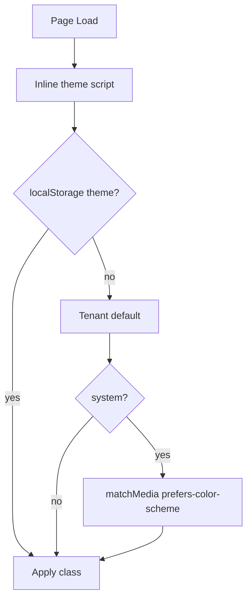

# Dark Mode

| Field | Value |
|-------|-------|
| **Document ID** | DS-DARK-001 |
| **Product** | Founder Portfolio Platform (FounderOS v1.0) |
| **Version** | 1.0 |
| **Status** | Approved |
| **Last Updated** | 2026-06-29 |
| **Owner** | Design & Engineering |
| **Related** | [Color System](./Color_System.md) · [Color System (Brand)](../01_Brand/Color_System.md) · [Design Tokens](./Design_Tokens.md) · [Settings (Admin)](../07_Admin/Settings.md) |

---

## Purpose

Specify dark mode (and optional light mode) theming for FounderOS — token strategy, toggle behavior, system preference sync, and tenant defaults for white-label deployments.

---

## Scope

### In Scope

- Dark-first design token mapping
- Light mode alternate tokens
- Theme toggle UI and persistence
- `prefers-color-scheme` integration
- shadcn/ui dark class strategy
- Chart, image, and OG considerations in dark UI

### Out of Scope

- Per-user theme in public anonymous sessions (cookie optional)
- High-contrast accessibility theme (v1.1)

---

## Business Context

The reference tenant is **dark-first** to signal premium AI/enterprise positioning. Tenants may default to light mode (corporate finance verticals). Theme must switch without flash (FOUC) on hydration.

---

## Goals

| # | Goal | Target |
|---|------|--------|
| G1 | No theme flash on load | `suppressHydrationWarning` + script |
| G2 | Contrast WCAG AA in both modes | All text pairs |
| G3 | Tenant default theme via settings | `theme: dark \| light \| system` |
| G4 | Charts/images legible in dark | Adjusted borders/backgrounds |

---

## Functional Requirements

| ID | Requirement | Priority |
|----|-------------|----------|
| FR-DARK-01 | Theme SHALL use `class="dark"` on `<html>` per shadcn | P0 |
| FR-DARK-02 | Toggle SHALL support dark / light / system | P0 |
| FR-DARK-03 | Preference SHALL persist in `localStorage` key `theme` | P0 |
| FR-DARK-04 | Inline blocking script SHALL set class before paint | P0 |
| FR-DARK-05 | Tenant default SHALL override until user chooses | P1 |
| FR-DARK-06 | Meta `theme-color` SHALL match background | P1 |

---

## Non-functional Requirements

| ID | Requirement | Target |
|----|-------------|--------|
| NFR-DARK-01 | Theme switch transition | 0ms or &lt; 150ms colors only |
| NFR-DARK-02 | Token parity | 100% semantic tokens have dark values |

---

## User Stories

| ID | As a… | I want… | So that… |
|----|-------|---------|----------|
| US-DARK-001 | Visitor | dark UI by default | it matches brand |
| US-DARK-002 | User | light mode toggle | I read in bright light |
| US-DARK-003 | System user | follow OS preference | experience feels native |
| US-DARK-004 | Tenant admin | set default theme | my clients see our brand |

---

## UX Requirements

- **Toggle placement**: Footer icon or header ghost button (sun/moon).
- **No flash**: Critical for brand perception.
- **Images**: Slight border `border-border` in dark on screenshots.
- **Shadows**: Reduced in dark; use border emphasis instead.
- **Code blocks**: Syntax theme matches dark/light.

---

## Technical Considerations

- CSS variables in `:root` and `.dark` in `globals.css`.
- `next-themes` `ThemeProvider` with `attribute="class"`.
- Tailwind `darkMode: ['class']`.
- Admin and public share token file; charts use `hsl(var(--muted))`.

---

## Security Considerations

- `localStorage` theme key low risk; no PII.
- CSP allows inline script for anti-FOUC only in documented nonce pattern.

---

## Acceptance Criteria

- [ ] Dark and light token mapping documented
- [ ] Toggle behavior and persistence specified
- [ ] FOUC prevention pattern documented
- [ ] Tenant default theme setting noted
- [ ] Cross-links to Color System and Design Tokens

---

## Future Enhancements

- High-contrast theme
- Scheduled auto theme (evening mode)
- Per-route forced theme (print/legal light)

---

## Open Questions

| # | Question | Owner |
|---|----------|-------|
| OQ-1 | Show theme toggle on public site or settings only? | Product |
| OQ-2 | Separate admin vs. public theme preference? | UX |
| OQ-3 | AMOLED true black background option? | Design |
