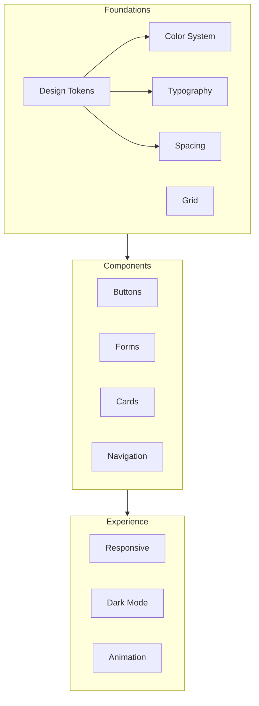

# Design System

| Field | Value |
|-------|-------|
| **Product** | Founder Portfolio Platform (FounderOS) |
| **Version** | 1.0 |
| **Document ID** | DS-000 |
| **Status** | Approved for Implementation |
| **Last Updated** | 2026-06-29 |
| **Owner** | Design & Engineering |
| **Related** | [Design Tokens](./Design_Tokens.md) · [Frontend Architecture](../04_Architecture/Frontend_Architecture.md) · [Interaction Principles](../02_UX/Interaction_Principles.md) |

---

## Purpose

Establish the unified design system for FounderOS v1.0 — principles, foundations, component inventory, and implementation standards — built on **Next.js 15**, **shadcn/ui**, and **TailwindCSS** with **FastAPI**-served content. This document is the entry point for all visual and component specifications.

---

## Scope

### In Scope

| Layer | Documents |
|-------|-----------|
| Foundations | Tokens, color, typography, spacing, grid, responsive, dark mode |
| Components | Buttons, forms, cards, tables, dialogs, navigation, feedback, loading |
| Motion | Animation system |
| Icons | Lucide icon standards |
| Implementation | shadcn/ui + Tailwind conventions |

### Out of Scope

| Area | Rationale |
|------|-----------|
| Page-level layouts | [05_Pages](../05_Pages/Home.md) |
| Admin-only bespoke UI | [07_Admin](../07_Admin/) when present |
| Marketing illustration style | Tenant brand assets |

---

## Business Context

FounderOS must look **enterprise-grade** out of the box while supporting white-label theming. A cohesive design system reduces implementation drift, speeds tenant onboarding, and ensures accessibility compliance across [02_UX](../02_UX/Accessibility.md) requirements.

---

## Goals

| # | Goal | Metric |
|---|------|--------|
| G1 | Single source of truth for all UI tokens | 100% components use semantic tokens |
| G2 | shadcn/ui as component base | No duplicate primitives |
| G3 | WCAG 2.1 AA contrast on default theme | [Color System](./Color_System.md) audit pass |
| G4 | Documented component variants for every public UI pattern | Component doc coverage |

---

## Functional Requirements

| ID | Requirement | Priority |
|----|-------------|----------|
| FR-DS-01 | All UI SHALL use Tailwind utility classes mapped to design tokens | P0 |
| FR-DS-02 | Components SHALL be sourced from shadcn/ui where available | P0 |
| FR-DS-03 | Custom components SHALL follow Radix accessibility patterns | P0 |
| FR-DS-04 | Theme SHALL support light and dark modes | P0 |
| FR-DS-05 | Spacing SHALL use the 4px base scale exclusively | P0 |
| FR-DS-06 | Typography SHALL use defined type scale only | P0 |
| FR-DS-07 | Icons SHALL use Lucide React at consistent sizes | P0 |
| FR-DS-08 | Component docs SHALL define all variants and states | P0 |

---

## Non-functional Requirements

| ID | Requirement | Target |
|----|-------------|--------|
| NFR-DS-01 | CSS bundle size (public pages) | Tailwind purge; no unused component CSS |
| NFR-DS-02 | Component consistency score | Design QA checklist 100% on launch pages |
| NFR-DS-03 | Theme switch latency | &lt; 50ms without flash |

---

## User Stories

| ID | As a… | I want to… | So that… |
|----|-------|------------|----------|
| US-DS-01 | Frontend engineer | documented tokens and components | I build UI without guessing |
| US-DS-02 | White-label tenant | swap brand colors via tokens | I don't fork components |
| US-DS-03 | Designer | consistent spacing and type | Pages feel cohesive |
| US-DS-04 | Visitor | readable, accessible interface | I trust the brand |

---

## UX Requirements

### Design Principles

| Principle | Application |
|-----------|-------------|
| **Clarity over decoration** | Minimal chrome; content-first layouts |
| **Consistent density** | Enterprise information density; not consumer playful |
| **Accessible by default** | Focus rings, contrast, touch targets built in |
| **Progressive enhancement** | Core UI works without animation |
| **Composable** | Small primitives compose into page sections |

### Component Inventory

| Category | Components | Document |
|----------|------------|----------|
| Actions | Button, Icon Button, Link | [Buttons](./Buttons.md) |
| Inputs | Input, Textarea, Select, Checkbox, Radio, Switch | [Forms](./Forms.md) |
| Layout | Card, Separator, Sheet | [Cards](./Cards.md) |
| Data | Table, Badge | [Tables](./Tables.md) |
| Overlay | Dialog, Alert Dialog, Popover, Tooltip | [Dialogs](./Dialogs.md) |
| Navigation | Header, Footer, Tabs, Breadcrumb, Sidebar | [Navigation Components](./Navigation_Components.md) |
| Feedback | Toast, Alert, Progress, Skeleton | [Feedback Components](./Feedback_Components.md) |
| Media | Avatar, Aspect Ratio | [Icons](./Icons.md) |

### Stack Mapping

| Layer | Technology | Role |
|-------|------------|------|
| Framework | Next.js 15 App Router | Server and client components |
| Styling | TailwindCSS 3.x | Utility-first CSS |
| Components | shadcn/ui | Accessible Radix-based primitives |
| Icons | Lucide React | Consistent icon set |
| Animation | Framer Motion (optional) | Page and micro-interactions |
| Theming | CSS variables + `next-themes` | Light/dark toggle |

---

## Technical Considerations

| Topic | Guidance |
|-------|----------|
| **Token location** | `globals.css` CSS variables; extended in `tailwind.config` |
| **Component path** | `components/ui/` for shadcn; `components/` for composites |
| **cn() utility** | `clsx` + `tailwind-merge` for variant classes |
| **Server components** | Prefer RSC; client only for interactivity |
| **Font loading** | `next/font` for Inter or Geist |

---

## Security Considerations

| Concern | Rule |
|---------|------|
| User-generated styles | No raw CSS injection from CMS |
| Third-party widgets | Isolate in iframes where possible |

---

## Acceptance Criteria

- [ ] All foundation docs in `03_Design_System/` approved
- [ ] `tailwind.config` references token documentation
- [ ] shadcn/ui components installed match documented inventory
- [ ] Dark mode toggle functional without FOUC
- [ ] Public pages use only documented components
- [ ] Design QA checklist passes on Home, Products, Contact

---

## Future Enhancements

| Enhancement | Notes |
|-------------|-------|
| Figma design kit | Sync with tokens |
| Storybook | Component playground |
| Additional themes | High contrast, tenant presets |
| Design tokens package | Shared npm package for monorepo |

---

## Open Questions

| ID | Question | Owner | Status |
|----|----------|-------|--------|
| OQ-DS-001 | Default font: Inter vs. Geist vs. tenant choice? | Design | Open |
| OQ-DS-002 | Framer Motion on all pages or selective? | Engineering | Open |
| OQ-DS-003 | Custom illustration system for empty states? | Design | Open |

---

## Related Documents

- [Design Tokens](./Design_Tokens.md)
- [Color System](./Color_System.md)
- [Typography System](./Typography_System.md)
- [Spacing System](./Spacing_System.md)
- [Grid System](./Grid_System.md)
- [Responsive System](./Responsive_System.md)
- [Dark Mode](./Dark_Mode.md)
- [Accessibility](../02_UX/Accessibility.md)
- [Frontend Architecture](../04_Architecture/Frontend_Architecture.md)
