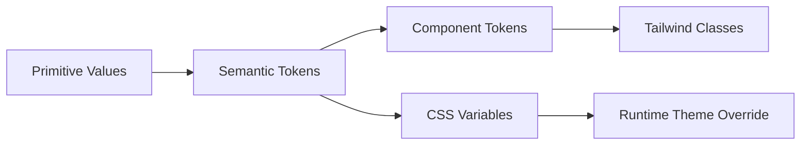

# Design Tokens

| Field | Value |
|-------|-------|
| **Product** | Founder Portfolio Platform (FounderOS) |
| **Version** | 1.0 |
| **Document ID** | DS-TOK-001 |
| **Status** | Approved for Implementation |
| **Last Updated** | 2026-06-29 |
| **Owner** | Design & Engineering |
| **Related** | [Design System](./Design_System.md) · [Color System](./Color_System.md) · [Typography System](./Typography_System.md) · [Spacing System](./Spacing_System.md) |

---

## Purpose

Define the canonical design token architecture for FounderOS v1.0 — semantic naming, CSS variable structure, Tailwind mapping, and white-label override points — ensuring visual consistency across Next.js frontend and admin panel.

---

## Scope

### In Scope

| Token Category | Reference Doc |
|----------------|---------------|
| Color (semantic) | [Color System](./Color_System.md) |
| Typography | [Typography System](./Typography_System.md) |
| Spacing | [Spacing System](./Spacing_System.md) |
| Radius, shadow, border | This document |
| Breakpoints | [Responsive System](./Responsive_System.md) |
| Animation duration/easing | [Animation System](./Animation_System.md) |
| Z-index scale | This document |

### Out of Scope

| Area | Rationale |
|------|-----------|
| Component-specific overrides | Individual component docs |
| Backend configuration | [Settings API](../08_API/) |

---

## Business Context

Design tokens enable **white-label deployments** — tenants override `--primary`, `--background`, and logo assets without forking React components. Enterprise buyers expect polished, consistent UI; tokens are the contract between design and engineering.

---

## Goals

| # | Goal | Metric |
|---|------|--------|
| G1 | 100% public UI references semantic tokens | Lint/rule audit |
| G2 | Single CSS variable source in `globals.css` | One theme file |
| G3 | Documented tenant override surface | Settings module mapping |

---

## Functional Requirements

| ID | Requirement | Priority |
|----|-------------|----------|
| FR-TOK-01 | Colors SHALL use HSL CSS variables (`hsl(var(--primary))`) | P0 |
| FR-TOK-02 | Spacing SHALL map to Tailwind spacing scale | P0 |
| FR-TOK-03 | Radius tokens SHALL define sm, md, lg, xl, full | P0 |
| FR-TOK-04 | Shadow tokens SHALL define sm, md, lg for elevation | P1 |
| FR-TOK-05 | Z-index SHALL use named scale (dropdown, modal, toast) | P0 |
| FR-TOK-06 | Tokens SHALL support `.dark` class theme switching | P0 |

---

## Non-functional Requirements

| ID | Requirement | Target |
|----|-------------|--------|
| NFR-TOK-01 | Theme variable count | &lt; 50 semantic tokens |
| NFR-TOK-02 | Override application | Site settings apply without rebuild (CSS vars) |

---

## User Stories

| ID | As a… | I want to… | So that… |
|----|-------|------------|----------|
| US-TOK-01 | Engineer | semantic token names | I don't hardcode hex values |
| US-TOK-02 | Tenant admin | change primary brand color | Site matches my brand |
| US-TOK-03 | Designer | documented token sheet | Handoff is unambiguous |

---

## UX Requirements

### Token Architecture

### Semantic Color Tokens

| Token | Usage |
|-------|-------|
| `--background` | Page background |
| `--foreground` | Primary text |
| `--card` / `--card-foreground` | Card surfaces |
| `--primary` / `--primary-foreground` | Primary actions |
| `--secondary` / `--secondary-foreground` | Secondary actions |
| `--muted` / `--muted-foreground` | Subtle backgrounds and helper text |
| `--accent` / `--accent-foreground` | Highlights |
| `--destructive` / `--destructive-foreground` | Errors, delete |
| `--border` | Borders and dividers |
| `--input` | Input borders |
| `--ring` | Focus rings |

See [Color System](./Color_System.md) for full palette and contrast audit.

### Radius Tokens

| Token | Value | Usage |
|-------|-------|-------|
| `--radius-sm` | 0.25rem (4px) | Chips, small badges |
| `--radius-md` | 0.375rem (6px) | Inputs, buttons (default) |
| `--radius-lg` | 0.5rem (8px) | Cards |
| `--radius-xl` | 0.75rem (12px) | Modals, large cards |
| `--radius-full` | 9999px | Avatars, pills |

### Shadow Tokens

| Token | Elevation | Usage |
|-------|-----------|-------|
| `shadow-sm` | 1 | Subtle card lift |
| `shadow-md` | 2 | Dropdowns, popovers |
| `shadow-lg` | 3 | Modals, drawers |
| `shadow-none` | 0 | Flat sections |

### Z-Index Scale

| Token | Value | Layer |
|-------|-------|-------|
| `z-base` | 0 | Default content |
| `z-dropdown` | 10 | Menus, selects |
| `z-sticky` | 20 | Fixed header |
| `z-overlay` | 30 | Modal backdrop |
| `z-modal` | 40 | Dialog content |
| `z-toast` | 50 | Toast notifications |

### Tailwind Extension Mapping

| Tailwind Key | Source |
|--------------|--------|
| `colors.*` | CSS variables via `hsl(var(--token))` |
| `borderRadius.*` | `--radius-*` |
| `fontFamily.sans` | `--font-sans` from `next/font` |
| `spacing.*` | [Spacing System](./Spacing_System.md) |

---

## Technical Considerations

| Topic | Guidance |
|-------|----------|
| **shadcn/ui** | Default theme in `components.json` aligns with tokens |
| **Tailwind** | Extend theme in `tailwind.config.ts`; never arbitrary hex in JSX |
| **Site settings** | API returns `primary_hsl`; injected as inline style on `<html>` |
| **Dark mode** | `.dark` selector overrides semantic tokens |

---

## Security Considerations

| Concern | Rule |
|---------|------|
| CSS injection via settings | Validate HSL format server-side |
| Arbitrary class in CMS | Block `class` attributes in rich text |

---

## Acceptance Criteria

- [ ] All semantic tokens documented with usage
- [ ] No raw hex in `components/` except token definitions
- [ ] Light and dark themes define full token set
- [ ] Tenant primary color override works via site settings
- [ ] Z-index scale prevents overlay stacking bugs

---

## Future Enhancements

| Enhancement | Notes |
|-------------|-------|
| Style Dictionary export | JSON tokens for Figma |
| Density tokens (compact/comfortable) | Admin tables |
| Motion tokens as CSS variables | Unified with animation doc |

---

## Open Questions

| ID | Question | Owner | Status |
|----|----------|-------|--------|
| OQ-TOK-001 | Per-tenant font family via settings? | Product | Open |
| OQ-TOK-002 | Export tokens to Tailwind v4 `@theme`? | Engineering | Open |

---

## Related Documents

- [Design System](./Design_System.md)
- [Color System](./Color_System.md)
- [Typography System](./Typography_System.md)
- [Spacing System](./Spacing_System.md)
- [Animation System](./Animation_System.md)
- [Dark Mode](./Dark_Mode.md)
