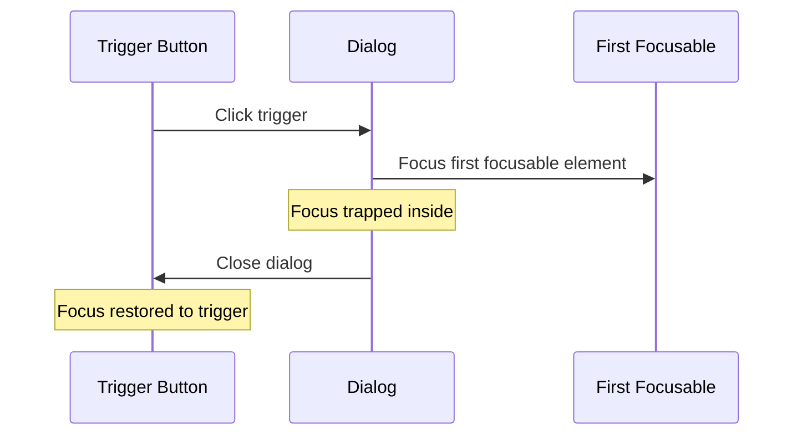

# Dialogs

| Field | Value |
|-------|-------|
| **Product** | Founder Portfolio Platform (FounderOS) |
| **Version** | 1.0 |
| **Document ID** | DS-DIALOG-001 |
| **Status** | Approved for Implementation |
| **Last Updated** | 2026-06-29 |
| **Owner** | Design & Engineering |
| **Related** | [Buttons](./Buttons.md) · [Forms](./Forms.md) · [Accessibility](../02_UX/Accessibility.md) |

---

## Purpose

Define modal dialog and alert dialog patterns for FounderOS v1.0 — used for confirmations, destructive actions, and focused interactions that require user attention without navigating away.

---

## Scope

### In Scope

- Dialog component (shadcn/ui + Radix)
- Alert Dialog for destructive confirmations
- Dialog anatomy (overlay, content, header, footer)
- Focus trap and keyboard behavior
- Animation enter/exit

### Out of Scope

- Drawer/sheet component (v1.1)
- Full-screen modals
- Video/media lightbox (v1.1)

---

## Business Context

Dialogs are used sparingly in FounderOS — primarily for **destructive action confirmation** in the admin panel (delete post, delete product) and potentially for quick-preview actions. Overuse of modals degrades UX; the platform favors page-based flows for primary actions.

---

## Goals

| # | Goal | Metric |
|---|------|--------|
| G1 | Destructive actions always confirmed | 100% delete flows use dialog |
| G2 | Accessible focus management | Focus trap + restore |
| G3 | Dismissible via Escape and overlay click | Both methods work |

---

## Functional Requirements

| ID | Requirement | Priority |
|----|-------------|----------|
| FR-DIALOG-01 | Dialogs SHALL use shadcn/ui Dialog (Radix primitive) | P0 |
| FR-DIALOG-02 | Destructive confirmations SHALL use AlertDialog | P0 |
| FR-DIALOG-03 | Focus SHALL be trapped inside open dialog | P0 |
| FR-DIALOG-04 | Escape key SHALL close dialog | P0 |
| FR-DIALOG-05 | Overlay click SHALL close dialog (non-destructive) | P1 |
| FR-DIALOG-06 | Focus SHALL return to trigger element on close | P0 |

---

## Non-functional Requirements

| ID | Requirement | Target |
|----|-------------|--------|
| NFR-DIALOG-01 | Enter animation | 200ms fade + scale |
| NFR-DIALOG-02 | Exit animation | 150ms fade |
| NFR-DIALOG-03 | Overlay opacity | 80% black (`bg-black/80`) |

---

## User Stories

| ID | As a… | I want to… | So that… |
|----|-------|------------|----------|
| US-DIALOG-01 | Admin | Confirm before deleting content | I don't lose work accidentally |
| US-DIALOG-02 | Keyboard user | Close dialog with Escape | I can dismiss quickly |
| US-DIALOG-03 | Screen reader user | Hear dialog title announced | I understand the dialog purpose |

---

## UX Requirements

### Dialog Anatomy

```
┌─────────────────────────────────────────┐
│  ░░░░░░░░░ OVERLAY ░░░░░░░░░░░░░░░░░░  │
│  ░░░░░░░░░░░░░░░░░░░░░░░░░░░░░░░░░░░░░  │
│  ░░░░░┌─────────────────────────┐░░░░░░  │
│  ░░░░░│  DialogHeader           │░░░░░░  │
│  ░░░░░│  DialogTitle            │░░░░░░  │
│  ░░░░░│  DialogDescription      │░░░░░░  │
│  ░░░░░├─────────────────────────┤░░░░░░  │
│  ░░░░░│  DialogContent            │░░░░░░  │
│  ░░░░░│  (body text or form)      │░░░░░░  │
│  ░░░░░├─────────────────────────┤░░░░░░  │
│  ░░░░░│  DialogFooter             │░░░░░░  │
│  ░░░░░│  [Cancel]  [Confirm]      │░░░░░░  │
│  ░░░░░└─────────────────────────┘░░░░░░  │
│  ░░░░░░░░░░░░░░░░░░░░░░░░░░░░░░░░░░░░░  │
└─────────────────────────────────────────┘
```

### Dialog Styles

| Element | Style | Tailwind |
|---------|-------|----------|
| Overlay | Semi-transparent black | `bg-black/80 fixed inset-0 z-50` |
| Content | Card-like container, centered | `bg-card border rounded-lg shadow-lg max-w-lg w-full p-6` |
| Position | Centered in viewport | `fixed left-1/2 top-1/2 -translate-x-1/2 -translate-y-1/2` |
| Z-index | Above all content | `z-50` |
| Title | Semibold | `text-lg font-semibold` |
| Description | Muted | `text-sm text-muted-foreground` |
| Footer | Right-aligned buttons | `flex justify-end gap-3 mt-6` |

### Dialog Types

| Type | Component | Usage | Dismissible |
|------|-----------|-------|-------------|
| **Confirmation** | `AlertDialog` | Delete content, irreversible actions | Only via buttons |
| **Informational** | `Dialog` | Show details, preview | Escape + overlay |
| **Form** | `Dialog` | Quick edit (v1.1) | Escape + overlay |

### Delete Confirmation Dialog

| Element | Content |
|---------|---------|
| Title | "Delete {content type}" |
| Description | "Are you sure you want to delete "{title}"? This action cannot be undone." |
| Cancel button | `Button` variant `outline` — "Cancel" |
| Confirm button | `Button` variant `destructive` — "Delete" |

### Animation

| Phase | Animation | Duration |
|-------|-----------|----------|
| Enter (overlay) | Fade in from opacity 0 | 200ms |
| Enter (content) | Fade in + scale from 95% | 200ms |
| Exit (overlay) | Fade out to opacity 0 | 150ms |
| Exit (content) | Fade out + scale to 95% | 150ms |

Implemented via Radix Dialog built-in animations or Framer Motion.

### Keyboard Behavior

| Key | Action |
|-----|--------|
| `Escape` | Close dialog (non-alert) |
| `Tab` | Cycle focus within dialog (trapped) |
| `Shift+Tab` | Reverse cycle focus |
| `Enter` | Activate focused button |

### Focus Management



### ARIA Attributes

| Attribute | Value | Element |
|-----------|-------|---------|
| `role` | `dialog` | Dialog content (Radix auto) |
| `aria-modal` | `true` | Dialog content |
| `aria-labelledby` | Title ID | Dialog content |
| `aria-describedby` | Description ID | Dialog content |

---

## Technical Considerations

| Topic | Implementation |
|-------|----------------|
| **Dialog** | `@radix-ui/react-dialog` via shadcn/ui |
| **AlertDialog** | `@radix-ui/react-alert-dialog` via shadcn/ui |
| **Focus trap** | Radix built-in focus trap |
| **Portal** | Dialog renders in portal (body level) |
| **Scroll lock** | Body scroll locked when dialog open (Radix) |

---

## Security Considerations

| Concern | Mitigation |
|---------|------------|
| Accidental deletion | AlertDialog requires explicit confirm |
| Dialog overlay click on destructive | AlertDialog disables overlay dismiss |

---

## Acceptance Criteria

- [ ] Delete confirmation uses AlertDialog
- [ ] Focus trapped inside open dialog
- [ ] Escape closes non-destructive dialogs
- [ ] Focus returns to trigger on close
- [ ] Overlay renders at 80% opacity
- [ ] Enter/exit animations smooth (200ms)
- [ ] Dialog title and description announced to screen readers
- [ ] Destructive confirm button uses `destructive` variant

---

## Future Enhancements

| Enhancement | Dialog Impact |
|-------------|-------------|
| Sheet/Drawer | Mobile-friendly side panel |
| Full-screen dialog | Content preview |
| Stacked dialogs | Multi-step confirmation |
| Image lightbox | Media gallery dialog |

---

## Open Questions

| # | Question | Owner |
|---|----------|-------|
| OQ-DIALOG-01 | Preview dialog for admin content? | Product — v1.1 |
| OQ-DIALOG-02 | Slide-up animation on mobile? | UX — v1.1 |

---

## Related Documents

- [Buttons](./Buttons.md)
- [Forms](./Forms.md)
- [Animation System](./Animation_System.md)
- [Accessibility](../02_UX/Accessibility.md)
- [Interaction Principles](../02_UX/Interaction_Principles.md)
