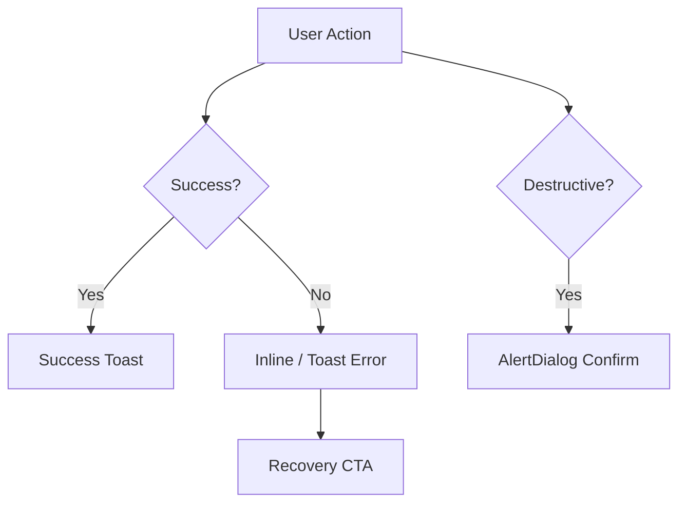

# Feedback Components

| Field | Value |
|-------|-------|
| **Document ID** | DS-FB-001 |
| **Product** | Founder Portfolio Platform (FounderOS v1.0) |
| **Version** | 1.0 |
| **Status** | Approved |
| **Last Updated** | 2026-06-29 |
| **Owner** | Design & Engineering |
| **Related** | [Dialogs](./Dialogs.md) · [Forms](./Forms.md) · [Brand Voice](../01_Brand/Brand_Voice.md) · [Interaction Principles](../02_UX/Interaction_Principles.md) |

---

## Purpose

Specify feedback UI patterns — alerts, toasts, banners, inline validation, and empty states — that communicate system status clearly without disrupting user flow.

---

## Scope

### In Scope

- Alert component variants
- Toast notifications (Sonner)
- Inline form field errors
- Page-level banners
- Empty and error states
- Success confirmations

### Out of Scope

- Modal dialogs (see [Dialogs](./Dialogs.md))
- Push notifications (mobile app — future)

---

## Business Context

Admin users perform high-stakes actions (publish blog, delete media). Feedback must be **immediate, specific, and recoverable**. Public contact form submissions need clear success/failure without losing entered data.

| Pattern | When to Use |
|---------|-------------|
| **Toast** | Transient success/error after action |
| **Alert** | Persistent page-level notice |
| **Inline error** | Field validation |
| **Banner** | System-wide maintenance or cookie consent |
| **Empty state** | No data yet; guide next action |

---

## Goals

| # | Goal |
|---|------|
| G1 | All destructive actions show toast + undo where possible |
| G2 | Errors follow Brand Voice — actionable, not blaming |
| G3 | Toasts accessible to screen readers |
| G4 | Consistent variant colors via semantic tokens |

---

## Functional Requirements

| ID | Requirement | Priority |
|----|-------------|----------|
| FR-FB-01 | Toasts SHALL use Sonner with max 3 visible | P0 |
| FR-FB-02 | Destructive confirm SHALL use AlertDialog, not toast only | P0 |
| FR-FB-03 | Form errors SHALL link `aria-describedby` to fields | P0 |
| FR-FB-04 | Success toast auto-dismiss SHALL be 5s (configurable) | P0 |
| FR-FB-05 | Error toast SHALL persist until dismissed | P0 |
| FR-FB-06 | Cookie banner SHALL block non-essential scripts until consent | P0 |

---

## Non-functional Requirements

| ID | Requirement | Target |
|----|-------------|--------|
| NFR-FB-01 | Toast enter animation | 200ms |
| NFR-FB-02 | Toast position | bottom-right desktop; top mobile |
| NFR-FB-03 | Z-index above modals | toast &lt; dialog stacking documented |

---

## User Stories

| ID | As a… | I want… | So that… |
|----|-------|---------|----------|
| US-FB-001 | Admin | save confirmation toast | I know publish succeeded |
| US-FB-002 | Visitor | contact form error message | I can fix and resubmit |
| US-FB-003 | Screen reader user | announced toasts | I hear status changes |
| US-FB-004 | Editor | empty state CTA | I create first blog post |

---

## UX Requirements

- **Variants**: default (info), success, warning, destructive.
- **Icons**: Lucide paired with text — never icon-only alerts.
- **Empty states**: Illustration optional; headline + description + primary CTA.
- **Stacking**: Newest toast on top; swipe to dismiss on mobile.

---

## Technical Considerations

- shadcn `Alert`, Sonner `Toaster` in root layout.
- Server Actions return `{ error, success }` for form feedback.
- Rate-limit errors map to dedicated toast copy.
- See [Validation](../11_Security/Validation.md).

---

## Security Considerations

- Toast messages must not leak stack traces or internal IDs.
- Banner content sanitized if admin-editable.

---

## Acceptance Criteria

- [ ] Alert, toast, inline, banner, empty state documented
- [ ] Variant table with semantic colors
- [ ] Accessibility requirements listed
- [ ] Cookie banner behavior cross-linked to Cookie page
- [ ] Brand Voice examples for error copy

---

## Future Enhancements

- Undo toast for soft-delete (30s window)
- Notification center in admin header
- Webhook failure digest emails

---

## Open Questions

| # | Question | Owner |
|---|----------|-------|
| OQ-1 | Toast vs. inline for API 500 on public forms? | UX |
| OQ-2 | Global maintenance banner via Settings API? | Engineering |
| OQ-3 | Haptic feedback on mobile success? | Design |
