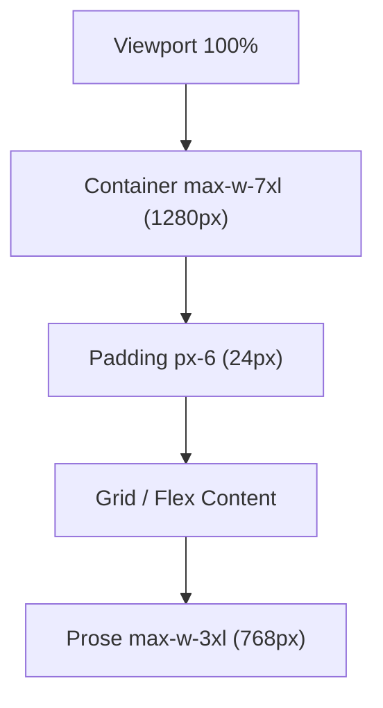

# Grid System

| Field | Value |
|-------|-------|
| **Product** | Founder Portfolio Platform (FounderOS) |
| **Version** | 1.0 |
| **Document ID** | DS-GRID-001 |
| **Status** | Approved for Implementation |
| **Last Updated** | 2026-06-29 |
| **Owner** | Design & Engineering |
| **Related** | [Spacing System](./Spacing_System.md) · [Responsive System](./Responsive_System.md) · [Wireframes](../02_UX/Wireframes.md) |

---

## Purpose

Define the layout grid system for FounderOS v1.0 — container widths, column structures, and responsive grid patterns that ensure consistent spatial organization across all page templates.

---

## Scope

### In Scope

- Content container max-widths
- Column grid patterns (1, 2, 3, 4 column)
- Page-level layout structure
- Section wrapper patterns
- Admin panel grid

### Out of Scope

- CSS Grid subgrid (limited browser support)
- Print layout grids

---

## Business Context

A consistent grid creates visual rhythm and professionalism. Enterprise buyers subconsciously evaluate layout quality — misaligned columns and inconsistent widths signal a lack of attention to detail. FounderOS uses a **12-column conceptual grid** implemented via Tailwind CSS Grid and Flexbox utilities.

---

## Goals

| # | Goal | Metric |
|---|------|--------|
| G1 | All pages use standard container width | `max-w-7xl` everywhere |
| G2 | Column layouts consistent per template | Grid audit pass |
| G3 | Responsive column collapse predictable | 3→2→1 column pattern |

---

## Functional Requirements

| ID | Requirement | Priority |
|----|-------------|----------|
| FR-GRID-01 | Content container SHALL be `max-w-7xl` (1280px) centered | P0 |
| FR-GRID-02 | Horizontal padding SHALL be `px-6` (24px) on all containers | P0 |
| FR-GRID-03 | Card grids SHALL use `grid` with responsive column classes | P0 |
| FR-GRID-04 | Footer SHALL use 4-column grid on md+ | P0 |
| FR-GRID-05 | Prose content SHALL be `max-w-3xl` (768px) centered | P1 |
| FR-GRID-06 | Admin layout SHALL use sidebar + main content grid | P1 |

---

## Non-functional Requirements

| ID | Requirement | Target |
|----|-------------|--------|
| NFR-GRID-01 | Container centering | `mx-auto` on all containers |
| NFR-GRID-02 | Grid gap consistency | `gap-6` (24px) default, `gap-12` (48px) for sections |

---

## User Stories

| ID | As a… | I want to… | So that… |
|----|-------|------------|----------|
| US-GRID-01 | Visitor | See aligned content on wide screens | The site feels polished |
| US-GRID-02 | Mobile user | See single-column layouts | Content is readable on small screens |
| US-GRID-03 | Engineer | Use standard grid classes | I don't invent layouts per page |

---

## UX Requirements

### Container Hierarchy



| Container | Max Width | Tailwind Class | Usage |
|-----------|-----------|----------------|-------|
| Full viewport | 100% | `w-full` | Header, footer backgrounds |
| Content container | 1280px | `max-w-7xl mx-auto px-6` | All page sections |
| Prose container | 768px | `max-w-3xl mx-auto` | Blog posts, case studies |
| Narrow container | 640px | `max-w-2xl mx-auto` | Contact form, 404 |
| Admin content | Fluid | `flex-1 p-6` | Admin main area |

### Grid Patterns

#### 3-Column Card Grid (Products, Blog)

| Breakpoint | Columns | Gap | Tailwind |
|------------|---------|-----|----------|
| `< md` (768px) | 1 | 24px | `grid gap-6` |
| `md – lg` | 2 | 24px | `md:grid-cols-2 gap-6` |
| `≥ lg` (1024px) | 3 | 24px | `lg:grid-cols-3 gap-6` |

```
Desktop (lg+):
┌──────────┬──────────┬──────────┐
│  Card 1  │  Card 2  │  Card 3  │
├──────────┼──────────┼──────────┤
│  Card 4  │  Card 5  │  Card 6  │
└──────────┴──────────┴──────────┘

Mobile:
┌──────────┐
│  Card 1  │
├──────────┤
│  Card 2  │
├──────────┤
│  Card 3  │
└──────────┘
```

#### 2-Column Feature Grid (Product Detail)

| Breakpoint | Columns | Tailwind |
|------------|---------|----------|
| `< md` | 1 | `grid gap-8` |
| `≥ md` | 2 | `md:grid-cols-2 gap-8` |

#### 4-Column Footer Grid

| Breakpoint | Layout | Tailwind |
|------------|--------|----------|
| `< md` | 1 column stacked | `grid gap-12` |
| `≥ md` | 4 columns (brand spans 2) | `md:grid-cols-4 gap-12` |

```
Desktop:
┌─────────────────────┬──────────┬──────────┐
│  Brand (col-span-2) │ Products │ Company  │
│  Description        │ Links    │ Links    │
│  Social links       │          │          │
└─────────────────────┴──────────┴──────────┘
```

#### 2-Column Contact Layout

| Breakpoint | Layout | Tailwind |
|------------|--------|----------|
| `< md` | Stacked (form then sidebar) | `grid gap-12` |
| `≥ md` | Form (2/3) + Sidebar (1/3) | `md:grid-cols-3 gap-12` |

Form: `md:col-span-2`. Sidebar: `md:col-span-1`.

#### Admin Layout

```
┌──────────┬────────────────────────────────┐
│ Sidebar  │ Main Content                   │
│ w-64     │ flex-1                         │
│ fixed    │ p-6                            │
│          │ ┌──────┐ ┌──────┐ ┌──────┐      │
│          │ │ KPI  │ │ KPI  │ │ KPI  │      │
│          │ └──────┘ └──────┘ └──────┘      │
│          │ ┌─────────────────────────┐     │
│          │ │ Data Table (full width) │     │
│          │ └─────────────────────────┘     │
└──────────┴────────────────────────────────┘
```

### Section Wrapper Pattern

All page sections use the `Section` component:

```tsx
<Section className="py-16 md:py-24">
  <div className="mx-auto max-w-7xl px-6">
    {/* Grid content here */}
  </div>
</Section>
```

| Property | Value | Purpose |
|----------|-------|---------|
| Vertical padding | `py-16` (64px) / `md:py-24` (96px) | Section breathing room |
| Container | `max-w-7xl mx-auto px-6` | Content width constraint |
| Optional bg | `bg-card`, `bg-muted` | Visual section separation |

### Grid Pattern Reference

| Pattern ID | Columns | Responsive | Used On |
|------------|---------|------------|---------|
| GRID-01 | 3-col card | 3→2→1 | Products, Blog |
| GRID-02 | 2-col feature | 2→1 | Product detail, Media |
| GRID-03 | 4-col footer | 4→1 | Footer |
| GRID-04 | 3-col contact | 3 (2+1)→1 | Contact page |
| GRID-05 | 3-col stats | 3→1 | Case study metrics |
| GRID-06 | 1-col prose | 1 | Blog body, legal pages |
| GRID-07 | Admin sidebar | Fixed + fluid | Admin panel |

---

## Technical Considerations

| Topic | Implementation |
|-------|----------------|
| **Grid engine** | CSS Grid via Tailwind `grid` utilities |
| **Flexbox** | Used for header (flex row) and inline layouts |
| **Section component** | `frontend/src/components/layout/section.tsx` |
| **No CSS Grid framework** | Pure Tailwind, no Bootstrap/Material grid |
| **Aspect ratios** | `aspect-video` for card images |

---

## Security Considerations

No security implications for layout grid.

---

## Acceptance Criteria

- [ ] All pages use `max-w-7xl mx-auto px-6` container
- [ ] Card grids follow 3→2→1 responsive pattern
- [ ] Footer uses 4-column grid on md+
- [ ] Prose content constrained to `max-w-3xl`
- [ ] Section vertical padding consistent (`py-16 md:py-24`)
- [ ] Admin layout uses sidebar + main content pattern
- [ ] No horizontal scroll on 375px viewport

---

## Future Enhancements

| Enhancement | Grid Impact |
|-------------|-------------|
| Masonry grid | Travel module photo gallery |
| Bento grid | Home page feature showcase |
| CSS subgrid | Nested card alignment |
| 12-column explicit grid | Design tool parity |

---

## Open Questions

| # | Question | Owner |
|---|----------|-------|
| OQ-GRID-01 | Use 12-column explicit grid or utility-based? | Engineering — Utility-based |
| OQ-GRID-02 | Sticky sidebar for long blog posts? | UX — v1.1 |

---

## Related Documents

- [Spacing System](./Spacing_System.md)
- [Responsive System](./Responsive_System.md)
- [Wireframes](../02_UX/Wireframes.md)
- [Cards](./Cards.md)
