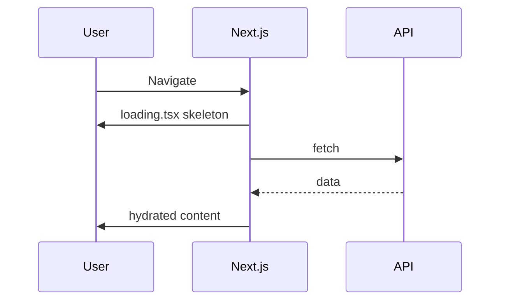

# Loading States

| Field | Value |
|-------|-------|
| **Document ID** | DS-LOAD-001 |
| **Product** | Founder Portfolio Platform (FounderOS v1.0) |
| **Version** | 1.0 |
| **Status** | Approved |
| **Last Updated** | 2026-06-29 |
| **Owner** | Design & Engineering |
| **Related** | [Animation System](./Animation_System.md) · [Motion Guidelines](../01_Brand/Motion_Guidelines.md) · [Tables](./Tables.md) · [Cards](./Cards.md) |

---

## Purpose

Define loading, skeleton, and pending UI patterns for FounderOS — balancing perceived performance with layout stability across public ISR pages and dynamic admin views.

---

## Scope

### In Scope

- Skeleton loaders
- Spinner usage rules
- Suspense boundaries and `loading.tsx`
- Button loading states
- Table and card grid placeholders
- Route transition indicators

### Out of Scope

- Backend job queue progress (see Admin Logs)
- WebSocket live updates (v1.1)

---

## Business Context

Perceived speed drives enterprise credibility. Skeleton screens reduce bounce during API fetches; indiscriminate spinners feel dated. Admin tables with 500 rows need pagination loading, not full-page blocking.

---

## Goals

| # | Goal | Target |
|---|------|--------|
| G1 | Zero CLS from loading → loaded swap | CLS &lt; 0.1 |
| G2 | Skeleton matches final layout | Dimension parity |
| G3 | Loading shown if &gt; 200ms | Avoid flash |
| G4 | Reduced motion disables skeleton pulse | a11y |

---

## Functional Requirements

| ID | Requirement | Priority |
|----|-------------|----------|
| FR-LOAD-01 | Route segments SHALL provide `loading.tsx` where fetch &gt; 200ms | P0 |
| FR-LOAD-02 | Skeletons SHALL mirror final component geometry | P0 |
| FR-LOAD-03 | Button loading SHALL disable + show spinner | P0 |
| FR-LOAD-04 | Full-page spinner ONLY for auth bootstrap | P1 |
| FR-LOAD-05 | Table loading SHALL show skeleton rows (5 default) | P0 |
| FR-LOAD-06 | Images SHALL use `placeholder="blur"` where LQIP available | P1 |

---

## Non-functional Requirements

| ID | Requirement | Target |
|----|-------------|--------|
| NFR-LOAD-01 | Skeleton pulse duration | 1.5s ease-in-out |
| NFR-LOAD-02 | Min display time (optional) | 300ms anti-flash |
| NFR-LOAD-03 | Spinner size scale | sm 16px, default 24px |

---

## User Stories

| ID | As a… | I want… | So that… |
|----|-------|---------|----------|
| US-LOAD-001 | Visitor | skeleton hero while data loads | layout doesn't jump |
| US-LOAD-002 | Admin | table skeleton on filter | I know data is fetching |
| US-LOAD-003 | User | button loading on submit | I don't double-click |
| US-LOAD-004 | a11y user | no seizure-inducing flash | content is safe |

---

## UX Requirements

- **Prefer skeleton** over spinner for content areas.
- **Spinner** only: button inline, small inline refresh, auth gate.
- **Color**: `muted` background pulse; no brand accent on skeletons.
- **Error after load**: Replace skeleton with error Alert + retry.
- **Streaming**: Use React Suspense boundaries per section on Home.

---

## Technical Considerations

- shadcn `Skeleton` component.
- `useTransition` for optimistic admin updates where safe.
- NProgress or top bar optional for route changes (off by default v1.0).
- Redis-cached public data reduces loading frequency.

---

## Security Considerations

- Loading states must not expose whether resource exists (404 vs. loading) for protected admin routes — uniform delay optional.

---

## Acceptance Criteria

- [ ] Skeleton vs. spinner decision tree
- [ ] Component-specific skeleton specs (card, table, hero)
- [ ] Button loading pattern documented
- [ ] `loading.tsx` placement guide
- [ ] Reduced-motion behavior stated

---

## Future Enhancements

- Shimmer gradient skeleton (brand)
- Progress bar for multi-step admin wizards
- Stale-while-revalidate indicator

---

## Open Questions

| # | Question | Owner |
|---|----------|-------|
| OQ-1 | Global route progress bar on public site? | Design |
| OQ-2 | Minimum skeleton time for fast APIs? | Engineering |
| OQ-3 | Infinite scroll loader vs. pagination? | Product |
