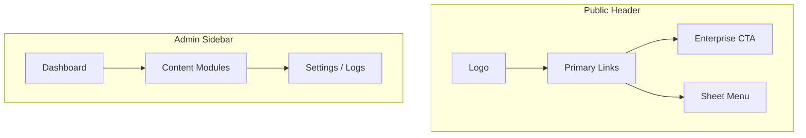

# Navigation Components

| Field | Value |
|-------|-------|
| **Document ID** | DS-NAV-001 |
| **Product** | Founder Portfolio Platform (FounderOS v1.0) |
| **Version** | 1.0 |
| **Status** | Approved |
| **Last Updated** | 2026-06-29 |
| **Owner** | Design & Engineering |
| **Related** | [Navigation (UX)](../02_UX/Navigation.md) · [Logo Guidelines](../01_Brand/Logo_Guidelines.md) · [Responsive System](./Responsive_System.md) · [Buttons](./Buttons.md) |

---

## Purpose

Define navigation UI components — header, footer, mobile menu, breadcrumbs, sidebar, and tabs — ensuring consistent wayfinding across public pages and admin surfaces.

---

## Scope

### In Scope

- Site header and mobile navigation
- Footer navigation and legal links
- Admin sidebar navigation
- Breadcrumbs and secondary nav
- Tab navigation patterns
- Active state and accessibility

### Out of Scope

- Information architecture (see [IA](../02_UX/Information_Architecture.md))
- Command palette / search (v1.1)

---

## Business Context

Navigation is the **spine of conversion**. Enterprise buyers must reach Products, Case Studies, and Enterprise pages within two clicks. Admin navigation must surface CMS, Media, and Settings without overwhelming solo founders.

---

## Goals

| # | Goal | Metric |
|---|------|--------|
| G1 | Public nav reachable via keyboard | 100% links tabbable |
| G2 | Mobile menu usable one-handed | Full-screen sheet |
| G3 | Admin sidebar collapsible | Icon-only mode |
| G4 | Active route visually distinct | `aria-current="page"` |

---

## Functional Requirements

| ID | Requirement | Priority |
|----|-------------|----------|
| FR-NAV-01 | Header SHALL use sticky positioning with backdrop blur | P0 |
| FR-NAV-02 | Mobile breakpoint SHALL switch to hamburger + Sheet | P0 |
| FR-NAV-03 | Admin sidebar SHALL reflect RBAC-visible routes | P0 |
| FR-NAV-04 | Footer SHALL include Privacy, Terms, Cookie links | P0 |
| FR-NAV-05 | Breadcrumbs SHALL appear on admin detail pages | P1 |
| FR-NAV-06 | Skip-to-content link SHALL be first focusable element | P0 |

---

## Non-functional Requirements

| ID | Requirement | Target |
|----|-------------|--------|
| NFR-NAV-01 | Header height (desktop) | 64px |
| NFR-NAV-02 | Sidebar width | 240px / 64px collapsed |
| NFR-NAV-03 | Nav render | Server component where possible |

---

## User Stories

| ID | As a… | I want… | So that… |
|----|-------|---------|----------|
| US-NAV-001 | Mobile visitor | a clear menu | I reach key pages |
| US-NAV-002 | Keyboard user | skip link | I bypass repetitive nav |
| US-NAV-003 | Admin editor | sidebar grouped by module | I find CMS quickly |
| US-NAV-004 | Enterprise buyer | prominent Enterprise link | I start acquisition talk |

---

## UX Requirements

- **Public header**: Logo | Home, Products, About, Blog, Contact | Enterprise CTA button.
- **Active state**: Underline or muted background; never color-only.
- **Mobile sheet**: Closes on route change and Escape.
- **Footer**: 3-column links + social + copyright.
- **Admin**: Collapsible groups with chevron; persist collapse in `localStorage`.

---

## Technical Considerations

- shadcn/ui: `NavigationMenu`, `Sheet`, `ScrollArea`, `Separator`.
- Active route via `usePathname()` (client) or segment props (server).
- Nav items driven from config `config/navigation.ts` for DRY.
- See [Frontend Architecture](../04_Architecture/Frontend_Architecture.md).

---

## Security Considerations

- Admin nav items filtered server-side by role — not client-only hide.
- External links use `rel="noopener noreferrer"`.

---

## Acceptance Criteria

- [ ] Header, footer, admin sidebar specs documented
- [ ] Mobile breakpoint behavior defined
- [ ] Accessibility checklist (skip link, aria-current, focus trap in sheet)
- [ ] RBAC-aware admin nav noted
- [ ] Cross-links to Navigation UX and Logo Guidelines

---

## Future Enhancements

- Mega menu for Products dropdown
- Command-K global search
- Contextual sub-nav for long admin forms

---

## Open Questions

| # | Question | Owner |
|---|----------|-------|
| OQ-1 | Sticky header on admin or static? | Design |
| OQ-2 | Blog categories in header nav? | Product |
| OQ-3 | Tenant-custom nav order via CMS? | Engineering |
