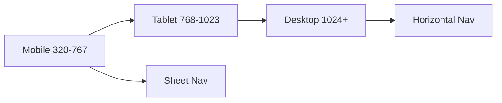

# Responsive System

| Field | Value |
|-------|-------|
| **Document ID** | DS-RESP-001 |
| **Product** | Founder Portfolio Platform (FounderOS v1.0) |
| **Version** | 1.0 |
| **Status** | Approved |
| **Last Updated** | 2026-06-29 |
| **Owner** | Design & Engineering |
| **Related** | [Grid System](./Grid_System.md) · [Spacing System](./Spacing_System.md) · [Navigation Components](./Navigation_Components.md) · [Typography System](./Typography_System.md) |

---

## Purpose

Define breakpoints, container behavior, and responsive layout rules so FounderOS delivers excellent experiences from 320px mobile to ultrawide desktop and admin dashboards.

---

## Scope

### In Scope

- Tailwind breakpoint scale
- Container max-widths and padding
- Responsive typography and spacing
- Component responsive behavior (nav, tables, grids)
- Touch vs. pointer interaction targets
- Print stylesheet basics (legal pages)

### Out of Scope

- Native mobile apps
- TV/kiosk displays

---

## Business Context

&gt; 50% of founder portfolio traffic is mobile (investors checking links on phone). Enterprise buyers review sites on tablets during meetings. Admin must remain usable on iPad for quick edits.

---

## Goals

| # | Goal | Target |
|---|------|--------|
| G1 | Mobile Lighthouse usability | Pass |
| G2 | No horizontal scroll on 320px | Zero overflow |
| G3 | Touch targets | ≥ 44×44px |
| G4 | Tables readable on mobile | Card fallback or scroll |

---

## Functional Requirements

| ID | Requirement | Priority |
|----|-------------|----------|
| FR-RESP-01 | Breakpoints SHALL follow Tailwind defaults (sm/md/lg/xl/2xl) | P0 |
| FR-RESP-02 | Container SHALL use `container` + horizontal padding `px-4 md:px-6` | P0 |
| FR-RESP-03 | Navigation SHALL collapse to sheet below `md` | P0 |
| FR-RESP-04 | Data tables SHALL switch to card layout or horizontal scroll below `md` | P0 |
| FR-RESP-05 | Admin sidebar SHALL overlay below `lg` | P0 |
| FR-RESP-06 | Images SHALL be responsive via `next/image` sizes attr | P0 |

---

## Non-functional Requirements

| ID | Requirement | Target |
|----|-------------|--------|
| NFR-RESP-01 | Mobile LCP | &lt; 2.5s |
| NFR-RESP-02 | Content max-width (prose) | 65ch |
| NFR-RESP-03 | Safe area insets | `env(safe-area-inset-*)` on mobile |

---

## User Stories

| ID | As a… | I want… | So that… |
|----|-------|---------|----------|
| US-RESP-001 | Mobile visitor | readable hero | I grasp value quickly |
| US-RESP-002 | Admin on iPad | usable sidebar | I edit on the go |
| US-RESP-003 | Developer | breakpoint table | I implement consistently |
| US-RESP-004 | Table user | scroll or cards on phone | I read row data |

---

## UX Requirements

### Breakpoint Table

| Token | Min Width | Typical Use |
|-------|-----------|-------------|
| default | 0px | Mobile portrait |
| `sm` | 640px | Mobile landscape |
| `md` | 768px | Tablet |
| `lg` | 1024px | Desktop |
| `xl` | 1280px | Wide desktop |
| `2xl` | 1536px | Ultrawide |

- **Mobile-first**: Base styles for mobile; add complexity at `md+`.
- **Grids**: 1 col → 2 col (`md`) → 3 col (`lg`) for product cards.
- **Typography**: Fluid `clamp()` for H1 on marketing pages.

---

## Technical Considerations

- Tailwind `screens` in config; no custom breakpoints without design approval.
- `useMediaQuery` hook for client-only behavior (sparingly).
- Container component in `components/layout/section.tsx`.
- See [Grid System](./Grid_System.md) for column counts.

---

## Security Considerations

- Responsive hiding must not be sole method of access control for admin actions.

---

## Acceptance Criteria

- [ ] Breakpoint table documented
- [ ] Container and padding rules stated
- [ ] Nav, table, grid responsive behavior per component
- [ ] Touch target minimum documented
- [ ] Cross-links to Grid and Navigation docs

---

## Future Enhancements

- Container queries for card components
- Responsive preview in admin
- PWA standalone safe areas

---

## Open Questions

| # | Question | Owner |
|---|----------|-------|
| OQ-1 | Custom `3xl` breakpoint for marketing hero? | Design |
| OQ-2 | Force desktop layout toggle in admin preview? | Product |
| OQ-3 | Table card layout component in v1.0 or v1.1? | Engineering |
