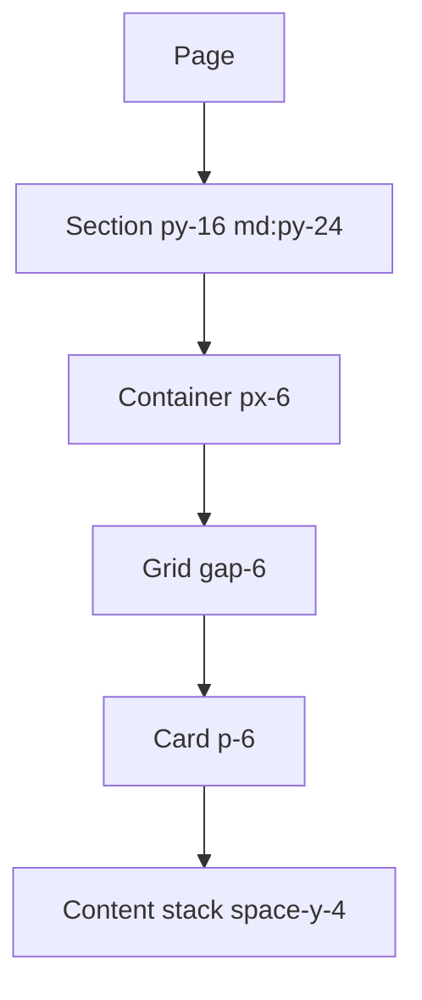

# Spacing System

| Field | Value |
|-------|-------|
| **Product** | Founder Portfolio Platform (FounderOS) |
| **Version** | 1.0 |
| **Document ID** | DS-SPACE-001 |
| **Status** | Approved for Implementation |
| **Last Updated** | 2026-06-29 |
| **Owner** | Design & Engineering |
| **Related** | [Grid System](./Grid_System.md) · [Design Tokens](./Design_Tokens.md) |

---

## Purpose

Define the spacing scale, usage rules, and vertical rhythm standards for FounderOS v1.0 to ensure consistent whitespace, padding, margins, and gaps across all components and page layouts.

---

## Scope

### In Scope

- Spacing scale (4px base unit)
- Component internal padding
- Section vertical spacing
- Grid gaps
- Stack spacing (between elements)

### Out of Scope

- Letter spacing (see [Typography System](./Typography_System.md))
- Line height (see [Typography System](./Typography_System.md))

---

## Business Context

Generous, consistent whitespace is a hallmark of premium SaaS design. FounderOS uses a **4px base spacing unit** aligned with Tailwind's default scale, creating visual rhythm that feels intentional rather than arbitrary.

---

## Goals

| # | Goal | Metric |
|---|------|--------|
| G1 | All spacing values from the defined scale | 0 arbitrary pixel values |
| G2 | Consistent section breathing room | Uniform `py-16 md:py-24` |
| G3 | Predictable component internal padding | Token-based padding per component |

---

## Functional Requirements

| ID | Requirement | Priority |
|----|-------------|----------|
| FR-SPACE-01 | Spacing SHALL use Tailwind spacing scale (4px base) | P0 |
| FR-SPACE-02 | Section vertical padding SHALL be `py-16 md:py-24` | P0 |
| FR-SPACE-03 | Container horizontal padding SHALL be `px-6` | P0 |
| FR-SPACE-04 | Card grid gap SHALL be `gap-6` | P0 |
| FR-SPACE-05 | No arbitrary spacing values (e.g., `p-[13px]`) | P1 |

---

## Non-functional Requirements

| ID | Requirement | Target |
|----|-------------|--------|
| NFR-SPACE-01 | Spacing scale steps | 4px increments |
| NFR-SPACE-02 | Maximum spacing value used | 96px (`py-24`) |

---

## User Stories

| ID | As a… | I want to… | So that… |
|----|-------|------------|----------|
| US-SPACE-01 | Designer | Use a limited spacing scale | Designs are consistent |
| US-SPACE-02 | Engineer | Apply standard spacing classes | I don't guess padding values |
| US-SPACE-03 | Visitor | Experience balanced whitespace | Content is easy to scan |

---

## UX Requirements

### Spacing Scale

| Token | Value | Tailwind | Common Usage |
|-------|-------|----------|--------------|
| 0 | 0px | `0` | Reset |
| 0.5 | 2px | `0.5` | Micro adjustments |
| 1 | 4px | `1` | Tight inline spacing |
| 1.5 | 6px | `1.5` | Icon-to-text gap |
| 2 | 8px | `2` | Compact padding |
| 3 | 12px | `3` | Button padding (vertical sm) |
| 4 | 16px | `4` | Standard inner padding |
| 5 | 20px | `5` | — |
| 6 | 24px | `6` | Container px, grid gap, card padding |
| 8 | 32px | `8` | Section inner spacing |
| 10 | 40px | `10` | — |
| 12 | 48px | `12` | Footer grid gap, large section gap |
| 16 | 64px | `16` | Section py (mobile) |
| 20 | 80px | `20` | — |
| 24 | 96px | `24` | Section py (desktop) |

### Spacing Application Map



### Component Spacing Standards

| Component | Padding | Gap / Margin | Tailwind |
|-----------|---------|-------------|----------|
| **Section** | `py-16 md:py-24` | — | Vertical section rhythm |
| **Container** | `px-6` | `mx-auto` | Horizontal page padding |
| **Card** | `p-6` | — | Internal card padding |
| **Card grid** | — | `gap-6` | Between cards |
| **Button (default)** | `px-4 py-2` | — | Standard button |
| **Button (sm)** | `px-3 py-1.5` | — | Compact button |
| **Button (lg)** | `px-6 py-3` | — | Hero CTA |
| **Input** | `px-3 py-2` | — | Form field |
| **Header** | `px-6` | `h-16` | Fixed header |
| **Footer** | `px-6 py-16` | `gap-12` (grid) | Footer area |
| **Nav links** | `px-3 py-2` | `gap-1` (between) | Header nav items |
| **Form fields** | — | `space-y-4` | Between form fields |
| **Form groups** | — | `space-y-2` | Label + input pairs |
| **Stack (content)** | — | `space-y-4` | Paragraph spacing |
| **Stack (sections)** | — | `space-y-8` | Sub-section spacing |
| **Icon + text** | — | `gap-2` | Inline icon pairs |

### Vertical Rhythm

```
┌─────────────────────────────────┐
│         py-24 (96px)            │  ← Section top padding (desktop)
│  ┌───────────────────────────┐│
│  │      Section Heading      ││
│  │         mb-8 (32px)       ││  ← Heading to content
│  │  ┌─────┐ ┌─────┐ ┌─────┐  ││
│  │  │Card │ │Card │ │Card │  ││  ← gap-6 (24px) between cards
│  │  └─────┘ └─────┘ └─────┘  ││
│  └───────────────────────────┘│
│         py-24 (96px)            │  ← Section bottom padding
└─────────────────────────────────┘
```

### Spacing Rules

| Rule | Description |
|------|-------------|
| **Proximity** | Related elements use smaller gaps (`gap-2`, `space-y-2`) |
| **Separation** | Unrelated groups use larger gaps (`gap-6`, `space-y-8`) |
| **Section isolation** | Sections separated by `py-16 md:py-24`, not margin |
| **Consistent edges** | All content aligns to container `px-6` edge |
| **No margin collapse** | Use padding for section spacing, gap for grids |
| **Responsive scaling** | Section padding scales: `py-16` → `md:py-24` |

---

## Technical Considerations

| Topic | Implementation |
|-------|----------------|
| **Scale source** | Tailwind CSS default spacing scale |
| **Gap vs margin** | Prefer `gap` in grids/flex; `space-y` for stacks |
| **Negative margin** | Avoid; use padding instead |
| **Arbitrary values** | Prohibited except documented exceptions |

---

## Security Considerations

No security implications for spacing.

---

## Acceptance Criteria

- [ ] All sections use `py-16 md:py-24` vertical padding
- [ ] All containers use `px-6` horizontal padding
- [ ] Card grids use `gap-6`
- [ ] No arbitrary spacing values in component files
- [ ] Form fields use `space-y-4` between groups
- [ ] Header height is `h-16` (64px)
- [ ] Footer padding is `py-16`

---

## Future Enhancements

| Enhancement | Impact |
|-------------|--------|
| CSS spacing tokens | Custom properties for spacing scale |
| Density modes | Compact/comfortable spacing variants |
| Spacing lint rule | ESLint rule to catch arbitrary values |

---

## Open Questions

| # | Question | Owner |
|---|----------|-------|
| OQ-SPACE-01 | Increase mobile section padding to py-20? | Design |
| OQ-SPACE-02 | Define explicit spacing tokens in CSS? | Engineering — v1.1 |

---

## Related Documents

- [Grid System](./Grid_System.md)
- [Design Tokens](./Design_Tokens.md)
- [Responsive System](./Responsive_System.md)
- [Cards](./Cards.md)
