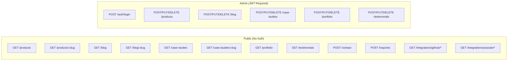
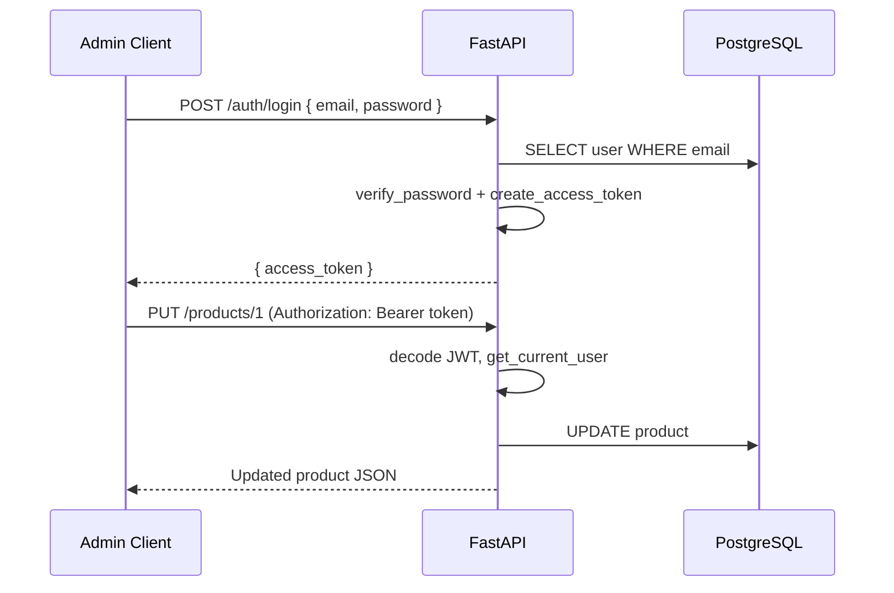

# API Architecture

| Field | Value |
|-------|-------|
| **Document ID** | ARCH-006 |
| **Product** | Founder Portfolio Platform (FounderOS v1.0) |
| **Status** | Approved |
| **Last Updated** | 2026-06-29 |
| **Related** | [Backend Architecture](./Backend_Architecture.md) · [08_API](../08_API/) |

---

## Purpose

Define the REST API architecture for FounderOS v1.0 — versioning, endpoint catalog, authentication flows, request/response contracts, error handling, and integration patterns.

## Scope

| In Scope | Out of Scope |
|----------|--------------|
| `/api/v1` REST endpoints | GraphQL, gRPC |
| Authentication (JWT) | OAuth social login |
| Public read vs. admin write separation | Webhook delivery |
| Integration proxy endpoints | Real-time WebSocket API |
| Error response format | API gateway configuration |

## Business Context

The API is the **contract between frontend and backend** and the foundation for future clients (mobile app, admin dashboard, third-party integrations). Enterprise licensees may consume the API directly for headless deployments.

## Goals

1. **Versioned** — All endpoints under `/api/v1`.
2. **RESTful** — Resource-oriented URLs, standard HTTP verbs.
3. **Typed** — Pydantic schemas for validation and OpenAPI generation.
4. **Secure** — JWT on mutations; public reads for published content.
5. **Cacheable** — GET responses cacheable (see [Caching Strategy](./Caching_Strategy.md)).

## Functional Requirements

| ID | Requirement | Priority |
|----|-------------|----------|
| FR-API-001 | Base path `/api/v1` on all resource routes | P0 |
| FR-API-002 | `POST /auth/login` returns JWT access token | P0 |
| FR-API-003 | Bearer token auth on admin CRUD | P0 |
| FR-API-004 | Public GET returns only `is_published=true` content | P0 |
| FR-API-005 | Slug-based detail endpoints | P0 |
| FR-API-006 | Contact and inquiry public POST endpoints | P0 |
| FR-API-007 | GitHub/YouTube proxy endpoints | P1 |
| FR-API-008 | Health check at `/health` (unversioned) | P0 |

## Non-functional Requirements

| ID | Requirement | Target |
|----|-------------|--------|
| NFR-API-001 | Response time p95 | &lt; 300ms |
| NFR-API-002 | Payload size (list endpoints) | &lt; 500 KB |
| NFR-API-003 | JSON content type | `application/json` |
| NFR-API-004 | API documentation | OpenAPI 3.1 at `/docs` (dev only) |
| NFR-API-005 | Backward compatibility | No breaking changes within v1 |

## User Stories

| ID | As a… | I want… | So that… |
|----|-------|---------|----------|
| US-API-001 | Frontend dev | predictable JSON responses | I build pages without surprises |
| US-API-002 | Admin | login and CRUD APIs | I manage content |
| US-API-003 | Visitor | submit contact forms via API | my message is received |
| US-API-004 | Integrator | OpenAPI spec | I build custom clients |

## UX Requirements

API design reflects **consumer UX**:

- Consistent field naming: `snake_case` in JSON (Python convention).
- Descriptive error messages in `detail` field.
- Empty lists return `[]`, not 404.
- 404 only for missing slug on detail endpoints.

## Technical Considerations

### API Topology



### Endpoint Reference

#### Authentication

| Method | Path | Auth | Description |
|--------|------|------|-------------|
| `POST` | `/api/v1/auth/login` | No | Returns `{ access_token, token_type }` |

**Request:**
```json
{ "email": "admin@example.com", "password": "secret" }
```

**Response (200):**
```json
{ "access_token": "eyJ...", "token_type": "bearer" }
```

#### Products

| Method | Path | Auth | Description |
|--------|------|------|-------------|
| `GET` | `/api/v1/products` | No | List published products |
| `GET` | `/api/v1/products/{slug}` | No | Product detail by slug |
| `POST` | `/api/v1/products` | JWT | Create product |
| `PUT` | `/api/v1/products/{id}` | JWT | Update product |
| `DELETE` | `/api/v1/products/{id}` | JWT | Delete product |

**Product Response Schema:**

| Field | Type | Description |
|-------|------|-------------|
| `id` | integer | Primary key |
| `slug` | string | URL slug |
| `name` | string | Product name |
| `tagline` | string | Short tagline |
| `description` | string | Full description |
| `features` | array | `[{ title, description, icon }]` |
| `domains` | array | Industry domains |
| `architecture` | object | `{ layers: [...] }` |
| `screenshots` | array | Image URLs |
| `is_flagship` | boolean | Featured product flag |
| `is_published` | boolean | Visibility |
| `sort_order` | integer | Display order |

#### Blog

| Method | Path | Auth | Description |
|--------|------|------|-------------|
| `GET` | `/api/v1/blog` | No | List published posts |
| `GET` | `/api/v1/blog/{slug}` | No | Post detail |
| `POST` | `/api/v1/blog` | JWT | Create post |
| `PUT` | `/api/v1/blog/{post_id}` | JWT | Update post |
| `DELETE` | `/api/v1/blog/{post_id}` | JWT | Delete post |

#### Case Studies

| Method | Path | Auth | Description |
|--------|------|------|-------------|
| `GET` | `/api/v1/case-studies` | No | List published |
| `GET` | `/api/v1/case-studies/{slug}` | No | Detail by slug |
| `POST` | `/api/v1/case-studies` | JWT | Create |
| `PUT` | `/api/v1/case-studies/{case_id}` | JWT | Update |
| `DELETE` | `/api/v1/case-studies/{case_id}` | JWT | Delete |

#### Portfolio

| Method | Path | Auth | Description |
|--------|------|------|-------------|
| `GET` | `/api/v1/portfolio` | No | List published items |
| `POST` | `/api/v1/portfolio` | JWT | Create item |
| `PUT` | `/api/v1/portfolio/{item_id}` | JWT | Update item |
| `DELETE` | `/api/v1/portfolio/{item_id}` | JWT | Delete item |

#### Testimonials

| Method | Path | Auth | Description |
|--------|------|------|-------------|
| `GET` | `/api/v1/testimonials` | No | List published |
| `POST` | `/api/v1/testimonials` | JWT | Create |
| `PUT` | `/api/v1/testimonials/{tid}` | JWT | Update |
| `DELETE` | `/api/v1/testimonials/{tid}` | JWT | Delete |

#### Contact & Inquiries

| Method | Path | Auth | Description |
|--------|------|------|-------------|
| `POST` | `/api/v1/contact` | No | General contact form |
| `POST` | `/api/v1/inquiries` | No | Enterprise/acquisition inquiry |

**Contact Request:**
```json
{
  "name": "Jane Doe",
  "email": "jane@corp.com",
  "company": "Corp Inc",
  "inquiry_type": "licensing",
  "message": "Interested in licensing..."
}
```

**Inquiry Request:**
```json
{
  "inquiry_type": "acquisition",
  "name": "John Smith",
  "email": "john@bigcorp.com",
  "company": "BigCorp",
  "role": "VP Engineering",
  "message": "Acquisition interest...",
  "budget_range": "$1M-$5M"
}
```

#### Integrations

| Method | Path | Auth | Description |
|--------|------|------|-------------|
| `GET` | `/api/v1/integrations/github/repos` | No | Public repos list |
| `GET` | `/api/v1/integrations/github/stats` | No | Profile stats |
| `GET` | `/api/v1/integrations/youtube/videos` | No | Recent videos |

#### Health

| Method | Path | Auth | Description |
|--------|------|------|-------------|
| `GET` | `/health` | No | `{ "status": "healthy" }` |

### Error Response Format

| Status | When | Body |
|--------|------|------|
| 400 | Bad request | `{ "detail": "message" }` |
| 401 | Missing/invalid JWT | `{ "detail": "Could not validate credentials" }` |
| 404 | Resource not found | `{ "detail": "Not found" }` |
| 422 | Validation error | `{ "detail": [{ "loc", "msg", "type" }] }` |
| 500 | Server error | `{ "detail": "Internal server error" }` |

### Authentication Flow



## Security Considerations

| Control | Detail |
|---------|--------|
| JWT algorithm | HS256 |
| Token header | `Authorization: Bearer <token>` |
| Password verification | bcrypt |
| CORS | Whitelist origins only |
| Rate limiting | On `/contact`, `/inquiries`, `/auth/login` |
| Input validation | Pydantic on all request bodies |
| Published filter | Public GET excludes unpublished content |

## Acceptance Criteria

- [ ] All endpoints documented with method, path, auth, schema.
- [ ] Frontend `lib/api.ts` matches endpoint catalog.
- [ ] JWT required on all mutating CMS endpoints.
- [ ] Public POST endpoints validate and persist without auth.
- [ ] Error responses follow consistent format.
- [ ] OpenAPI spec generates without errors in dev.

## Future Enhancements

| Enhancement | Version |
|-------------|---------|
| Cursor-based pagination (`?cursor=&limit=`) | v1.5 |
| API key auth for integrations | v2.0 |
| `PATCH` partial updates | v1.5 |
| HATEOAS links in responses | v2.0 |
| `/api/v2` with breaking changes | v2.0 |
| Webhook subscriptions | v2.0 |

## Open Questions

| ID | Question | Owner | Status |
|----|----------|-------|--------|
| OQ-API-001 | Rate limit thresholds for public POST? | Security | Open |
| OQ-API-002 | HMAC signing for webhook payloads? | Backend | Open |
| OQ-API-003 | OpenAPI published publicly or internal only? | Product | Open |

---

## Related Documents

- [Backend Architecture](./Backend_Architecture.md)
- [Caching Strategy](./Caching_Strategy.md)
- [Security Architecture](./Security_Architecture.md)
- [Frontend Architecture](./Frontend_Architecture.md) — `lib/api.ts`
- [08_API](../08_API/)
