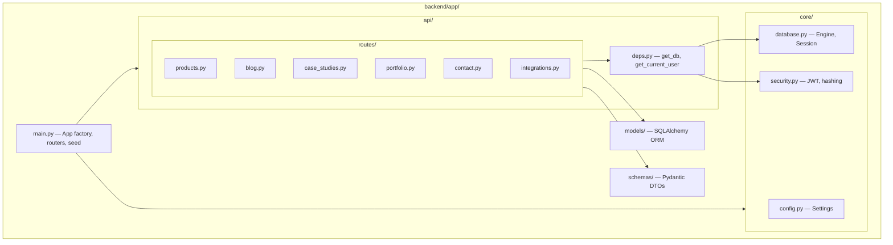
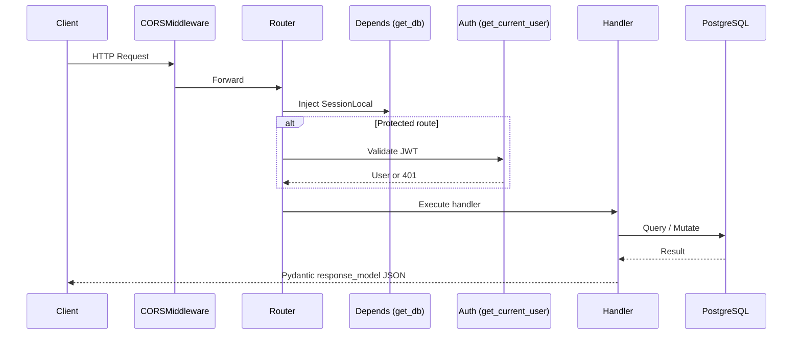

# Backend Architecture

| Field | Value |
|-------|-------|
| **Document ID** | ARCH-003 |
| **Product** | Founder Portfolio Platform (FounderOS v1.0) |
| **Status** | Approved |
| **Last Updated** | 2026-06-29 |
| **Related** | [System Architecture](./System_Architecture.md) · [API Architecture](./API_Architecture.md) · [Database Architecture](./Database_Architecture.md) |

---

## Purpose

Define the backend application architecture for FounderOS v1.0 — a **FastAPI** service providing versioned REST APIs, authentication, content management, integrations proxy, and data persistence via **SQLAlchemy** and **PostgreSQL**.

## Scope

| In Scope | Out of Scope |
|----------|--------------|
| FastAPI application structure and routing | Frontend rendering |
| SQLAlchemy ORM models and session management | Database migration tooling (Alembic setup in `09_Database`) |
| JWT authentication and authorization | Message queues / event bus |
| Pydantic request/response schemas | GraphQL layer |
| Startup seeding and health checks | Multi-tenant isolation (v2.0) |
| External API proxy (GitHub, YouTube) | Payment processing |

## Business Context

The backend is the **system of record** for all CMS content, form submissions, and admin operations. It must be reliable enough for enterprise buyers submitting acquisition inquiries while remaining simple to deploy on a single VPS for v1.0 white-label instances.

## Goals

1. **RESTful API-first** — All content accessible via `/api/v1` endpoints.
2. **Schema-validated I/O** — Pydantic models on every request and response.
3. **Secure admin surface** — JWT Bearer auth on mutating endpoints.
4. **Seed-on-start** — Demo content for first-run developer experience.
5. **Integration proxy** — Backend holds API keys; frontend never exposes secrets.

## Functional Requirements

| ID | Requirement | Priority |
|----|-------------|----------|
| FR-BE-001 | FastAPI app with CORS middleware | P0 |
| FR-BE-002 | Versioned API prefix `/api/v1` | P0 |
| FR-BE-003 | JWT login at `POST /api/v1/auth/login` | P0 |
| FR-BE-004 | CRUD for products, blog, case studies, portfolio, testimonials | P0 |
| FR-BE-005 | Public read endpoints without auth | P0 |
| FR-BE-006 | Admin write endpoints require valid JWT | P0 |
| FR-BE-007 | Contact and inquiry form persistence | P0 |
| FR-BE-008 | GitHub/YouTube integration proxy endpoints | P1 |
| FR-BE-009 | Health check at `GET /health` | P0 |
| FR-BE-010 | Database seed on startup (idempotent) | P1 |

## Non-functional Requirements

| ID | Requirement | Target |
|----|-------------|--------|
| NFR-BE-001 | API p95 response time | &lt; 300ms |
| NFR-BE-002 | Concurrent requests | 500 req/s (single VPS) |
| NFR-BE-003 | Uptime | 99.9% |
| NFR-BE-004 | Password hashing | bcrypt via passlib |
| NFR-BE-005 | JWT expiry | 24 hours (configurable) |
| NFR-BE-006 | Connection pool size | 10–20 connections |

## User Stories

| ID | As a… | I want… | So that… |
|----|-------|---------|----------|
| US-BE-001 | Frontend app | stable JSON APIs | pages render dynamic content |
| US-BE-002 | Admin | secure login and CRUD | I manage site content |
| US-BE-003 | Enterprise visitor | reliable form submission | my inquiry is stored |
| US-BE-004 | DevOps | health endpoint | monitoring alerts on failure |
| US-BE-005 | Developer | seed data on first run | local setup is instant |

## UX Requirements

Backend UX is **API consumer experience**:

- Consistent JSON error format: `{ "detail": "message" }`.
- HTTP status codes follow REST conventions (200, 201, 400, 401, 404, 422, 500).
- Pagination-ready list endpoints (v1.0 returns full lists; v1.5 adds cursor pagination).
- OpenAPI docs auto-generated at `/docs` (disabled in production).

## Technical Considerations

### Application Structure



### Request Lifecycle



### Router Registration

| Router Module | Prefix | Auth Required (Write) |
|---------------|--------|----------------------|
| `products.py` (auth) | `/api/v1/auth` | No (login) |
| `products.py` | `/api/v1/products` | Yes |
| `blog.py` | `/api/v1/blog` | Yes |
| `case_studies.py` | `/api/v1/case-studies` | Yes |
| `portfolio.py` | `/api/v1/portfolio` | Yes |
| `contact.py` (testimonials) | `/api/v1/testimonials` | Yes |
| `contact.py` | `/api/v1/contact` | No (public POST) |
| `contact.py` (inquiry) | `/api/v1/inquiries` | No (public POST) |
| `integrations.py` | `/api/v1/integrations` | No (read) |

### Configuration (`core/config.py`)

| Setting | Env Variable | Default |
|---------|--------------|---------|
| `PROJECT_NAME` | — | FounderOS API |
| `API_V1_PREFIX` | — | `/api/v1` |
| `DATABASE_URL` | `DATABASE_URL` | `postgresql://...` |
| `SECRET_KEY` | `SECRET_KEY` | **Must override in prod** |
| `CORS_ORIGINS` | `CORS_ORIGINS` | `http://localhost:13000` |
| `ADMIN_EMAIL` | `ADMIN_EMAIL` | — |
| `ADMIN_PASSWORD` | `ADMIN_PASSWORD` | — |
| `GITHUB_USERNAME` | `GITHUB_USERNAME` | — |

### Dependency Injection

```python
# Canonical patterns
def get_db() -> Generator[Session, None, None]:
    db = SessionLocal()
    try:
        yield db
    finally:
        db.close()

def get_current_user(token: str = Depends(oauth2_scheme), db: Session = Depends(get_db)) -> User:
    # Decode JWT, load user, raise 401 if invalid
```

## Security Considerations

| Control | Implementation |
|---------|----------------|
| Password storage | bcrypt hashing via `passlib` |
| Token format | JWT HS256 with `SECRET_KEY` |
| SQL injection | SQLAlchemy parameterized queries |
| CORS | Explicit origin whitelist |
| Rate limiting | Redis-backed (see [Caching Strategy](./Caching_Strategy.md)) |
| Secrets in code | None — all via environment |
| OpenAPI in prod | Disable `/docs` and `/redoc` |

## Acceptance Criteria

- [ ] All routers registered in `main.py` with correct prefixes.
- [ ] Public GET endpoints return data without authentication.
- [ ] POST/PUT/DELETE require valid JWT (except contact/inquiry).
- [ ] Pydantic `response_model` on all endpoints.
- [ ] Health check returns `{"status": "healthy"}`.
- [ ] Seed data creates admin user and demo content idempotently.
- [ ] CORS allows frontend origin per environment.

## Future Enhancements

| Enhancement | Version |
|-------------|---------|
| Alembic migrations (replace `create_all`) | v1.5 |
| Refresh tokens + token rotation | v1.5 |
| Role-based access control (RBAC) | v2.0 |
| Webhook notifications on form submit | v1.5 |
| Background tasks (Celery/ARQ) | v2.0 |
| API rate limiting middleware | v1.5 |

## Open Questions

| ID | Question | Owner | Status |
|----|----------|-------|--------|
| OQ-BE-001 | Alembic from day one or `create_all` for v1.0? | Backend | Open |
| OQ-BE-002 | Email notification on contact/inquiry submit? | Product | Open |
| OQ-BE-003 | Soft delete vs. hard delete for CMS entities? | Backend | Open |

---

## Related Documents

- [API Architecture](./API_Architecture.md)
- [Database Architecture](./Database_Architecture.md)
- [Security Architecture](./Security_Architecture.md)
- [Caching Strategy](./Caching_Strategy.md)
- [08_API](../08_API/) (detailed endpoint contracts)
