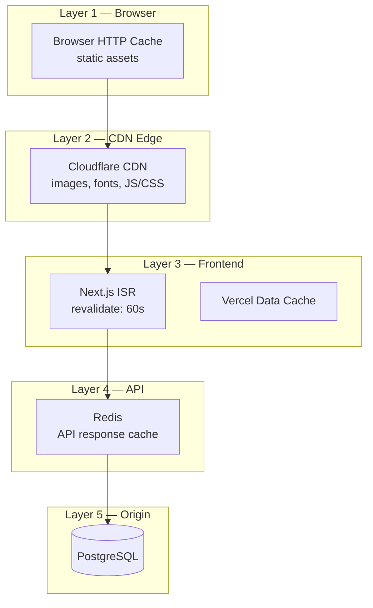
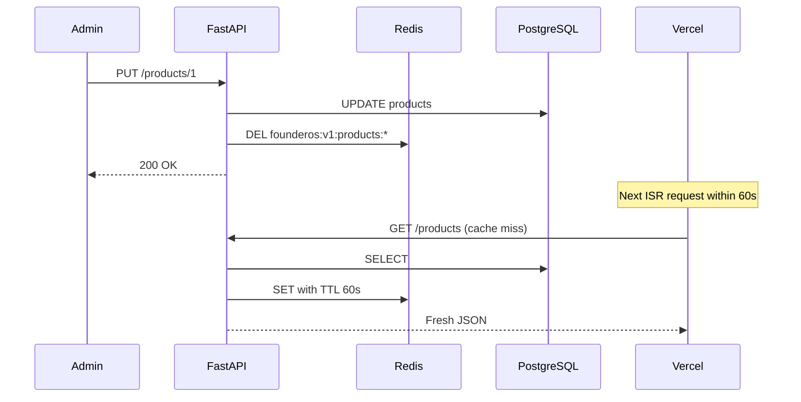

# Caching Strategy

| Field | Value |
|-------|-------|
| **Document ID** | ARCH-007 |
| **Product** | Founder Portfolio Platform (FounderOS v1.0) |
| **Status** | Approved |
| **Last Updated** | 2026-06-29 |
| **Related** | [System Architecture](./System_Architecture.md) · [Frontend Architecture](./Frontend_Architecture.md) |

---

## Purpose

Define the multi-layer caching strategy for FounderOS v1.0 — covering Next.js ISR, Redis API cache, Cloudflare CDN edge cache, and cache invalidation policies.

## Scope

| In Scope | Out of Scope |
|----------|--------------|
| Frontend ISR (`revalidate`) | Browser service worker cache |
| Redis response caching (planned) | Full-page CDN cache of dynamic HTML |
| Cloudflare CDN static asset cache | Database query result cache (ORM level) |
| Cache invalidation on admin writes | Distributed cache coherence (v2.0) |

## Business Context

Founder portfolio sites receive traffic spikes from product launches, blog posts, and social media. Caching reduces VPS load, improves global latency, and keeps API costs predictable for white-label deployments.

## Goals

1. **Sub-200ms TTFB** for cached pages globally.
2. **Reduce database load** by 80%+ on read-heavy endpoints.
3. **Stale-while-revalidate** semantics for content updates.
4. **Explicit invalidation** on admin content mutations.
5. **Graceful cache miss** — always fall through to origin.

## Functional Requirements

| ID | Requirement | Priority |
|----|-------------|----------|
| FR-CACHE-001 | Next.js ISR with 60s default revalidation | P0 |
| FR-CACHE-002 | Redis cache for API GET responses | P1 |
| FR-CACHE-003 | Cloudflare CDN for static assets and media | P0 |
| FR-CACHE-004 | Cache invalidation on admin PUT/POST/DELETE | P1 |
| FR-CACHE-005 | Integration responses cached (GitHub, YouTube) | P1 |
| FR-CACHE-006 | Health endpoint never cached | P0 |

## Non-functional Requirements

| ID | Requirement | Target |
|----|-------------|--------|
| NFR-CACHE-001 | Cache hit ratio (API) | &gt; 80% steady state |
| NFR-CACHE-002 | Redis memory usage | &lt; 256 MB (v1.0) |
| NFR-CACHE-003 | Stale content max age | 60s (ISR default) |
| NFR-CACHE-004 | Cache invalidation latency | &lt; 5s after admin write |

## User Stories

| ID | As a… | I want… | So that… |
|----|-------|---------|----------|
| US-CACHE-001 | Visitor | fast repeat page loads | I have a smooth experience |
| US-CACHE-002 | Admin | content updates visible within 1 minute | I see my changes quickly |
| US-CACHE-003 | DevOps | reduced DB query volume | the VPS handles traffic spikes |
| US-CACHE-004 | Developer | clear cache TTL documentation | I configure correctly |

## UX Requirements

- Content updates appear within **60 seconds** without manual cache purge (ISR default).
- Admin preview (v1.5) bypasses cache for WYSIWYG verification.
- API failure during cache miss shows last known good ISR page if available.

## Technical Considerations

### Cache Layer Topology



### Cache TTL Matrix

| Resource | Layer | TTL | Invalidation |
|----------|-------|-----|--------------|
| Static assets (JS/CSS/fonts) | Cloudflare | 1 year (immutable) | Build deploy |
| Images (R2/CDN) | Cloudflare | 30 days | URL change |
| ISR pages | Vercel | 60s + stale-while-revalidate | Time-based + on-demand |
| API GET `/products` | Redis | 60s | Admin product write |
| API GET `/blog` | Redis | 60s | Admin blog write |
| API GET `/case-studies` | Redis | 60s | Admin case study write |
| API GET `/portfolio` | Redis | 60s | Admin portfolio write |
| API GET `/testimonials` | Redis | 60s | Admin testimonial write |
| GitHub repos | Redis | 300s (5 min) | Time-based |
| YouTube videos | Redis | 600s (10 min) | Time-based |
| Contact POST | — | No cache | — |
| Health check | — | No cache | — |

### Frontend ISR Pattern

```typescript
// lib/api.ts — default revalidation
fetch(`${API_URL}${endpoint}`, {
  next: { revalidate: 60 },
});

// Per-page override for rarely-changing content
export const revalidate = 3600; // Legal pages: 1 hour
```

### Redis Cache Key Convention

```
founderos:v1:{resource}:{identifier}

Examples:
founderos:v1:products:list
founderos:v1:products:slug:ai-customer-operations
founderos:v1:blog:list
founderos:v1:blog:slug:building-enterprise-ai-saas
founderos:v1:integrations:github:repos
```

### Cache Invalidation Flow



### Cloudflare Cache Rules

| Path Pattern | Cache | Edge TTL |
|--------------|-------|----------|
| `/_next/static/*` | Yes | 1 year |
| `/og-image.png` | Yes | 1 day |
| `/api/*` | No (bypass) | — |
| `/*` (HTML) | Respect origin headers | Per ISR |

## Security Considerations

| Concern | Mitigation |
|---------|------------|
| Cached admin responses | Never cache authenticated endpoints |
| Cache poisoning | Validate cache keys; no user input in keys |
| Redis exposure | Bind to localhost; password auth in production |
| Stale sensitive data | Contact/inquiry data never cached |
| CDN cache of private content | `Cache-Control: private` on admin routes |

## Acceptance Criteria

- [ ] ISR `revalidate: 60` applied in `lib/api.ts`.
- [ ] Redis cache keys follow naming convention.
- [ ] Admin writes invalidate relevant Redis keys.
- [ ] Health endpoint returns `Cache-Control: no-store`.
- [ ] Cloudflare bypasses cache for API routes.
- [ ] Integration endpoints have extended TTL (5–10 min).

## Future Enhancements

| Enhancement | Version |
|-------------|---------|
| On-demand ISR revalidation via webhook | v1.5 |
| Redis Cluster for HA | v2.0 |
| Cache warming on deploy | v1.5 |
| Per-tenant cache namespaces | v2.0 |
| Vercel `revalidateTag` / `revalidatePath` | v1.5 |

## Open Questions

| ID | Question | Owner | Status |
|----|----------|-------|--------|
| OQ-CACHE-001 | Redis required for v1.0 or optional with ISR-only? | Backend | Open |
| OQ-CACHE-002 | 60s vs. 300s default ISR for blog lists? | Product | Open |
| OQ-CACHE-003 | Cloudflare Tier — Free vs. Pro for cache analytics? | DevOps | Open |

---

## Related Documents

- [System Architecture](./System_Architecture.md)
- [Frontend Architecture](./Frontend_Architecture.md)
- [API Architecture](./API_Architecture.md)
- [Deployment Architecture](./Deployment_Architecture.md)
- [Scalability](./Scalability.md)
